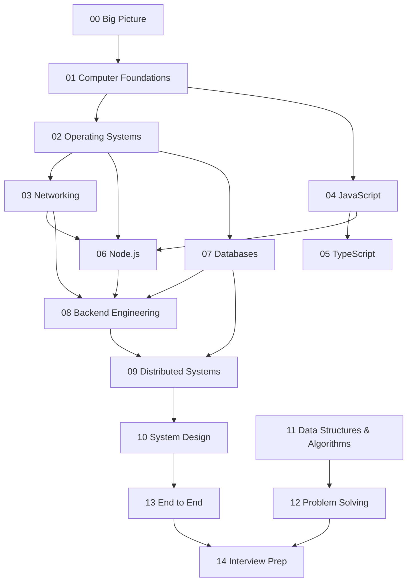

# Start Here

[Home](../README.md) › Start Here

This page explains how the knowledge base is organized, how to read a page, and which order to study in.

## What this knowledge base is

It is one connected explanation of how backend systems work, from bits in memory up to distributed systems. It is written for a Node.js / TypeScript backend engineer, but most of it is general engineering knowledge that does not depend on one language.

Three ideas shaped the design:

1. **Layers.** A backend system is a stack of layers: hardware, operating system, network, runtime, application, data stores, and the distributed system around them. Each section covers one layer. Each layer is explained using the layers below it.
2. **Connections.** A concept is only useful when you know what it touches. Every page says what it depends on and what depends on it, and explains *why* the relationship exists.
3. **Traces.** The [End to End](../13-end-to-end/README.md) section follows real operations (one HTTP request, one database write) through every layer. This is where the separate pages become one mental model.

Read [The Big Picture](big-picture.md) next. It is the map for everything else.

## How a page is built

Every concept page uses the same structure, so you always know where to look.

| Part | Purpose |
|---|---|
| **In one sentence** | The core idea. If you remember only one thing, remember this. |
| **Before this / After this** | Prerequisites and the pages that build on this one. |
| **Body** | The explanation: what it is, why it exists, how it works inside, where it breaks. |
| **How this connects** | The relationships to other layers, with the reason for each. |
| **Interview questions** | Questions with answers hidden behind a click, so you can test yourself first. |
| **Key takeaways** | A short list for fast review. |

### Conventions

- **Code is JavaScript or TypeScript** unless the topic needs something else (SQL, shell, C-like pseudo code).
- **`// → value`** after an expression shows its result.
- **PostgreSQL is the reference database.** When behavior is specific to PostgreSQL, the text says so. Other databases are compared where the difference matters.
- **Linux is the reference operating system**, because that is where backend code runs in production.
- **Version-specific facts are labeled.** Node.js, PostgreSQL and TypeScript change. When a behavior depends on a version, the version is named. See [Versions](#versions-this-was-written-against).
- **Diagrams are Mermaid.** GitHub renders them directly.
- **Interview answers are written the way you would say them.** They are short and direct on purpose. The page body has the depth.

### How to use the interview questions

Do not read the answers first. Read the question, answer it out loud, then open the answer and compare. Saying the answer out loud is the skill an interview tests. Each question is tagged:

- 🟢 **Fundamental** — you must know this.
- 🟡 **Deep** — internals and trade-offs. This is what separates candidates.
- 🔴 **Hard / follow-up** — what a senior interviewer asks after you answer the first question well.

## Learning paths

There is no schedule here. Go as fast or as slow as you need. These paths only suggest an order.

### Path A — Full rebuild (recommended if you have been away for a while)

Follow the section numbers. The order is chosen so that every section only uses ideas from earlier sections.

Sections 11 and 12 (algorithms and problem solving) do not depend on the others. Study them in parallel with everything else, a little every day. Problem solving is a skill built by repetition, not by reading once.

### Path B — Job search first

If interviews are close, this order gives the most value per hour:

1. [JavaScript: async](../04-javascript/04-async-javascript.md), [Node.js: event loop](../06-nodejs/02-event-loop.md), [Node.js: architecture](../06-nodejs/01-architecture.md)
2. [Databases: indexes](../07-databases/05-indexes.md), [transactions](../07-databases/07-transactions-isolation.md), [query planning](../07-databases/06-query-planning.md)
3. [HTTP](../03-networking/05-http-fundamentals.md), [API design](../08-backend-engineering/01-api-design.md), [auth](../08-backend-engineering/02-authentication-authorization.md), [caching](../08-backend-engineering/04-caching.md)
4. [System design method](../10-system-design/01-method-and-estimation.md) and two or three case studies
5. [Problem solving](../12-problem-solving/README.md) every day, in parallel
6. [Rapid review](../14-interview-prep/01-rapid-review.md) before each interview

Then return to Path A to fill the gaps.

### Path C — Reference use

Use the [Index](../INDEX.md) to find a page by topic, or the [Glossary](../GLOSSARY.md) to find a term. Each page stands on its own if you already know its prerequisites.

## How to study a technical page

Reading is not learning. For each page:

1. Read the "In one sentence" line and the takeaways first, so you know where the page is going.
2. Read the body. When there is code, **run it**. Change it. Predict the output before you run it.
3. Close the page and explain the concept out loud in simple words, as if to a colleague.
4. Answer the interview questions without looking.
5. Follow one link in "How this connects" and see the same idea from another layer.

Step 3 is the one people skip, and it is the one that matters most.

## Versions this was written against

Facts that depend on versions were checked against these releases (late 2026):

| Technology | Version context |
|---|---|
| Node.js | 22, 24 and 26 are the LTS lines. Behavior described here applies to all three unless stated. |
| V8 | The pipeline described (Ignition, Sparkplug, Maglev, TurboFan) is the one shipped in these Node.js lines. |
| TypeScript | 5.x / 6.x language semantics. TypeScript 7 replaced the compiler implementation with a native one; the type system you write against is the same. |
| PostgreSQL | 17 and 18. Version-specific features are labeled. |
| NestJS | 11 and 12. The architecture described is stable across both. |
| HTTP | HTTP/1.1 (RFC 9110/9112), HTTP/2 (RFC 9113), HTTP/3 (RFC 9114). |

Internals change over time. When exact behavior matters for a decision, check the official documentation for the version you run. Each section's README lists the primary sources used.

---

Next: [The Big Picture →](big-picture.md)
