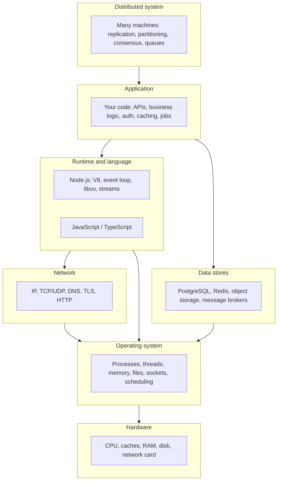
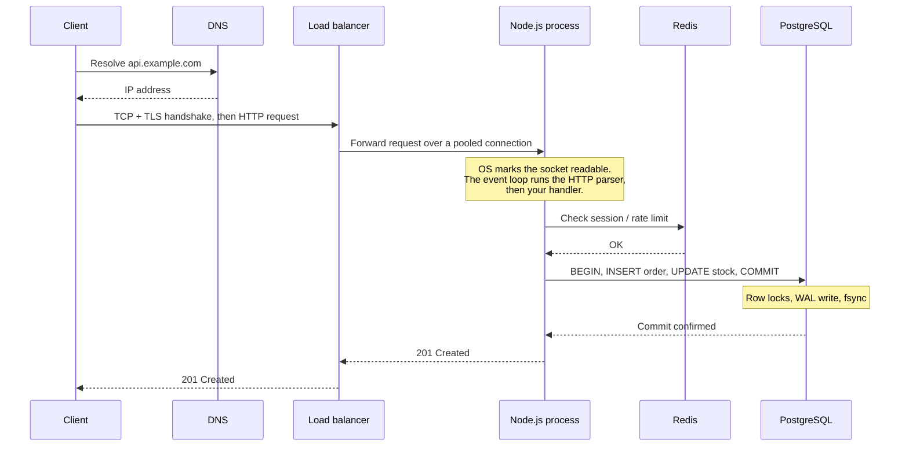

# The Big Picture

[Home](../README.md) › [Start Here](README.md) › The Big Picture

> **In one sentence:** A backend system is a stack of layers, each one hiding the complexity below it and adding guarantees on top, and a strong engineer can move up and down that stack when something goes wrong.

**After this:** every other section. This page is the map.

## Why a map matters

Most backend bugs and most interview questions are not about one layer. They are about the place where two layers meet.

- "Why is my API slow?" could be a missing database index, a blocked event loop, a full connection pool, a slow DNS lookup, or a garbage collection pause.
- "Why did the user get charged twice?" is about retries (network), idempotency (API design), and transactions (database) at the same time.

If you know each layer alone, you can describe the parts. If you know how they connect, you can find the cause. This knowledge base is organized to build the second kind of knowledge.

## The layers of a backend system

Read the diagram from the bottom up:

| Layer | What it gives the layer above | Section |
|---|---|---|
| **Hardware** | Raw computation, memory and storage, with very different speeds | [01 Computer Foundations](../01-computer-foundations/README.md) |
| **Operating system** | Safe sharing of hardware: processes, virtual memory, files, sockets | [02 Operating Systems](../02-operating-systems/README.md) |
| **Network** | A way for two programs on different machines to exchange bytes reliably and securely | [03 Networking](../03-networking/README.md) |
| **Language and runtime** | A productive way to write programs: memory management, an event loop, async I/O | [04 JavaScript](../04-javascript/README.md), [05 TypeScript](../05-typescript/README.md), [06 Node.js](../06-nodejs/README.md) |
| **Data stores** | Durable, queryable, concurrent-safe state | [07 Databases](../07-databases/README.md) |
| **Application** | The actual product behavior, plus security, speed and reliability | [08 Backend Engineering](../08-backend-engineering/README.md) |
| **Distributed system** | More capacity and availability than one machine can give | [09 Distributed Systems](../09-distributed-systems/README.md), [10 System Design](../10-system-design/README.md) |

Two sections cut across all layers:

- [11 Data Structures and Algorithms](../11-data-structures-algorithms/README.md) and [12 Problem Solving](../12-problem-solving/README.md). Every layer is built from them: the database index is a B-tree, the event loop uses a heap for timers, the load balancer uses hashing, the DNS cache is a hash map with expiry.
- [13 End to End](../13-end-to-end/README.md) follows single operations through all layers.

## Abstractions leak

Each layer is an **abstraction**: it hides details so the layer above can stay simple. `await db.query(...)` hides a TCP connection, a wire protocol, a query planner, a buffer pool and a disk.

But abstractions **leak**. The hidden details show through when things are slow or broken:

| What you wrote | What leaks through |
|---|---|
| `await fetch(url)` | DNS lookup time, TCP and TLS handshakes, connection reuse, timeouts |
| `JSON.parse(bigString)` | It runs on the single JavaScript thread and blocks every other request |
| `SELECT * FROM orders WHERE user_id = $1` | Without an index, the database reads the whole table |
| `fs.readFile()` | It uses a thread from a pool of 4. Four slow reads block the fifth |
| `await redis.get(key)` | The cache can be empty, stale, or down |
| `setTimeout(fn, 100)` | It runs *at least* 100 ms later, only when the event loop is free |

This is the reason to learn the lower layers. You do not need them to write code that works on a good day. You need them to understand why it stops working on a bad day.

## The five questions that every layer answers

When you study any technology, ask these questions. They are the same at every layer, and answering them is what "understanding" means.

1. **What problem does it solve?** What was painful before it existed?
2. **What does it promise?** What guarantees can the layer above rely on?
3. **How does it keep that promise inside?** The mechanism.
4. **What does it cost?** Every guarantee costs time, memory, or complexity.
5. **How does it fail?** What happens at the limits, and what does the failure look like from above?

Example, applied to TCP:

1. Problem: IP packets can be lost, duplicated, or arrive out of order.
2. Promise: an ordered, reliable stream of bytes between two programs.
3. Mechanism: sequence numbers, acknowledgments, retransmission, flow and congestion control.
4. Cost: a handshake before data, and one lost packet delays everything behind it.
5. Failure: connections that hang, time out, or get reset. From Node.js you see `ECONNRESET` or `ETIMEDOUT`.

The pages in this knowledge base follow these questions, even when they do not name them.

## Recurring ideas

Some ideas appear at almost every layer. When you meet one in a new place, you already understand half of it.

| Idea | Where you will meet it |
|---|---|
| **Caching** — keep a copy closer to where it is needed | CPU caches, OS page cache, database buffer pool, DNS cache, HTTP cache, CDN, Redis |
| **Buffering and batching** — do work in groups to reduce overhead | Disk writes, TCP segments, streams, database WAL group commit, message queues |
| **Queues and backpressure** — what to do when work arrives faster than it can be done | Event loop queues, TCP flow control, Node.js streams, connection pools, message brokers |
| **Indirection** — add a layer that maps names to things | Virtual memory, DNS, file descriptors, load balancers, database indexes |
| **Trade time for space** (or the reverse) | Hash tables, indexes, memoization, denormalization |
| **Logs** — append-only records as the source of truth | Database WAL, replication, Kafka, event sourcing, LSM trees |
| **Timeouts and retries** — the only tools for dealing with a slow or silent peer | TCP, HTTP clients, database drivers, distributed systems |
| **Idempotency** — making "do it again" safe | HTTP methods, payment APIs, message consumers, database upserts |
| **Consistency versus availability and speed** | Isolation levels, replication lag, caches, CAP |
| **Locks versus optimistic approaches** | Mutexes, row locks, MVCC, compare-and-swap, version columns |

## One request, all layers

Here is a short version of what happens when a client calls `POST /orders`. The [full trace](../13-end-to-end/01-life-of-an-http-request.md) goes into every step.

Every arrow in this diagram is a place where latency is added and where a failure can happen. Every box has a section in this knowledge base.

## How this connects

- If this page felt abstract, that is expected. Start with [01 Computer Foundations](../01-computer-foundations/README.md) and come back after a few sections. The table of recurring ideas will mean much more.
- When you finish a section, re-read the layer table above and ask: what does the layer I just learned give to the one above it?

## Key takeaways

- A backend system is a stack of layers. Each one hides complexity and adds guarantees.
- Abstractions leak under load and during failures. That is when lower-layer knowledge pays off.
- For any technology, ask: what problem, what promise, what mechanism, what cost, what failure.
- A small set of ideas (caching, queues, logs, timeouts, idempotency, locking) repeats at every layer.

---

← [Start Here](README.md) | Next: [01 Computer Foundations →](../01-computer-foundations/README.md)
