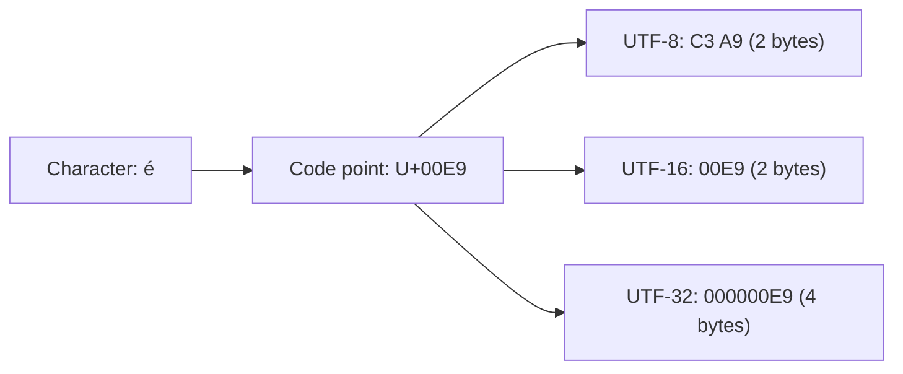

# Data Representation

[Home](../README.md) › [Computer Foundations](README.md) › Data Representation

> **In one sentence:** All data is bits, and the *type* is only the rule that says how to read those bits, so most "strange" behavior with numbers and text comes from the rule, not from the data.

**Before this:** nothing.
**After this:** [JavaScript types](../04-javascript/01-types-and-coercion.md), [Buffers](../06-nodejs/03-buffers-and-streams.md), [schema design](../07-databases/03-schema-design.md).

## Bits, bytes, and meaning

A **bit** is one binary digit: 0 or 1. A **byte** is 8 bits and can hold 256 different values (2⁸).

The same byte can mean different things:

| Bits | As unsigned integer | As signed integer | As ASCII text |
|---|---|---|---|
| `01000001` | 65 | 65 | `A` |
| `11111111` | 255 | -1 | (not valid ASCII) |

The bits do not carry their meaning. The program decides how to read them. This is the root idea behind types, serialization, and encodings.

### Hexadecimal

Binary is long to write, so engineers use **hexadecimal** (base 16, digits `0-9a-f`). One hex digit is exactly 4 bits, so one byte is always two hex digits.

```js
(255).toString(2);   // → '11111111'
(255).toString(16);  // → 'ff'
0xff;                // → 255
0b1010;              // → 10
```

You see hex in memory addresses, hashes, UUIDs, colors, and when you print a `Buffer`.

## Integers

### Unsigned

With `n` bits you can store values from `0` to `2ⁿ − 1`.

| Bits | Range |
|---|---|
| 8 | 0 to 255 |
| 16 | 0 to 65,535 |
| 32 | 0 to 4,294,967,295 (about 4.29 billion) |
| 64 | 0 to about 1.8 × 10¹⁹ |

### Signed: two's complement

To store negative numbers, almost every system uses **two's complement**. The highest bit has a negative weight.

For 8 bits, the bit weights are: `−128, 64, 32, 16, 8, 4, 2, 1`.

- `00000101` = 5
- `11111011` = −128 + 64 + 32 + 16 + 8 + 2 + 1 = −5

To negate a number: flip all bits, then add 1.

Why this design? Because addition works with the same circuit for positive and negative numbers. The CPU does not need a separate subtraction circuit.

Range with `n` bits: `−2ⁿ⁻¹` to `2ⁿ⁻¹ − 1`. For 32 bits: −2,147,483,648 to 2,147,483,647.

### Overflow

When a result does not fit, the extra bits are dropped and the value "wraps around".

```js
// JavaScript bitwise operators work on 32-bit signed integers
2147483647 + 1;        // → 2147483648  (normal number math, no overflow)
(2147483647 + 1) | 0;  // → -2147483648 (forced to int32: wrapped around)
```

Real consequences:

- **A 32-bit auto-increment ID runs out at about 2.1 billion.** Several well-known services have had outages from this. This is why `BIGINT` (64-bit) primary keys are the safe default. See [schema design](../07-databases/03-schema-design.md).
- **Unix timestamps in 32-bit signed integers overflow in January 2038.**

## Floating point (IEEE 754)

Integers cannot store `0.5` or very large values like 10³⁰⁰. **Floating point** stores a number in scientific notation, in binary:

```
value = (−1)^sign × 1.fraction × 2^exponent
```

A 64-bit "double" uses:

| Part | Bits | Purpose |
|---|---|---|
| Sign | 1 | Positive or negative |
| Exponent | 11 | Where the binary point is |
| Fraction (mantissa) | 52 | The significant digits |

**JavaScript's `number` type is exactly this 64-bit double.** There is no separate integer type (except `BigInt`).

### Why 0.1 + 0.2 is not 0.3

In decimal, 1/3 cannot be written exactly: `0.3333…`. In binary, 1/10 has the same problem: `0.0001100110011…` repeating forever. The double stores the closest value that fits in 52 bits. It is very close to 0.1, but not equal.

```js
0.1 + 0.2;                  // → 0.30000000000000004
0.1 + 0.2 === 0.3;          // → false
Math.abs(0.1 + 0.2 - 0.3) < Number.EPSILON;  // → true
```

This is not a JavaScript bug. Python, Java, Go and C give the same result, because they all use IEEE 754.

### Safe integers

A double has 52 fraction bits plus one implicit bit, so it can represent every integer exactly only up to 2⁵³ − 1.

```js
Number.MAX_SAFE_INTEGER;        // → 9007199254740991
9007199254740992 === 9007199254740993;  // → true  (!)
```

Above this limit, integers start to "skip". Consequences for a backend:

- **A 64-bit ID from the database (PostgreSQL `BIGINT`, Twitter-style snowflake IDs) does not fit in a JavaScript `number`.** `JSON.parse` will silently change the last digits. Send such IDs as strings, or use `BigInt`. The `pg` driver returns `BIGINT` as a string by default for this reason.
- **Never store money in floating point.** Use integers in the smallest unit (cents), or a decimal type (`NUMERIC` in PostgreSQL), or a decimal library.

```js
// Wrong: rounding errors accumulate
let total = 0;
for (let i = 0; i < 10; i++) total += 0.1;
total;            // → 0.9999999999999999

// Right: integer cents
let cents = 0;
for (let i = 0; i < 10; i++) cents += 10;
cents / 100;      // → 1
```

### Special values

| Value | Meaning | How you get it |
|---|---|---|
| `Infinity`, `-Infinity` | Larger than any double | `1 / 0` |
| `NaN` | "Not a Number": an invalid result | `0 / 0`, `Number('abc')` |
| `-0` | Negative zero | `-1 * 0` |

`NaN` is not equal to anything, including itself: `NaN === NaN` is `false`. Use `Number.isNaN(x)`.

### BigInt

`BigInt` stores integers of any size, but it is slower and cannot be mixed with `number` in arithmetic.

```js
2n ** 64n;                  // → 18446744073709551616n
BigInt(Number.MAX_SAFE_INTEGER) + 2n;  // → 9007199254740993n
```

## Endianness

A 32-bit integer takes 4 bytes. **Endianness** is the order of those bytes in memory or on the wire.

For the value `0x12345678`:

| Order | Bytes in memory | Used by |
|---|---|---|
| **Big-endian** | `12 34 56 78` | Network protocols ("network byte order") |
| **Little-endian** | `78 56 34 12` | x86-64 and ARM CPUs (in normal use) |

You only need this when you read or write binary formats. That is why `Buffer` has both versions of each method:

```js
const buf = Buffer.alloc(4);
buf.writeUInt32BE(0x12345678);
buf;                     // → <Buffer 12 34 56 78>
buf.readUInt32LE();      // → 2018915346  (same bytes, read in the other order)
```

## Text: characters, code points, encodings

Text needs two separate decisions:

1. **Character set:** which number means which character. **Unicode** assigns a number (a **code point**) to every character: `A` is U+0041, `é` is U+00E9, `😀` is U+1F600.
2. **Encoding:** how to store that number as bytes.



### UTF-8

UTF-8 is the encoding of the web, of JSON, of Linux, and the usual database encoding. It uses 1 to 4 bytes per code point.

| Code point range | Bytes | Byte pattern |
|---|---|---|
| U+0000 – U+007F | 1 | `0xxxxxxx` |
| U+0080 – U+07FF | 2 | `110xxxxx 10xxxxxx` |
| U+0800 – U+FFFF | 3 | `1110xxxx 10xxxxxx 10xxxxxx` |
| U+10000 – U+10FFFF | 4 | `11110xxx 10xxxxxx 10xxxxxx 10xxxxxx` |

Why it won:

- **ASCII text is already valid UTF-8** (1 byte per character, same values).
- **Self-synchronizing:** you can tell from any byte whether it starts a character or continues one.
- No endianness problem, because the unit is one byte.

### UTF-16 and JavaScript strings

**JavaScript strings are sequences of 16-bit code units (UTF-16).** Code points above U+FFFF need two units, called a **surrogate pair**. This creates a difference between "length" and "number of characters":

```js
'é'.length;                  // → 1
'😀'.length;                 // → 2   (two UTF-16 code units)
[...'😀'].length;            // → 1   (iteration works by code point)
Buffer.byteLength('😀');     // → 4   (bytes in UTF-8)
Buffer.byteLength('hello');  // → 5
```

Three different sizes for the same string: UTF-16 code units (`.length`), code points, and UTF-8 bytes.

Backend consequences:

- **`Content-Length` is in bytes, not in `.length`.** Use `Buffer.byteLength(body)`.
- **A database `VARCHAR(n)` limit** counts characters in PostgreSQL, but bytes in some other systems.
- **Cutting a string or a buffer in the middle of a multi-byte character produces `�`** (U+FFFD, the replacement character). This happens when you decode stream chunks one by one. See [streams](../06-nodejs/03-buffers-and-streams.md) for the fix (`StringDecoder` / `TextDecoder` with `stream: true`).

### One character, several code points

What a user sees as one character can be several code points:

```js
const a = 'é';            // U+00E9 (one code point)
const b = 'é';      // 'e' + combining accent (two code points)
a === b;                  // → false
a.normalize('NFC') === b.normalize('NFC');  // → true
```

If you compare or index user input (usernames, search), **normalize it first**. Otherwise two strings that look the same can be different keys.

## Other encodings you use every day

These are not character encodings. They turn arbitrary bytes into safe text.

| Encoding | What it does | Size cost | Where |
|---|---|---|---|
| **Hex** | 1 byte → 2 characters | +100% | Hashes, IDs, debugging |
| **Base64** | 3 bytes → 4 characters | +33% | Binary in JSON, email, `Authorization: Basic`, JWT (base64url variant) |
| **URL encoding** | Unsafe bytes → `%XX` | varies | Query strings and paths |

```js
Buffer.from('hi').toString('hex');      // → '6869'
Buffer.from('hi').toString('base64');   // → 'aGk='
encodeURIComponent('a b&c');            // → 'a%20b%26c'
```

**Base64 is not encryption.** Anyone can decode it. A JWT payload is readable by everyone who has the token. See [authentication](../08-backend-engineering/02-authentication-authorization.md).

## How this connects

- **JavaScript numbers** are IEEE 754 doubles. All the coercion and precision rules in [Types and Coercion](../04-javascript/01-types-and-coercion.md) follow from that.
- **`Buffer` and `TypedArray`** in [Node.js](../06-nodejs/03-buffers-and-streams.md) are direct views over raw bytes. Endianness and encodings matter there.
- **Database column types** (`INTEGER` vs `BIGINT`, `NUMERIC` vs `DOUBLE PRECISION`, `TEXT`) are choices about representation. See [schema design](../07-databases/03-schema-design.md).
- **Network protocols** define exact byte layouts. TCP and IP headers use big-endian integers. See [TCP](../03-networking/02-tcp-udp.md).
- **Hashing and bit manipulation** in algorithms work on these representations. See [greedy, intervals and bits](../11-data-structures-algorithms/09-greedy-intervals-bits.md).

## Interview questions

<details>
<summary><strong>🟢 Q1. Why is <code>0.1 + 0.2 !== 0.3</code> in JavaScript?</strong></summary>

JavaScript numbers are 64-bit IEEE 754 floating-point values. They store numbers in binary. The value 0.1 has no exact binary form, the same way 1/3 has no exact decimal form. So the stored values are very close approximations, and when you add them, the small errors show up in the result: `0.30000000000000004`.

It is not specific to JavaScript. Any language that uses doubles behaves the same way. For money, I use integers in the smallest unit, like cents, or a decimal type in the database.

</details>

<details>
<summary><strong>🟢 Q2. What is <code>Number.MAX_SAFE_INTEGER</code> and why does it matter for a backend?</strong></summary>

It is 2⁵³ − 1, about 9 quadrillion. It is the largest integer that a double can represent exactly, because the format has 53 bits of precision. Above it, some integers cannot be represented and get rounded.

It matters because databases often use 64-bit integers for IDs. If the API sends such an ID as a JSON number, `JSON.parse` in JavaScript can silently change it. The fix is to send large IDs as strings or to use `BigInt`.

</details>

<details>
<summary><strong>🟡 Q3. What is the difference between Unicode and UTF-8?</strong></summary>

Unicode is a character set. It gives every character a number, called a code point. UTF-8 is an encoding. It defines how to store a code point as bytes, using one to four bytes.

So Unicode answers "which number is this character", and UTF-8 answers "how do I write that number as bytes". UTF-16 and UTF-32 are other encodings of the same Unicode code points.

</details>

<details>
<summary><strong>🟡 Q4. Why can <code>'😀'.length</code> be 2? What problems can that cause?</strong></summary>

JavaScript strings are UTF-16. `.length` counts 16-bit code units, not characters. Code points above U+FFFF, like most emoji, need two code units, called a surrogate pair.

Problems: truncating a string by `.length` can cut a character in half. Validating "max 20 characters" by `.length` gives the wrong count. And `.length` is not the byte size, so I cannot use it for `Content-Length`. For bytes I use `Buffer.byteLength`, and for code points I can iterate with `for...of` or spread the string.

</details>

<details>
<summary><strong>🟡 Q5. How would you store money in a system?</strong></summary>

Never as a float. I have two options. First, store an integer number of the smallest unit, such as cents, and keep the currency code next to it. Second, use an exact decimal type, like `NUMERIC` in PostgreSQL.

In Node.js I keep it as an integer or use a decimal library, and I am careful that the driver may return `NUMERIC` and `BIGINT` as strings. I also define the rounding rule explicitly, because operations like tax or splitting a bill create fractions.

</details>

<details>
<summary><strong>🔴 Q6. Two usernames look identical on screen but your unique index accepts both. What could be happening?</strong></summary>

Probably Unicode normalization. The same visible character can be built in different ways, for example `é` as one code point, or as `e` plus a combining accent. They are different byte sequences, so the database treats them as different values.

It could also be look-alike characters from different scripts, such as Latin `a` and Cyrillic `а`, or invisible characters like a zero-width space.

The fix is to normalize input to one form, usually NFC, before storing and comparing. For usernames I would also restrict the allowed characters and compare in a case-insensitive way.

</details>

## Key takeaways

- Bits have no meaning alone. The type or encoding is the rule for reading them.
- Signed integers use two's complement. Fixed-size integers overflow, so use 64-bit IDs.
- JavaScript `number` is a 64-bit double: exact integers only up to 2⁵³ − 1, and no exact decimals.
- Never store money in floating point.
- Unicode maps characters to code points. UTF-8 maps code points to bytes.
- A JavaScript string has three sizes: UTF-16 units (`.length`), code points, and UTF-8 bytes.
- Base64 and hex are encodings, not security.

---

← [Computer Foundations](README.md) | Next: [Hardware and Latency →](02-hardware-and-latency.md)
