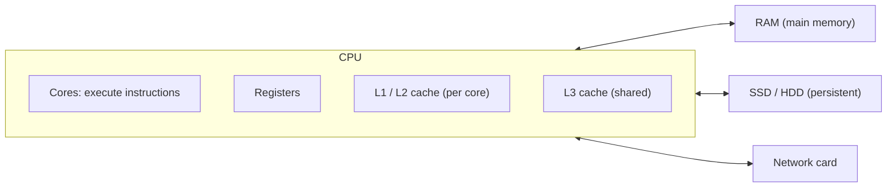
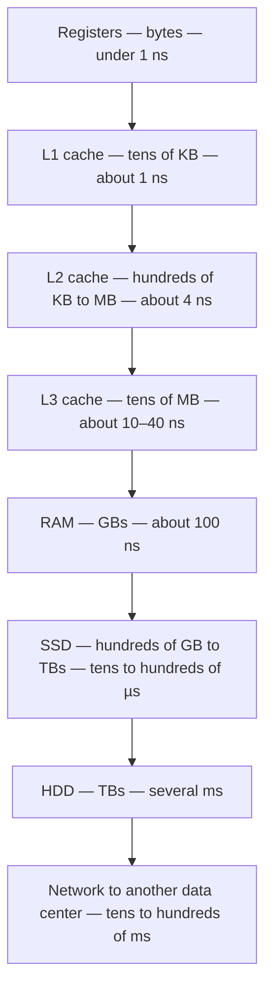

# Hardware and Latency

[Home](../README.md) › [Computer Foundations](README.md) › Hardware and Latency

> **In one sentence:** The components of a computer differ in speed by factors of thousands to millions, and almost every performance technique in backend engineering exists to avoid waiting for the slow ones.

**Before this:** [Data Representation](01-data-representation.md).
**After this:** [Memory management](../02-operating-systems/02-memory-management.md), [Files and I/O](../02-operating-systems/04-files-and-io.md), [Caching](../08-backend-engineering/04-caching.md).

## The machine in one picture



- **CPU cores** run instructions. One core runs one stream of instructions at a time.
- **Registers** are tiny storage slots inside the core. Instructions work on registers.
- **Caches (L1, L2, L3)** are small, fast copies of recently used memory.
- **RAM** holds the data of running programs. It is fast but lost when power goes off.
- **Disk** keeps data when power goes off. It is much slower than RAM.
- **Network card (NIC)** sends and receives packets.

## What the CPU does

A CPU repeats a simple cycle: **fetch** the next instruction, **decode** it, **execute** it. Modern CPUs do billions of these cycles per second and use tricks to go faster:

- **Pipelining:** work on several instructions at different stages at the same time.
- **Branch prediction:** guess which way an `if` will go and start executing before knowing. A wrong guess costs about 10–20 cycles.
- **Multiple cores:** several independent execution units on one chip. This gives real **parallelism**, but only if the program uses multiple threads or processes.

This last point matters directly for Node.js: **your JavaScript runs on one thread, so it uses one core**. An 8-core server running one Node.js process uses 12.5% of its CPU for JavaScript. See [scaling CPU work](../06-nodejs/04-scaling-cpu-work.md).

## The memory hierarchy

Fast storage is expensive and small. Cheap storage is large and slow. Computers combine them in a hierarchy and keep the most-used data in the fastest level.



This works because of **locality**:

- **Temporal locality:** data used now will probably be used again soon.
- **Spatial locality:** data near the data used now will probably be used soon.

The whole idea of [caching](../08-backend-engineering/04-caching.md), at every layer, depends on locality being true.

### Why arrays beat linked lists in practice

Both can have O(n) traversal, but an array stores elements next to each other. One cache miss loads a whole **cache line** (usually 64 bytes), so the next several elements are already in cache. A linked list stores nodes anywhere in memory, so each step can be a cache miss.

This is why "Big-O is the same" does not mean "speed is the same", and why [V8](../04-javascript/05-v8-engine-internals.md) works hard to store arrays of numbers as packed, continuous memory.

## Latency numbers every engineer should know

These are **orders of magnitude**, not exact values. Real numbers depend on hardware. What matters is the ratio between them.

| Operation | Approximate time | If 1 ns were 1 second |
|---|---|---|
| CPU cycle | 0.3 ns | 0.3 seconds |
| L1 cache access | 1 ns | 1 second |
| Branch mispredict | 3–5 ns | 5 seconds |
| L2 cache access | 4 ns | 4 seconds |
| Mutex lock/unlock (no contention) | ~20 ns | 20 seconds |
| RAM access | 100 ns | 1.5 minutes |
| System call (simple) | 100 ns – 1 µs | 2–15 minutes |
| Thread context switch | 1–10 µs | 15 minutes – 3 hours |
| NVMe SSD random read | 20–150 µs | 6 hours – 2 days |
| Round trip in the same data center | 0.2–0.5 ms | 2–6 days |
| HDD seek | 5–10 ms | 2–4 months |
| Round trip between continents | 100–200 ms | 3–6 years |
| TCP retransmission timeout (minimum on Linux) | 200 ms | 6 years |

How to read this table:

- **RAM is about 100× slower than L1 cache.** Tight loops over data that fits in cache are very fast.
- **SSD is about 1,000× slower than RAM.** This is why databases keep hot pages in memory (the [buffer pool](../07-databases/04-storage-internals.md)).
- **A network round trip in one data center is about 5,000× slower than RAM.** This is why an in-process cache can beat Redis, and why the [N+1 query problem](../07-databases/11-data-access-from-node.md) hurts so much: 100 queries of 0.5 ms each is 50 ms of pure waiting.
- **Cross-region calls are another 500× slower.** This is why [CDNs](../03-networking/08-proxies-load-balancers-cdn.md) and regional replicas exist.

### Using the numbers

A quick estimate for an endpoint that makes 3 database queries and one call to another service in the same data center:

```
3 × (0.5 ms network + 1 ms query)   = 4.5 ms
1 × (0.5 ms network + 10 ms work)   = 10.5 ms
JSON parsing and business logic     ≈ 1 ms
                                    ≈ 16 ms total
```

If the real number is 400 ms, you know something is wrong before you open a profiler: a missing index, a cold cache, sequential calls that could be parallel, or a blocked event loop. This kind of estimate is also the base of [capacity estimation](../10-system-design/01-method-and-estimation.md) in system design.

## Storage devices

| | HDD | SATA SSD | NVMe SSD |
|---|---|---|---|
| Mechanism | Spinning disk, moving head | Flash memory | Flash memory, faster interface |
| Random read | ~10 ms | ~100 µs | ~20–100 µs |
| Random IOPS | ~100–200 | tens of thousands | hundreds of thousands |
| Sequential vs random | Sequential is far faster | Smaller gap | Smaller gap |

Two facts shape database design:

1. **Sequential access is faster than random access**, on every device. On HDDs the gap is huge. On SSDs it is smaller but still exists. This is why databases write changes to an append-only log first (the [WAL](../07-databases/04-storage-internals.md)), and why LSM trees turn random writes into sequential ones.
2. **Durability requires a flush.** Writing to a file usually only puts data in the OS page cache. It reaches the disk later. To be sure, the program must call `fsync`, which is slow. A database's commit speed is mostly its `fsync` speed. See [files and I/O](../02-operating-systems/04-files-and-io.md).

Cloud disks (for example network-attached block storage) add a network round trip to each I/O and often have an **IOPS limit**. A database that is "slow for no reason" is sometimes just at its IOPS limit.

## Data sizes

Useful for estimation:

| Unit | Bytes | Roughly |
|---|---|---|
| KB | 10³ | A short text message |
| MB | 10⁶ | A photo, a minute of MP3 |
| GB | 10⁹ | A movie, the RAM of a small server |
| TB | 10¹² | A large database |
| PB | 10¹⁵ | A big company's data lake |

Powers of two to remember: 2¹⁰ ≈ 1 thousand, 2²⁰ ≈ 1 million, 2³⁰ ≈ 1 billion, 2³² ≈ 4.3 billion, 2⁶⁴ ≈ 1.8 × 10¹⁹.

One day has 86,400 seconds, close to 10⁵. So 1 million requests per day is only about 12 requests per second on average.

## How this connects

- **The OS** hides this hardware behind processes, virtual memory and files. See [Operating Systems](../02-operating-systems/README.md).
- **The memory hierarchy** is the first example of caching. The same idea repeats in the OS page cache, the database buffer pool, Redis, and CDNs. See [Caching](../08-backend-engineering/04-caching.md).
- **The disk/RAM speed gap** explains B-trees (few disk reads per lookup) and the WAL (sequential writes). See [storage internals](../07-databases/04-storage-internals.md) and [indexes](../07-databases/05-indexes.md).
- **The cost of waiting for I/O** is the reason for non-blocking I/O and the event loop: a thread that waits 1 ms for the network wastes millions of CPU cycles. See [I/O multiplexing](../02-operating-systems/05-io-multiplexing.md) and the [event loop](../06-nodejs/02-event-loop.md).
- **One core per thread** is why Node.js needs clustering or worker threads to use a multi-core machine. See [scaling CPU work](../06-nodejs/04-scaling-cpu-work.md).

## Interview questions

<details>
<summary><strong>🟢 Q1. Roughly how much slower is reading from disk or network than reading from memory?</strong></summary>

A memory access is about 100 nanoseconds. A random read from a fast SSD is tens of microseconds, so hundreds to a thousand times slower. A network round trip inside a data center is about half a millisecond, so thousands of times slower. A round trip between continents is around 100 to 200 milliseconds, which is about a million times slower than memory.

That is why we cache in memory, batch network calls, and avoid sequential round trips.

</details>

<details>
<summary><strong>🟢 Q2. Why is caching effective at all?</strong></summary>

Because of locality. Programs tend to reuse the same data in a short time, and to use data that is close to what they just used. So a small, fast store that keeps recent data can answer most requests. This works at every level: CPU caches, the OS page cache, the database buffer pool, and application caches like Redis.

It stops being effective when access is uniformly random over a large data set, because then the hit rate is low.

</details>

<details>
<summary><strong>🟡 Q3. Two data structures have the same Big-O for traversal. Why can one be much faster?</strong></summary>

Because of how they use the CPU cache. An array keeps its elements next to each other in memory. When the CPU loads one element, it loads the whole cache line, so the next elements are already there. A linked list or a tree of separate objects has its nodes spread over the heap, so each step can be a cache miss, which costs about 100 nanoseconds instead of 1.

Big-O counts operations, but it treats every memory access as equal. On real hardware they are not equal.

</details>

<details>
<summary><strong>🟡 Q4. Why do databases write to a log before changing the data files?</strong></summary>

Two reasons. First, durability: the log record is flushed to disk at commit, so after a crash the database can replay it. Second, speed: appending to a log is sequential I/O, which is much faster than updating many pages in random places. The data pages can then be written later, in the background.

So the write-ahead log turns many random writes into one sequential write at commit time.

</details>

<details>
<summary><strong>🔴 Q5. Your service has 16 cores but CPU usage never goes above about 7% while requests are queuing. What is your first hypothesis?</strong></summary>

One divided by sixteen is about 6%. So one core is at 100% and the others are idle. In Node.js this means a single process is doing CPU-bound work on the main thread, and the event loop is saturated.

I would confirm it by looking at per-core usage and at event loop delay. The fix depends on the cause: run more processes so all cores are used, move CPU-heavy work to worker threads or a separate service, or remove the blocking code, for example a large synchronous JSON operation or a slow regular expression.

</details>

## Key takeaways

- Speed gaps: cache ~1 ns, RAM ~100 ns, SSD ~100 µs, same-data-center network ~0.5 ms, cross-continent ~150 ms.
- Caching works because of locality.
- Sequential access beats random access. Durable writes need an `fsync`.
- One thread uses one core. Parallelism needs multiple threads or processes.
- Estimate latency from these numbers before you measure. A large gap between estimate and reality points to the bug.

---

← [Data Representation](01-data-representation.md) | Next: [02 Operating Systems →](../02-operating-systems/README.md)
