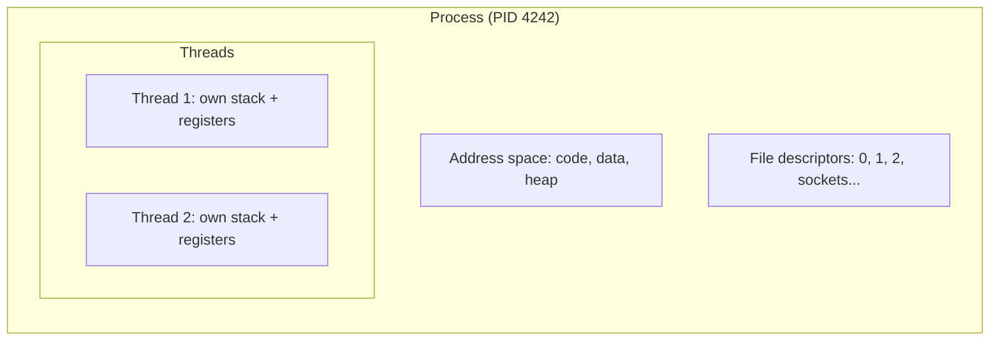
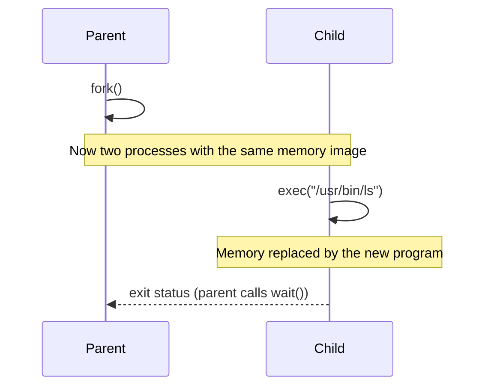
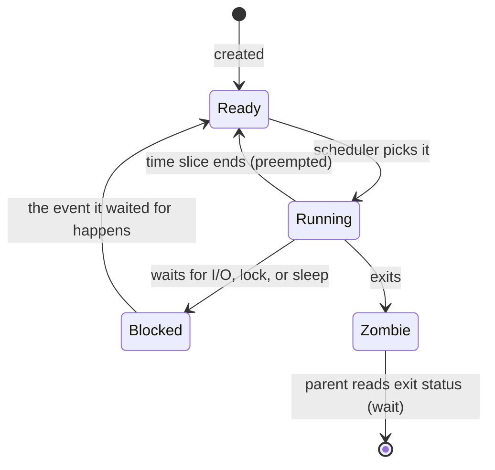
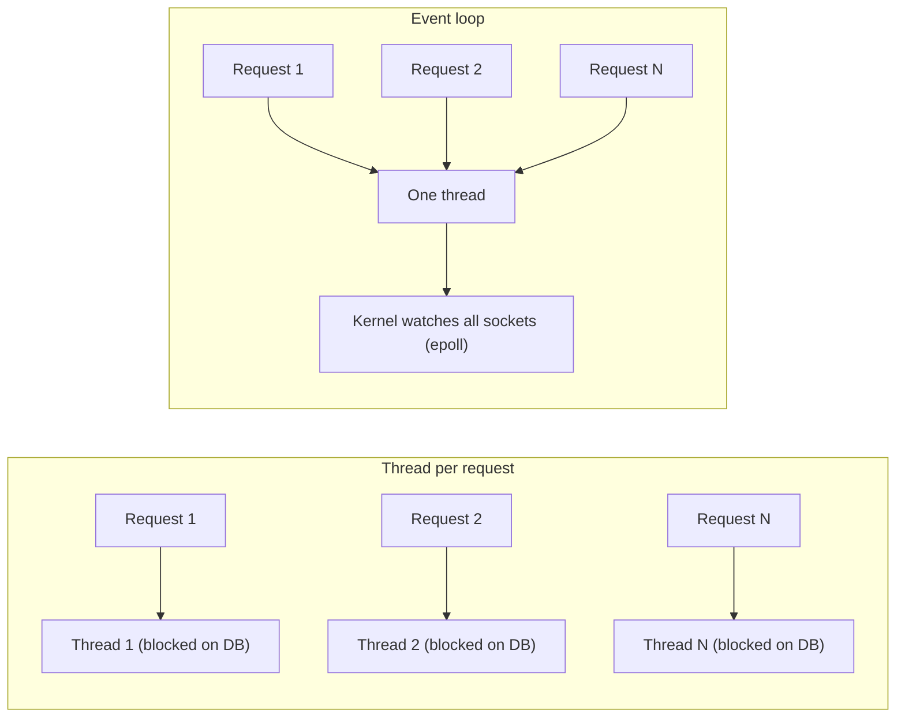

# Processes, Threads and Scheduling

[Home](../README.md) › [Operating Systems](README.md) › Processes, Threads and Scheduling

> **In one sentence:** A process is a running program with its own private memory, a thread is one path of execution inside a process, and the scheduler switches the CPU between threads so fast that they all seem to run at once.

**Before this:** [Hardware and Latency](../01-computer-foundations/02-hardware-and-latency.md).
**After this:** [Memory management](02-memory-management.md), [Concurrency](03-concurrency-and-synchronization.md), [Node.js architecture](../06-nodejs/01-architecture.md).

## Programs and processes

A **program** is a file on disk. A **process** is that program while it runs. The kernel gives each process:

- **Its own virtual address space** (code, data, heap, stack). One process cannot read another's memory.
- **A table of open file descriptors** (files, sockets, pipes).
- **A process ID (PID)**, a parent, a user and group, and environment variables.
- **One or more threads** that execute its code.



Isolation is the main property. If one process crashes, the others continue. This is why a database and an application server run as separate processes, and why running several Node.js processes gives you fault isolation as well as more CPU.

## User mode and kernel mode

The CPU has at least two privilege levels:

- **User mode:** where your code runs. It cannot access hardware or other processes' memory.
- **Kernel mode:** where the OS kernel runs. It can do anything.

To do I/O, allocate memory, or create a process, a program makes a **system call**. The CPU switches to kernel mode, the kernel does the work, and control returns. A system call costs more than a normal function call (hundreds of nanoseconds up to a few microseconds), because of the mode switch and the checks. This is one reason for buffering: one `write` of 64 KB is far cheaper than 64,000 writes of one byte.

You can watch the system calls of a process with `strace -p <pid>` on Linux. It is one of the most useful debugging tools when a process "hangs" and you do not know why.

## Creating processes: fork and exec

On Unix, new processes are created in two steps:

1. **`fork()`** creates a copy of the current process. The child gets a copy of the parent's memory and file descriptors.
2. **`exec()`** replaces the program in the current process with a new one.



`fork` does not really copy all the memory. It uses **copy-on-write**: parent and child share the same physical pages, marked read-only. A page is copied only when one of them writes to it. This makes `fork` fast.

Where you meet this:

- **PostgreSQL forks one backend process per client connection.** Each connection costs real memory and a process. This is why you cannot open 10,000 connections to PostgreSQL and why [connection pooling](../07-databases/11-data-access-from-node.md) is required.
- **Redis uses `fork` to create a snapshot.** The child sees a frozen copy of the data thanks to copy-on-write, while the parent keeps serving requests.
- **Node.js `child_process.spawn`** does fork + exec. `child_process.fork` and `cluster` start new Node.js processes with a communication channel. See [scaling CPU work](../06-nodejs/04-scaling-cpu-work.md).

### Process states and zombies



- A **blocked** process uses no CPU. A thread waiting on a slow disk read costs memory but not CPU time.
- A **zombie** is a process that has exited but whose parent has not read its exit status yet. It holds only a PID entry.
- An **orphan** is a process whose parent died. It is adopted by PID 1 (the init process). In a container, **your application is often PID 1**, so it must handle signals and reap children correctly. See [signals and containers](06-signals-ipc-containers.md).

## Threads

A **thread** is an independent flow of execution inside a process. Threads in the same process **share** the address space and the file descriptors. Each thread has its **own** stack, registers, and program counter.

| | Process | Thread |
|---|---|---|
| Memory | Private | Shared with other threads of the process |
| Creation cost | Higher | Lower |
| Communication | IPC: pipes, sockets, shared memory | Direct: they read the same variables |
| Crash effect | Only that process | Usually the whole process |
| Safety | Isolated by the kernel | Needs [synchronization](03-concurrency-and-synchronization.md) |

Sharing memory is what makes threads both powerful and dangerous. They can cooperate without copying data, but two threads changing the same data at the same time cause **race conditions**.

On Linux, threads and processes are both "tasks" created by the same system call (`clone`). The difference is only what they share.

### Kernel threads and user-level threads

- **Kernel threads** (OS threads) are known to the kernel and scheduled by it. They can run in parallel on different cores. Each has a stack (often 1–8 MB of reserved virtual memory) and switching between them goes through the kernel.
- **User-level threads** (green threads, fibers, coroutines) are scheduled by the language runtime in user space. They are very cheap: a Go goroutine starts with a stack of a few KB. Many of them are mapped onto a few OS threads (the **M:N model**).

JavaScript takes a third path: **one thread and an event loop**. `async` functions are not threads. They are functions that can pause and continue later on the same thread. See [async JavaScript](../04-javascript/04-async-javascript.md).

## Concurrency and parallelism

These two words are often confused.

- **Concurrency** is about *structure*: dealing with many tasks in overlapping time periods. It is possible on one core by switching between tasks.
- **Parallelism** is about *execution*: running several tasks at the same instant. It needs several cores.

```mermaid
gantt
    title Concurrency on 1 core versus parallelism on 2 cores
    dateFormat X
    axisFormat %s
    section Concurrent (1 core)
    Task A :a1, 0, 1
    Task B :b1, 1, 2
    Task A :a2, 2, 3
    Task B :b2, 3, 4
    section Parallel (core 1)
    Task A :c1, 0, 2
    section Parallel (core 2)
    Task B :d1, 0, 2
```



**Node.js is concurrent but not parallel for JavaScript code.** It can have 10,000 requests in progress, because most of the time each request is waiting for I/O. But at any moment only one piece of JavaScript is running.

This fits typical backend work well, because that work is **I/O-bound** (waiting for the database and network), not **CPU-bound** (computing). For CPU-bound work, concurrency alone does not help. You need parallelism: worker threads or more processes.

## The scheduler

There are usually more runnable threads than cores. The **scheduler** decides which thread runs on which core and for how long.

Modern general-purpose schedulers are **preemptive**: the kernel can stop a running thread at any time (using a timer interrupt) and give the CPU to another one. No thread can keep the CPU forever.

Compare this with the Node.js event loop, which is **cooperative**: a callback runs until it returns. Nothing interrupts it. One slow callback delays everyone. This contrast is one of the most important ideas for a Node.js engineer.

| | Preemptive (OS threads) | Cooperative (event loop, coroutines) |
|---|---|---|
| Who decides when to switch | The kernel, at any instruction | The code, at `await` or when a callback returns |
| Can one task starve the others? | No | Yes, if it does not yield |
| Data races inside one thread | Possible everywhere | Only possible across `await` points |
| Switch cost | Higher (kernel involved) | Very low |

### What the Linux scheduler tries to do

The default Linux scheduler (CFS for many years, EEVDF in recent kernels) tries to give each runnable thread a **fair share** of CPU time, with adjustments for priority (the `nice` value). Threads that block often, such as interactive or I/O-bound ones, get the CPU quickly when they wake up.

You rarely tune the scheduler. What you need to know is:

- A thread that is **blocked** is not scheduled and costs no CPU.
- A thread that is **runnable** but not running is waiting in a run queue. If there are many more runnable threads than cores, they all get slower. The **load average** shown by `uptime` or `top` measures this (on Linux it also counts threads blocked on disk I/O).
- In containers, a **CPU limit** is enforced by throttling. If your process uses its quota early in a period, it is paused until the next period. This appears as mysterious latency spikes. See [deployment](../08-backend-engineering/09-deployment-and-operations.md).

## Context switches

A **context switch** happens when the CPU stops running one thread and starts another. The kernel must:

1. Save the registers and program counter of the current thread.
2. Choose the next thread.
3. Load its registers and program counter.
4. If the next thread belongs to a different process, switch the address space.

The direct cost is a few microseconds. The indirect cost is bigger: the new thread's data is not in the CPU caches, and after an address space switch the **TLB** (the cache of virtual-to-physical address translations) is partly useless. Performance stays lower until the caches warm up again.

Switching between threads of the same process is cheaper than between processes, because the address space stays the same.

### Why this matters: thread-per-request versus event loop

The classic server model uses one thread (or process) per connection:



With thread-per-request, 10,000 concurrent connections means 10,000 threads. Most are blocked waiting for I/O, but each one holds a stack, and the scheduler must switch between those that become runnable. Memory use and context switching grow with the number of connections. This is the **C10k problem**.

The event-loop model keeps a small, fixed number of threads. Instead of blocking a thread per connection, it asks the kernel "tell me which of these 10,000 sockets is ready" and handles them one by one. See [I/O multiplexing](05-io-multiplexing.md).

Neither model is always better:

| | Thread per request | Event loop |
|---|---|---|
| Code style | Simple, sequential | Async (callbacks, promises) |
| Memory per connection | A thread stack | A small object |
| CPU-heavy request | Only slows its own thread | Blocks everyone |
| Uses all cores | Yes, naturally | Needs multiple processes or worker threads |
| Best for | CPU-bound or mixed work | Many connections that mostly wait for I/O |

Modern runtimes blur this line: Go's goroutines and Java's virtual threads give sequential-looking code on top of an event-loop-like scheduler.

## Inspecting processes

Commands worth knowing on a Linux server:

```bash
ps aux                      # all processes
ps -eLf                     # all threads
top                         # live CPU and memory; press 1 for per-core, H for threads
pidstat -w 1                # context switches per second
cat /proc/<pid>/status      # memory, threads, state of one process
ls /proc/<pid>/fd | wc -l   # number of open file descriptors
strace -f -p <pid>          # live system calls
```

From Node.js:

```js
process.pid;                  // this process ID
process.ppid;                 // parent process ID
os.availableParallelism();    // how many threads can usefully run in parallel
process.cpuUsage();           // { user, system } in microseconds
```

`user` time is CPU time spent in your code. `system` time is CPU time the kernel spent on your behalf (system calls). A process with high `system` time is doing a lot of I/O calls, often many small ones.

## How this connects

- **One thread, one core:** the reason a Node.js process cannot use more than one core for JavaScript. See [Node.js architecture](../06-nodejs/01-architecture.md).
- **Cooperative scheduling:** the reason a long synchronous function blocks every request. See [event loop](../06-nodejs/02-event-loop.md).
- **Process isolation and `fork`:** the base of `cluster` and of PostgreSQL's process-per-connection model. See [scaling CPU work](../06-nodejs/04-scaling-cpu-work.md) and [data access](../07-databases/11-data-access-from-node.md).
- **Shared memory between threads** creates the need for [synchronization](03-concurrency-and-synchronization.md). The same problems appear between database transactions, with similar solutions. See [locking](../07-databases/08-locking.md).
- **Blocked versus runnable** is the key to reading CPU graphs: high latency with low CPU means waiting (I/O, locks, a pool), not computing. See the [debugging playbook](../13-end-to-end/03-production-debugging-playbook.md).

## Interview questions

<details>
<summary><strong>🟢 Q1. What is the difference between a process and a thread?</strong></summary>

A process is a running program with its own address space and its own resources, like open files. A thread is a unit of execution inside a process. Threads of the same process share memory and file descriptors, but each has its own stack and registers.

Processes are isolated, so a crash in one does not affect the others, but communication between them needs IPC and is more expensive. Threads are cheaper to create and can share data directly, but that shared data needs synchronization, and a crash usually kills the whole process.

</details>

<details>
<summary><strong>🟢 Q2. What is the difference between concurrency and parallelism?</strong></summary>

Concurrency means making progress on several tasks in the same period of time by switching between them. Parallelism means executing several tasks at exactly the same moment on different cores.

Node.js is a good example. It is concurrent, because it can handle thousands of requests that are in progress at once. But it is not parallel for JavaScript, because only one piece of JavaScript runs at a time. Parallelism in Node.js needs worker threads or multiple processes.

</details>

<details>
<summary><strong>🟡 Q3. What happens during a context switch, and why is it expensive?</strong></summary>

The kernel saves the state of the running thread, which means its registers and program counter. It picks another thread and restores its state. If the new thread is in another process, it also switches the address space.

The direct cost is small, a few microseconds. The larger cost is indirect. The CPU caches hold the old thread's data, and the TLB entries may be invalid after an address space switch. So the new thread runs slower until the caches fill again. With thousands of threads, the system can spend a large part of its time switching instead of doing work.

</details>

<details>
<summary><strong>🟡 Q4. Why can a single-threaded server like Node.js handle more connections than a thread-per-request server?</strong></summary>

In a thread-per-request server, every connection holds a thread, even when it is only waiting for the database or the network. Each thread needs stack memory and the kernel must schedule it. With tens of thousands of connections, memory and context switching become the limit.

Node.js does not block a thread per connection. It registers all sockets with the kernel, using epoll on Linux, and the kernel reports which ones are ready. One thread then handles those events one after another. A waiting connection costs only a small object in memory.

The trade-off is that this only works when the work per event is short. A CPU-heavy task blocks all connections.

</details>

<details>
<summary><strong>🟡 Q5. What is copy-on-write and where is it used?</strong></summary>

After `fork`, the kernel does not copy the parent's memory. Parent and child share the same physical pages, marked read-only. When one of them writes to a page, the kernel copies only that page for the writer.

It makes `fork` fast and cheap. Redis uses it for snapshots: it forks, the child writes the frozen data to disk, and the parent keeps serving writes. Only the pages that change during the snapshot are duplicated.

</details>

<details>
<summary><strong>🔴 Q6. A server shows a load average of 40 on 8 cores, but CPU usage is only 15%. What is going on?</strong></summary>

On Linux, the load average counts threads that are running or waiting for CPU, and also threads in uninterruptible sleep, which usually means waiting for disk I/O. So high load with low CPU usage means many threads are stuck on I/O, not on CPU.

I would check I/O wait in `top` or `vmstat`, and disk statistics with `iostat` to see if the disk is saturated or if a network file system is slow. Typical causes are a disk at its IOPS limit, heavy swapping, or a hung NFS mount.

</details>

<details>
<summary><strong>🔴 Q7. Preemptive versus cooperative scheduling: which one does Node.js use, and what follows from that?</strong></summary>

Both, at different levels. The operating system schedules the Node.js threads preemptively, like any other threads. But inside the process, JavaScript tasks are scheduled cooperatively by the event loop. A callback runs until it finishes. Nothing can interrupt it.

Two things follow. The good one: between two `await` points my code cannot be interrupted by other JavaScript, so I do not need locks for simple in-memory state. The bad one: a slow synchronous operation blocks every other request, because no other callback can run until it returns. So I must keep each piece of synchronous work short, or move it off the main thread.

</details>

## Key takeaways

- A process has private memory and resources. Threads share them inside a process.
- System calls are the only way to ask the kernel for something, and they are not free.
- `fork` is cheap because of copy-on-write. PostgreSQL uses a process per connection.
- Concurrency is structure. Parallelism needs multiple cores.
- OS scheduling is preemptive. The event loop is cooperative.
- Context switches cost microseconds directly and more indirectly through cold caches.
- Thread-per-request does not scale to huge connection counts. Event loops do, if work per event is short.

---

← [Operating Systems](README.md) | Next: [Memory Management →](02-memory-management.md)
