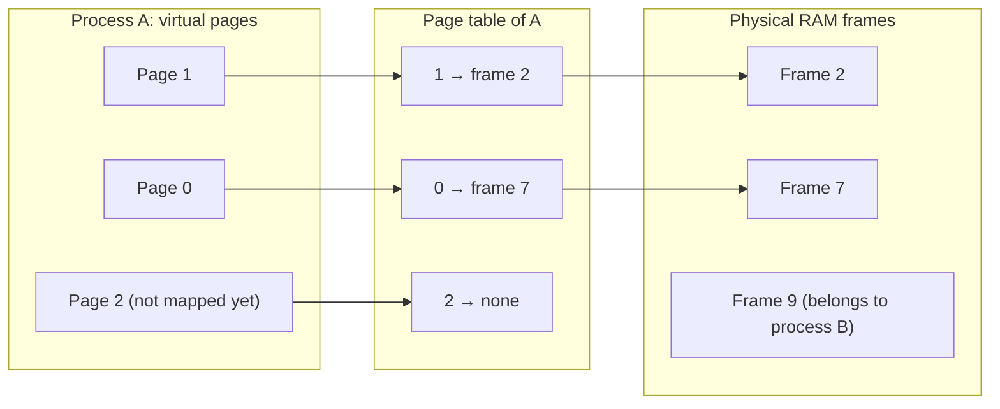
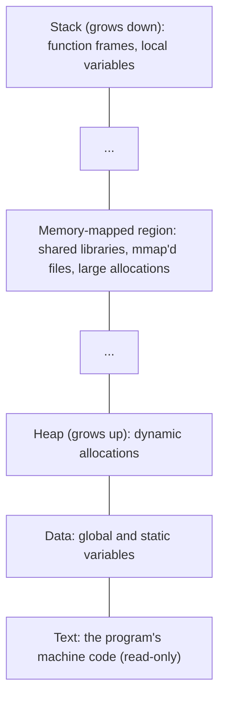
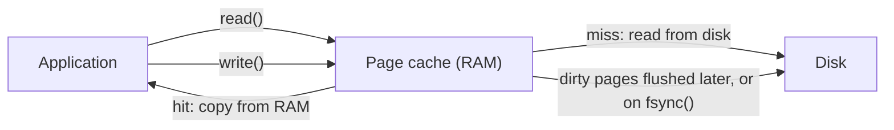

# Memory Management

[Home](../README.md) › [Operating Systems](README.md) › Memory Management

> **In one sentence:** Every process sees its own large, private, continuous memory space, and the kernel together with the CPU translates those virtual addresses to real RAM one page at a time.

**Before this:** [Processes and threads](01-processes-threads-scheduling.md).
**After this:** [JavaScript memory and GC](../04-javascript/06-memory-garbage-collection.md), [database storage internals](../07-databases/04-storage-internals.md).

## The problem

Physical RAM is one shared array of bytes. If programs used it directly:

- One program could read or overwrite another's data.
- Every program would need to know which addresses are free.
- A program could never use more memory than is physically free at that moment.

**Virtual memory** solves all three.

## Virtual memory

Each process gets its own **virtual address space**. On 64-bit Linux this is 128 TB of addresses for user space, far more than the RAM installed. The addresses a program uses are virtual. The CPU translates each one to a physical address when it is used.

Memory is divided into fixed-size blocks called **pages** (4 KB by default). The mapping from virtual pages to physical page frames is stored in the process's **page table**.



What this gives:

- **Isolation.** Process A has no mapping to process B's frames, so it cannot touch them.
- **Simplicity.** Every process can use the same address layout.
- **Sharing.** Two processes can map the same physical frame: shared libraries, or pages shared after `fork` (copy-on-write).
- **Lazy allocation.** Memory you ask for is not given immediately. A physical frame is assigned only when you first touch the page.

### The TLB

Walking the page table on every memory access would be slow. The CPU keeps a small cache of recent translations called the **TLB** (Translation Lookaside Buffer). A TLB hit makes translation almost free. A TLB miss costs a page table walk.

This is part of why [context switches](01-processes-threads-scheduling.md#context-switches) between processes are expensive: the cached translations belong to the old process.

Large in-memory systems, including databases, sometimes use **huge pages** (2 MB or 1 GB) so that one TLB entry covers more memory.

### Page faults

When a program touches a virtual page that has no physical frame yet, the CPU raises a **page fault** and the kernel takes over:

- **Minor fault:** the kernel only needs to assign a frame (first touch of new memory) or the data is already in RAM. Fast: microseconds or less.
- **Major fault:** the data must be read from disk (a memory-mapped file, or swap). Slow: it is a disk read.
- **Invalid access:** the address is not part of the process's memory at all. The kernel sends `SIGSEGV`, the classic **segmentation fault**.

## The layout of a process



### Stack

Each thread has its own stack. Every function call **pushes a frame** with the function's parameters, local variables and return address. When the function returns, the frame is **popped**.

- Allocation is extremely fast: only a pointer moves.
- Memory is freed automatically when the function returns.
- The size is limited (commonly 8 MB for the main thread on Linux). Too much recursion fills it: a **stack overflow**. In JavaScript you see `RangeError: Maximum call stack size exceeded`.

### Heap

The heap is for data whose size or lifetime is not known when the function is compiled: objects, arrays, strings, buffers.

- In C you manage it by hand with `malloc` and `free`. Mistakes cause leaks, double frees and use-after-free bugs.
- In JavaScript, Go, Java, and Python, a **garbage collector** frees heap memory that is no longer reachable. See [memory and garbage collection](../04-javascript/06-memory-garbage-collection.md).

The allocator gets memory from the kernel with system calls (`brk` to grow the heap, or `mmap` for large blocks) and then hands out small pieces itself. A problem called **fragmentation** can appear: there is enough free memory in total, but it is split into holes too small for a large request.

| | Stack | Heap |
|---|---|---|
| Lifetime | Until the function returns | Until freed or garbage collected |
| Speed | Very fast | Slower: bookkeeping, possible GC |
| Size | Small, fixed limit | Large, limited by RAM and settings |
| Shared between threads | No, one per thread | Yes |

In JavaScript, a simple way to think is: primitive values in local variables can live on the stack or in registers, and objects live on the heap, with the variable holding a reference. The engine is free to optimize this, but the model is good enough to reason about behavior.

## How much memory does my process use?

There are several different answers, and monitoring tools mix them.

| Metric | Meaning |
|---|---|
| **VSZ / virtual size** | All virtual address space reserved. Often huge and mostly meaningless. |
| **RSS (Resident Set Size)** | Physical RAM currently mapped by the process. The number that matters for limits. |
| **Shared** | Part of RSS that is shared with other processes (libraries, copy-on-write pages). |
| **PSS** | RSS with shared pages divided among the processes sharing them. |

Node.js shows its own view:

```js
process.memoryUsage();
// {
//   rss:          physical memory of the whole process
//   heapTotal:    memory V8 has reserved for the JS heap
//   heapUsed:     memory used by JS objects right now
//   external:     memory of C++ objects tied to JS objects (for example Buffers)
//   arrayBuffers: memory of ArrayBuffers and Buffers (part of external)
// }
```

A common confusion: `heapUsed` is stable but `rss` keeps growing. Then the leak is not in JavaScript objects. It is in `Buffer`s, native add-ons, or memory that the allocator has not returned to the OS. See [performance and debugging](../06-nodejs/07-performance-debugging.md).

## The page cache

Free RAM is wasted RAM. The kernel uses memory that no process needs as a **page cache**: a cache of file data.

- When you read a file, the kernel reads it from disk into the page cache and copies it to your buffer. The next read of the same data comes from RAM.
- When you write a file, the data goes into the page cache and the page is marked **dirty**. The kernel writes dirty pages to disk later, in the background. This is why a write "succeeds" before the data is safe on disk. See [files and I/O](04-files-and-io.md).



This explains several things:

- `free -m` shows almost no "free" memory on a healthy server. Look at **available**, which includes cache that can be released.
- A database is fast after it "warms up", and slow right after a restart or a failover.
- PostgreSQL relies on **two caches**: its own `shared_buffers`, and the OS page cache below it. See [storage internals](../07-databases/04-storage-internals.md).

### mmap

`mmap` maps a file (or anonymous memory) directly into the address space. Reading the memory reads the file through the page cache, with no explicit `read` call and no extra copy. Some databases (for example LMDB) are built on it. It is also how shared libraries are loaded.

## When memory runs out

### Swap

If RAM is full, the kernel can move pages that were not used recently to a **swap** area on disk. Later access to such a page causes a major page fault.

Swapping keeps the system alive but makes it very slow, because a memory access becomes a disk access (about 1,000× slower). A server that swaps heavily is **thrashing**. Many production systems, and Kubernetes by default, run without swap so that failure is fast and visible instead of slow.

### Overcommit and the OOM killer

Linux lets processes reserve more virtual memory than exists (**overcommit**), because most programs never touch all they reserve. If processes later touch more than RAM plus swap can hold, the kernel has no way to refuse. It runs the **OOM killer** (Out Of Memory), which chooses a process, usually the largest, and kills it with `SIGKILL`.

What you see:

- The process disappears with no error in its own logs. It had no chance to log.
- Exit code **137** (128 + 9, meaning killed by signal 9).
- `dmesg` or the system log shows `Out of memory: Killed process ...`.

In containers, a **cgroup memory limit** triggers the same thing inside the container. In Kubernetes the pod status shows `OOMKilled`.

### Node.js memory limits

Two different limits exist, and they fail differently:

| Limit | What happens when exceeded |
|---|---|
| **V8 heap limit** (`--max-old-space-size`) | V8 runs the garbage collector harder and harder, then crashes with `FATAL ERROR: ... JavaScript heap out of memory` and a stack trace |
| **Container / OS limit** | The kernel kills the process with `SIGKILL`. No message from Node.js |

The V8 heap limit should be set **below** the container limit, with room for buffers, native memory and thread stacks. Otherwise the kernel kills the process before V8 even tries to collect garbage aggressively. Modern Node.js versions take the container limit into account when choosing a default heap size, but setting it explicitly is safer. See [deployment](../08-backend-engineering/09-deployment-and-operations.md).

## How this connects

- **The V8 heap** is a region inside the process's virtual memory, managed by V8's garbage collector instead of by you. See [memory and garbage collection](../04-javascript/06-memory-garbage-collection.md).
- **`Buffer` memory** is allocated outside the V8 heap. That is why it appears in `external` and `rss` but not in `heapUsed`. See [buffers and streams](../06-nodejs/03-buffers-and-streams.md).
- **The page cache** is the OS-level example of the general caching idea. See [caching](../08-backend-engineering/04-caching.md).
- **Database buffer pools** apply paging again at the database level: fixed-size pages, a cache of pages in memory, and dirty pages written later. See [storage internals](../07-databases/04-storage-internals.md).
- **Each thread or process costs memory.** This is the reason for small thread pools and for database [connection pooling](../07-databases/11-data-access-from-node.md).
- **Stack depth limits** are why deep recursion must sometimes be rewritten as iteration. See [recursion and backtracking](../11-data-structures-algorithms/07-recursion-backtracking.md).

## Interview questions

<details>
<summary><strong>🟢 Q1. What is virtual memory and why do we need it?</strong></summary>

Virtual memory gives every process its own private address space. The process uses virtual addresses, and the CPU and kernel translate them to physical addresses using page tables.

It gives three things. Isolation: a process cannot access another process's memory. Simplicity: each program sees one continuous address space and does not care where the data is physically. And flexibility: memory can be allocated lazily, shared between processes, or backed by files or swap.

</details>

<details>
<summary><strong>🟢 Q2. What is the difference between the stack and the heap?</strong></summary>

The stack stores function call frames: parameters, local variables and return addresses. It is managed automatically. Allocation and release are just moving a pointer, so it is very fast, but its size is limited and data only lives until the function returns.

The heap stores data with a dynamic size or a longer lifetime, like objects and arrays. It is slower to allocate, and it must be freed manually or by a garbage collector. Each thread has its own stack, but the heap is shared by all threads in the process.

</details>

<details>
<summary><strong>🟡 Q3. What is a page fault? Is it always an error?</strong></summary>

No. A page fault happens when a program accesses a virtual page that has no physical frame mapped right now. The kernel handles it.

A minor fault is normal: for example, the first touch of newly allocated memory, and the kernel just assigns a frame. A major fault means the data must be loaded from disk, from a mapped file or from swap, so it is slow. Only an access to an address that does not belong to the process is an error, and that gives a segmentation fault.

</details>

<details>
<summary><strong>🟡 Q4. A Linux server shows only 200 MB of free memory out of 16 GB. Is that a problem?</strong></summary>

Usually not. Linux uses unused RAM for the page cache, which keeps file data in memory to make I/O faster. That memory is counted as used, but the kernel can release it immediately when programs need memory.

The number to look at is "available", not "free". A real problem looks different: available memory is low, swap usage is growing, or the OOM killer is active.

</details>

<details>
<summary><strong>🟡 Q5. Your Node.js container restarts with exit code 137 and nothing in the logs. What happened?</strong></summary>

Exit code 137 means the process was killed with SIGKILL, signal 9. With no log output, the most likely cause is the kernel's OOM killer: the container went over its memory limit. In Kubernetes the pod will show the reason `OOMKilled`.

Next I would look at the memory graph before the kill. If RSS grows steadily, there is a leak. I would compare `heapUsed` with `rss` to see if the growth is in the JavaScript heap or outside it, such as buffers or native memory. I would also check that the V8 heap limit is set below the container limit, so that V8 collects garbage or fails with a clear error before the kernel kills the process.

</details>

<details>
<summary><strong>🔴 Q6. <code>heapUsed</code> is flat but RSS keeps growing. Where is the memory going?</strong></summary>

It is outside the V8 heap. The main candidates are: Buffers and ArrayBuffers, which are allocated off-heap; memory from native add-ons; many threads, each with its own stack; and fragmentation in the system memory allocator, where freed memory is not returned to the operating system.

I would check `external` and `arrayBuffers` in `process.memoryUsage()`. If those grow, I look for buffers that are kept alive, for example in a cache or a stream that is never consumed. If they do not grow, I suspect native code or allocator fragmentation. Trying a different allocator such as jemalloc is a common test for the fragmentation case.

</details>

<details>
<summary><strong>🔴 Q7. Why do many production systems disable swap?</strong></summary>

Because swapping makes the system slow in a way that is hard to detect and hard to control. A memory access that hits a swapped page becomes a disk read, thousands of times slower. For a latency-sensitive service, or for a garbage-collected runtime that scans its whole heap, this can make response times terrible while the process still looks alive.

Without swap, a process that uses too much memory is killed quickly. The orchestrator restarts it and the problem is visible. It is the "fail fast" choice. Kubernetes historically required swap to be off for this reason, so that memory limits are predictable.

</details>

## Key takeaways

- Each process has a private virtual address space, mapped to physical RAM in 4 KB pages.
- The TLB caches translations. Page faults load or assign pages on demand.
- Stack: fast, automatic, small, per thread. Heap: flexible, slower, shared, needs GC or manual free.
- RSS is the real memory use. `heapUsed` is only the JavaScript part.
- The page cache uses free RAM to speed up file I/O. "Free" memory is not the number to watch.
- Running out of memory ends with the OOM killer: `SIGKILL`, exit code 137, no logs.

---

← [Processes, Threads and Scheduling](01-processes-threads-scheduling.md) | Next: [Concurrency and Synchronization →](03-concurrency-and-synchronization.md)
