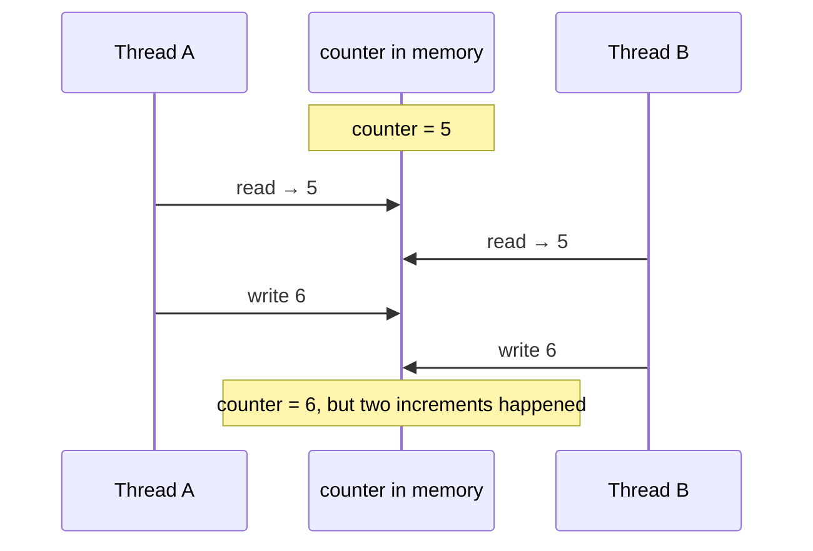
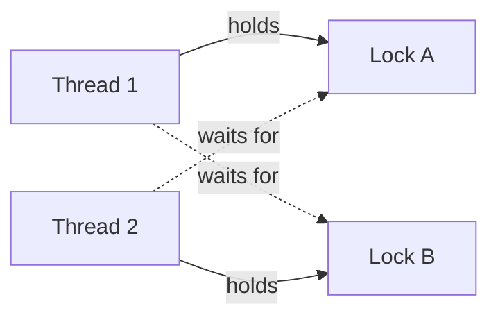

# Concurrency and Synchronization

[Home](../README.md) › [Operating Systems](README.md) › Concurrency and Synchronization

> **In one sentence:** When several flows of execution share data and at least one of them changes it, the result depends on timing unless you control access, and the tools for that control (locks, atomic operations, message passing) are the same ideas at every layer of a backend.

**Before this:** [Processes and threads](01-processes-threads-scheduling.md).
**After this:** [Async JavaScript](../04-javascript/04-async-javascript.md), [database locking](../07-databases/08-locking.md), [distributed coordination](../09-distributed-systems/03-consensus-coordination.md).

## Race conditions

A **race condition** is a bug where the result depends on the order in which concurrent operations happen to run.

The classic example is two threads incrementing a shared counter. `counter++` looks like one step, but it is three:

1. Read `counter` from memory.
2. Add 1.
3. Write the result back.



One update is lost. This pattern is called **read-modify-write**, and it is the source of most concurrency bugs at every layer.

A **critical section** is a piece of code that uses shared data and must not be run by two flows at the same time. Making sure only one flow is inside is called **mutual exclusion**.

### Does this happen in Node.js? Yes.

JavaScript runs on one thread, so two lines of synchronous code cannot be interrupted. But a race only needs *interleaving*, and **every `await` is a point where other code can run.**

```js
// Race condition in single-threaded JavaScript
async function withdraw(accountId, amount) {
  const account = await db.getAccount(accountId);    // read
  if (account.balance < amount) throw new Error('Insufficient funds');
  await db.setBalance(accountId, account.balance - amount);  // write
}

// Two requests at the same time, balance = 100:
// A reads 100, B reads 100, A writes 20 (100 - 80), B writes 20 (100 - 80).
// 160 was withdrawn from an account that had 100.
```

The shared state here is in the database, and the "threads" are two requests. The same bug happens with two Node.js processes, or two servers. A lock inside one process would not help. The fix must be where the shared data lives: an atomic `UPDATE ... SET balance = balance - 80 WHERE balance >= 80`, a row lock, or a transaction with the right isolation. See [transactions](../07-databases/07-transactions-isolation.md).

This is the reason to learn OS-level synchronization as a backend engineer. You will rarely write a mutex, but you will meet the same problem between requests, processes and services.

## Mutual exclusion tools

### Mutex (lock)

A **mutex** has two operations: `lock` and `unlock`. Only one thread can hold it. Others that try to lock it wait.

```
lock(m)
  counter = counter + 1     // critical section
unlock(m)
```

Rules for correct use:

- Keep the critical section **short**. While you hold the lock, others wait.
- **Always release**, including on errors. This is what `try/finally` is for.
- Do not do slow I/O while holding a lock, if you can avoid it.

### Spinlock

A spinlock waits by looping ("spinning") instead of sleeping. It avoids a context switch, so it is good only when the wait is expected to be extremely short and the lock is held on another core. Kernels and databases use them for internal structures. In practice, modern mutexes spin briefly and then sleep.

### Read-write lock

Many readers can hold the lock at once, but a writer needs it alone. This is useful when reads are much more frequent than writes.

Database row locks follow the same idea: `FOR SHARE` (many readers) and `FOR UPDATE` (one writer). See [locking](../07-databases/08-locking.md).

### Semaphore

A semaphore is a counter with two operations: `acquire` (decrement, wait if zero) and `release` (increment). It allows **up to N** holders at once.

- A semaphore with N = 1 behaves like a mutex.
- A semaphore with N = 10 limits concurrency to 10.

You use this idea constantly in Node.js, even without the name: a **connection pool** of size 10 is a semaphore around database connections, and a concurrency limiter like `p-limit` is a semaphore around async tasks.

```js
// A minimal semaphore for async code
class Semaphore {
  #free;
  #waiting = [];
  constructor(n) { this.#free = n; }

  async acquire() {
    if (this.#free > 0) { this.#free--; return; }
    await new Promise((resolve) => this.#waiting.push(resolve));
  }

  release() {
    const next = this.#waiting.shift();
    if (next) next();          // hand the slot directly to the next waiter
    else this.#free++;
  }
}

const sem = new Semaphore(5);
async function limited(task) {
  await sem.acquire();
  try { return await task(); }
  finally { sem.release(); }
}
```

### Condition variable

A condition variable lets a thread sleep until some condition becomes true ("the queue is not empty"), and another thread wake it. It is always used with a mutex. In async JavaScript the equivalent is awaiting a promise that someone else resolves, exactly like the `#waiting` list above.

### Atomic operations and compare-and-swap

CPUs provide instructions that do a small read-modify-write as one indivisible step. The most important is **compare-and-swap (CAS)**:

```
CAS(address, expected, new):
    atomically:
        if value at address == expected:
            write new, return true
        else:
            return false
```

With CAS you can build **lock-free** code: read the value, compute the new one, and CAS. If the CAS fails, someone else changed it, so retry.

This is **optimistic concurrency**, and it appears at every layer:

| Layer | Compare-and-swap form |
|---|---|
| CPU | The `CAS` instruction; `Atomics.compareExchange` in JavaScript |
| Database | `UPDATE ... SET ..., version = version + 1 WHERE id = $1 AND version = $2` |
| HTTP | `If-Match: "etag"` on a `PUT` request |
| Redis | `SET key value NX`, or `WATCH` + `MULTI` |
| Distributed stores | Conditional writes in etcd, DynamoDB, ZooKeeper |

**Pessimistic** concurrency (take a lock first) is better when conflicts are frequent. **Optimistic** concurrency (try, detect conflict, retry) is better when conflicts are rare.

## Deadlock

A **deadlock** is when a group of threads wait for each other forever.



A deadlock needs four conditions at the same time (the Coffman conditions):

1. **Mutual exclusion:** the resource can be held by only one thread.
2. **Hold and wait:** a thread holds one resource while waiting for another.
3. **No preemption:** a resource cannot be taken away by force.
4. **Circular wait:** there is a cycle of threads, each waiting for the next.

Remove any one and deadlock is impossible. In practice:

- **Lock ordering** (breaks circular wait): always take locks in the same global order. If every transaction updates accounts in order of ascending ID, two transfers between the same accounts cannot deadlock. This is the standard fix for database deadlocks.
- **Timeouts** (breaks hold and wait): give up if a lock is not obtained in time, release everything, and retry.
- **Detection:** let it happen, find the cycle, and abort one participant. PostgreSQL does this: after `deadlock_timeout` (1 second by default) it looks for a cycle and cancels one transaction with a deadlock error. Your application must retry it.

### Related problems

- **Livelock:** threads are not blocked, but they keep reacting to each other and make no progress. Two people stepping the same way in a corridor. Retries without random delay can cause this.
- **Starvation:** one thread never gets the resource because others always get it first.
- **Priority inversion:** a high-priority thread waits for a lock held by a low-priority thread, which itself is not scheduled.

## Thread safety and shared state

Code is **thread-safe** if it works correctly when called from several threads at once. The ways to get there, from safest to hardest:

1. **Do not share.** Each thread has its own data. Communicate by sending messages. This is the model of Node.js `worker_threads` (`postMessage`), of Go channels, and of microservices.
2. **Share only immutable data.** Data that never changes needs no locks.
3. **Share with synchronization.** Mutexes, atomics. Correct but hard to get right.

> "Do not communicate by sharing memory; share memory by communicating." — a Go proverb that also describes the design of Node.js workers.

Node.js does allow real shared memory between worker threads through `SharedArrayBuffer`, with `Atomics` for safe operations:

```js
const shared = new SharedArrayBuffer(4);
const counter = new Int32Array(shared);

Atomics.add(counter, 0, 1);                 // atomic increment
Atomics.compareExchange(counter, 0, 1, 2);  // CAS: if value is 1, set to 2
Atomics.load(counter, 0);                   // → 2
```

You rarely need it. Message passing is simpler and fast enough for most work. See [scaling CPU work](../06-nodejs/04-scaling-cpu-work.md).

## The same problem at every layer

| Layer | Who races | Shared state | Tools |
|---|---|---|---|
| Threads in a process | Threads | Memory | Mutex, atomics, CAS |
| Async code in Node.js | Tasks interleaved at `await` | Variables, caches | Keep read-modify-write synchronous; promise-based mutex or queue |
| Requests on one database | Transactions | Rows | Row locks, isolation levels, atomic `UPDATE`, unique constraints |
| Several servers | Processes on different machines | A database, Redis, an external API | Database constraints, distributed locks with fencing tokens, idempotency keys |

One example of the second row, a common bug in Node.js:

```js
// Bug: cache stampede. 100 concurrent requests all see a miss and all call the API.
const cache = new Map();
async function getConfig(key) {
  if (cache.has(key)) return cache.get(key);
  const value = await fetchFromSlowApi(key);   // other requests run during this await
  cache.set(key, value);
  return value;
}

// Fix: store the promise, not the value. The check-and-set is now synchronous.
const pending = new Map();
function getConfigSafe(key) {
  if (!pending.has(key)) {
    const promise = fetchFromSlowApi(key).catch((err) => {
      pending.delete(key);     // do not cache failures
      throw err;
    });
    pending.set(key, promise);
  }
  return pending.get(key);
}
```

The fix works because between `has` and `set` there is no `await`, so no other code can run in between. Recognizing where the interleaving points are is the core concurrency skill in JavaScript.

## How this connects

- **`await` is the interleaving point** in JavaScript. See [async JavaScript](../04-javascript/04-async-javascript.md).
- **Database transactions** face the same races between sessions, and solve them with locks and MVCC. See [transactions and isolation](../07-databases/07-transactions-isolation.md) and [locking](../07-databases/08-locking.md).
- **Optimistic concurrency** with version numbers and ETags is used in [API design](../08-backend-engineering/01-api-design.md).
- **Distributed locks** try to give mutual exclusion across machines, where timing guarantees are much weaker. See [consensus and coordination](../09-distributed-systems/03-consensus-coordination.md).
- **Semaphores** are the model for connection pools and rate limiters. See [reliability patterns](../08-backend-engineering/06-reliability-patterns.md).
- **Cache stampede** is covered in depth in [caching](../08-backend-engineering/04-caching.md).

## Interview questions

<details>
<summary><strong>🟢 Q1. What is a race condition? Give an example.</strong></summary>

A race condition is a bug where the result depends on the timing or order of concurrent operations. It needs shared data and at least one writer.

The classic example is two threads doing `counter++`. That is really read, add, write. If both read the same value before either writes, one increment is lost.

A backend example is checking a balance and then updating it in two separate queries. Two requests can both pass the check and both withdraw, so the account goes negative.

</details>

<details>
<summary><strong>🟢 Q2. What is a deadlock and how do you prevent it?</strong></summary>

A deadlock is when two or more threads wait for each other forever. For example, thread one holds lock A and wants B, while thread two holds B and wants A.

It needs four conditions: mutual exclusion, hold and wait, no preemption, and circular wait. The most practical prevention is to always take locks in the same order, which removes the circular wait. Other options are lock timeouts with retry, or keeping transactions short so the window is small. Databases like PostgreSQL detect deadlocks and abort one transaction, so the application must be ready to retry.

</details>

<details>
<summary><strong>🟡 Q3. JavaScript is single-threaded. Can it still have race conditions?</strong></summary>

Yes. It cannot have a data race where two threads write the same memory at the same instant, but it can have logical race conditions. Every `await` is a point where other code can run. If I read some state, await something, and then write based on what I read, another request may have changed the state in between.

Examples are a check-then-act on a database row, or a cache that many requests try to fill at the same time. The fix is to make the read-modify-write atomic: either keep it synchronous with no `await` in the middle, or push it into the database with an atomic statement, a lock, or a constraint.

</details>

<details>
<summary><strong>🟡 Q4. What is the difference between a mutex and a semaphore?</strong></summary>

A mutex allows exactly one holder, and normally the thread that locked it must unlock it. It protects a critical section.

A semaphore is a counter that allows up to N holders. It is used to limit concurrent access to a resource with limited capacity. A database connection pool behaves like a semaphore: with a pool of 10, the 11th request waits until someone releases a connection.

</details>

<details>
<summary><strong>🟡 Q5. Explain optimistic and pessimistic locking. When do you use each?</strong></summary>

Pessimistic locking takes a lock before working, so nobody else can change the data. In SQL that is `SELECT ... FOR UPDATE`. It is good when conflicts are frequent, or when a retry would be expensive.

Optimistic locking takes no lock. Each row has a version. I read the row and its version, and when I update I add `WHERE version = oldVersion`. If no row is updated, someone else changed it first, so I retry or report a conflict. It is good when conflicts are rare, and when the "transaction" covers a user's thinking time, such as editing a form, where holding a database lock would be a bad idea.

</details>

<details>
<summary><strong>🔴 Q6. You run 4 instances of your Node.js service. A job must run only once at a time across all of them. How do you guarantee that?</strong></summary>

An in-process lock does not work, because each instance has its own memory. The lock must be in something all instances share.

The simplest reliable option is the database. I can use a PostgreSQL advisory lock, or a row in a jobs table that I claim with an atomic update, or `SELECT ... FOR UPDATE SKIP LOCKED` for a job queue.

A Redis lock with `SET key value NX PX ttl` is also common, but it has a weakness: the lock can expire while the holder is paused, and then two instances believe they have it. To be safe, the protected resource should check a fencing token, a number that increases with each lock grant, and reject writes with an older token. And I would make the job idempotent anyway, so running twice is harmless.

</details>

<details>
<summary><strong>🔴 Q7. What is compare-and-swap, and how does the same idea appear in databases and HTTP?</strong></summary>

Compare-and-swap is an atomic CPU operation: "set this memory to the new value only if it still contains the value I expect." If it fails, another thread changed it, and I retry. It allows updates without a lock.

The same pattern is a conditional write at higher layers. In a database: `UPDATE ... WHERE id = x AND version = n`. In HTTP: a `PUT` with an `If-Match` header carrying the ETag, and the server answers 412 Precondition Failed if the resource changed. In Redis: `SET NX`, or `WATCH` with `MULTI`. In all cases, the write succeeds only if nothing changed since I read.

</details>

## Key takeaways

- Race conditions come from unprotected read-modify-write on shared state.
- In JavaScript, interleaving happens at `await`. Synchronous sections are atomic.
- Mutex: one holder. Semaphore: N holders. Read-write lock: many readers or one writer.
- Deadlock needs four conditions. Consistent lock ordering is the usual prevention.
- Compare-and-swap is optimistic concurrency. It reappears as version columns, ETags, and conditional writes.
- A lock must live where the shared state lives. Across processes, that means the database or a coordination service.

---

← [Memory Management](02-memory-management.md) | Next: [Files and I/O →](04-files-and-io.md)
