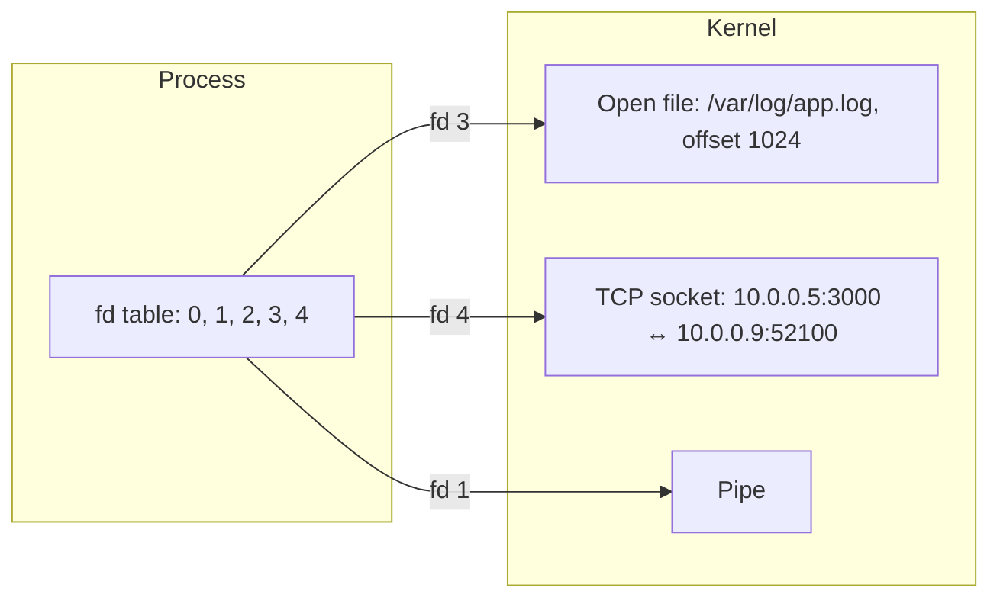
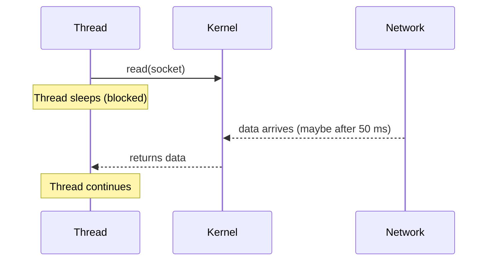

# Files and I/O

[Home](../README.md) › [Operating Systems](README.md) › Files and I/O

> **In one sentence:** On Unix almost everything a program reads or writes (files, sockets, pipes, terminals) is a file descriptor, and how you wait for it (blocking or non-blocking) and how you make writes durable (`fsync`) decide your server's performance and safety.

**Before this:** [Memory management](02-memory-management.md) (page cache).
**After this:** [I/O multiplexing](05-io-multiplexing.md), [buffers and streams](../06-nodejs/03-buffers-and-streams.md), [database storage internals](../07-databases/04-storage-internals.md).

## File descriptors

When a process opens a file, the kernel returns a small integer called a **file descriptor (fd)**. The process uses that number in later calls: `read(fd, ...)`, `write(fd, ...)`, `close(fd)`.

Every process starts with three:

| fd | Name | Node.js |
|---|---|---|
| 0 | Standard input | `process.stdin` |
| 1 | Standard output | `process.stdout` |
| 2 | Standard error | `process.stderr` |

The key Unix idea is **"everything is a file"**: the same `read` and `write` calls work on regular files, TCP sockets, pipes, terminals and devices. This is why Node.js can offer one [stream](../06-nodejs/03-buffers-and-streams.md) interface for all of them, and why you can pipe a file into a socket.



### Limits: "too many open files"

Each process has a maximum number of open descriptors (`ulimit -n`, often 1024 by default for a shell, much higher under a service manager or in containers). **Every open socket uses one.** A server with many connections, or code that forgets to close files or sockets, hits the limit and gets `EMFILE: too many open files`.

A **descriptor leak** is the fd version of a memory leak. Common causes in Node.js: streams that are not closed on error, HTTP responses that are never consumed, or creating a new database client per request instead of using a pool.

```bash
ulimit -n                      # soft limit for this shell
ls /proc/<pid>/fd | wc -l      # descriptors currently open in a process
```

## System calls for I/O

| Call | Purpose |
|---|---|
| `open(path, flags)` | Open a file, returns an fd |
| `read(fd, buf, n)` | Read up to `n` bytes. May return **fewer** |
| `write(fd, buf, n)` | Write up to `n` bytes. May write **fewer** |
| `close(fd)` | Release the descriptor |
| `lseek(fd, offset)` | Move the position in a file |
| `fsync(fd)` | Force the file's data to stable storage |
| `socket`, `bind`, `listen`, `accept`, `connect` | Create and use network sockets. See [TCP](../03-networking/02-tcp-udp.md) |

Two details matter:

- **Short reads and writes are normal.** `read` returns what is available, not what you asked for. A TCP socket does not preserve message boundaries. Code must loop, or use a library that does. In Node.js, this is why a `'data'` event gives you "some bytes", not "one message".
- **Each call crosses into the kernel.** Many tiny calls are slow. Buffering reduces the count.

## Buffering: three layers

When you write to a file, the data passes through several buffers before it is on the disk.


1. **User-space buffer.** Libraries collect small writes into a larger block to reduce system calls. Node.js writable streams do this (the `highWaterMark`). If the process crashes, this data is lost.
2. **Kernel page cache.** After `write()` returns, the data is in kernel memory. If the *process* crashes, the data is safe, because the kernel still has it. If the *machine* loses power, it is lost.
3. **Disk.** Only after the kernel flushes the dirty pages, and the device confirms, is the data durable.

### fsync and durability

`fsync(fd)` tells the kernel: write all dirty data of this file to the device and wait until it is confirmed. This is the only way to be sure that data survives a power failure.

`fsync` is slow: from a fraction of a millisecond on a good NVMe SSD to several milliseconds on other storage. This cost is the central trade-off of durable systems:

- **PostgreSQL** calls `fsync` on its write-ahead log at every commit (with default settings). That is the "D" in [ACID](../07-databases/07-transactions-isolation.md). To make this cheaper, it groups commits from several transactions into one flush (**group commit**).
- **Redis** with AOF persistence lets you choose: `fsync` on every write (safe, slow), every second (lose up to one second), or never (the OS decides).
- **Kafka** by default does not `fsync` each message. It relies on replication to several brokers for durability instead.

Each system makes a different choice between **latency** and **the amount of data you can lose in a crash**.

```js
import { open } from 'node:fs/promises';

const file = await open('data.log', 'a');
await file.write('important record\n');   // now in the page cache
await file.sync();                        // now on stable storage (fsync)
await file.close();
```

### Atomic file replacement

A common need is to replace a file so that readers see either the old or the new version, never half. The pattern is:

1. Write the new content to a temporary file in the same directory.
2. `fsync` the temporary file.
3. `rename` it over the target. On POSIX file systems, `rename` within one file system is atomic.

Configuration writers and many databases use this.

## Blocking and non-blocking I/O

This distinction is the foundation of Node.js.

### Blocking I/O

By default, `read` on a socket with no data **blocks**: the kernel puts the thread to sleep until data arrives. The thread can do nothing else.



This is simple to program, but one thread can wait for only one thing. To serve many clients you need many threads. See the [thread-per-request discussion](01-processes-threads-scheduling.md#why-this-matters-thread-per-request-versus-event-loop).

### Non-blocking I/O

A descriptor can be set to non-blocking mode (`O_NONBLOCK`). Now `read` never sleeps:

- If data is available, it returns the data.
- If not, it returns immediately with the error `EAGAIN` ("try again later").

The thread stays free. But how does it know *when* to try again? Asking every socket in a loop ("polling") would burn CPU. The answer is to ask the kernel to watch many descriptors and report which are ready. That is [I/O multiplexing](05-io-multiplexing.md), the subject of the next page.

### The four I/O models

| Model | How it waits | Example |
|---|---|---|
| **Blocking** | The thread sleeps inside the call | Classic thread-per-connection servers |
| **Non-blocking + readiness notification** | The kernel says "fd is ready", then you call `read` | `epoll`, `kqueue`. Used by Node.js for sockets |
| **Asynchronous (completion-based)** | You submit the operation; the kernel says "it is done, here is the result" | Windows IOCP, Linux `io_uring` |
| **Thread pool emulation** | A helper thread does blocking I/O and reports back | Node.js for file system calls |

### Why files are different from sockets

Readiness-based APIs like `epoll` do not work for regular files. A file on disk is always "ready" from the kernel's point of view, yet a `read` can still block while the disk is accessed.

So **libuv runs file system operations on a thread pool**: a worker thread makes the blocking call and tells the event loop when it finishes. Network sockets do not use the thread pool. They use `epoll` directly.

| Operation | Mechanism in Node.js |
|---|---|
| TCP / UDP / pipes | Non-blocking sockets + `epoll` / `kqueue` / IOCP, on the event loop thread |
| `fs.*` (async versions) | libuv thread pool (default 4 threads) |
| `dns.lookup()` | libuv thread pool (it calls the blocking `getaddrinfo`) |
| `crypto.pbkdf2`, `scrypt`, `zlib` async calls | libuv thread pool (CPU work, not I/O) |

This has a practical effect: four slow file reads or four password hashes can occupy the whole pool, and the fifth operation waits, even though the event loop is idle. See [Node.js architecture](../06-nodejs/01-architecture.md).

## Synchronous versus asynchronous APIs in Node.js

Do not confuse the kernel-level terms above with Node.js API names:

```js
import fs from 'node:fs';

// Synchronous API: blocks the event loop thread until done.
const data = fs.readFileSync('config.json');

// Asynchronous API: the work happens on the thread pool. The event loop stays free.
const data2 = await fs.promises.readFile('config.json');
```

`readFileSync` is fine during startup (loading config before the server listens). Inside a request handler it blocks every other request for the duration of the disk read.

## Zero-copy

Sending a file over a socket in the simple way copies the data several times: disk → page cache → your buffer (user space) → socket buffer (kernel) → network card.

The `sendfile` system call tells the kernel to move data from a file descriptor to a socket directly, without the round trip through user space. This is **zero-copy**. Nginx uses it for static files, and Kafka uses it to send log segments to consumers, which is a large part of its throughput.

## Standard streams, pipes and redirection

A **pipe** is a kernel buffer with a write end and a read end. The shell command `a | b` connects `a`'s fd 1 to `b`'s fd 0.

```bash
cat access.log | grep " 500 " | wc -l
```

If the reader is slower than the writer, the pipe's buffer (64 KB by default on Linux) fills and the writer **blocks** until the reader catches up. This is **backpressure** at the OS level. Node.js streams implement the same idea in user space. See [buffers and streams](../06-nodejs/03-buffers-and-streams.md).

A practical consequence for logging: writing logs to stdout is the standard for containers ([twelve-factor](../08-backend-engineering/09-deployment-and-operations.md)), but if stdout is a pipe and the log collector is slow, synchronous writes to it can block your process.

## How this connects

- **Non-blocking I/O plus readiness notification** is the mechanism the [event loop](../06-nodejs/02-event-loop.md) is built on. The next page, [I/O multiplexing](05-io-multiplexing.md), explains the notification part.
- **The libuv thread pool** exists because file I/O cannot use that mechanism. See [Node.js architecture](../06-nodejs/01-architecture.md).
- **`fsync`** is the cost behind every durable commit. See [storage internals](../07-databases/04-storage-internals.md) and [transactions](../07-databases/07-transactions-isolation.md).
- **Short reads** are why protocols need framing (length prefixes or delimiters). See [TCP](../03-networking/02-tcp-udp.md) and [streams](../06-nodejs/03-buffers-and-streams.md).
- **File descriptor limits** appear in production as `EMFILE` and connection failures. See the [debugging playbook](../13-end-to-end/03-production-debugging-playbook.md).
- **Backpressure** in pipes is the same idea as TCP flow control and stream `highWaterMark`. See [reliability patterns](../08-backend-engineering/06-reliability-patterns.md).

## Interview questions

<details>
<summary><strong>🟢 Q1. What is a file descriptor?</strong></summary>

It is a small integer that a process uses to refer to an open I/O resource. The kernel keeps a table per process that maps each number to an open file, socket, pipe or device. The process passes the number to system calls like `read`, `write` and `close`.

Descriptors 0, 1 and 2 are standard input, output and error. Because sockets are also descriptors, a server with many connections uses many of them, and there is a per-process limit. Leaking them gives the error "too many open files".

</details>

<details>
<summary><strong>🟢 Q2. What is the difference between blocking and non-blocking I/O?</strong></summary>

With blocking I/O, a call like `read` puts the thread to sleep until data is available. The thread cannot do anything else in that time.

With non-blocking I/O, the call returns immediately. If there is no data, it returns an error that means "try again later". The program then uses a mechanism like epoll to learn when the descriptor is ready, so one thread can manage many connections.

</details>

<details>
<summary><strong>🟡 Q3. When <code>write()</code> returns successfully, is the data on disk?</strong></summary>

Not necessarily. Usually the data is only in the kernel's page cache, in memory. The kernel writes it to disk later. If the process crashes, the data is safe because the kernel has it. If the machine loses power before the flush, the data is lost.

To guarantee durability, the program must call `fsync`, which waits until the device confirms the write. That is slow, so systems choose when to do it. PostgreSQL does it at commit for its write-ahead log. Redis lets you choose between every write, every second, or never.

</details>

<details>
<summary><strong>🟡 Q4. Why does Node.js use a thread pool for file system operations but not for network sockets?</strong></summary>

For sockets, the operating system supports non-blocking mode with readiness notification, like epoll on Linux. The event loop thread can watch thousands of sockets and only act on the ready ones.

Regular files do not work with that model. The kernel always reports them as ready, but the actual read can still block on the disk. So libuv runs file operations as blocking calls on a small pool of worker threads, four by default, and delivers the result to the event loop when they finish.

</details>

<details>
<summary><strong>🟡 Q5. Why is <code>fs.readFileSync</code> dangerous in a request handler, but acceptable at startup?</strong></summary>

It blocks the only JavaScript thread until the read finishes. During that time, the event loop cannot handle any other request, timer or callback. In a request handler under load, every other user waits for that disk read.

At startup there are no requests yet, so nothing is delayed. Loading configuration or certificates synchronously before the server starts listening is simple and fine.

</details>

<details>
<summary><strong>🔴 Q6. Your service starts failing with <code>EMFILE</code> after running for a few days. How do you investigate?</strong></summary>

`EMFILE` means the process reached its limit of open file descriptors. Since it takes days, it is probably a leak, not just load.

I would count the open descriptors of the process over time, with `ls /proc/<pid>/fd | wc -l`, and look at what they point to. If most are sockets, I check for connections that are opened and never closed: an HTTP client without keep-alive pooling, responses whose body is never consumed or destroyed, or a database client created per request. If they are files, I look for streams that are not closed on error paths.

Raising the limit with `ulimit` can give time, but the real fix is to find the leak. I would also add a metric for open descriptors so we see it early next time.

</details>

<details>
<summary><strong>🔴 Q7. How would you write a file so that a crash can never leave it half-written?</strong></summary>

I write the new content to a temporary file in the same directory, call `fsync` on it, and then rename it over the original. On POSIX file systems a rename inside one file system is atomic, so any reader sees either the complete old file or the complete new file. For full durability I also `fsync` the directory, so the rename itself survives a power failure.

The temporary file must be on the same file system as the target. Otherwise the rename becomes a copy, and that is not atomic.

</details>

## Key takeaways

- A file descriptor is a per-process integer handle for files, sockets and pipes. They are limited.
- `read` and `write` can transfer fewer bytes than requested. Streams of bytes have no message boundaries.
- A successful `write` puts data in the page cache. Only `fsync` makes it durable, and it is slow.
- Blocking I/O sleeps the thread. Non-blocking I/O returns immediately and needs readiness notification.
- Node.js uses `epoll`-style notification for sockets, and a thread pool for file system calls.
- Synchronous `fs` calls block the event loop. Use them only at startup.

---

← [Concurrency and Synchronization](03-concurrency-and-synchronization.md) | Next: [I/O Multiplexing →](05-io-multiplexing.md)
