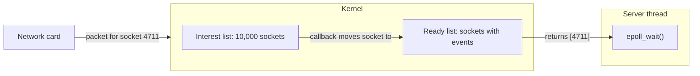
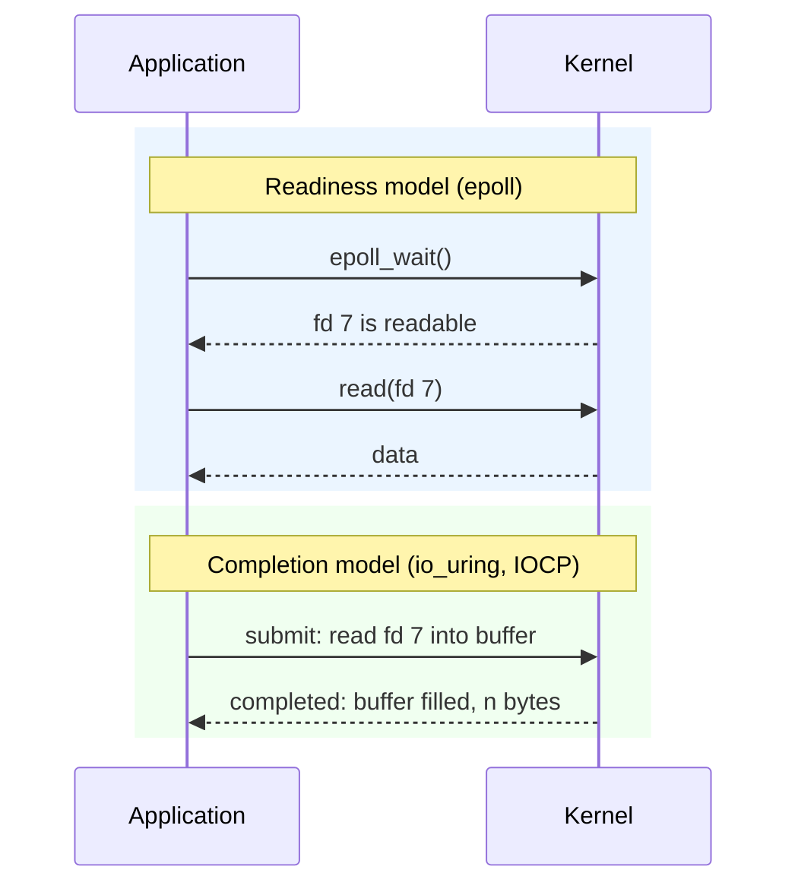

# I/O Multiplexing

[Home](../README.md) › [Operating Systems](README.md) › I/O Multiplexing

> **In one sentence:** I/O multiplexing lets one thread ask the kernel "which of these thousands of connections has something for me?", and that single capability is what makes event-loop servers like Node.js, Nginx and Redis possible.

**Before this:** [Files and I/O](04-files-and-io.md).
**After this:** [Node.js architecture](../06-nodejs/01-architecture.md), [the event loop](../06-nodejs/02-event-loop.md).

## The problem

A server has 10,000 open sockets. At any moment, only a few have data to read. With non-blocking sockets the server could call `read` on each one in a loop, but 9,990 of those calls would return `EAGAIN`. That wastes CPU.

What the server needs is one call that says: **"sleep until at least one of these sockets is ready, then tell me which ones."**

## select and poll: the first answers

`select` and `poll` do exactly this. You give the kernel a list of descriptors. It blocks until one is ready and returns.

Their problem is cost per call:

1. Your program passes the **whole list** to the kernel on every call.
2. The kernel **scans every descriptor** in the list.
3. The program **scans the result** to find which ones are ready.

All three steps are O(n) in the number of watched descriptors, even if only one is ready. With 10,000 mostly idle connections, the work is almost all waste. `select` also has a hard limit (usually 1,024 descriptors).

## epoll: the Linux answer

`epoll` separates "what I am interested in" from "wait for events". The kernel keeps the interest list between calls.

| Call | Purpose |
|---|---|
| `epoll_create1()` | Create an epoll instance (itself a file descriptor) |
| `epoll_ctl(epfd, ADD / MOD / DEL, fd, events)` | Register, change or remove interest in one descriptor |
| `epoll_wait(epfd, events, max, timeout)` | Sleep until events are ready; return **only the ready ones** |



Why it scales:

- Registration happens **once** per socket, not on every wait.
- When a packet arrives, the kernel's network stack adds that socket to a **ready list** directly. No scanning.
- `epoll_wait` returns only ready descriptors. Its cost depends on the number of **active** connections, not the total.

So 10,000 idle connections cost almost nothing per loop iteration. This is how the [C10k problem](01-processes-threads-scheduling.md#why-this-matters-thread-per-request-versus-event-loop) was solved.

### Level-triggered and edge-triggered

`epoll` has two notification modes:

- **Level-triggered (default):** `epoll_wait` reports a descriptor as long as it *is* ready. If you read only part of the data, you are told again next time.
- **Edge-triggered:** it reports only when the state *changes* from not-ready to ready. You must read until `EAGAIN`, or you will not be notified again for the remaining data.

Edge-triggered causes fewer wake-ups but is easier to get wrong. libuv (and so Node.js) uses level-triggered mode. Nginx uses edge-triggered.

### Equivalents on other systems

| OS | Mechanism | Type |
|---|---|---|
| Linux | `epoll` | Readiness |
| macOS, BSD | `kqueue` | Readiness |
| Windows | IOCP (I/O Completion Ports) | Completion |
| Linux (newer) | `io_uring` | Completion |

**libuv** hides these differences behind one API. That is its main job, and the reason Node.js code runs the same on all platforms.

## The event loop pattern

Every event-driven server is built on this loop:

```
register the listening socket with epoll

loop forever:
    events = epoll_wait(timeout)       # sleep until something is ready
    for each event in events:
        if event is on the listening socket:
            conn = accept()            # new connection
            set conn non-blocking
            register conn with epoll
        else if event is "readable":
            data = read(event.fd)      # will not block: we know it is ready
            handle(data)               # run the application's callback
        else if event is "writable":
            continue sending queued data
    run timers that are due
```

This pattern is called the **reactor pattern**: one thread waits for events and dispatches each one to a handler.

Compare it with what you write in Node.js:

```js
import net from 'node:net';

const server = net.createServer((socket) => {     // handler for "new connection"
  socket.on('data', (chunk) => {                  // handler for "readable"
    socket.write(chunk);                          // echo
  });
});
server.listen(3000);
```

You never write the loop. Node.js runs it for you, and your callbacks are the handlers. The `timeout` passed to `epoll_wait` is how timers fit in: the loop sleeps only until the next timer is due. See [the event loop](../06-nodejs/02-event-loop.md) for the full picture with its phases.

### The one rule

`handle(data)` runs **on the loop thread**. While it runs, the loop is not calling `epoll_wait`, so no other event is processed. If a handler takes 200 ms, every other connection waits 200 ms.

This is the entire reason for the rule "do not block the event loop". The mechanism only works when handlers are short.

## Readiness versus completion

`epoll` tells you a socket is **ready**. You still make the `read` call yourself.

**Completion-based** APIs work differently: you submit the whole operation ("read 4 KB from this fd into this buffer") and are notified when it **has finished**.



### io_uring

`io_uring` is Linux's modern completion-based interface. The application and the kernel share two ring buffers: a submission queue and a completion queue.

Its advantages:

- **Fewer system calls.** Many operations can be submitted and collected in one call, or even none.
- **It works for files.** Unlike `epoll`, it gives real asynchronous file I/O without a thread pool.

Status in the ecosystem: libuv has `io_uring` support for some file system operations on Linux, but its use in Node.js has been limited and turned off by default at times because of security concerns. PostgreSQL 18 added an asynchronous I/O subsystem that can use `io_uring` on Linux. The details are still changing, so check current documentation before relying on it.

## Multiplexing and multiple cores

One event loop uses one core. To use more cores, servers run several loops:

| Server | Model |
|---|---|
| **Nginx** | Several worker processes, each with its own event loop. Usually one per core |
| **Node.js** | One loop per process. Use the `cluster` module or several containers for more cores |
| **Redis** | One main thread for commands (so every command is atomic), plus optional I/O threads for reading and writing sockets |
| **Go** | A runtime scheduler that runs many goroutines on a pool of OS threads, with an internal `epoll`-based network poller |
| **PostgreSQL** | Not event-driven for clients: one process per connection |

How do several processes share one listening port? Either they inherit the same listening socket from a parent process, or each opens its own socket with the `SO_REUSEPORT` option and the kernel distributes new connections between them. See [scaling CPU work](../06-nodejs/04-scaling-cpu-work.md) for how `cluster` does it.

## How this connects

- **libuv wraps `epoll`, `kqueue` and IOCP.** The "poll" phase of the Node.js [event loop](../06-nodejs/02-event-loop.md) is the `epoll_wait` call.
- **The reactor pattern** explains why Node.js code is written as callbacks and promises: your code is the set of handlers. See [async JavaScript](../04-javascript/04-async-javascript.md).
- **File I/O cannot use `epoll`**, which is why the thread pool exists. See [files and I/O](04-files-and-io.md) and [Node.js architecture](../06-nodejs/01-architecture.md).
- **Redis being single-threaded** is the same design, and it explains why Redis commands are atomic and why one slow command (like `KEYS *`) blocks all clients. See [NoSQL and Redis](../07-databases/10-nosql-redis.md).
- **Reverse proxies** like Nginx use this model to hold huge numbers of slow client connections cheaply. See [proxies and load balancers](../03-networking/08-proxies-load-balancers-cdn.md).

## Interview questions

<details>
<summary><strong>🟢 Q1. What is I/O multiplexing?</strong></summary>

It is a way for one thread to watch many file descriptors at once. The thread gives the kernel a set of descriptors and then makes one blocking call. The kernel wakes the thread when any of them is ready for reading or writing and says which ones.

This lets a single thread handle thousands of connections without blocking on any one of them. `select`, `poll`, and `epoll` on Linux are implementations of it.

</details>

<details>
<summary><strong>🟡 Q2. Why is epoll more efficient than select or poll?</strong></summary>

With `select` and `poll`, the program passes the full list of descriptors on every call, and the kernel scans all of them. The cost grows with the total number of connections, even if almost all are idle.

With `epoll`, the program registers each descriptor once. The kernel keeps the list and, when data arrives on a socket, puts that socket on a ready list. `epoll_wait` only returns the ready ones. So the cost depends on the number of active connections, not the total number. With ten thousand idle connections, that is a big difference.

</details>

<details>
<summary><strong>🟡 Q3. Describe the event loop pattern that servers like Node.js and Nginx use.</strong></summary>

It is the reactor pattern. The server sets all sockets to non-blocking and registers them with epoll. Then one thread runs a loop: it calls `epoll_wait`, which sleeps until something is ready. For each ready event it runs the matching handler, for example accepting a new connection or reading data and calling application code. Then it goes back to waiting.

The important constraint is that handlers run on the loop thread. A slow handler delays all other connections.

</details>

<details>
<summary><strong>🟡 Q4. What is the difference between level-triggered and edge-triggered notification?</strong></summary>

Level-triggered means the kernel reports a descriptor every time I call wait, as long as it is still ready. If I read only part of the data, I get notified again.

Edge-triggered means I get notified only when the descriptor changes from not ready to ready. I must read until I get `EAGAIN`, or the remaining data will sit there with no new notification. It gives fewer wake-ups but is easier to get wrong. libuv uses level-triggered, and Nginx uses edge-triggered.

</details>

<details>
<summary><strong>🔴 Q5. If epoll is so efficient, why does Node.js still have a thread pool?</strong></summary>

Because epoll only helps with descriptors that can report readiness, like sockets and pipes. Regular files are always reported as ready, but reading them can still block on the disk. Some other operations are blocking by nature, like the system's DNS resolver function `getaddrinfo`, or are CPU work, like hashing passwords and compression.

For these, libuv uses a pool of worker threads, four by default. The worker makes the blocking call, and when it is done, it notifies the event loop, which runs the JavaScript callback on the main thread.

</details>

<details>
<summary><strong>🔴 Q6. What is io_uring and how is it different from epoll?</strong></summary>

`epoll` is a readiness API. It tells me a descriptor is ready, and then I make the read or write system call myself. `io_uring` is a completion API. I put complete operations into a submission queue that is shared with the kernel, and the kernel puts results into a completion queue.

It has two main benefits. It reduces the number of system calls, because many operations can be submitted and collected together. And it supports real asynchronous file I/O, which epoll cannot do. So in principle it can replace the thread pool for file operations. Adoption is still in progress and some environments restrict it for security reasons.

</details>

## Key takeaways

- Multiplexing: one blocking call that waits on many descriptors at once.
- `select`/`poll` cost O(total connections) per call. `epoll` costs O(active connections).
- The event loop is: wait for events, run handlers, repeat. Handlers must be short.
- `epoll`/`kqueue` are readiness-based. IOCP and `io_uring` are completion-based.
- libuv hides the platform differences. That abstraction is the base of Node.js.
- One loop uses one core. Scaling across cores means several loops in several processes or threads.

---

← [Files and I/O](04-files-and-io.md) | Next: [Signals, IPC and Containers →](06-signals-ipc-containers.md)
