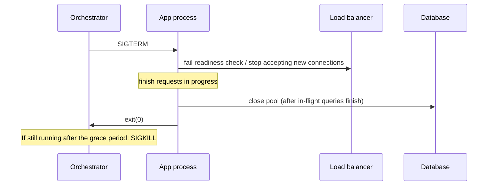
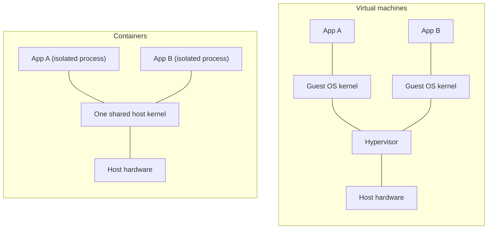

# Signals, IPC and Containers

[Home](../README.md) › [Operating Systems](README.md) › Signals, IPC and Containers

> **In one sentence:** Signals are how the OS and other processes interrupt your process, IPC is how processes exchange data, and a container is just a normal process that the kernel has isolated with namespaces and limited with cgroups.

**Before this:** [Processes and threads](01-processes-threads-scheduling.md), [Files and I/O](04-files-and-io.md).
**After this:** [Errors and process lifecycle](../06-nodejs/05-errors-and-process-lifecycle.md), [deployment and operations](../08-backend-engineering/09-deployment-and-operations.md).

## Signals

A **signal** is a small asynchronous notification sent to a process. The process can install a **handler** for most signals, ignore them, or accept the default action.

| Signal | Number | Default | Typical source | Can be handled? |
|---|---|---|---|---|
| `SIGINT` | 2 | Terminate | Ctrl+C in a terminal | Yes |
| `SIGTERM` | 15 | Terminate | `kill <pid>`, Docker stop, Kubernetes pod shutdown | Yes |
| `SIGKILL` | 9 | Terminate immediately | `kill -9`, OOM killer, shutdown timeout expired | **No** |
| `SIGSTOP` | 19 | Pause | Debuggers, job control | **No** |
| `SIGHUP` | 1 | Terminate | Terminal closed; by convention "reload config" for daemons | Yes |
| `SIGSEGV` | 11 | Terminate + core dump | Invalid memory access | Yes, but rarely useful |
| `SIGPIPE` | 13 | Terminate | Write to a pipe or socket with no reader | Yes (Node.js ignores it) |
| `SIGCHLD` | 17 | Ignore | A child process exited | Yes |
| `SIGUSR1`, `SIGUSR2` | 10, 12 | Terminate | Application-defined | Yes |

Two facts to remember:

- **`SIGTERM` is a polite request.** The process can clean up and exit. This is the signal orchestrators send first.
- **`SIGKILL` cannot be caught.** The kernel removes the process immediately. No cleanup, no logs, open transactions are abandoned. A process killed by signal `N` has exit code `128 + N`, so 137 means `SIGKILL` and 143 means `SIGTERM`.

### Graceful shutdown

When a deployment replaces your service, the orchestrator sends `SIGTERM`, waits for a grace period (30 seconds by default in Kubernetes), then sends `SIGKILL`.

If your process ignores `SIGTERM`, requests in progress are cut off when `SIGKILL` arrives. A correct shutdown is:



```js
import http from 'node:http';

const server = http.createServer(handler);
server.listen(3000);

let shuttingDown = false;
async function shutdown(signal) {
  if (shuttingDown) return;          // a second signal should not restart the process
  shuttingDown = true;
  console.log(`${signal} received, shutting down`);

  // Safety net: never hang forever.
  setTimeout(() => process.exit(1), 25_000).unref();

  server.close(async () => {         // stop accepting; wait for in-flight requests
    await db.end();                  // then release other resources
    process.exit(0);
  });
  server.closeIdleConnections();     // drop keep-alive connections that are idle
}

process.on('SIGTERM', () => shutdown('SIGTERM'));
process.on('SIGINT', () => shutdown('SIGINT'));
```

The full pattern, including readiness probes, is in [errors and process lifecycle](../06-nodejs/05-errors-and-process-lifecycle.md).

### The PID 1 problem

Inside a container, the first process has PID 1. The kernel treats PID 1 specially:

- **Signals with no handler are ignored** instead of using the default action. A Node.js app as PID 1 with no `SIGTERM` handler does not stop on `docker stop`. It waits for the timeout and then gets `SIGKILL`.
- **PID 1 must reap orphaned child processes** (collect their exit status), or they stay as zombies.

A second trap: if the Dockerfile uses the shell form (`CMD npm start`) the real PID 1 is a shell, or `npm`, which may not forward signals to your app. Use the exec form and run `node` directly:

```dockerfile
CMD ["node", "dist/main.js"]
```

Or use a small init process (`docker run --init`, or `tini`) that forwards signals and reaps zombies.

## Inter-process communication (IPC)

Processes have separate memory, so they need explicit channels to exchange data.

| Mechanism | What it is | Typical use |
|---|---|---|
| **Pipe** | One-way byte stream between related processes | Shell pipelines; a parent reading a child's stdout |
| **Named pipe (FIFO)** | A pipe with a name in the file system | Simple communication between unrelated processes |
| **Unix domain socket** | A socket identified by a file path. Two-way. Stays inside the kernel | Local services: PostgreSQL on `/var/run/postgresql/.s.PGSQL.5432`, the Docker daemon |
| **TCP / UDP socket** | A network socket | Any communication that may cross machines |
| **Shared memory** | Several processes map the same physical pages | Highest speed; needs synchronization. PostgreSQL's shared buffers |
| **Signals** | Notifications with almost no data | Lifecycle control |
| **Message queues** | Kernel-managed queues of messages | Rare in new code; brokers like RabbitMQ are used instead |
| **Files** | Shared files, sometimes with locks | Simple and slow; lock files |

### Unix domain sockets versus TCP on localhost

Both connect two processes on the same machine. A Unix domain socket skips the network stack (no IP headers, no checksums, no routing), so it has less overhead. Access is controlled by file permissions.

Use a Unix socket when both processes are always on one machine (an app and a local proxy or a sidecar). Use TCP when they might be separated later.

### IPC in Node.js

- `child_process.spawn()` connects to the child's stdin, stdout and stderr through **pipes**.
- `child_process.fork()` and `cluster` add an **IPC channel** for `process.send()` and `'message'` events. Messages are serialized, so they are copied, not shared.
- `worker_threads` are not processes, but they communicate in a similar way with `postMessage`. They can also share memory with `SharedArrayBuffer`.

See [scaling CPU work](../06-nodejs/04-scaling-cpu-work.md).

## Containers

A container is **not** a small virtual machine. It is one or more ordinary Linux processes, running on the host's kernel, that have been given a restricted view of the system.



| | Virtual machine | Container |
|---|---|---|
| Kernel | Its own | Shared with the host |
| Start time | Seconds to minutes | Milliseconds to seconds |
| Overhead | A full OS per VM | Almost none |
| Isolation strength | Strong (hardware virtualization) | Weaker (a kernel bug affects all containers) |

Three kernel features build a container.

### 1. Namespaces: what a process can see

A **namespace** gives a process its own private copy of one kind of global resource.

| Namespace | Isolates |
|---|---|
| **PID** | Process IDs. The container's first process sees itself as PID 1 |
| **Network** | Network interfaces, IP addresses, ports, routing tables |
| **Mount** | The file system tree |
| **UTS** | Hostname |
| **IPC** | Shared memory and message queues |
| **User** | User and group IDs. Root inside can be a normal user outside |

Because each container has its own network namespace, two containers can both listen on port 3000. Publishing a port (`-p 8080:3000`) creates a rule that forwards host port 8080 to the container.

### 2. Cgroups: what a process can use

**Control groups (cgroups)** limit and measure the resources of a group of processes: CPU, memory, disk I/O, and the number of processes.

- **Memory limit.** If the group goes above it, the kernel's OOM killer kills a process in the group. This is the `OOMKilled` status and exit code 137. See [memory management](02-memory-management.md#when-memory-runs-out).
- **CPU limit.** Enforced by time quota: for example, "200 ms of CPU per 100 ms period" means 2 cores. When the quota is used up, the processes are **throttled**: paused until the next period. This causes latency spikes that do not show as high CPU usage.

An important trap for Node.js: a container limited to 1 CPU on a 64-core host may still see 64 cores through older APIs. A process that starts one worker per reported core will start 64 workers and fight for 1 CPU of quota. `os.availableParallelism()` is the right call for sizing worker pools, but check what it returns in your environment, and prefer explicit configuration for anything important.

### 3. Layered file systems: what a process starts with

A container **image** is a stack of read-only layers. Each instruction in a Dockerfile creates a layer. When a container starts, a thin writable layer is put on top (a union file system such as OverlayFS).

- Layers are shared between images and cached. This makes builds and pulls fast.
- Changes inside a running container go to the writable layer and **are lost** when the container is removed. Persistent data must go to a volume or an external store. This pushes you toward **stateless** application processes, which is exactly what horizontal scaling needs. See [deployment](../08-backend-engineering/09-deployment-and-operations.md).

Layer order matters for build speed: put things that change rarely (dependency installation) before things that change often (your source code).

```dockerfile
FROM node:24-slim
WORKDIR /app
COPY package*.json ./
RUN npm ci --omit=dev          # cached until package files change
COPY dist ./dist               # changes on every build
USER node                      # do not run as root
CMD ["node", "dist/main.js"]   # exec form: node is PID 1 and gets signals
```

## How this connects

- **`SIGTERM` handling** is the OS half of graceful shutdown. The Node.js half is in [errors and process lifecycle](../06-nodejs/05-errors-and-process-lifecycle.md).
- **`SIGKILL` from the OOM killer** links back to [memory management](02-memory-management.md).
- **Pipes and IPC channels** are how [child processes and cluster workers](../06-nodejs/04-scaling-cpu-work.md) talk to each other.
- **Network namespaces** explain container networking, and why `localhost` inside a container is not the host. See [layers, IP and routing](../03-networking/01-layers-ip-routing.md).
- **Cgroup limits** decide how you size the V8 heap and worker counts. See [deployment](../08-backend-engineering/09-deployment-and-operations.md).
- **Ephemeral container file systems** are a reason services are designed to be stateless. See [system design building blocks](../10-system-design/02-building-blocks.md).

## Interview questions

<details>
<summary><strong>🟢 Q1. What is the difference between SIGTERM and SIGKILL?</strong></summary>

`SIGTERM` asks the process to terminate. The process can catch it, finish its work, release resources, and exit cleanly. `SIGKILL` cannot be caught, blocked or ignored. The kernel ends the process immediately, with no cleanup.

Orchestrators like Kubernetes send `SIGTERM` first, wait for a grace period, and send `SIGKILL` only if the process is still running. So a well-behaved service must handle `SIGTERM`.

</details>

<details>
<summary><strong>🟢 Q2. How is a container different from a virtual machine?</strong></summary>

A virtual machine runs its own complete operating system on virtual hardware provided by a hypervisor. A container is a normal process on the host's kernel. The kernel isolates it with namespaces, so it has its own view of processes, network and file system, and limits it with cgroups.

Containers start faster and use fewer resources, because there is no second kernel. Virtual machines give stronger isolation, because they do not share a kernel.

</details>

<details>
<summary><strong>🟡 Q3. How do you implement graceful shutdown in a Node.js service?</strong></summary>

I listen for `SIGTERM` and `SIGINT`. In the handler I first stop taking new work: I mark the service as not ready, so the load balancer stops sending traffic, and I call `server.close()`, which stops accepting new connections and waits for the current requests to finish. I also close idle keep-alive connections, because they would otherwise keep the server open.

After the requests finish, I close the database pool, the queue consumers and other resources, and then exit with code zero. I also set a timeout a bit shorter than the orchestrator's grace period, so that if something hangs I exit by myself instead of being killed.

</details>

<details>
<summary><strong>🟡 Q4. What are namespaces and cgroups?</strong></summary>

They are the two Linux kernel features that containers are built on. Namespaces control what a process can see. There are namespaces for process IDs, network, mounts, hostname, IPC and users. A process in its own PID and network namespace sees only its own processes and its own network interfaces.

Cgroups control what a process can use. They set limits and collect usage for CPU, memory, I/O and number of processes. When a container goes over its memory limit, the kernel kills it. When it goes over its CPU quota, it is throttled.

</details>

<details>
<summary><strong>🟡 Q5. <code>docker stop</code> takes 10 seconds on your Node.js container and then kills it. Why?</strong></summary>

`docker stop` sends `SIGTERM` and waits 10 seconds before sending `SIGKILL`. So the application did not exit on `SIGTERM`. There are two common reasons.

First, Node is PID 1 in the container and has no handler for `SIGTERM`. For PID 1, the kernel does not apply the default action, so the signal is ignored.

Second, the container starts through a shell or through `npm start`. Then the shell or npm is PID 1, and it may not forward the signal to the Node process.

The fix is to use the exec form of `CMD` to run `node` directly, add a `SIGTERM` handler that shuts down cleanly, and optionally use an init process like tini.

</details>

<details>
<summary><strong>🔴 Q6. Your service has latency spikes every few hundred milliseconds, but CPU usage looks moderate. It runs in Kubernetes with a CPU limit. What do you check?</strong></summary>

I would check CPU throttling. A CPU limit is enforced with a quota per period, usually 100 milliseconds. If the process uses its whole quota early in the period, it is paused until the next period starts. Average CPU usage can look fine while the process is frozen for tens of milliseconds at a time.

It is worse when the process has more threads than its quota allows, for example a Node.js process with the libuv thread pool, garbage collector threads, and worker threads all running at once.

I would look at the container's throttling metrics, which come from the cgroup CPU statistics. Fixes include raising or removing the CPU limit while keeping the request, reducing the number of threads, or sizing worker pools to the quota instead of the host's core count.

</details>

<details>
<summary><strong>🔴 Q7. Why should a containerized service not write important data to its local file system?</strong></summary>

A container's file system is a writable layer on top of the read-only image layers. That layer is deleted when the container is removed, and a new container starts from the image again. Containers are replaced often: on every deploy, on a crash, when the scheduler moves them to another node. So local data disappears.

It also blocks horizontal scaling: if there are three replicas, data written by one is invisible to the others. So application processes should be stateless. State goes to a database, an object store, or a mounted volume that has its own lifecycle.

</details>

## Key takeaways

- `SIGTERM` can be handled and is the request to shut down. `SIGKILL` cannot be handled. Exit code = 128 + signal number.
- Graceful shutdown: stop accepting, finish in-flight work, close resources, exit, with a timeout.
- In a container, run `node` directly as PID 1 (exec form) and handle signals, or use an init process.
- IPC options: pipes, Unix sockets, TCP sockets, shared memory. Messages are copied; shared memory is not.
- Container = process + namespaces (what it sees) + cgroups (what it can use) + layered file system.
- Memory limits kill. CPU limits throttle. Container file systems are temporary.

---

← [I/O Multiplexing](05-io-multiplexing.md) | Next: [03 Networking →](../03-networking/README.md)
