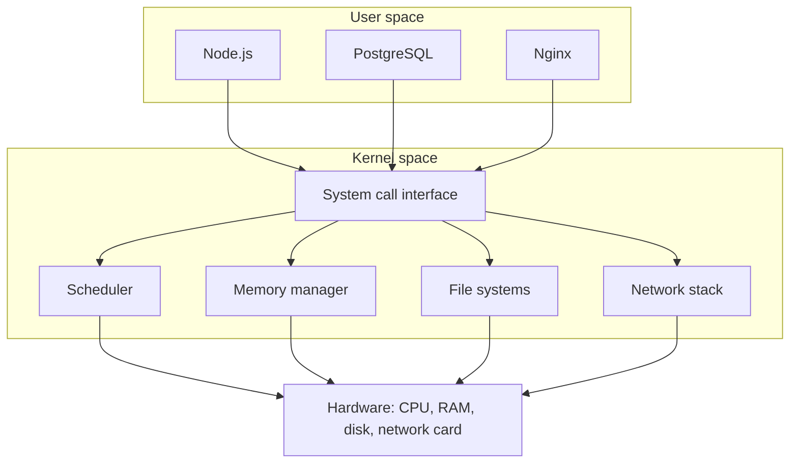

# 02 — Operating Systems

[Home](../README.md) › Operating Systems

The operating system is the layer between your program and the hardware. Node.js, PostgreSQL, Redis and Nginx are all ordinary programs that ask the OS for everything: CPU time, memory, files and network connections. To understand how they behave under load, you need to know what the OS gives them and what it costs.

Linux is the reference system in this section.

## Pages

| # | Page | What you will understand |
|---|---|---|
| 1 | [Processes, Threads and Scheduling](01-processes-threads-scheduling.md) | What a process is, how threads differ, how the kernel shares CPU time, the cost of a context switch |
| 2 | [Memory Management](02-memory-management.md) | Virtual memory, paging, stack and heap, the page cache, the OOM killer |
| 3 | [Concurrency and Synchronization](03-concurrency-and-synchronization.md) | Race conditions, mutexes, semaphores, deadlock, atomic operations |
| 4 | [Files and I/O](04-files-and-io.md) | File descriptors, system calls, buffered I/O, `fsync`, blocking and non-blocking I/O |
| 5 | [I/O Multiplexing](05-io-multiplexing.md) | `select`, `poll`, `epoll`, `kqueue`, `io_uring`: how one thread serves thousands of connections |
| 6 | [Signals, IPC and Containers](06-signals-ipc-containers.md) | Signals, pipes, sockets, namespaces and cgroups: what a container really is |

## The central idea

A program cannot touch hardware directly. It asks the kernel through **system calls** (`read`, `write`, `open`, `socket`, `mmap`, `fork`...). The kernel checks the request, does the work, and returns. This boundary is what makes it safe for many programs to share one machine.

## How this section connects to the rest

| OS concept | Where it shows up |
|---|---|
| Threads and context switches | Why Node.js uses one thread plus an event loop instead of a thread per request: [Node.js architecture](../06-nodejs/01-architecture.md) |
| `epoll` | The mechanism under libuv and the [event loop](../06-nodejs/02-event-loop.md) |
| Processes and `fork` | [Cluster and child processes](../06-nodejs/04-scaling-cpu-work.md); PostgreSQL's process-per-connection model and the need for [connection pooling](../07-databases/11-data-access-from-node.md) |
| Virtual memory and the page cache | [V8 heap](../04-javascript/06-memory-garbage-collection.md); the database [buffer pool](../07-databases/04-storage-internals.md) |
| `fsync` | Database durability and the [WAL](../07-databases/04-storage-internals.md) |
| Locks and deadlocks | [Database locking](../07-databases/08-locking.md); distributed locks in [consensus and coordination](../09-distributed-systems/03-consensus-coordination.md) |
| Sockets and file descriptors | [TCP](../03-networking/02-tcp-udp.md); "too many open files" in the [debugging playbook](../13-end-to-end/03-production-debugging-playbook.md) |
| Signals | [Graceful shutdown](../06-nodejs/05-errors-and-process-lifecycle.md) |
| Namespaces and cgroups | Docker and Kubernetes in [deployment](../08-backend-engineering/09-deployment-and-operations.md) |

## Primary sources

- Arpaci-Dusseau, *Operating Systems: Three Easy Pieces* (free online).
- Kerrisk, *The Linux Programming Interface*.
- Linux `man` pages, sections 2 (system calls) and 7 (overviews such as `epoll(7)`, `signal(7)`, `cgroups(7)`).

---

← [Hardware and Latency](../01-computer-foundations/02-hardware-and-latency.md) | Next: [Processes, Threads and Scheduling →](01-processes-threads-scheduling.md)
