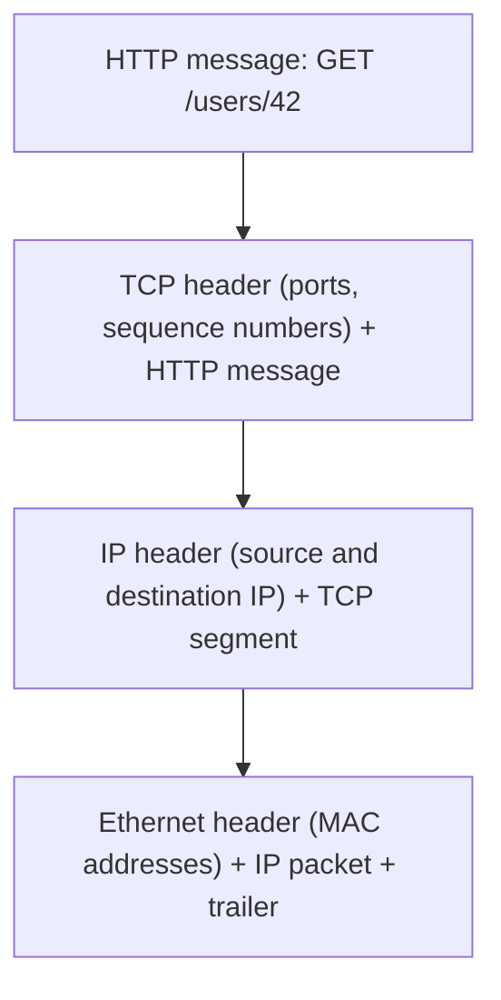
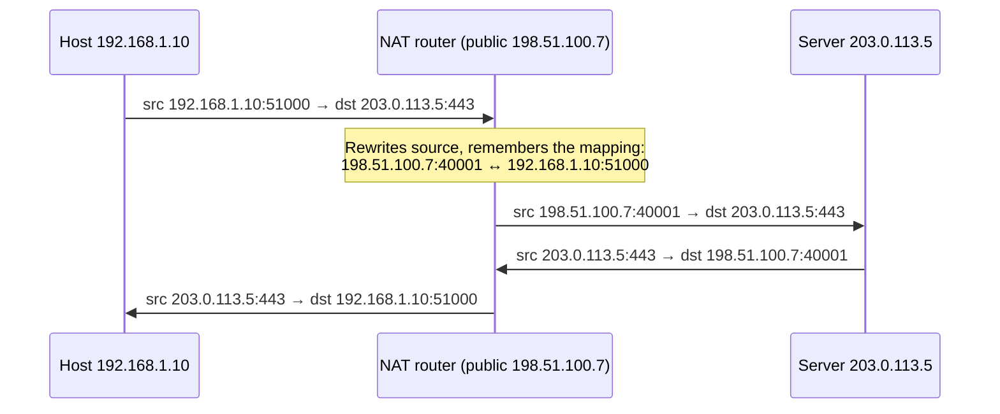

# Layers, IP and Routing

[Home](../README.md) › [Networking](README.md) › Layers, IP and Routing

> **In one sentence:** The internet is a network of networks where each packet carries a destination IP address and every router on the way independently forwards it one hop closer, with no guarantee that it arrives.

**Before this:** [Data representation](../01-computer-foundations/01-data-representation.md).
**After this:** [TCP and UDP](02-tcp-udp.md), [DNS](03-dns.md).

## Why layers

Sending data between two programs involves many separate problems: electrical signals, finding a route, handling lost data, encryption, and the meaning of the message. Networking splits these into **layers**. Each layer solves one problem and offers a simple service to the layer above.

Two models describe the layers. The **OSI model** has 7 layers and is used as vocabulary ("a layer 4 load balancer", "a layer 7 firewall"). The **TCP/IP model** has 4 layers and matches real implementations.

| OSI # | OSI name | TCP/IP layer | Examples | Addressing |
|---|---|---|---|---|
| 7 | Application | Application | HTTP, DNS, SMTP, gRPC | URLs, hostnames |
| 6 | Presentation | Application | TLS, compression, encodings | |
| 5 | Session | Application | (mostly merged into applications) | |
| 4 | Transport | Transport | TCP, UDP, QUIC | Ports |
| 3 | Network | Internet | IP, ICMP | IP addresses |
| 2 | Data link | Link | Ethernet, Wi-Fi | MAC addresses |
| 1 | Physical | Link | Cables, radio | |

The numbers you will hear most are **L3** (IP), **L4** (TCP/UDP) and **L7** (HTTP).

### Encapsulation

Each layer wraps the data from the layer above with its own header.



The receiver removes the headers in the reverse order. A router only looks at the IP header. It does not know or care that the payload is HTTP. This separation is why new application protocols can be created without changing routers.

## IP addresses

An **IP address** identifies a network interface.

- **IPv4:** 32 bits, written as four numbers: `192.168.1.10`. About 4.3 billion addresses, which is not enough for the world.
- **IPv6:** 128 bits, written in hex groups: `2001:db8::1`. Practically unlimited.

### Subnets and CIDR

An address has two parts: the **network** part and the **host** part. **CIDR notation** says how many leading bits are the network part.

```
10.0.1.37/24
└─ network: 10.0.1    host: 37      (24 network bits, 8 host bits → 256 addresses)

10.0.0.0/16   → 65,536 addresses  (10.0.0.0 – 10.0.255.255)
10.0.0.0/8    → about 16.7 million addresses
```

Hosts in the same subnet can reach each other directly. Traffic to another subnet goes through a **router** (the "default gateway").

You use this when you design cloud networks: a VPC with CIDR `10.0.0.0/16`, a public subnet `10.0.1.0/24` for load balancers, and private subnets for application servers and databases.

### Special addresses

| Range | Meaning |
|---|---|
| `127.0.0.0/8` (`::1` in IPv6) | **Loopback**: the same machine. `localhost` |
| `10.0.0.0/8`, `172.16.0.0/12`, `192.168.0.0/16` | **Private** addresses. Not routed on the public internet |
| `0.0.0.0` | When binding: "all interfaces on this machine" |
| `169.254.0.0/16` | Link-local. Cloud metadata services live at `169.254.169.254` |

### 127.0.0.1 versus 0.0.0.0

This is a classic deployment bug.

```js
server.listen(3000, '127.0.0.1');  // only reachable from the same machine (or same container)
server.listen(3000, '0.0.0.0');    // reachable on every network interface
```

Inside a container, `127.0.0.1` is the container's own loopback interface, because each container has its own [network namespace](../02-operating-systems/06-signals-ipc-containers.md#1-namespaces-what-a-process-can-see). A server bound to `127.0.0.1` in a container cannot be reached from outside it, even with a published port. And from inside a container, `localhost` does not mean the host machine.

## Ports

An IP address identifies a machine. A **port** (a 16-bit number, 0–65535) identifies a program on that machine.

| Port | Service |
|---|---|
| 22 | SSH |
| 53 | DNS |
| 80 | HTTP |
| 443 | HTTPS |
| 5432 | PostgreSQL |
| 6379 | Redis |
| 27017 | MongoDB |

Ports below 1024 need special privileges to bind. When a client connects, the OS gives it a temporary **ephemeral port** (often in the range 32768–60999 on Linux).

A TCP connection is identified by four values, the **4-tuple**:

```
(source IP, source port, destination IP, destination port)
```

This is how one server port can serve many clients: each connection has a different source IP or source port. It also creates a limit in the other direction: one client IP talking to one server IP and port can have at most about 28,000–64,000 connections (the ephemeral port range). A service that opens a new connection for every outgoing request can hit **ephemeral port exhaustion**. The fix is connection reuse (keep-alive, pooling).

## How a packet travels

IP is **connectionless** and **best-effort**. Each packet is forwarded independently. It can be lost, duplicated, delayed, or arrive out of order. IP does not fix any of that. Reliability is the job of [TCP](02-tcp-udp.md).


At each hop:

1. The router reads the destination IP.
2. It looks in its **routing table** for the most specific matching prefix (**longest prefix match**).
3. It forwards the packet to the next hop.
4. It decreases the packet's **TTL** (Time To Live) by 1. If TTL reaches 0, the packet is dropped. This stops packets from looping forever.

Routers exchange route information with routing protocols. **BGP** connects the large networks of the internet. A wrong BGP announcement can make large parts of the internet unreachable, and has caused several famous outages.

### The link layer, briefly

On one local network, delivery uses **MAC addresses** (hardware addresses). To send an IP packet to a neighbor, a host needs the neighbor's MAC address. **ARP** (Address Resolution Protocol) answers "who has IP 10.0.1.5?".

So the IP addresses in a packet stay the same from end to end (except with NAT), while the MAC addresses change at every hop.

### MTU and fragmentation

Each link has a **Maximum Transmission Unit**: the largest packet it can carry. For Ethernet this is 1,500 bytes. TCP splits your data into segments that fit (the **MSS**, usually 1,460 bytes of payload after 20 bytes of IP header and 20 bytes of TCP header).

This is why a 1 MB HTTP response is roughly 700 packets, and why "one `write` call" is not "one packet".

## NAT

There are not enough IPv4 addresses, so most devices have **private** addresses. **Network Address Translation** lets many private hosts share one public address.



Consequences for backend engineers:

- **The server does not see the client's real address.** It sees the NAT's public address. Many users (a whole office or a mobile carrier) can share one IP, so **rate limiting by IP alone is unfair**.
- Behind your own load balancer, the socket's remote address is the load balancer. The original client IP is passed in the `X-Forwarded-For` header, which can be faked unless you only trust it from your own proxies. See [proxies and load balancers](08-proxies-load-balancers-cdn.md).
- **NAT mappings expire.** An idle connection can be silently forgotten by a NAT device or a cloud load balancer (often after a few minutes). The next packet goes nowhere. This is why long-lived connections need keep-alive messages or heartbeats. See [TCP](02-tcp-udp.md) and [WebSockets](07-websockets-sse-realtime.md).
- In the cloud, servers in private subnets reach the internet through a **NAT gateway**, which has a limit on simultaneous connections to one destination.

## Firewalls and security groups

A **firewall** allows or blocks packets by rules on addresses, ports and protocols. Cloud **security groups** are stateful firewalls attached to instances: you allow inbound port 443 from anywhere, and port 5432 only from the application servers' group.

The principle is **least privilege**: a database should never be reachable from the public internet. See [web security](../08-backend-engineering/03-web-security.md).

When a firewall drops packets silently, the client does not get an error. It waits until its timeout. That is the difference between two common errors:

| Error in Node.js | What happened |
|---|---|
| `ECONNREFUSED` | The host answered "nothing listens on this port" (a TCP reset). Fast failure. The service is down or the port is wrong |
| `ETIMEDOUT` | No answer at all. A firewall dropped the packet, the host is down, or the route is broken |
| `ENOTFOUND` | DNS could not resolve the name. See [DNS](03-dns.md) |
| `ECONNRESET` | An existing connection was closed abruptly by the other side or by a device in between |
| `EHOSTUNREACH` | No route to that host |

## Tools

```bash
ip addr                     # interfaces and addresses of this machine
ip route                    # routing table
ping example.com            # is the host reachable? (ICMP; often blocked)
traceroute example.com      # the routers on the path
ss -tlnp                    # which ports are listening, and which process owns them
ss -s                       # summary of socket counts
nc -vz db.internal 5432     # can I open a TCP connection to this port?
curl -v https://example.com # full HTTP exchange with headers and timing
tcpdump -i any port 443     # capture packets (needs root)
```

## How this connects

- **IP gives no guarantees.** TCP adds reliability on top. See [TCP and UDP](02-tcp-udp.md). At a larger scale, the same unreliability is the starting point of [distributed systems](../09-distributed-systems/01-fundamentals.md).
- **Names to addresses** is the job of [DNS](03-dns.md).
- **Network namespaces** give each container its own interfaces and loopback. See [containers](../02-operating-systems/06-signals-ipc-containers.md).
- **L4 versus L7** is the main distinction between kinds of [load balancers](08-proxies-load-balancers-cdn.md).
- **Client IP behind NAT and proxies** affects [rate limiting](../10-system-design/05-case-rate-limiter.md) and logging.
- **The error codes above** are the first clue in the [debugging playbook](../13-end-to-end/03-production-debugging-playbook.md).

## Interview questions

<details>
<summary><strong>🟢 Q1. What is the difference between an IP address and a port?</strong></summary>

An IP address identifies a network interface, so it gets a packet to the right machine. A port is a 16-bit number that identifies a specific program or service on that machine. The operating system uses the port to deliver incoming data to the right socket.

A TCP connection is identified by four values: source IP, source port, destination IP and destination port. That is why one server port can handle many clients at the same time.

</details>

<details>
<summary><strong>🟢 Q2. What do "layer 4" and "layer 7" mean?</strong></summary>

They come from the OSI model. Layer 4 is the transport layer: TCP and UDP. Something that works at layer 4 sees IP addresses, ports and connections, but not the content. Layer 7 is the application layer: HTTP and similar protocols. Something at layer 7 can read URLs, headers and cookies.

So a layer 4 load balancer forwards connections without understanding them, which is fast. A layer 7 load balancer can route by path or host, terminate TLS, and retry requests, but does more work per request.

</details>

<details>
<summary><strong>🟡 Q3. Your Node.js server works on your laptop, but in Docker the published port does not respond. What is a likely cause?</strong></summary>

The server is probably listening on `127.0.0.1`. Inside a container, that is the container's own loopback interface. Traffic forwarded from the host arrives on the container's other interface, so nothing accepts it.

The fix is to listen on `0.0.0.0`, which means all interfaces in the container. I would also check that the port mapping matches the port the application really listens on.

</details>

<details>
<summary><strong>🟡 Q4. What is NAT, and what problems does it create for a backend?</strong></summary>

NAT lets many devices with private addresses share one public IP address. The NAT device rewrites the source address and port of outgoing packets and keeps a table to translate the replies back.

For a backend it means three things. The IP address I see may represent many users, so rate limiting or blocking by IP is imprecise. Behind my own proxies I must read the client IP from a header like `X-Forwarded-For`, and only trust it from my own infrastructure. And NAT devices drop idle mappings, so long-lived idle connections can die silently, which is why they need keep-alives or heartbeats.

</details>

<details>
<summary><strong>🟡 Q5. What is the difference between <code>ECONNREFUSED</code> and <code>ETIMEDOUT</code>?</strong></summary>

`ECONNREFUSED` means my connection attempt reached the host and the host actively rejected it, because nothing is listening on that port. It fails immediately. It usually means the service is down, still starting, or I have the wrong port.

`ETIMEDOUT` means I got no answer at all within the timeout. The packets were dropped somewhere: a firewall or security group rule, a host that is down, or a routing problem. It fails slowly, which is more dangerous, because requests pile up while they wait.

</details>

<details>
<summary><strong>🔴 Q6. A service that calls another API heavily starts failing with <code>EADDRNOTAVAIL</code> or connection errors under load. CPU and memory are fine. What could it be?</strong></summary>

It could be ephemeral port exhaustion. Every outgoing TCP connection needs a local port from a limited range, around 28,000 by default on Linux. Connections to the same destination IP and port must each use a different source port. If the service opens a new connection for every request, and closed connections stay in the `TIME_WAIT` state for a while, it can run out.

I would check the number of sockets and their states with `ss -s`. The real fix is connection reuse: an HTTP agent with keep-alive and a limit on sockets, or a connection pool. If the traffic goes through a cloud NAT gateway, that gateway has a similar per-destination limit, and the same fix applies.

</details>

## Key takeaways

- Layers separate concerns. L3 = IP, L4 = TCP/UDP, L7 = HTTP.
- IP is best-effort: packets can be lost, duplicated or reordered.
- CIDR `/n` means the first `n` bits are the network part.
- A port identifies a program. A connection is identified by the 4-tuple.
- Bind to `0.0.0.0` in containers. `127.0.0.1` is only the local namespace.
- NAT hides client addresses and silently drops idle connections.
- `ECONNREFUSED` = rejected quickly. `ETIMEDOUT` = no answer.

---

← [Networking](README.md) | Next: [TCP and UDP →](02-tcp-udp.md)
