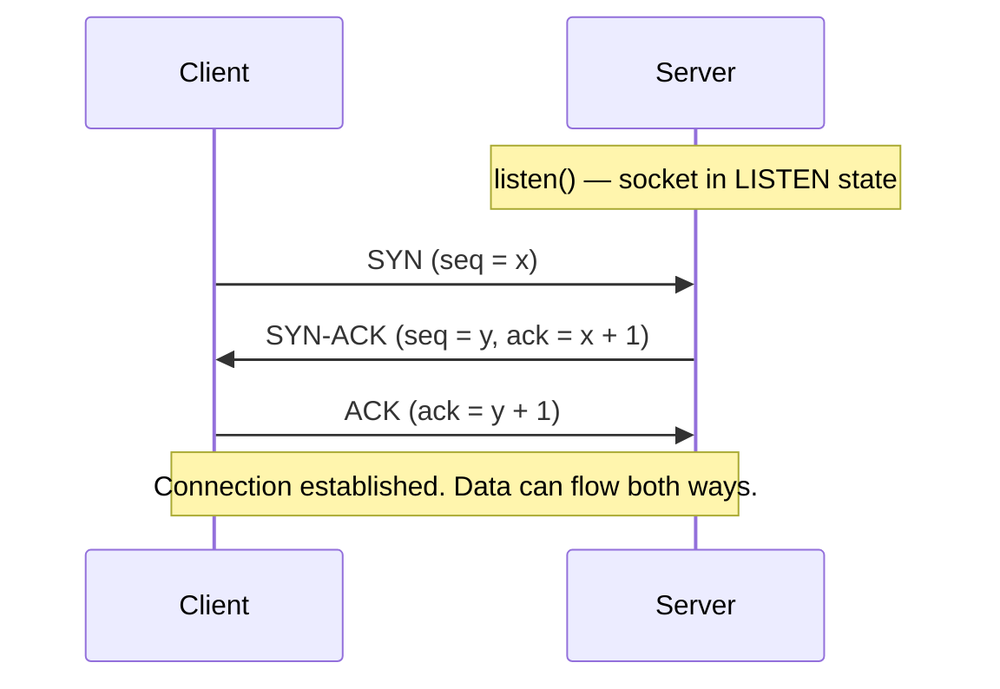
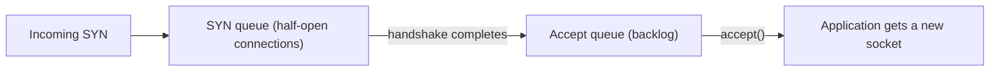
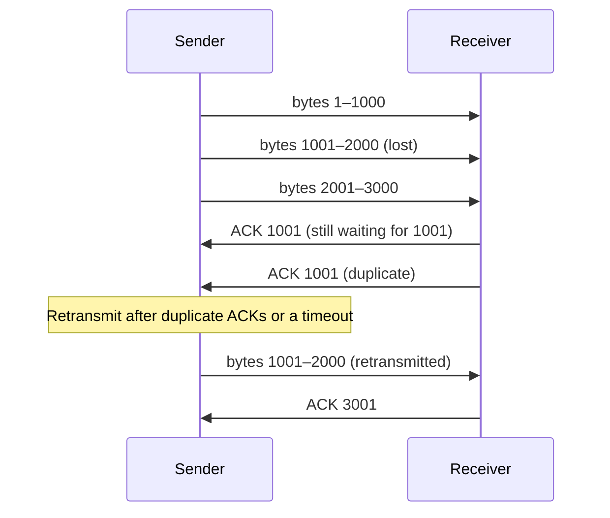
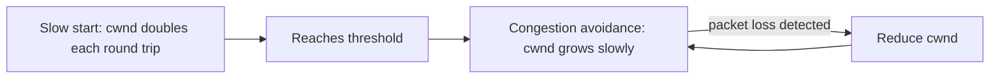
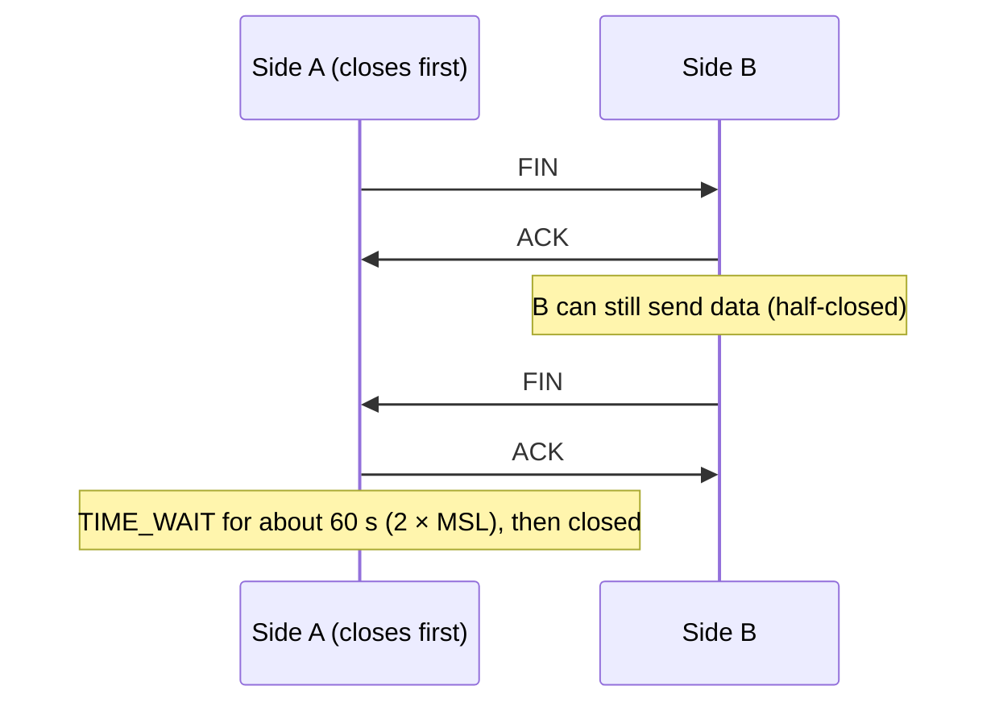
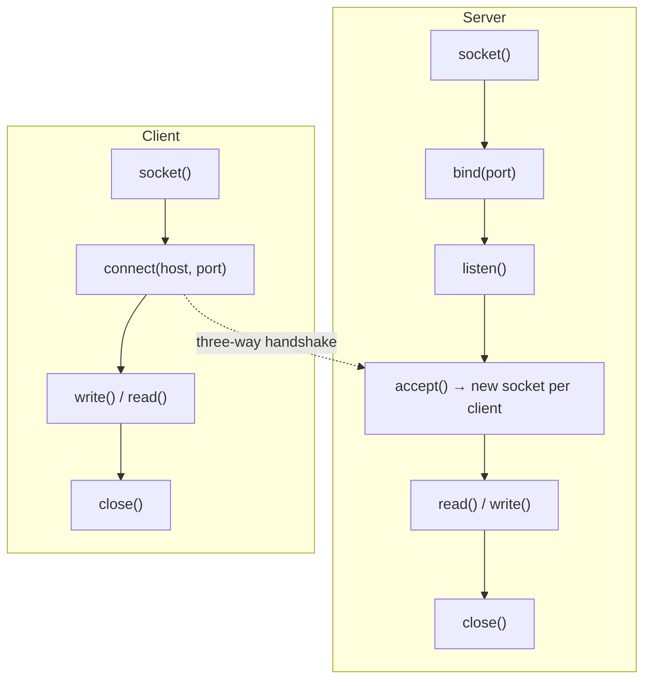

# TCP and UDP

[Home](../README.md) › [Networking](README.md) › TCP and UDP

> **In one sentence:** TCP turns unreliable IP packets into a reliable, ordered stream of bytes between two programs, and it pays for that with handshakes, waiting, and retransmission, while UDP adds only ports and leaves everything else to the application.

**Before this:** [Layers, IP and routing](01-layers-ip-routing.md).
**After this:** [TLS](04-tls-https.md), [HTTP](05-http-fundamentals.md), [HTTP/2 and HTTP/3](06-http2-http3.md).

## What TCP promises

IP can lose, duplicate, reorder and corrupt packets. TCP gives the application:

| Guarantee | Mechanism |
|---|---|
| **Reliable delivery** | Acknowledgments and retransmission |
| **Ordered delivery** | Sequence numbers |
| **No duplicates, no corruption** | Sequence numbers and checksums |
| **Flow control** (do not overwhelm the receiver) | Receive window |
| **Congestion control** (do not overwhelm the network) | Congestion window |
| **Connection-oriented** | Handshake to open, handshake to close |

What TCP does **not** give:

- **Message boundaries.** TCP is a stream of bytes. If you write 100 bytes and then 200 bytes, the receiver may read 300 bytes at once, or 50 and then 250. Applications must add their own **framing**: a length prefix (PostgreSQL protocol, HTTP/2), a delimiter (`\r\n` in Redis and HTTP/1.1 headers), or a `Content-Length` header.
- **Timing guarantees.** Data arrives eventually, or the connection fails after a long time.
- **Security.** TCP is plain text. That is the job of [TLS](04-tls-https.md).

## Opening a connection: the three-way handshake



1. **SYN:** the client chooses a random initial sequence number and asks to connect.
2. **SYN-ACK:** the server acknowledges and sends its own initial sequence number.
3. **ACK:** the client acknowledges the server's number.

Three messages are needed so that **both** sides know that the other side received their sequence number.

**Cost: one full round trip before any data can be sent.** With a 100 ms round-trip time, that is 100 ms of pure waiting. TLS adds more (see [TLS](04-tls-https.md)). This is the single most important reason for **connection reuse**:

- HTTP keep-alive: many requests on one connection.
- Database [connection pools](../07-databases/11-data-access-from-node.md): keep connections open and lend them to requests.
- HTTP/2: one connection for many parallel requests.

### On the server: listen, backlog, accept



The kernel completes handshakes by itself and puts finished connections in the **accept queue**. The application takes them with `accept()`. If the application is slow to accept (for example, a blocked event loop), the queue fills and new connections are dropped or delayed. `server.listen(port, host, backlog)` in Node.js sets the queue size, limited by the kernel setting `net.core.somaxconn`.

A **SYN flood** attack sends many SYNs without finishing the handshake, to fill the SYN queue. **SYN cookies** are the kernel's defense.

## Reliability: sequence numbers and ACKs

Every byte in the stream has a **sequence number**. The receiver sends **acknowledgments (ACKs)** that say "I have received all bytes up to N".



If a segment is lost, the sender finds out in one of two ways:

- **Retransmission timeout (RTO):** no ACK arrived in time. The timer is based on the measured round-trip time, with a minimum of about 200 ms on Linux, and it doubles on each retry (**exponential backoff**).
- **Fast retransmit:** three duplicate ACKs arrive, which means later segments got through but one is missing. The sender retransmits at once, without waiting for the timer.

### Head-of-line blocking

In the diagram, bytes 2001–3000 arrived, but the receiver's TCP **cannot give them to the application** until 1001–2000 arrives, because TCP promises order. One lost packet delays everything behind it.

This is **TCP head-of-line blocking**. It is the main reason HTTP/3 moved from TCP to QUIC. See [HTTP/2 and HTTP/3](06-http2-http3.md).

## Flow control

The receiver has a limited buffer. In every ACK it advertises its **receive window**: how many more bytes it can accept. The sender never sends more than that.

If the receiving application stops reading, the buffer fills, the window becomes zero, and the sender stops. This is **backpressure** built into TCP.

It connects directly to Node.js: when `socket.write()` returns `false`, the kernel send buffer and Node's internal buffer are full, usually because the other side is not reading fast enough. A program that ignores this and keeps writing fills its own memory. See [buffers and streams](../06-nodejs/03-buffers-and-streams.md).

## Congestion control

Flow control protects the receiver. **Congestion control** protects the network between them. If every sender transmitted as fast as possible, routers would overflow and drop packets, and the retransmissions would make it worse.

TCP keeps a **congestion window (cwnd)**: its own estimate of how much the network can take. The amount it can send is `min(cwnd, receive window)`.



- **Slow start:** a new connection starts with a small window (10 segments, about 14 KB) and doubles it each round trip.
- **Congestion avoidance:** after a threshold, growth becomes slow and linear.
- **On loss:** the window is reduced, because loss is taken as a sign of congestion.

Algorithms differ in the details. **CUBIC** is the Linux default and uses loss as its signal. **BBR** (from Google) estimates bandwidth and delay instead.

Practical effects:

- **New connections are slow at first.** A fresh connection cannot send a large response at full speed. A response larger than ~14 KB needs at least one more round trip. Another reason to reuse warm connections.
- **Packet loss hurts throughput much more than you expect**, because every loss cuts the sending rate.

## Closing a connection



Each direction is closed separately, so closing normally takes four messages.

- **Half-close:** after sending `FIN`, a side can still receive. In Node.js, `socket.end()` sends `FIN`, and the `'end'` event means the other side sent `FIN`.
- **`TIME_WAIT`:** the side that closes first keeps the connection's 4-tuple reserved for a while, so that late packets from the old connection cannot be confused with a new one. Many short connections leave many sockets in `TIME_WAIT`. This contributes to ephemeral port exhaustion (see [layers and IP](01-layers-ip-routing.md#ports)).
- **`RST` (reset):** an abrupt close. Sent when a packet arrives for a connection that does not exist, when a process closes a socket that still has unread data, or by firewalls and load balancers. In Node.js you see `ECONNRESET`.

### Why ECONNRESET happens in practice

The most common production cause is an **idle timeout mismatch** on kept-alive connections:

1. Your client keeps an idle connection in its pool.
2. The server (or a load balancer between you) closes idle connections after, say, 60 seconds.
3. At the same moment, your client sends a new request on that connection.
4. The request arrives at a closed socket. The reply is `RST`.

The fix is to make the **client's idle timeout shorter than the server's**, and the server's keep-alive timeout **longer than the load balancer's** idle timeout. In Node.js these are `server.keepAliveTimeout` and the agent's settings. Retrying idempotent requests on this error is also standard.

## TCP keep-alive and dead peers

If the other side disappears (power loss, cable pulled, NAT mapping expired), **TCP does not notice until it tries to send**. A connection that only waits to receive can stay "open" forever.

Two defenses:

- **TCP keep-alive:** the kernel sends small probes on idle connections and closes the connection if there is no answer. It is off by default, and the default delay is 2 hours on Linux, which is useless without tuning. In Node.js: `socket.setKeepAlive(true, initialDelayMs)`.
- **Application-level heartbeats and timeouts:** ping/pong frames in [WebSockets](07-websockets-sse-realtime.md), and request timeouts in every client. These are more reliable, because they also detect a peer that is alive but stuck.

**Do not confuse this with HTTP keep-alive**, which means "reuse this connection for several requests".

## Nagle's algorithm and delayed ACKs

- **Nagle's algorithm** delays sending small segments while earlier data is unacknowledged, to combine them into fewer packets.
- **Delayed ACK** makes the receiver wait a little (up to ~40 ms) before sending an ACK, hoping to attach it to outgoing data.

Together they can add a 40 ms delay to small request–response exchanges. Low-latency protocols disable Nagle with the `TCP_NODELAY` option. Node.js sets `noDelay` by default for HTTP connections, and you can call `socket.setNoDelay(true)` on raw sockets.

## UDP

UDP adds only two things to IP: **ports** and a **checksum**.

| | TCP | UDP |
|---|---|---|
| Connection | Yes (handshake) | No |
| Reliability | Yes | No |
| Ordering | Yes | No |
| Message boundaries | No (byte stream) | Yes (each datagram is one message) |
| Flow / congestion control | Yes | No |
| Header size | 20+ bytes | 8 bytes |
| Head-of-line blocking | Yes | No |

UDP is the right choice when:

- **Late data is useless.** Voice, video calls, online games. A retransmitted audio packet arrives too late to play.
- **The exchange is one small request and one small response.** [DNS](03-dns.md) queries. A handshake would double the cost.
- **You want to build your own transport.** **QUIC** (the base of HTTP/3) runs on UDP and implements reliability, ordering, congestion control and encryption in user space, with independent streams so that one lost packet does not block the others. See [HTTP/2 and HTTP/3](06-http2-http3.md).
- **Metrics and logs where loss is acceptable.** StatsD sends metrics over UDP.

## Sockets: the programming interface

A **socket** is the OS object that represents one end of a connection. It is a [file descriptor](../02-operating-systems/04-files-and-io.md).



The listening socket only accepts. Every accepted connection gets its **own new socket**, all sharing the same server port.

In Node.js, `net` is the direct wrapper:

```js
import net from 'node:net';

const server = net.createServer((socket) => {
  socket.setTimeout(30_000);                 // application-level idle timeout
  socket.on('timeout', () => socket.destroy());

  let buffered = '';
  socket.on('data', (chunk) => {
    buffered += chunk;                       // TCP is a stream: a chunk is NOT a message
    let index;
    while ((index = buffered.indexOf('\n')) !== -1) {   // framing by newline
      const line = buffered.slice(0, index);
      buffered = buffered.slice(index + 1);
      socket.write(`echo: ${line}\n`);
    }
  });

  socket.on('error', (err) => console.error(err.code));  // e.g. ECONNRESET
});

server.listen(4000);
```

The `while` loop is the important part. One `'data'` event can contain half a message, or three and a half. Every protocol on TCP needs this kind of framing code, and `http`, `pg` and `ioredis` all contain it.

## Timeouts: the only way to detect failure

A network cannot tell you "the other side is dead". You only see silence. So every network operation needs a timeout, and there are several different ones:

| Timeout | Protects against |
|---|---|
| **Connect timeout** | The host is unreachable or drops SYNs |
| **TLS handshake timeout** | A stuck handshake |
| **Request / response timeout** | The server accepted the request but never answers |
| **Idle (socket) timeout** | A connection with no activity |
| **Total deadline** | The sum of everything, including retries |

Many HTTP clients have no timeout by default, including Node's built-in `fetch` beyond its long internal defaults. A request without a timeout can hang until something else kills it, holding a socket, memory, and often a database connection.

```js
// Always set a deadline.
const res = await fetch(url, { signal: AbortSignal.timeout(3000) });
```

See [reliability patterns](../08-backend-engineering/06-reliability-patterns.md) for timeouts, retries and circuit breakers together.

## How this connects

- **Sockets are file descriptors** watched by `epoll`. See [I/O multiplexing](../02-operating-systems/05-io-multiplexing.md).
- **TCP is a stream, not messages.** Node.js streams and protocol parsers exist because of this. See [buffers and streams](../06-nodejs/03-buffers-and-streams.md).
- **Flow control is backpressure.** The same idea continues into Node.js streams and message queues. See [reliability patterns](../08-backend-engineering/06-reliability-patterns.md).
- **Handshake cost** drives keep-alive, pooling, and HTTP/2. See [HTTP fundamentals](05-http-fundamentals.md) and [data access](../07-databases/11-data-access-from-node.md).
- **Head-of-line blocking** explains the design of [HTTP/3](06-http2-http3.md).
- **Exponential backoff** in retransmission is the same idea you use for application retries. See [reliability patterns](../08-backend-engineering/06-reliability-patterns.md).
- **"You cannot tell slow from dead"** is the central problem of [distributed systems](../09-distributed-systems/01-fundamentals.md).

## Interview questions

<details>
<summary><strong>🟢 Q1. What is the difference between TCP and UDP? When would you use each?</strong></summary>

TCP is connection-oriented and reliable. It guarantees that bytes arrive, in order, without duplicates, and it has flow control and congestion control. The cost is a handshake, more overhead, and delays when packets are lost.

UDP is connectionless. It sends independent datagrams with no guarantee of delivery or order. It is fast and simple.

I use TCP when correctness matters: HTTP, database connections, file transfer. I use UDP when speed matters more than completeness, like voice, video and games, or for small request–response protocols like DNS. QUIC, which is used by HTTP/3, is built on UDP and adds its own reliability.

</details>

<details>
<summary><strong>🟢 Q2. Explain the TCP three-way handshake.</strong></summary>

The client sends a SYN segment with its initial sequence number. The server answers with SYN-ACK: it acknowledges the client's number and sends its own. The client answers with an ACK for the server's number. After that, both sides know the other is reachable and they agree on sequence numbers, so data can flow.

It costs one round trip before the first byte of data. That is why reusing connections with keep-alive or a pool is so important.

</details>

<details>
<summary><strong>🟡 Q3. TCP is called a "byte stream". What does that mean for application code?</strong></summary>

It means TCP does not keep message boundaries. If I send two messages with two writes, the receiver might get them in one read, or split across several reads in any way.

So every protocol on top of TCP needs framing. The usual methods are a length prefix before each message, a delimiter such as a newline, or a header that gives the body length, like `Content-Length` in HTTP. In Node.js, a `'data'` event gives a chunk of bytes, and I must buffer and parse until I have complete messages.

</details>

<details>
<summary><strong>🟡 Q4. What is the difference between flow control and congestion control?</strong></summary>

Flow control protects the receiver. The receiver advertises a window that says how much buffer space it has, and the sender does not send more than that. If the receiving application reads slowly, the sender slows down.

Congestion control protects the network. The sender keeps a congestion window, which is its estimate of what the path can carry. It starts small, grows while things go well, and shrinks when it detects loss. The sender is limited by the smaller of the two windows.

</details>

<details>
<summary><strong>🟡 Q5. What is head-of-line blocking in TCP?</strong></summary>

TCP delivers bytes to the application strictly in order. If one segment is lost, the segments after it may arrive, but they stay in the receiver's buffer until the missing one is retransmitted. So one lost packet delays all the data behind it.

This matters for HTTP/2, which sends many requests over a single TCP connection. One lost packet stalls all of them. HTTP/3 uses QUIC over UDP, where each stream is ordered independently, so a loss only affects its own stream.

</details>

<details>
<summary><strong>🔴 Q6. You see occasional <code>ECONNRESET</code> errors on requests from your service to another service behind a load balancer. How do you explain and fix it?</strong></summary>

The most common cause is a keep-alive race. My HTTP client keeps idle connections open to reuse them. The load balancer or the upstream server closes idle connections after its own timeout. If my client sends a request at the moment the other side closes the connection, the request hits a closed socket and I get a reset.

The fix is to order the timeouts. The client's idle timeout should be shorter than the load balancer's idle timeout, and the backend server's keep-alive timeout should be longer than the load balancer's. Then the side that initiates requests is always the one that closes first. In addition, I retry idempotent requests on this specific error, because it can never be removed completely.

</details>

<details>
<summary><strong>🔴 Q7. A client machine loses power in the middle of a TCP connection. When does the server find out?</strong></summary>

Possibly never, if the server is only waiting to receive. The client could not send a FIN or a RST, so from the server's side nothing happened. The connection stays open and holds its resources.

The server finds out only when it tries to send data: the segments are not acknowledged, it retransmits with backoff, and after a long time, many minutes by default, it gives up. Or, if TCP keep-alive is enabled, the kernel probes the idle connection and closes it when the probes fail.

So servers need idle timeouts, and long-lived protocols need application-level heartbeats, such as WebSocket ping and pong. This is also why every client call needs its own timeout.

</details>

<details>
<summary><strong>🔴 Q8. Why can a brand-new connection be slower than a reused one, even after the handshake?</strong></summary>

Because of TCP slow start. A new connection starts with a small congestion window, about ten segments, which is around 14 kilobytes. It can only send that much before it must wait for acknowledgments, and the window doubles each round trip. So a large response on a fresh connection needs several round trips to reach full speed.

A reused connection already has a large window, so it can send much more at once. Together with avoiding the TCP and TLS handshakes, this is why warm, reused connections are much faster.

</details>

## Key takeaways

- TCP: reliable, ordered byte stream. No message boundaries, so applications need framing.
- The handshake costs one round trip. Reuse connections.
- Loss is detected by duplicate ACKs or timeout, and retransmission causes head-of-line blocking.
- Flow control protects the receiver. Congestion control protects the network. New connections start slow.
- `ECONNRESET` often comes from idle timeout mismatches. Order your timeouts.
- TCP cannot detect a silent dead peer. Use timeouts and heartbeats everywhere.
- UDP: datagrams with ports, nothing else. The base for DNS, real-time media and QUIC.

---

← [Layers, IP and Routing](01-layers-ip-routing.md) | Next: [DNS →](03-dns.md)
