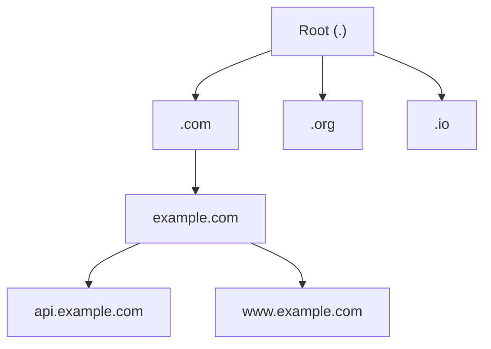
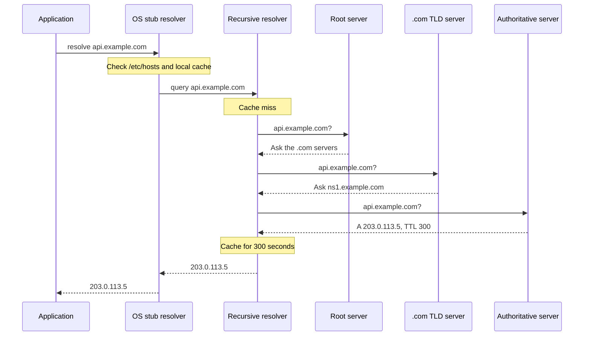
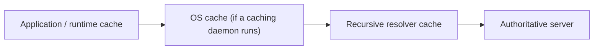

# DNS

[Home](../README.md) › [Networking](README.md) › DNS

> **In one sentence:** DNS is a distributed, hierarchical, heavily cached database that turns names into addresses, and its caching (controlled by TTL) is both why it is fast and why changes take time to be seen.

**Before this:** [Layers, IP and routing](01-layers-ip-routing.md), [TCP and UDP](02-tcp-udp.md).
**After this:** [TLS](04-tls-https.md), [load balancers and CDNs](08-proxies-load-balancers-cdn.md).

## The problem

Programs connect to IP addresses. People and configuration files use names like `api.example.com`. Names are easier to remember, and they add **indirection**: the IP behind a name can change without changing any client.

No single server could hold all names for the whole internet. DNS splits the data into a tree, and gives each part of the tree to whoever owns it.

## The hierarchy



A name is read from right to left: `api.example.com.` is `api` inside `example` inside `com` inside the root.

| Server type | Knows |
|---|---|
| **Root servers** | Which servers handle each top-level domain (`.com`, `.org`...) |
| **TLD servers** | Which servers are authoritative for each domain under that TLD |
| **Authoritative servers** | The actual records of a domain. Run by the domain owner or their DNS provider |
| **Recursive resolver** | Does the lookups for clients and caches the answers. Run by an ISP, a cloud provider, or a public service such as `8.8.8.8` or `1.1.1.1` |

## How a lookup works



- The application asks the OS. The OS asks one **recursive resolver** (its address comes from `/etc/resolv.conf` on Linux).
- The resolver walks the tree with **iterative** queries: root, then TLD, then authoritative.
- In practice almost all steps are answered from cache. A full walk is rare.

DNS normally uses **UDP on port 53**, because one small question and one small answer do not justify a TCP handshake. It falls back to TCP for large answers. Encrypted variants exist: DNS over TLS (DoT) and DNS over HTTPS (DoH).

## Record types

| Type | Maps a name to | Example |
|---|---|---|
| **A** | An IPv4 address | `api.example.com → 203.0.113.5` |
| **AAAA** | An IPv6 address | `api.example.com → 2001:db8::5` |
| **CNAME** | Another name (an alias) | `www.example.com → example.cdn-provider.net` |
| **MX** | Mail servers for the domain | `example.com → 10 mail.example.com` |
| **TXT** | Free text | Domain ownership checks, SPF, DKIM |
| **NS** | The authoritative name servers of a zone | `example.com → ns1.dnshost.com` |
| **SRV** | Host **and port** of a service | Used by some service discovery systems |
| **PTR** | An IP address back to a name (reverse lookup) | |
| **CAA** | Which certificate authorities may issue certificates for the domain | |

Details worth knowing:

- A name can have **several A records**. Clients usually try them in the order received, and resolvers often rotate the order. This is the simplest form of load distribution (**DNS round robin**).
- A **CNAME cannot exist at the root of a zone** (`example.com` itself), because the root must also hold NS and SOA records. DNS providers offer special "ALIAS" or "ANAME" records to work around this for pointing a root domain at a load balancer.
- A CNAME adds another lookup, since the target name must also be resolved.

## Caching and TTL

Every record has a **TTL** (Time To Live) in seconds. A resolver or client may reuse the answer for that long.

Caches exist at many levels:



TTL is a trade-off:

| | Short TTL (30–60 s) | Long TTL (hours) |
|---|---|---|
| Changes are seen | Quickly | Slowly |
| Failover by DNS | Works reasonably | Too slow |
| Query load and latency | Higher | Lower |
| Effect of a DNS provider outage | Felt quickly | Hidden for a while by caches |

**"DNS propagation" is just cache expiry.** When you change a record, nothing is pushed. Each cache keeps the old answer until its TTL ends. Before a planned migration, lower the TTL well ahead of time (at least one old-TTL period before), make the change, then raise it again.

Some clients and resolvers do not respect TTL exactly. Some cache longer, and some programs resolve a name once at startup and keep the address forever.

**Negative caching:** "this name does not exist" (`NXDOMAIN`) is also cached. If you look up a name just before creating it, the negative answer can stay cached for a while.

## DNS and Node.js

This is one of the most commonly misunderstood parts of Node.js.

| Function | How it resolves | Where it runs |
|---|---|---|
| `dns.lookup()` | Calls the OS function `getaddrinfo`. Uses `/etc/hosts` and system configuration | **libuv thread pool** (blocking call on a worker thread) |
| `dns.resolve*()`, `dns.promises.resolve*()` | Sends DNS queries directly using the c-ares library. Ignores `/etc/hosts` | The event loop (non-blocking sockets) |

**`http`, `https`, `net`, `fetch`, and almost every database driver use `dns.lookup()`.** Two consequences:

1. **DNS lookups share the thread pool** with file system and crypto work. The pool has 4 threads by default. If the DNS server is slow, a burst of outgoing requests to new hosts can fill the pool and delay unrelated `fs` calls. See [Node.js architecture](../06-nodejs/01-architecture.md).
2. **Node.js does not cache DNS results itself.** Each new connection triggers a lookup, unless the OS has a caching resolver. This is one more reason to use keep-alive connections: an existing connection needs no lookup.

```js
import dns from 'node:dns/promises';

await dns.lookup('example.com');            // → { address: '93.184.216.34', family: 4 }
await dns.resolve4('example.com', { ttl: true });  // → [ { address: '...', ttl: 300 } ]
```

### IPv4 or IPv6 first

If a name has both A and AAAA records, which is used? Since Node.js 17, `dns.lookup` returns addresses in the order the OS gives them (older versions put IPv4 first). On many systems `localhost` resolves to `::1` (IPv6) first. If your server listens only on `127.0.0.1` (IPv4), a client connecting to `localhost` can get `ECONNREFUSED`. Recent Node.js versions try addresses of both families when connecting (the "Happy Eyeballs" algorithm, `autoSelectFamily`), which hides most of these cases, but using `127.0.0.1` explicitly in configuration avoids the question.

## DNS for traffic management

Because DNS decides which address a client connects to, it is the first layer of [load balancing](08-proxies-load-balancers-cdn.md).

| Technique | How it works |
|---|---|
| **Round robin** | Several A records. Clients spread across them |
| **Weighted records** | Send 90% to one target and 10% to another. Used for gradual migrations |
| **Geo / latency routing** | The authoritative server answers with the address closest to the user |
| **Health-checked failover** | Stop returning the address of an unhealthy target |
| **Anycast** | The same IP address is announced from many locations. Routing delivers each packet to the nearest one. Used by DNS providers and CDNs |

DNS-based balancing is **coarse**. The DNS server does not know the real load, clients cache answers, and one resolver's answer may serve thousands of users. It decides *which region or load balancer*, not which server. Fine-grained balancing happens after that, at L4 or L7.

## Service discovery inside a cluster

Inside a platform like Kubernetes, services find each other by DNS names such as `orders.default.svc.cluster.local`. A cluster DNS server answers with the service's virtual IP or with the pod IPs.

A known performance trap: the default resolver configuration in Kubernetes pods (`ndots:5`) makes a lookup of an external name like `api.stripe.com` try several internal suffixes first (`api.stripe.com.default.svc.cluster.local`, and so on), producing several failed queries before the real one. If your service calls external hosts a lot, this multiplies DNS traffic. Using fully qualified names with a trailing dot, or keep-alive connections, reduces it.

## Failure modes

- **`ENOTFOUND`** in Node.js: the name could not be resolved (`NXDOMAIN`, or the resolver is unreachable).
- **`EAI_AGAIN`**: a temporary resolver failure. Usually the DNS server did not answer in time.
- **Slow lookups** add latency to the first request to each host, and in Node.js they occupy thread pool threads.
- **Stale records**: a client keeps using an old IP after a change, because of caching.
- **DNS provider outage**: if the authoritative servers are down, names stop resolving as caches expire. Large incidents have taken down many sites at once this way.

## Tools

```bash
dig api.example.com              # full answer with TTL
dig +short api.example.com       # only the addresses
dig api.example.com AAAA         # a specific record type
dig @8.8.8.8 api.example.com     # ask a specific resolver
dig +trace api.example.com       # walk from the root, like a resolver does
cat /etc/resolv.conf             # which resolver this machine uses
cat /etc/hosts                   # local overrides
```

## How this connects

- **`dns.lookup` on the thread pool** is a concrete example of why the pool exists. See [files and I/O](../02-operating-systems/04-files-and-io.md) and [Node.js architecture](../06-nodejs/01-architecture.md).
- **TTL-based caching** has the same staleness trade-off as every cache. See [caching](../08-backend-engineering/04-caching.md).
- **DNS is the first hop** of every request. See [life of an HTTP request](../13-end-to-end/01-life-of-an-http-request.md).
- **Geo-routing and anycast** are how [CDNs](08-proxies-load-balancers-cdn.md) send users to a nearby location.
- **DNS failover is slow**, which is why high availability relies on load balancers and health checks instead. See [building blocks](../10-system-design/02-building-blocks.md).
- **The hierarchy with delegation and caching** is a good model of a scalable distributed database with eventual consistency. See [replication and consistency](../09-distributed-systems/02-replication-consistency.md).

## Interview questions

<details>
<summary><strong>🟢 Q1. What happens when you resolve a domain name?</strong></summary>

The application asks the operating system, which checks the hosts file and any local cache. If there is no answer, it sends the query to its configured recursive resolver. If the resolver has the answer in cache, it returns it.

If not, the resolver walks the hierarchy. It asks a root server, which points to the servers for the top-level domain, for example `.com`. It asks one of those, which points to the authoritative servers of the domain. It asks an authoritative server, which returns the record. The resolver caches the answer for the TTL and returns it to the client.

</details>

<details>
<summary><strong>🟢 Q2. What is the difference between an A record and a CNAME record?</strong></summary>

An A record maps a name directly to an IPv4 address. A CNAME maps a name to another name, so it is an alias, and the resolver must then look up that other name.

CNAMEs are useful when the target's IP addresses can change, for example pointing `www` at a CDN or a load balancer hostname. One limitation is that the root of a domain cannot be a CNAME, so DNS providers offer alias-type records for that case.

</details>

<details>
<summary><strong>🟡 Q3. What is a TTL in DNS, and how do you choose it?</strong></summary>

The TTL is the number of seconds a resolver or client may cache a record. It is a trade-off between freshness and load. A short TTL means changes and failovers are seen quickly, but there are more queries and a little more latency. A long TTL reduces queries and protects against short DNS outages, but changes take a long time to reach everyone.

For records that might need to change quickly, such as those pointing at a load balancer, I use something like 60 to 300 seconds. Before a planned migration I lower the TTL in advance, wait for the old TTL to expire, make the change, and then raise it again.

</details>

<details>
<summary><strong>🟡 Q4. You updated a DNS record, but some users still reach the old server. Why?</strong></summary>

Because of caching. The old answer is still held in recursive resolvers, operating systems, or the applications themselves, and each cache keeps it until its TTL ends. Nothing is pushed to them. Some resolvers and clients also keep records longer than the TTL, and some long-running processes resolve a name only once.

So I should keep the old server running until the old TTL has fully passed, and a bit longer. For the future, I lower the TTL before making changes.

</details>

<details>
<summary><strong>🟡 Q5. How does Node.js resolve hostnames, and why does it matter for performance?</strong></summary>

By default, Node uses `dns.lookup`, which calls the system's `getaddrinfo` function. That call is blocking, so libuv runs it on its thread pool, which has four threads by default. The HTTP client, `fetch`, and database drivers all use it.

It matters because Node does not cache DNS results, and the thread pool is shared with file system and crypto operations. If the DNS server is slow, or the service opens many new connections, lookups can fill the pool and delay other work. The main fixes are to reuse connections with keep-alive, so fewer lookups are needed, and if necessary to add a DNS cache or increase the pool size.

</details>

<details>
<summary><strong>🔴 Q6. Why is DNS not enough for load balancing and failover?</strong></summary>

DNS only gives a list of addresses, and it has no control after that. It does not know the load on each server. Answers are cached by resolvers and clients, so a change, including removing a dead server, takes at least a TTL to take effect, and often longer. One cached answer in a big resolver can send a huge number of users to the same address. And many clients just take the first address and never try the others.

So DNS is good for coarse decisions, such as which region or which load balancer. For per-request balancing, fast health checking and failover, I put a load balancer in front of the servers, and DNS points to the load balancer.

</details>

## Key takeaways

- DNS is a hierarchy: root → TLD → authoritative, with recursive resolvers that cache.
- A/AAAA map to addresses. CNAME is an alias. TXT, MX, NS, SRV have special uses.
- TTL controls caching. "Propagation" is only cache expiry. Lower TTLs before migrations.
- In Node.js, `dns.lookup` runs on the thread pool and is not cached. Keep-alive avoids lookups.
- DNS can route traffic coarsely (round robin, weighted, geo), but it is slow to react.

---

← [TCP and UDP](02-tcp-udp.md) | Next: [TLS and HTTPS →](04-tls-https.md)
