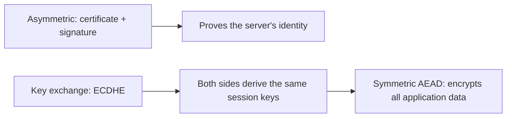
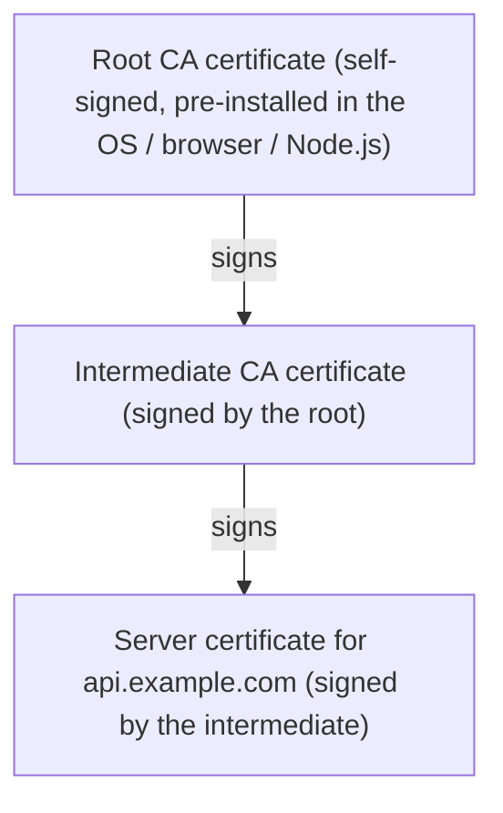
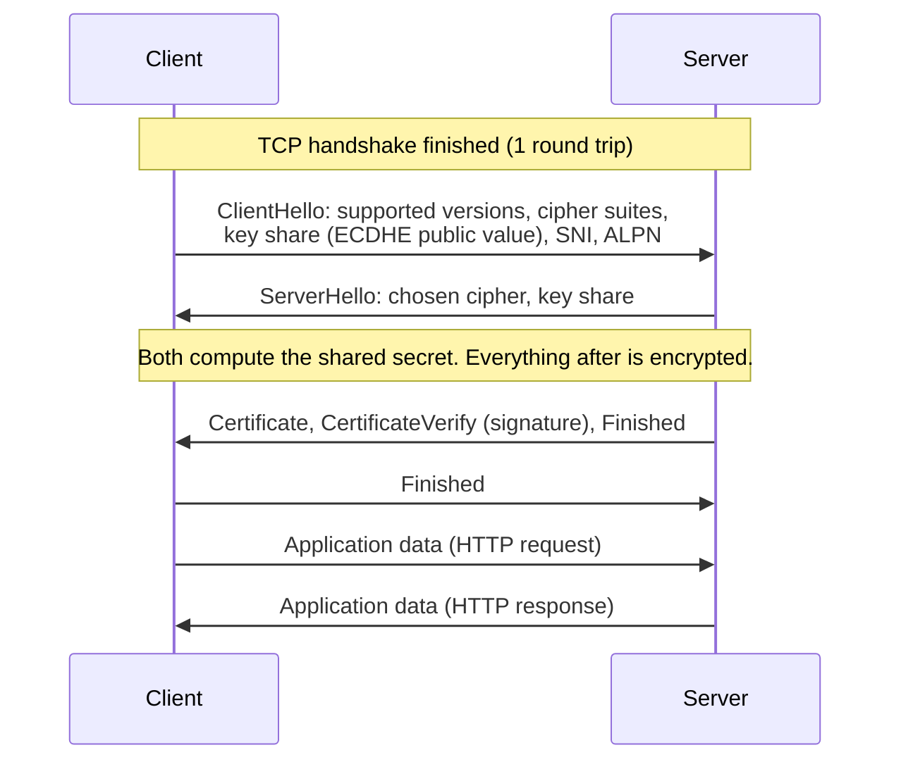
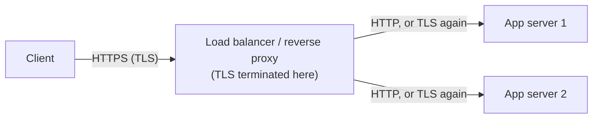

# TLS and HTTPS

[Home](../README.md) › [Networking](README.md) › TLS and HTTPS

> **In one sentence:** TLS wraps a TCP connection so that nobody in between can read or change the data and so that the client knows it is talking to the real server, by using slow asymmetric cryptography once to agree on a key and fast symmetric cryptography for everything after.

**Before this:** [TCP and UDP](02-tcp-udp.md), [DNS](03-dns.md).
**After this:** [HTTP fundamentals](05-http-fundamentals.md), [authentication](../08-backend-engineering/02-authentication-authorization.md), [web security](../08-backend-engineering/03-web-security.md).

## What TLS provides

Without TLS, every router, Wi-Fi access point and ISP between client and server can read and modify the traffic. TLS gives three properties:

| Property | Meaning | Provided by |
|---|---|---|
| **Confidentiality** | Nobody else can read the data | Symmetric encryption |
| **Integrity** | Nobody can change the data without detection | Authenticated encryption (AEAD) |
| **Authentication** | The server is who it claims to be | Certificates and digital signatures |

**HTTPS is simply HTTP sent through a TLS connection.** TLS is not specific to HTTP: database connections, Redis, gRPC and SMTP use it too.

## Cryptography you need to know

You do not need the mathematics. You need to know what each tool does and what it costs.

### Symmetric encryption

One secret key both encrypts and decrypts.

- **Fast.** Modern CPUs have hardware instructions for AES.
- **Problem:** both sides must already share the key. How do you agree on a key with a server you have never talked to, over a network that is being watched?
- Examples: **AES-GCM**, **ChaCha20-Poly1305**. Both are **AEAD** ciphers: they encrypt and also produce a tag that proves the data was not changed.

### Asymmetric (public-key) cryptography

A **key pair**: a public key that anyone can know, and a private key that is kept secret.

- What is encrypted with the public key can only be decrypted with the private key.
- What is **signed** with the private key can be **verified** by anyone with the public key.
- **Slow**: hundreds to thousands of times slower than symmetric encryption.
- Examples: **RSA**, **ECDSA**, **Ed25519**.

### Key exchange

**Diffie–Hellman** (in practice the elliptic-curve version, **ECDHE**) lets two parties compute the same shared secret by exchanging only public values. Someone watching the exchange cannot compute the secret.

### Hash functions

A **cryptographic hash** (SHA-256) maps any input to a fixed-size output. It is one-way, and changing one bit of input changes the output completely. Hashes are used in signatures, certificates and integrity checks. Password hashing is a different, deliberately slow, use. See [authentication](../08-backend-engineering/02-authentication-authorization.md).

### How TLS combines them



Slow asymmetric operations are used only during the handshake. All application data uses fast symmetric encryption. This is called a **hybrid** scheme.

## Certificates and trust

Encryption alone is not enough. If an attacker sits in the middle and pretends to be the server, you would set up a perfectly encrypted connection to the attacker. This is a **man-in-the-middle** attack. The client must **verify the server's identity**.

A **certificate** (X.509) is a document that says: "the public key `K` belongs to `api.example.com`", signed by a **Certificate Authority (CA)**.

### The chain of trust



The client checks:

1. **The signature chain** leads to a root CA it already trusts.
2. **The name** in the certificate (the Subject Alternative Name field) matches the hostname it connected to.
3. **The dates**: the certificate is not expired and not used before its start date.
4. **Revocation**: the certificate was not cancelled (checked through OCSP or revocation lists, with varying strictness).

The server must send its own certificate **and the intermediates**. A classic misconfiguration is a missing intermediate: browsers may work because they cache intermediates, but Node.js or `curl` fail with `unable to verify the first certificate`.

### Getting a certificate

A CA must check that you control the domain. **Let's Encrypt** automated this with the **ACME** protocol: you prove control by serving a specific file over HTTP or by creating a specific DNS record, and you get a free certificate valid for a short period. Tools renew it automatically.

**Expired certificates are one of the most common causes of outages.** Renewal must be automatic and monitored.

### Common certificate errors in Node.js

| Error | Meaning |
|---|---|
| `CERT_HAS_EXPIRED` | The certificate's end date has passed (or your clock is wrong) |
| `UNABLE_TO_VERIFY_LEAF_SIGNATURE` / `unable to verify the first certificate` | The server did not send the intermediate certificate |
| `DEPTH_ZERO_SELF_SIGNED_CERT` / `SELF_SIGNED_CERT_IN_CHAIN` | Self-signed, or signed by a private CA you do not trust |
| `ERR_TLS_CERT_ALTNAME_INVALID` | The hostname is not in the certificate |

The **wrong** fix is `rejectUnauthorized: false` or `NODE_TLS_REJECT_UNAUTHORIZED=0`. That turns off authentication, so encryption protects you from nobody. The right fix for a private CA is to add that CA to the trust list (`NODE_EXTRA_CA_CERTS=/path/ca.pem`, or the `ca` option).

## The TLS 1.3 handshake

TLS 1.3 (2018) is the current version. It needs **one round trip** before application data.



Step by step:

1. **ClientHello.** The client sends the versions and ciphers it supports, and already includes its key-exchange public value. It also sends two important extensions (below).
2. **ServerHello.** The server chooses the parameters and sends its key-exchange value. Both sides can now derive the session keys.
3. **Certificate and CertificateVerify.** The server sends its certificate chain and a signature over the handshake made with its private key. This proves it owns the private key that matches the certificate.
4. **Finished.** Both sides confirm that they saw the same handshake messages, so nothing was changed in transit.

### Two extensions every backend engineer meets

- **SNI (Server Name Indication).** The client puts the hostname in the ClientHello. This lets one IP address host many domains with different certificates, because the server knows which certificate to send. SNI is sent unencrypted in standard TLS, so observers can see which host you visit, but not the path or the content.
- **ALPN (Application-Layer Protocol Negotiation).** The client lists the protocols it speaks (`h2`, `http/1.1`) and the server picks one. This is how [HTTP/2](06-http2-http3.md) is selected without an extra round trip.

### Forward secrecy

In TLS 1.3 the session keys always come from an **ephemeral** key exchange (new random values for each connection). If the server's private key is stolen later, recorded traffic from the past still cannot be decrypted, because the private key was only used for signing, not for encrypting the session keys. This property is **forward secrecy**.

### The cost, and how it is reduced

| Step | Round trips |
|---|---|
| TCP handshake | 1 |
| TLS 1.3 handshake | 1 |
| TLS 1.2 handshake | 2 |
| First HTTP request and response | 1 |

A new HTTPS connection with TLS 1.3 needs 3 round trips before the first response byte. At 100 ms round-trip time, that is 300 ms. The handshake also costs CPU for the signature and key exchange.

Ways to reduce it:

- **Connection reuse** (keep-alive, HTTP/2). The best fix: pay once.
- **Session resumption.** The server gives the client a ticket. On the next connection the client presents it and skips the certificate exchange.
- **0-RTT** (early data). With a ticket, the client can send data in its first message. That data can be **replayed** by an attacker, so it must only be used for idempotent requests.
- **QUIC / HTTP/3** combines the transport and TLS handshakes into one round trip. See [HTTP/2 and HTTP/3](06-http2-http3.md).
- **TLS termination close to the user**, at a CDN or edge proxy.

## Where TLS ends: termination



| Mode | How it works | Notes |
|---|---|---|
| **Termination at the proxy** | The proxy decrypts. Traffic to the app is plain HTTP | Simple and common. The internal network must be trusted. The app learns the original scheme from `X-Forwarded-Proto` |
| **Re-encryption** | The proxy decrypts, inspects, and opens a new TLS connection to the app | Encrypted everywhere. More CPU |
| **Passthrough** | The proxy forwards encrypted bytes (L4). The app terminates TLS | The proxy cannot see paths or headers |

In most deployments your Node.js process does **not** handle TLS. A load balancer, an ingress controller, or Nginx does. Your app must then trust proxy headers correctly (`app.set('trust proxy', ...)` in Express) to know the client IP and whether the original request was HTTPS.

## Mutual TLS (mTLS)

Normal TLS authenticates only the server. In **mutual TLS**, the client also presents a certificate and the server verifies it.

It is used for **service-to-service authentication** inside a system: each service has its own certificate, usually from a private CA, and services only accept connections from peers with a valid one. Service meshes (Istio, Linkerd) automate this with sidecar proxies. It is a core part of **zero trust** networking, where being "inside the network" grants no access by itself.

## HTTPS-specific protections

- **HSTS** (`Strict-Transport-Security` header): tells the browser to use only HTTPS for this domain for a given time, even if the user types `http://`. It prevents **downgrade attacks** where an attacker keeps the user on plain HTTP.
- **Secure cookies:** the `Secure` attribute makes a cookie go only over HTTPS. See [HTTP fundamentals](05-http-fundamentals.md#cookies).
- **Mixed content:** browsers block scripts loaded over HTTP from an HTTPS page.
- **Redirect HTTP to HTTPS** at the edge, so no API endpoint is ever served in plain text.

## What TLS does not protect

- **Data at rest.** After decryption the server holds plain data. Database encryption is a separate topic.
- **The endpoints.** Malware on the client or a compromised server sees everything.
- **Metadata.** Observers still see IP addresses, the hostname (through SNI and DNS), timing, and sizes.
- **Application bugs.** SQL injection works perfectly well over HTTPS. See [web security](../08-backend-engineering/03-web-security.md).

## Tools

```bash
openssl s_client -connect example.com:443 -servername example.com   # show the handshake and certificate chain
openssl x509 -in cert.pem -noout -text                              # decode a certificate
curl -vI https://example.com                                        # TLS version, cipher, certificate summary
curl -w '%{time_connect} %{time_appconnect} %{time_starttransfer}\n' -o /dev/null -s https://example.com
#        TCP done      TLS done            first byte
```

## How this connects

- **TLS sits on top of TCP**, so it inherits TCP's handshake cost and head-of-line blocking. QUIC merges the two. See [HTTP/2 and HTTP/3](06-http2-http3.md).
- **Handshake cost** is one more reason for connection reuse and pooling. See [data access](../07-databases/11-data-access-from-node.md).
- **Signatures and hashing** are also the basis of JWTs and password storage. See [authentication](../08-backend-engineering/02-authentication-authorization.md).
- **Termination at the proxy** shapes how your app sees client IPs and schemes. See [proxies and load balancers](08-proxies-load-balancers-cdn.md).
- **Crypto operations** in Node.js (`crypto.pbkdf2`, `scrypt`) run on the libuv thread pool, and TLS encryption itself runs on the main thread in native code. See [Node.js architecture](../06-nodejs/01-architecture.md).
- **mTLS** is one answer to service identity in [microservices](../10-system-design/03-architecture-styles.md).

## Interview questions

<details>
<summary><strong>🟢 Q1. What does HTTPS give you that HTTP does not?</strong></summary>

HTTPS is HTTP over TLS. It gives three things. Confidentiality: the data is encrypted, so someone in the middle cannot read it. Integrity: the data cannot be changed in transit without being detected. Authentication: the server proves its identity with a certificate, so the client knows it is not talking to an impostor.

</details>

<details>
<summary><strong>🟢 Q2. What is the difference between symmetric and asymmetric encryption, and why does TLS use both?</strong></summary>

Symmetric encryption uses one shared key for encryption and decryption. It is very fast, but both sides must already have the key. Asymmetric cryptography uses a key pair: a public key and a private key. It solves the problem of talking securely to someone you have never met, but it is much slower.

TLS uses asymmetric cryptography during the handshake, to authenticate the server and to agree on a shared secret. Then it uses symmetric encryption with keys derived from that secret for all the actual data. So it gets the trust properties of one and the speed of the other.

</details>

<details>
<summary><strong>🟡 Q3. Walk me through the TLS 1.3 handshake.</strong></summary>

After the TCP connection is open, the client sends a ClientHello. It contains the supported versions and cipher suites, a key share for the Diffie–Hellman exchange, and extensions like SNI for the hostname and ALPN for the application protocol.

The server answers with a ServerHello that contains its choice of cipher and its own key share. Now both sides can compute the same shared secret and derive encryption keys. The rest of the handshake is encrypted. The server sends its certificate chain, a signature over the handshake that proves it has the private key, and a Finished message. The client verifies the certificate chain, the hostname and the signature, and sends its own Finished message. Then application data flows.

It takes one round trip, compared with two in TLS 1.2.

</details>

<details>
<summary><strong>🟡 Q4. How does the client know the server's certificate is valid?</strong></summary>

It checks four things. First, the chain of signatures: the server certificate is signed by an intermediate CA, which is signed by a root CA that is already in the client's trust store. Second, the hostname it connected to must appear in the certificate's subject alternative names. Third, the current date must be inside the certificate's validity period. Fourth, the certificate should not be revoked.

And during the handshake, the server signs the handshake data with its private key, which proves it actually owns the key in the certificate and is not just replaying someone else's certificate.

</details>

<details>
<summary><strong>🟡 Q5. A developer "fixes" a certificate error by setting <code>rejectUnauthorized: false</code>. What is wrong with that?</strong></summary>

It disables certificate verification. The connection is still encrypted, but the client no longer checks who is on the other side. An attacker in the middle can present any certificate, and the client will accept it and send its data, including credentials, to the attacker. So the encryption no longer protects anything.

The correct fix depends on the cause. If the server uses a private or self-signed CA, add that CA to the trusted list, for example with `NODE_EXTRA_CA_CERTS`. If the chain is incomplete, fix the server so it sends the intermediate certificate. If the certificate is expired or the name does not match, fix the certificate.

</details>

<details>
<summary><strong>🟡 Q6. What is TLS termination and where does it usually happen?</strong></summary>

TLS termination is the point where the encrypted connection from the client is decrypted. It usually happens at a load balancer, a reverse proxy like Nginx, an ingress controller, or a CDN, not in the application process.

This keeps certificates in one place, takes the crypto work off the application, and lets the proxy read HTTP for routing. Behind the proxy, traffic is either plain HTTP on a trusted network, or encrypted again. The application then has to read headers like `X-Forwarded-Proto` and `X-Forwarded-For` from the proxy to know the original scheme and client address.

</details>

<details>
<summary><strong>🔴 Q7. What is forward secrecy and why does it matter?</strong></summary>

Forward secrecy means that if the server's long-term private key is stolen in the future, traffic that was recorded in the past still cannot be decrypted.

It is achieved by using an ephemeral Diffie–Hellman key exchange for every connection. The session keys come from temporary values that are thrown away afterward. The server's private key is only used to sign the handshake, to prove identity. It is never used to encrypt the session key. TLS 1.3 only allows key exchanges with this property. In older setups with RSA key exchange, one stolen key could decrypt years of captured traffic.

</details>

<details>
<summary><strong>🔴 Q8. What is mutual TLS and when would you use it?</strong></summary>

In normal TLS only the server presents a certificate. In mutual TLS the client presents one too, and the server verifies it. So both sides are authenticated at the connection level.

I would use it for service-to-service communication inside a system, where each service gets its own certificate from an internal CA. It gives strong service identity without passing shared secrets around, and it is a base for zero-trust networks. The cost is operational: issuing, distributing and rotating certificates for every service. That is why it is often handled by a service mesh rather than by application code.

</details>

## Key takeaways

- TLS = confidentiality + integrity + authentication on top of TCP.
- Asymmetric crypto for the handshake, symmetric crypto for the data.
- Certificates bind a public key to a hostname, signed by a CA the client trusts. Servers must send intermediates.
- TLS 1.3 handshake: one round trip, always forward-secret. SNI picks the certificate. ALPN picks the protocol.
- Never disable certificate verification. Add the right CA instead.
- TLS usually terminates at a proxy. Trust proxy headers carefully.
- mTLS authenticates both sides and is used between services.

---

← [DNS](03-dns.md) | Next: [HTTP Fundamentals →](05-http-fundamentals.md)
