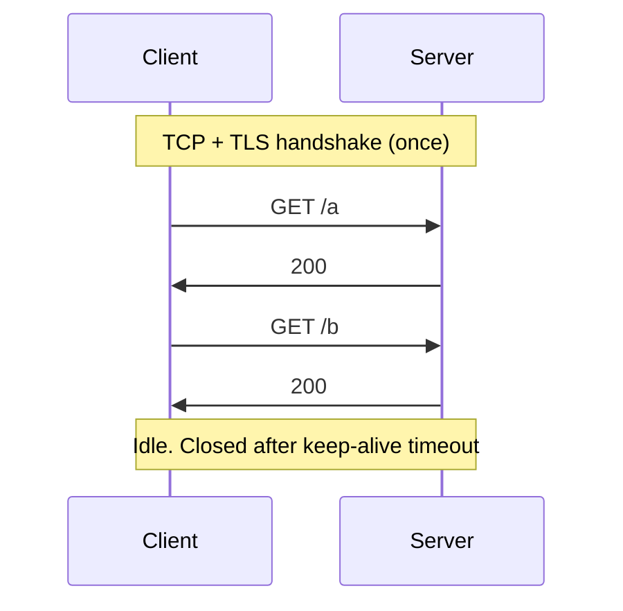
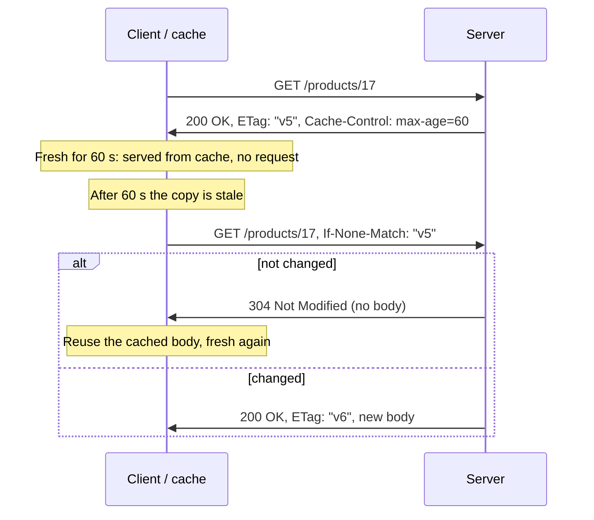
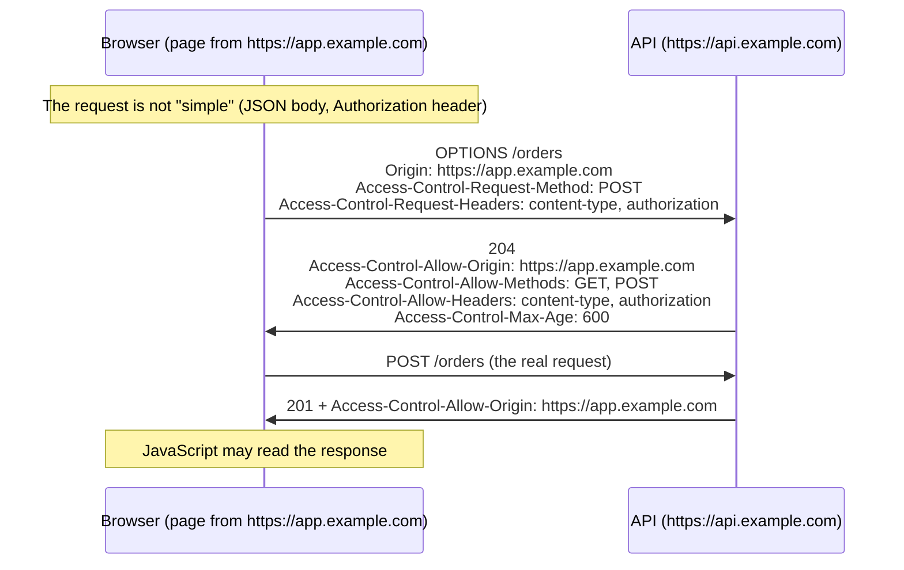

# HTTP Fundamentals

[Home](../README.md) › [Networking](README.md) › HTTP Fundamentals

> **In one sentence:** HTTP is a stateless request–response protocol whose methods, status codes and headers have precise meanings that clients, proxies and caches rely on, so using them correctly is what makes an API predictable.

**Before this:** [TCP and UDP](02-tcp-udp.md), [TLS](04-tls-https.md).
**After this:** [HTTP/2 and HTTP/3](06-http2-http3.md), [API design](../08-backend-engineering/01-api-design.md), [caching](../08-backend-engineering/04-caching.md).

## The model

A **client** sends a **request**. A **server** returns a **response**. That is all.

HTTP is **stateless**: the protocol does not remember earlier requests. Each request must carry everything the server needs (credentials, cookies, parameters). State lives in the client (cookies, tokens) or in a store the server reads (a session store, a database). Statelessness is what lets you put many identical servers behind a load balancer.

The **semantics** (methods, status codes, headers) are the same in HTTP/1.1, HTTP/2 and HTTP/3. Only the way bytes are sent on the wire differs. This page covers the semantics and the HTTP/1.1 wire format. [The next page](06-http2-http3.md) covers the newer wire formats.

## Anatomy of a message (HTTP/1.1)

```http
POST /api/orders?notify=true HTTP/1.1
Host: api.example.com
Content-Type: application/json
Content-Length: 42
Authorization: Bearer eyJhbGciOi...
Accept: application/json

{"productId": 17, "quantity": 2}
```

```http
HTTP/1.1 201 Created
Content-Type: application/json; charset=utf-8
Content-Length: 58
Location: /api/orders/9001
Cache-Control: no-store

{"id": 9001, "status": "pending"}
```

| Part | Request | Response |
|---|---|---|
| Start line | Method, target (path + query), version | Version, status code, reason phrase |
| Headers | Metadata, one per line, names are case-insensitive | Same |
| Empty line | Marks the end of headers | Same |
| Body | Optional | Optional |

HTTP/1.1 is plain text, which is why you can read it with `curl -v` or type it by hand with `nc`.

### How the receiver knows where the body ends

TCP is a byte stream with no message boundaries (see [TCP](02-tcp-udp.md)). HTTP/1.1 defines the end of a body in one of these ways:

- **`Content-Length: n`** — exactly `n` bytes follow.
- **`Transfer-Encoding: chunked`** — the body comes in chunks, each with its size first, and a zero-size chunk marks the end. Used when the size is not known in advance, for example with streaming.
- **Closing the connection** — the oldest way, and it prevents connection reuse.

Disagreement between a proxy and a server about which rule applies is the base of **request smuggling** attacks. See [web security](../08-backend-engineering/03-web-security.md).

### URLs

```
https://api.example.com:443/v1/users/42/orders?status=paid&limit=10#section
└─┬─┘   └──────┬──────┘ └┬┘└─────────┬────────┘ └─────────┬────────┘ └──┬──┘
scheme        host      port        path                query         fragment
```

The fragment is never sent to the server. Query values must be URL-encoded. Never put secrets in a URL: URLs are written to access logs, browser history and `Referer` headers.

## Methods

A method says what the client wants to do. Two properties define how it may be handled:

- **Safe:** it does not change server state. Clients and crawlers may send it freely.
- **Idempotent:** sending it N times has the same effect on the server as sending it once. It is safe to **retry**.

| Method | Purpose | Safe | Idempotent | Has request body |
|---|---|---|---|---|
| `GET` | Read a resource | ✅ | ✅ | No (not meaningful) |
| `HEAD` | Like GET, but only headers | ✅ | ✅ | No |
| `OPTIONS` | Ask what is allowed (used by CORS preflight) | ✅ | ✅ | No |
| `POST` | Create a resource, or run an action | ❌ | ❌ | Yes |
| `PUT` | Replace a resource completely at a known URL | ❌ | ✅ | Yes |
| `PATCH` | Change part of a resource | ❌ | ❌ (not guaranteed) | Yes |
| `DELETE` | Remove a resource | ❌ | ✅ | Usually no |

Why idempotency matters so much: networks fail in the middle of requests. If a `POST /payments` times out, the client cannot know whether the payment was created. Retrying might charge twice. `PUT` and `DELETE` can be retried safely by definition. For `POST`, APIs add an **idempotency key**. See [API design](../08-backend-engineering/01-api-design.md) and [reliability patterns](../08-backend-engineering/06-reliability-patterns.md).

Idempotent refers to the **effect on the server**, not to the response. The first `DELETE /users/42` returns `204`, the second may return `404`. The state is the same after both: the user does not exist.

`PUT` versus `PATCH`:

```http
PUT /users/42      {"name": "Sara", "email": "sara@example.com"}   → replaces the whole resource
PATCH /users/42    {"email": "new@example.com"}                    → changes only one field
```

## Status codes

The first digit gives the class. Clients, proxies, retries and monitoring all act on it.

| Class | Meaning | Who is at fault |
|---|---|---|
| 1xx | Informational | |
| 2xx | Success | |
| 3xx | Redirection | |
| 4xx | The client sent something wrong | Client. Do not retry without changing the request |
| 5xx | The server failed | Server. Retry may work |

The codes you need to know:

| Code | Name | Use |
|---|---|---|
| **200** | OK | Success with a body |
| **201** | Created | A resource was created. Add a `Location` header |
| **202** | Accepted | The request was accepted for asynchronous processing |
| **204** | No Content | Success with no body (common for DELETE) |
| **301** | Moved Permanently | Permanent redirect. Clients may change POST to GET |
| **302** | Found | Temporary redirect. Clients may change POST to GET |
| **304** | Not Modified | The cached copy is still valid (see caching below) |
| **307 / 308** | Temporary / Permanent Redirect | Like 302 / 301, but the method and body are kept |
| **400** | Bad Request | Malformed request, or failed validation |
| **401** | Unauthorized | **Not authenticated**: missing or invalid credentials |
| **403** | Forbidden | **Authenticated but not allowed** |
| **404** | Not Found | The resource does not exist (or you hide that it exists) |
| **405** | Method Not Allowed | The path exists but not with this method |
| **409** | Conflict | The request conflicts with current state (duplicate, version conflict) |
| **410** | Gone | It existed and was removed permanently |
| **412** | Precondition Failed | An `If-Match` / `If-Unmodified-Since` condition was false |
| **413** | Content Too Large | The body is too big |
| **415** | Unsupported Media Type | The `Content-Type` is not accepted |
| **422** | Unprocessable Content | Well-formed, but semantically invalid |
| **429** | Too Many Requests | Rate limited. Add `Retry-After` |
| **500** | Internal Server Error | An unhandled error on the server |
| **502** | Bad Gateway | A proxy got an invalid response from the upstream server |
| **503** | Service Unavailable | Overloaded or down for maintenance. Add `Retry-After` |
| **504** | Gateway Timeout | A proxy got no response from the upstream in time |

Three pairs people confuse:

- **401 versus 403.** 401 means "I do not know who you are". 403 means "I know who you are, and the answer is no".
- **400 versus 422.** Both are client errors on input. Many APIs use 400 for everything. Others use 400 for malformed syntax and 422 for valid syntax with invalid content. Choose one rule and keep it.
- **502 versus 504.** 502: the upstream answered badly or refused the connection (often the app crashed or is restarting). 504: the upstream did not answer in time (the app is slow or stuck).

**Never return `200` with `{"error": ...}` in the body.** Clients, retries, caches, load balancer health checks and dashboards all read the status code.

## Headers

Headers carry metadata. The most important groups:

### Content negotiation and body description

| Header | Direction | Meaning |
|---|---|---|
| `Content-Type` | Both | The media type of this body: `application/json`, `multipart/form-data` |
| `Content-Length` | Both | Body size in **bytes** |
| `Content-Encoding` | Both | Compression applied to the body: `gzip`, `br`, `zstd` |
| `Accept` | Request | Media types the client can handle |
| `Accept-Encoding` | Request | Compression the client can handle |
| `Accept-Language` | Request | Preferred languages |
| `Vary` | Response | Which request headers changed this response. Caches must use them as part of the key |

### Authentication

| Header | Meaning |
|---|---|
| `Authorization: Bearer <token>` | Credentials for the request. Also `Basic <base64(user:pass)>` |
| `WWW-Authenticate` | Sent with 401: how to authenticate |
| `Cookie` / `Set-Cookie` | See [cookies](#cookies) |

### Connection and proxy headers

| Header | Meaning |
|---|---|
| `Host` | Which site is requested. Required in HTTP/1.1, because one IP can serve many domains |
| `Connection: keep-alive` / `close` | Whether to reuse the TCP connection (HTTP/1.1 only) |
| `X-Forwarded-For` | Added by proxies: the chain of client IP addresses |
| `X-Forwarded-Proto` | The original scheme (`https`) before TLS termination |
| `Forwarded` | The standardized version of the two above |
| `User-Agent` | The client software |

### Tracing

| Header | Meaning |
|---|---|
| `X-Request-Id` | A unique ID per request, used to connect logs |
| `traceparent` | The W3C trace context for distributed tracing. See [observability](../08-backend-engineering/08-observability.md) |

## Persistent connections (keep-alive)

In HTTP/1.0 every request used a new TCP connection. With HTTPS that is 3 round trips of setup for each request.

HTTP/1.1 makes connections **persistent** by default. After a response, the connection stays open for the next request.



The limit of HTTP/1.1: **one request at a time per connection.** The next request waits for the previous response. This is **HTTP-level head-of-line blocking**. Browsers work around it by opening about 6 connections per host. HTTP/2 removes it with multiplexing. See [HTTP/2 and HTTP/3](06-http2-http3.md).

### Keep-alive in Node.js

For outgoing calls, connection reuse is controlled by an **agent** (for `http`/`https`) or a dispatcher (for `fetch`, which uses undici). Since Node.js 19 the default global agent uses keep-alive. `fetch` pools connections by default.

```js
import https from 'node:https';

const agent = new https.Agent({
  keepAlive: true,
  maxSockets: 50,          // maximum concurrent connections per host
  maxFreeSockets: 10,      // idle connections kept for reuse
  timeout: 30_000,
});
```

`maxSockets` works as a [semaphore](../02-operating-systems/03-concurrency-and-synchronization.md#semaphore): when all sockets are busy, further requests queue inside the agent. That queueing is invisible latency if you are not measuring it.

For the server side, `server.keepAliveTimeout` (5 seconds by default) decides how long an idle connection stays open. Behind a load balancer it should be **longer** than the load balancer's idle timeout, to avoid the `ECONNRESET` race explained in [TCP](02-tcp-udp.md#why-econnreset-happens-in-practice).

## HTTP caching

HTTP has a complete caching system built in. Browsers, CDNs and reverse proxies all implement it.

### Freshness: can I reuse this without asking?

The `Cache-Control` response header decides.

| Directive | Meaning |
|---|---|
| `max-age=3600` | Fresh for 3600 seconds |
| `s-maxage=3600` | Same, but only for shared caches (CDN, proxy). Overrides `max-age` there |
| `public` | Any cache may store it |
| `private` | Only the user's browser may store it. Not a CDN |
| `no-cache` | May be stored, but **must be revalidated** with the server before each use |
| `no-store` | Must not be stored anywhere |
| `must-revalidate` | When stale, do not serve it without revalidating |
| `immutable` | Will never change. Do not revalidate even on reload |
| `stale-while-revalidate=60` | May serve the stale copy for 60 s while fetching a new one in the background |

`no-cache` does **not** mean "do not cache". That is `no-store`.

### Validation: is my copy still good?

When a cached copy is stale, the client asks the server with a **conditional request**.



| Validator (response) | Condition (request) |
|---|---|
| `ETag: "abc"` — an opaque version identifier | `If-None-Match: "abc"` |
| `Last-Modified: <date>` | `If-Modified-Since: <date>` |

A `304` saves bandwidth, but the server may still do the work to compute the ETag, unless it can get the version cheaply (for example from an `updated_at` column).

### Conditional writes: optimistic concurrency over HTTP

The same validators protect against lost updates:

```http
PUT /documents/7
If-Match: "v5"
```

The server applies the change only if the current version is still `"v5"`. Otherwise it answers `412 Precondition Failed`. This is [compare-and-swap](../02-operating-systems/03-concurrency-and-synchronization.md#atomic-operations-and-compare-and-swap) at the HTTP level.

### Typical policies

| Content | Policy |
|---|---|
| Static files with a hash in the name (`app.3f9a1c.js`) | `Cache-Control: public, max-age=31536000, immutable` |
| HTML pages | `Cache-Control: no-cache` (always revalidate) |
| Public API data that changes sometimes | `Cache-Control: public, max-age=60, stale-while-revalidate=300` + `ETag` |
| Personal data | `Cache-Control: private, no-store` |

`Vary` matters for correctness: if the response depends on `Accept-Encoding` or `Authorization`, the cache must store separate copies. A missing `Vary` can make a shared cache serve one user's response to another. The full topic, including application-level caches, is in [caching](../08-backend-engineering/04-caching.md).

## Cookies

HTTP is stateless, so **cookies** let a server store a small piece of data in the client, which the client sends back on later requests.

```http
HTTP/1.1 200 OK
Set-Cookie: sid=abc123; HttpOnly; Secure; SameSite=Lax; Path=/; Max-Age=86400
```

```http
GET /profile HTTP/1.1
Cookie: sid=abc123
```

| Attribute | Effect | Protects against |
|---|---|---|
| `HttpOnly` | JavaScript in the page cannot read the cookie | Theft through XSS |
| `Secure` | Sent only over HTTPS | Network sniffing |
| `SameSite=Strict` | Never sent on cross-site requests | CSRF |
| `SameSite=Lax` | Sent on top-level navigation (clicking a link) but not on cross-site POSTs or sub-requests. The browser default | Most CSRF |
| `SameSite=None` | Sent on all cross-site requests. Requires `Secure` | Nothing. Needed for real third-party use |
| `Domain` | Which hosts receive it. If omitted: only the exact host that set it | |
| `Path` | Which URL paths receive it | |
| `Max-Age` / `Expires` | Lifetime. Without them it is a session cookie, removed when the browser closes | |

The browser attaches cookies **automatically** to every matching request, including requests started by other websites. That automatic behavior is what makes sessions convenient and also what makes **CSRF** possible. See [authentication](../08-backend-engineering/02-authentication-authorization.md) and [web security](../08-backend-engineering/03-web-security.md).

## CORS

### The same-origin policy

An **origin** is the combination of scheme, host and port: `https://app.example.com:443`.

Browsers apply the **same-origin policy**: JavaScript on one origin cannot **read** responses from another origin. Without it, any website you visit could read your email or bank pages using your cookies.

### What CORS does

**Cross-Origin Resource Sharing** is the way a server tells the browser: "I allow this other origin to read my responses."



- **Simple requests** (GET, HEAD, or POST with a basic content type and no custom headers) are sent directly. The browser checks the response headers before giving the response to JavaScript.
- Other requests trigger a **preflight** `OPTIONS` request first. `Access-Control-Max-Age` lets the browser cache the preflight answer.
- To send cookies cross-origin, the client must use `credentials: 'include'`, the server must answer `Access-Control-Allow-Credentials: true`, and `Access-Control-Allow-Origin` must be a specific origin, **not** `*`.

### What CORS is not

**CORS is not a security feature of your API. It is a controlled relaxation of a browser rule.**

- It is enforced **only by browsers**. `curl`, Postman, mobile apps and other servers ignore it completely.
- It does not stop a request from reaching your server. A simple cross-origin POST is still sent and still executed. The browser only blocks JavaScript from reading the response. That is why CORS does not prevent CSRF.
- A CORS error in the browser console is always fixed on the **server** (or avoided by serving the frontend and API from the same origin through a proxy).

## How this connects

- **Method semantics and status codes** are the vocabulary of [API design](../08-backend-engineering/01-api-design.md).
- **Idempotency** makes retries safe. See [reliability patterns](../08-backend-engineering/06-reliability-patterns.md) and the [payment system case](../10-system-design/08-case-payment-system.md).
- **`Cache-Control` and ETags** are the HTTP layer of [caching](../08-backend-engineering/04-caching.md), and they control [CDN](08-proxies-load-balancers-cdn.md) behavior.
- **Cookies and their attributes** are the base of session authentication and CSRF defenses. See [authentication](../08-backend-engineering/02-authentication-authorization.md) and [web security](../08-backend-engineering/03-web-security.md).
- **Keep-alive and agents** are connection pooling for HTTP, the same idea as [database pools](../07-databases/11-data-access-from-node.md).
- **Statelessness** enables horizontal scaling. See [building blocks](../10-system-design/02-building-blocks.md).
- **Parsing HTTP** is done in Node.js by a native parser (llhttp) fed by the event loop. See [Node.js architecture](../06-nodejs/01-architecture.md).

## Interview questions

<details>
<summary><strong>🟢 Q1. What does it mean that HTTP is stateless? How do we keep users logged in?</strong></summary>

Stateless means the protocol does not keep any memory between requests. Each request is independent and must contain everything the server needs to handle it.

To keep a user logged in, the client sends an identifier with every request. With sessions, the server stores session data and gives the browser a cookie with the session ID. With tokens, the client sends a signed token, like a JWT, in the `Authorization` header. In both cases the state is carried by the request or stored in a shared store, not in the connection. That is also why any server behind a load balancer can handle any request.

</details>

<details>
<summary><strong>🟢 Q2. What is the difference between PUT, PATCH and POST?</strong></summary>

`POST` creates a new resource or triggers an action. It is not idempotent: sending it twice may create two resources.

`PUT` replaces a resource at a specific URL with the full representation I send. It is idempotent: sending it ten times gives the same state as sending it once.

`PATCH` changes part of a resource. It is not guaranteed to be idempotent, because a patch can be something like "add one to the counter", although a patch that only sets fields is idempotent in practice.

</details>

<details>
<summary><strong>🟢 Q3. What is the difference between 401 and 403?</strong></summary>

401 means the request is not authenticated. Credentials are missing, expired or invalid, and the client should authenticate and try again.

403 means the request is authenticated, the server knows who the user is, but that user is not allowed to do this. Sending the same credentials again will not help.

</details>

<details>
<summary><strong>🟡 Q4. What do "safe" and "idempotent" mean, and why do they matter in practice?</strong></summary>

A safe method does not change state on the server. `GET`, `HEAD` and `OPTIONS` are safe. An idempotent method has the same effect whether I send it once or many times. `GET`, `PUT` and `DELETE` are idempotent. `POST` is neither.

It matters because of failures. If a request times out, the client does not know whether the server processed it. With an idempotent method, the client, a proxy or a library can retry safely. With `POST`, a retry can create a duplicate, for example a second payment. So for important `POST` operations I add an idempotency key: the client sends a unique key, and the server stores the result under that key and returns the same result for a retry.

</details>

<details>
<summary><strong>🟡 Q5. How does HTTP caching work with ETags?</strong></summary>

The server sends a response with an `ETag` header, which is an identifier for that version of the resource, and usually a `Cache-Control` header with a `max-age`. While the response is fresh, the client uses its copy without contacting the server.

When it becomes stale, the client sends the request again with `If-None-Match` and the ETag value. If the resource has not changed, the server answers `304 Not Modified` with no body, and the client reuses its cached copy. If it changed, the server sends `200` with the new body and a new ETag. This saves bandwidth and transfer time.

</details>

<details>
<summary><strong>🟡 Q6. What is the difference between <code>no-cache</code> and <code>no-store</code>?</strong></summary>

`no-store` means the response must not be stored at all, by any cache. I use it for sensitive data.

`no-cache` means the response can be stored, but the cache must revalidate it with the server every time before using it. With an ETag, that revalidation is often a cheap 304. So `no-cache` really means "always check first", not "do not cache".

</details>

<details>
<summary><strong>🟡 Q7. What is CORS and why does it exist?</strong></summary>

Browsers have a same-origin policy: JavaScript from one origin cannot read responses from a different origin. An origin is the scheme, host and port together. This protects users, because otherwise any site could read data from other sites where the user is logged in.

CORS is a set of response headers that lets a server relax this rule for specific origins. The server sends `Access-Control-Allow-Origin` with the allowed origin. For requests that are not simple, such as those with a JSON content type or an `Authorization` header, the browser first sends a preflight `OPTIONS` request to ask what is allowed.

</details>

<details>
<summary><strong>🔴 Q8. Does CORS protect your API from malicious clients or from CSRF?</strong></summary>

No to both. CORS is enforced only by browsers. Any non-browser client, like curl or a script, ignores it. So it is not access control. Authentication and authorization on the server do that.

It also does not stop CSRF. For a simple request, such as a form POST, the browser sends the request with the user's cookies, and the server executes it. CORS only prevents the attacking page from reading the response. The damage is already done. CSRF protection needs `SameSite` cookies, CSRF tokens, or checking the `Origin` header on state-changing requests.

A wrong CORS configuration can add risk, though. Reflecting any origin together with `Allow-Credentials: true` lets any website read authenticated responses.

</details>

<details>
<summary><strong>🔴 Q9. Your API returns <code>502</code> for some requests and <code>504</code> for others. What does each suggest?</strong></summary>

Both come from a proxy or load balancer in front of the application, not from the application itself.

`502 Bad Gateway` means the proxy could not get a valid response from the upstream. Typical causes: the application process crashed or is restarting, the connection was refused or reset, or the application closed a keep-alive connection at the moment the proxy reused it. That last one points to the keep-alive timeout being shorter than the proxy's idle timeout.

`504 Gateway Timeout` means the upstream did not respond within the proxy's timeout. The application is too slow or stuck: a slow query, a blocked event loop, an exhausted connection pool, or a dependency that hangs.

So for 502 I look at crashes, restarts, deploys and keep-alive settings. For 504 I look at latency, slow dependencies and timeouts.

</details>

<details>
<summary><strong>🔴 Q10. Why should the server's keep-alive timeout be longer than the load balancer's idle timeout?</strong></summary>

The load balancer keeps a pool of idle connections to the backend. If the backend closes an idle connection first, there is a small window where the load balancer has not yet seen the close and sends a new request on that connection. The request reaches a closed socket, the backend answers with a TCP reset, and the client gets a 502.

If the backend's timeout is longer, the load balancer always closes idle connections first, and it never sends a request on a connection it has closed itself. In Node.js that means setting `server.keepAliveTimeout`, and `headersTimeout` slightly above it, to more than the load balancer's idle timeout.

</details>

## Key takeaways

- HTTP is stateless request–response. State travels in cookies or tokens.
- Safe = no change. Idempotent = safe to retry. `POST` is neither.
- Status classes: 2xx success, 3xx redirect, 4xx client error, 5xx server error. Always use the right one.
- 401 = not authenticated. 403 = not allowed. 502 = bad upstream. 504 = slow upstream.
- Keep-alive reuses connections. HTTP/1.1 allows one request at a time per connection.
- `Cache-Control` decides freshness. ETags allow cheap revalidation and conditional writes.
- Cookie flags: `HttpOnly`, `Secure`, `SameSite`.
- CORS is a browser-only relaxation of the same-origin policy. It is not API security.

---

← [TLS and HTTPS](04-tls-https.md) | Next: [HTTP/2 and HTTP/3 →](06-http2-http3.md)
