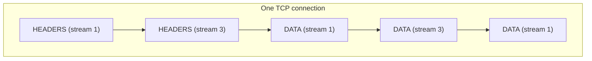
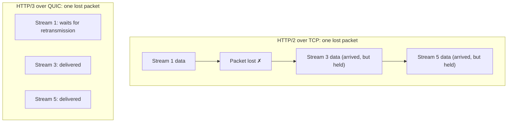
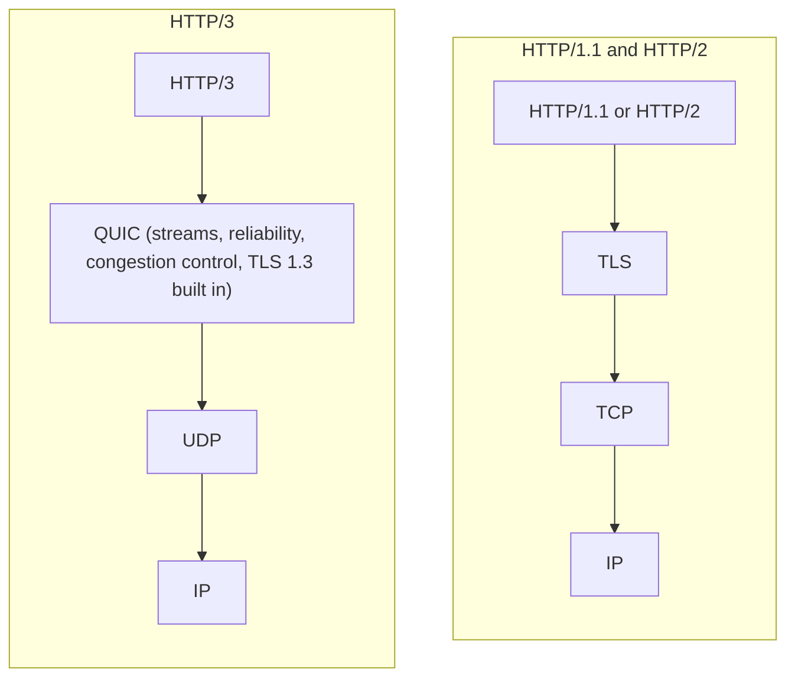
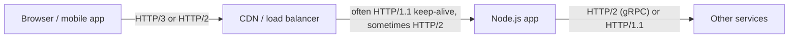

# HTTP/2 and HTTP/3

[Home](../README.md) › [Networking](README.md) › HTTP/2 and HTTP/3

> **In one sentence:** HTTP/2 and HTTP/3 keep the same methods, headers and status codes as HTTP/1.1 but change how they travel, each version removing one kind of head-of-line blocking: HTTP/2 at the HTTP layer, HTTP/3 at the transport layer.

**Before this:** [TCP and UDP](02-tcp-udp.md), [TLS](04-tls-https.md), [HTTP fundamentals](05-http-fundamentals.md).
**After this:** [WebSockets and SSE](07-websockets-sse-realtime.md), [API design](../08-backend-engineering/01-api-design.md) (gRPC).

## The problem with HTTP/1.1

One HTTP/1.1 connection handles **one request at a time**. The second request waits until the first response is complete.

Workarounds, all with costs:

- **Several connections per host** (browsers open about 6). Each needs its own TCP and TLS handshake and its own slow start, and each uses server memory.
- **Bundling** many files into one, sprite images, and spreading resources across many hostnames ("domain sharding"). These are hacks around the protocol.

Other weaknesses: headers are plain text and repeated on every request (cookies and user agents can be kilobytes each time).

## HTTP/2

HTTP/2 (2015) changes the wire format. One TCP connection carries many requests **at the same time**.

### Binary framing and streams

Instead of text messages, HTTP/2 sends small binary **frames**. Each frame belongs to a **stream**, identified by a number. One stream is one request–response pair.

Frames from different streams are **interleaved**. A slow response on stream 1 does not block stream 3. This is **multiplexing**, and it removes HTTP-level head-of-line blocking.

| Frame type | Purpose |
|---|---|
| `HEADERS` | Request or response headers (compressed) |
| `DATA` | Body bytes |
| `SETTINGS` | Connection parameters, such as the maximum number of concurrent streams |
| `WINDOW_UPDATE` | Flow control, per stream and per connection |
| `RST_STREAM` | Cancel one stream without closing the connection |
| `GOAWAY` | "I am shutting down. Do not start new streams." Used for graceful shutdown |
| `PING` | Keep-alive and round-trip measurement |

### Other features

- **Header compression (HPACK).** Both sides keep a table of headers already sent. Repeated headers are sent as a short index. This matters a lot for APIs with large cookies or tokens.
- **Flow control per stream.** The same idea as the TCP receive window, applied to each stream, so one slow consumer does not starve the others.
- **Cancellation.** A client can cancel one request with `RST_STREAM` and keep the connection.
- **Server push** allowed the server to send resources before the client asked. It was hard to use well and browsers have removed support. Treat it as deprecated.

In headers, the request line became **pseudo-headers**: `:method`, `:path`, `:scheme`, `:authority`. Header names are lowercase.

Browsers only use HTTP/2 over TLS. The protocol is chosen during the TLS handshake with **ALPN** (see [TLS](04-tls-https.md#two-extensions-every-backend-engineer-meets)). Unencrypted HTTP/2 ("h2c") exists and is used inside data centers, for example for gRPC between services.

### The remaining problem: TCP head-of-line blocking

All streams share **one TCP connection**. TCP delivers bytes in order. If one packet is lost, TCP holds back **all** later bytes until the retransmission arrives, even bytes that belong to other streams.

On a network with packet loss (mobile networks), HTTP/2 can be slower than HTTP/1.1 with 6 connections, because one loss stalls everything. HTTP/2 fixed the application layer and exposed the problem in the transport layer.

## HTTP/3 and QUIC

TCP is implemented in operating system kernels and in network devices everywhere, so it cannot be changed quickly. HTTP/3 (2022) replaces it with **QUIC**, a new transport protocol built on **UDP** and implemented in user space.

What QUIC changes:

| Feature | Effect |
|---|---|
| **Independent streams** | Loss on one stream does not block the others. No transport head-of-line blocking |
| **Faster connection setup** | The transport handshake and the TLS 1.3 handshake are combined: 1 round trip for a new connection, 0 round trips when resuming |
| **Encryption is mandatory** | TLS 1.3 is part of QUIC. Even most of the transport headers are encrypted |
| **Connection migration** | A connection is identified by a **connection ID**, not by the IP/port 4-tuple. Moving from Wi-Fi to mobile data keeps the connection alive |
| **Evolves in user space** | New versions ship with applications, not with kernels |

Costs and limits:

- **More CPU** than TCP, which has decades of kernel and hardware optimization.
- **UDP is blocked or limited** on some networks. Clients fall back to HTTP/2.
- **Discovery.** A client first connects with HTTP/1.1 or HTTP/2 and learns that HTTP/3 is available from the `Alt-Svc` response header or an HTTPS DNS record. Later connections use it.

### Setup cost compared

| | Round trips before the first request can be sent |
|---|---|
| HTTP/1.1 or HTTP/2 over TLS 1.2 | 3 (TCP 1 + TLS 2) |
| HTTP/1.1 or HTTP/2 over TLS 1.3 | 2 (TCP 1 + TLS 1) |
| HTTP/3, new connection | 1 |
| HTTP/3, resumed connection | 0 |

## Comparison

| | HTTP/1.1 | HTTP/2 | HTTP/3 |
|---|---|---|---|
| Format | Text | Binary frames | Binary frames |
| Transport | TCP | TCP | QUIC over UDP |
| Concurrent requests per connection | 1 | Many (streams) | Many (streams) |
| Head-of-line blocking | HTTP level and TCP level | TCP level only | None across streams |
| Header compression | None | HPACK | QPACK |
| Encryption | Optional | Required in practice | Always |
| Connection survives an IP change | No | No | Yes |

## What this means for a backend engineer

### Where each version is used

Most Node.js applications never speak HTTP/2 or HTTP/3 to the public. The edge (CDN, load balancer, Nginx) terminates them and talks HTTP/1.1 with keep-alive to the application. The newer protocols help most on the slow, lossy link between the user and the edge. Inside a data center, with fast links and long-lived pooled connections, HTTP/1.1 is often good enough.

Node.js includes an `http2` module. HTTP/3 support in Node.js core has been experimental for a long time, so check the current status before depending on it.

### gRPC

**gRPC** uses HTTP/2 as its transport. Each RPC is one stream. This gives it multiplexing, cancellation, flow control and **streaming** in both directions. See [API design](../08-backend-engineering/01-api-design.md).

### Things that change with multiplexing

- **Old optimizations become harmful.** Domain sharding and heavy bundling defeat multiplexing and header compression.
- **Load balancing gets harder.** With HTTP/1.1, each connection carries few requests, so balancing connections balances load. With HTTP/2, one long-lived connection carries thousands of requests. An **L4** load balancer sends the whole connection to one backend, so one backend can get most of the load. gRPC needs **L7** (request-level) balancing or client-side balancing. See [proxies and load balancers](08-proxies-load-balancers-cdn.md).
- **Concurrency limits.** The server announces `SETTINGS_MAX_CONCURRENT_STREAMS`. A client must queue beyond that.
- **Graceful shutdown uses `GOAWAY`**: the server tells clients to finish current streams and open a new connection for new ones.

## How this connects

- **TCP head-of-line blocking** comes straight from TCP's ordering guarantee. See [TCP and UDP](02-tcp-udp.md#head-of-line-blocking).
- **ALPN in the TLS handshake** is how the protocol version is chosen. See [TLS](04-tls-https.md).
- **Stream-level flow control** is one more instance of backpressure. See [buffers and streams](../06-nodejs/03-buffers-and-streams.md).
- **gRPC and streaming APIs** build on HTTP/2. See [API design](../08-backend-engineering/01-api-design.md).
- **Long-lived multiplexed connections** change how you must load balance. See [proxies and load balancers](08-proxies-load-balancers-cdn.md).

## Interview questions

<strong>🟢 Q1. What are the main improvements of HTTP/2 over HTTP/1.1?</strong>

The main one is multiplexing. HTTP/2 splits messages into binary frames that belong to streams, and many streams share one TCP connection at the same time. So many requests and responses can be in progress in parallel on a single connection, and a slow response does not block the others.

It also compresses headers with HPACK, which avoids sending the same large headers again and again, and it has per-stream flow control and the ability to cancel a single request. The meaning of HTTP, the methods, status codes and headers, did not change.

<strong>🟡 Q2. What is head-of-line blocking, and how do HTTP/1.1, HTTP/2 and HTTP/3 differ on it?</strong>

Head-of-line blocking means one slow or missing item delays everything behind it.

In HTTP/1.1 it happens at the HTTP level: a connection handles one request at a time, so the next request waits for the previous response.

HTTP/2 fixes that with multiplexing, but all streams share one TCP connection. TCP delivers bytes in order, so one lost packet blocks all streams until it is retransmitted. That is head-of-line blocking at the transport level.

HTTP/3 runs on QUIC over UDP. QUIC handles ordering and retransmission per stream, so a lost packet only delays the stream it belongs to.

<strong>🟡 Q3. Why is HTTP/3 built on UDP instead of improving TCP?</strong>

TCP lives in operating system kernels and is handled by many devices on the network, like firewalls and NATs, that expect it to behave in a fixed way. Changing it would take many years and often would not work across the internet.

UDP is a minimal protocol that passes through existing networks. QUIC uses it as a base and implements reliability, ordering, congestion control and encryption itself, in user space. That lets it have independent streams, a combined transport and TLS handshake, and connection migration, and it can be updated together with the application.

<strong>🟡 Q4. Do you need HTTP/2 between your load balancer and your Node.js service?</strong>

Usually not. The benefits of HTTP/2 and HTTP/3 are biggest on the link between the user's device and the edge, where latency is high, packets are lost, and browsers limit connections. The load balancer terminates that connection.

Between the load balancer and the application, the network is fast and reliable, and the load balancer keeps a pool of keep-alive connections. HTTP/1.1 works well there, is simpler, and is easier to load balance. The exception is when I need HTTP/2 features end to end, mainly for gRPC or streaming.

<strong>🔴 Q5. You moved internal traffic to gRPC and now one backend instance gets most of the load. Why?</strong>

gRPC uses HTTP/2, where a client opens one long-lived connection and sends all its requests over it as streams. If the load balancer works at layer 4, it balances connections, not requests. It picks a backend when the connection is opened, and every later request on that connection goes to the same backend. With a few clients and long-lived connections, the load becomes very uneven. New instances added by autoscaling also get no traffic, because existing connections stay where they are.

The fix is to balance at the request level: use a layer 7 proxy that understands HTTP/2, such as Envoy, or client-side load balancing where the client holds connections to all backends and spreads requests itself. A simpler but weaker fix is to limit the maximum age of connections on the server, so clients reconnect regularly.

<strong>🔴 Q6. How does QUIC make connection setup faster than TCP plus TLS?</strong>

With TCP and TLS 1.3, there are two separate handshakes: one round trip for TCP, then one for TLS. QUIC combines them. TLS 1.3 is built into QUIC, so the first packets carry both the transport setup and the cryptographic handshake. A new connection needs one round trip.

For a server the client has talked to before, QUIC supports zero round trip resumption: the client sends its request in the first packet, encrypted with keys from the previous session. That early data can be replayed by an attacker, so it should only be used for idempotent requests.

## Key takeaways

- Same HTTP semantics in all versions. Only the transport differs.
- HTTP/2: binary frames, streams, multiplexing on one TCP connection, header compression.
- HTTP/2 still suffers from TCP head-of-line blocking on packet loss.
- HTTP/3: QUIC over UDP, independent streams, 1-RTT or 0-RTT setup, connection migration.
- Newer versions matter most between the user and the edge. Apps behind a proxy often still speak HTTP/1.1.
- Multiplexed long-lived connections need request-level (L7) load balancing.

---

← [HTTP Fundamentals](05-http-fundamentals.md) | Next: [WebSockets, SSE and Real-Time →](07-websockets-sse-realtime.md)
