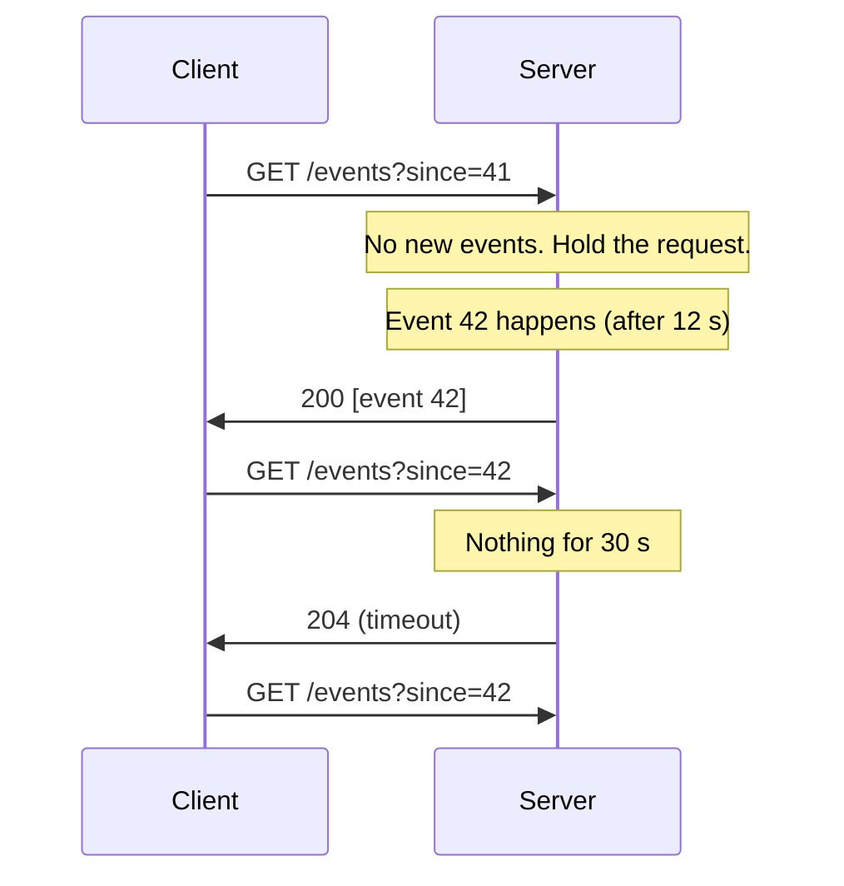
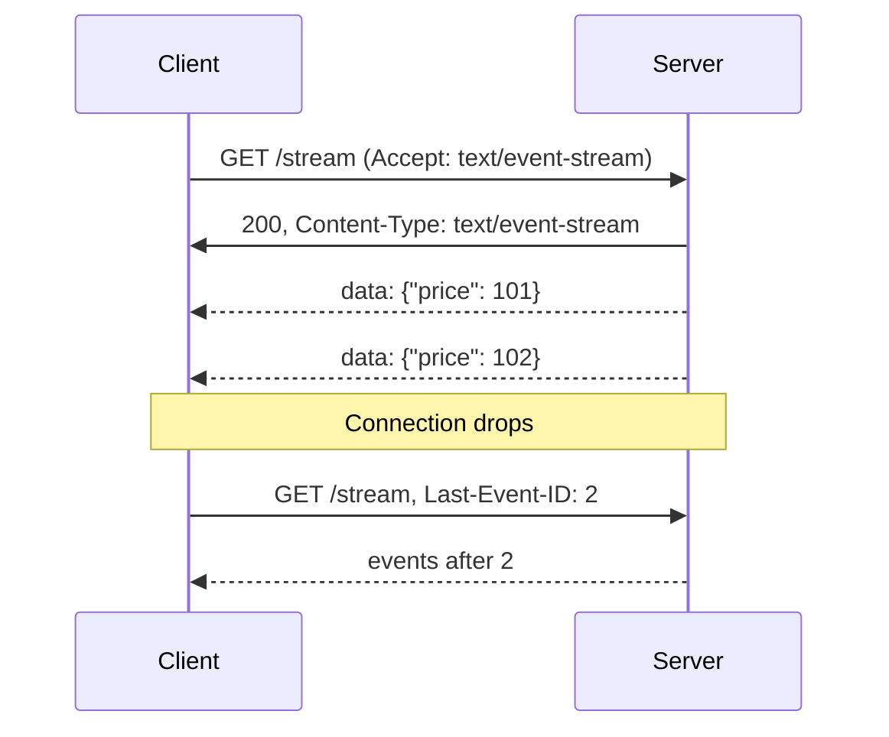
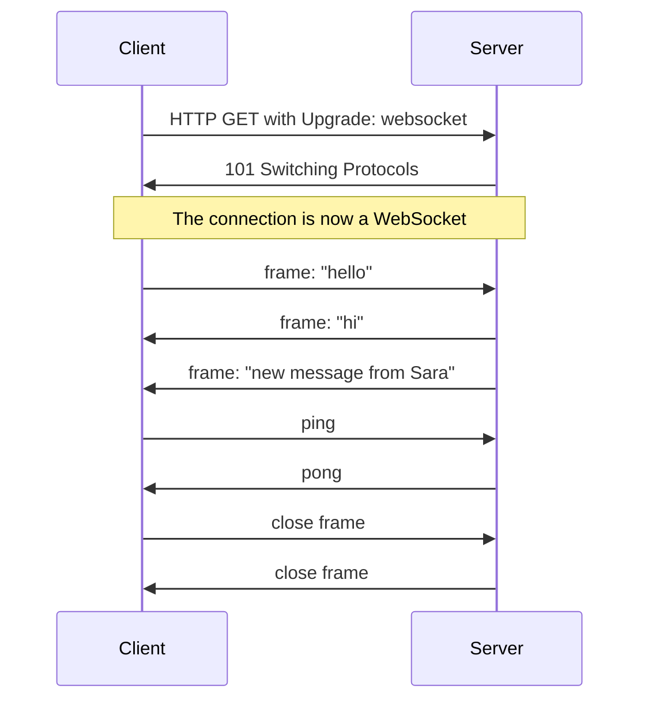
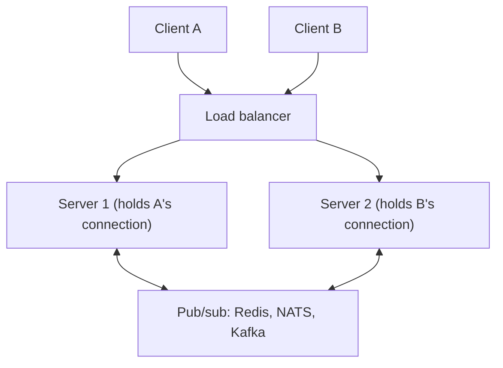

# WebSockets, SSE and Real-Time

[Home](../README.md) › [Networking](README.md) › WebSockets, SSE and Real-Time

> **In one sentence:** HTTP only lets the client start a conversation, so real-time features need a way for the server to push: either by holding a request open (long polling), streaming one long response (SSE), or upgrading the connection to a two-way channel (WebSocket).

**Before this:** [HTTP fundamentals](05-http-fundamentals.md), [TCP and UDP](02-tcp-udp.md).
**After this:** [chat system design](../10-system-design/06-case-chat-system.md), [messaging and queues](../08-backend-engineering/05-messaging-queues.md).

## The problem

In HTTP the client asks and the server answers. The server cannot start. For chat, notifications, live dashboards or collaborative editing, the server needs to send data when something happens, not when the client asks.

There are four techniques. They differ in latency, cost and complexity.

## 1. Short polling

The client asks again and again on a timer.

```js
setInterval(async () => {
  const res = await fetch('/api/notifications?since=' + lastId);
  render(await res.json());
}, 5000);
```

- **Simple**, and works everywhere.
- **Wasteful:** most responses are empty.
- **Latency** is up to one interval.

It is the right choice when updates are rare, a delay of seconds is fine, and simplicity matters, for example checking the status of a background job.

## 2. Long polling

The client sends a request. The server **holds it open** until it has data or a timeout passes. The client then immediately sends the next request.



- Near real-time, using plain HTTP.
- Each message costs a full request with headers.
- The server holds many open requests. For Node.js that is cheap (an idle connection is a small object), but for thread-per-request servers it is expensive.
- The `since` parameter matters: it makes sure no event is lost between two requests.

## 3. Server-Sent Events (SSE)

SSE is **one long HTTP response** that never ends. The server writes events to it as they happen. Communication is **one-way**: server to client.



The format is plain text:

```
id: 1
event: price
data: {"symbol":"ACME","price":101}

id: 2
event: price
data: {"symbol":"ACME","price":102}

: this line is a comment, used as a heartbeat

```

Each event ends with an empty line.

```js
// Server (Node.js)
import http from 'node:http';

http.createServer((req, res) => {
  res.writeHead(200, {
    'Content-Type': 'text/event-stream',
    'Cache-Control': 'no-cache',
    'X-Accel-Buffering': 'no',        // ask Nginx not to buffer the stream
  });

  let id = 0;
  const send = (data) => res.write(`id: ${++id}\ndata: ${JSON.stringify(data)}\n\n`);

  const timer = setInterval(() => send({ time: Date.now() }), 1000);
  const heartbeat = setInterval(() => res.write(': ping\n\n'), 15_000);

  req.on('close', () => {             // the client went away: clean up
    clearInterval(timer);
    clearInterval(heartbeat);
  });
}).listen(3000);
```

```js
// Browser
const source = new EventSource('/stream');
source.onmessage = (e) => console.log(JSON.parse(e.data));
```

Strengths:

- **It is just HTTP.** It works with existing authentication, cookies, proxies, load balancers and HTTP/2.
- **Automatic reconnection** is built into the browser's `EventSource`, and it sends `Last-Event-ID` so the server can continue from where the client stopped.
- Simple to implement and debug (`curl -N` shows the stream).

Limits:

- **One direction only.** The client sends with normal HTTP requests.
- **Text only** (binary must be encoded).
- Over HTTP/1.1, browsers allow only about 6 connections per host, shared across tabs. With HTTP/2 this limit disappears, because streams are multiplexed.
- `EventSource` cannot set custom headers such as `Authorization`. Use cookies, or read the stream with `fetch`.

SSE fits notifications, live feeds, progress updates, and **token streaming from LLM APIs**, which is its most visible use today.

## 4. WebSockets

A WebSocket is a **persistent, two-way** channel over one TCP connection. Either side can send a message at any time, with very small overhead per message.

### The upgrade handshake

A WebSocket starts as an HTTP/1.1 request that asks to change protocol.

```http
GET /chat HTTP/1.1
Host: example.com
Upgrade: websocket
Connection: Upgrade
Sec-WebSocket-Key: dGhlIHNhbXBsZSBub25jZQ==
Sec-WebSocket-Version: 13
Origin: https://app.example.com
```

```http
HTTP/1.1 101 Switching Protocols
Upgrade: websocket
Connection: Upgrade
Sec-WebSocket-Accept: s3pPLMBiTxaQ9kYGzzhZRbK+xOo=
```

After `101 Switching Protocols`, the same TCP connection is no longer HTTP. Both sides exchange WebSocket **frames**.



Starting as HTTP means it uses ports 80/443 and passes through most proxies. The URL schemes are `ws://` and `wss://` (over TLS). Always use `wss://`.

### Frames

A frame has a small header (2–14 bytes) with an opcode: text, binary, ping, pong, or close. The protocol keeps **message boundaries**: one `send` is one `message` event, unlike raw [TCP](02-tcp-udp.md). Frames from client to server are masked with a random key, which protects old proxies from cache poisoning.

### What you must build yourself

WebSocket gives you a raw channel. Everything else is your job:

| Need | What to do |
|---|---|
| **Detect dead connections** | Send ping frames on a timer. Close the connection if no pong arrives. TCP alone will not tell you (see [TCP keep-alive](02-tcp-udp.md#tcp-keep-alive-and-dead-peers)). Heartbeats also stop load balancers and NATs from dropping idle connections |
| **Reconnection** | The client must reconnect with exponential backoff and **random jitter**. Without jitter, a server restart makes all clients reconnect at the same moment (a **thundering herd**) |
| **Missed messages** | Messages sent while the client was disconnected are lost. Give messages sequence numbers or IDs and let the client ask for what it missed after reconnecting |
| **Authentication** | The browser WebSocket API cannot set headers. Authenticate with a cookie during the handshake, or with a short-lived token in the URL or in the first message. Then check **authorization on each action**, not only at connect time |
| **Origin check** | Browsers do not apply the same-origin policy or CORS to WebSockets. A page on any site can open a WebSocket to your server and the browser will send your cookies. **Validate the `Origin` header** during the handshake, or this is Cross-Site WebSocket Hijacking |
| **Backpressure** | If a client reads slowly, messages accumulate in the server's memory. Check the buffered amount and drop, slow down, or disconnect slow clients |
| **Message format** | Define your own: usually JSON with a `type` field |

Libraries like **Socket.IO** add reconnection, rooms, acknowledgments and fallbacks on top. Socket.IO uses its own protocol, so a plain WebSocket client cannot talk to a Socket.IO server.

### Scaling WebSockets

WebSocket connections are **stateful**: a specific client is connected to a specific server process. This breaks the simple "any server can handle any request" model.



Problem: A sends a message for B, but they are on different servers. Server 1 has no connection to B.

Solution: a **pub/sub backplane**. Each server subscribes to a shared channel. Server 1 publishes the message, Server 2 receives it and writes it to B's socket. See [messaging and queues](../08-backend-engineering/05-messaging-queues.md) and the full [chat system design](../10-system-design/06-case-chat-system.md).

Other scaling concerns:

- **Load balancer support.** The balancer must support the upgrade and long idle timeouts. With an L7 balancer, set the idle timeout above your heartbeat interval.
- **Memory per connection.** Each connection costs memory for the socket, buffers and your own state. One Node.js process can hold tens of thousands of mostly idle connections, but you must measure with your own workload.
- **File descriptors.** One per connection. Raise the limit (see [files and I/O](../02-operating-systems/04-files-and-io.md#limits-too-many-open-files)).
- **Deployments.** Restarting a server drops all its connections, and all those clients reconnect at once. Drain gradually and rely on client backoff with jitter.
- **Uneven load.** Connections are long-lived, so new servers stay empty until clients reconnect.

## Choosing

| | Short polling | Long polling | SSE | WebSocket |
|---|---|---|---|---|
| Direction | Client → server | Client → server (held) | Server → client | Both |
| Latency | Up to the interval | Low | Low | Lowest |
| Overhead per message | Full request | Full request | Small | Very small |
| Protocol | HTTP | HTTP | HTTP | Own protocol after upgrade |
| Reconnection | Not needed | Not needed | Built in | You build it |
| Works through all proxies | Yes | Yes | Usually | Usually |
| Server state | None | Held request | Open connection | Open connection |
| Binary data | Yes | Yes | No | Yes |

A decision rule:

1. Do updates need to arrive in under a few seconds? If not, **poll**.
2. Does the client need to send frequent, low-latency messages too? If not, use **SSE**.
3. Only when you need real two-way, low-latency communication (chat, games, collaborative editing), use **WebSockets**.

Many systems that use WebSockets only need SSE plus normal HTTP requests. The simpler option has fewer failure modes.

Other technologies you may hear about: **WebRTC** for peer-to-peer audio, video and data (it uses UDP), **WebTransport** for streams and datagrams over HTTP/3, and **gRPC streaming** between services.

## How this connects

- **Long-lived connections are cheap in Node.js** because of the event loop and `epoll`. See [I/O multiplexing](../02-operating-systems/05-io-multiplexing.md).
- **Heartbeats** exist because TCP cannot detect a silent dead peer. See [TCP and UDP](02-tcp-udp.md).
- **Scaling stateful connections** needs a pub/sub layer. See [messaging and queues](../08-backend-engineering/05-messaging-queues.md) and [chat system design](../10-system-design/06-case-chat-system.md).
- **Reconnect with backoff and jitter** is the same pattern as retries. See [reliability patterns](../08-backend-engineering/06-reliability-patterns.md).
- **Origin checks and token handling** are part of [web security](../08-backend-engineering/03-web-security.md).
- **SSE responses are Node.js writable streams** and need the same backpressure care. See [buffers and streams](../06-nodejs/03-buffers-and-streams.md).

## Interview questions

<details>
<summary><strong>🟢 Q1. What are the options for sending real-time updates from server to client?</strong></summary>

There are four main ones. Short polling: the client asks on a timer. It is simple but wasteful and delayed. Long polling: the client sends a request and the server holds it until there is data, then the client asks again. Server-Sent Events: the server keeps one HTTP response open and streams events, one direction only, with automatic reconnection in the browser. WebSockets: the connection is upgraded to a persistent two-way channel with small per-message overhead.

I choose the simplest one that meets the need. Polling for infrequent updates, SSE for server-to-client streams, and WebSockets when both sides need to send often with low latency.

</details>

<details>
<summary><strong>🟢 Q2. How does a WebSocket connection start?</strong></summary>

It starts as a normal HTTP/1.1 GET request with the headers `Upgrade: websocket` and `Connection: Upgrade`, plus a random key. If the server accepts, it answers with status `101 Switching Protocols` and a value computed from the key. From that point the same TCP connection is no longer HTTP. Both sides send WebSocket frames in either direction until one of them closes it.

</details>

<details>
<summary><strong>🟡 Q3. When would you choose SSE over WebSockets?</strong></summary>

When data only needs to flow from the server to the client, like notifications, live scores, progress updates, or streaming a generated response. SSE is plain HTTP, so it works with existing authentication, proxies, and HTTP/2, and the browser reconnects automatically and tells the server the last event ID it received.

WebSockets make sense when the client also sends frequent messages and latency matters in both directions, like chat or multiplayer games. They are more work: I have to build heartbeats, reconnection and recovery of missed messages myself, and scaling is harder.

</details>

<details>
<summary><strong>🟡 Q4. How do you scale WebSockets across multiple servers?</strong></summary>

The problem is that each connection lives on one specific server. If user A is connected to server 1 and user B to server 2, server 1 cannot write to B's socket.

The standard solution is a pub/sub layer between the servers, for example Redis pub/sub, NATS or Kafka. When a server receives a message for a user or a room, it publishes it. Every server subscribes, and the one that holds the target connection delivers it. For large systems I would also keep a registry of which server holds which user, so messages are routed only to the right server.

I also need a load balancer that supports WebSocket upgrades and long idle timeouts, heartbeats to detect dead connections, and clients that reconnect with backoff and jitter.

</details>

<details>
<summary><strong>🟡 Q5. How do you detect that a WebSocket client has disappeared?</strong></summary>

I cannot rely on TCP. If the client loses its network or power, no close frame or FIN is sent, and the server's socket looks open until it tries to write and the retransmissions time out, which can take minutes.

So I use application-level heartbeats. The server sends a ping frame on an interval, for example every 30 seconds, and expects a pong. If no pong arrives before the next interval, the server terminates the connection and frees its resources. The heartbeat also keeps the connection active so that load balancers and NAT devices do not drop it as idle.

</details>

<details>
<summary><strong>🔴 Q6. What security problems are specific to WebSockets?</strong></summary>

First, the same-origin policy and CORS do not apply to WebSockets. A page on any website can open a WebSocket to my server, and the browser will include my site's cookies. If I authenticate only by cookie and do not check the `Origin` header in the handshake, an attacker's page can act as the logged-in user. That is cross-site WebSocket hijacking. So I must validate `Origin`, or use a token that an attacker's page cannot get.

Second, authentication happens once at connection time, but the connection lives for a long time. Permissions can change or tokens can expire while it is open. So I check authorization per action, and close connections when a session is revoked.

Third, denial of service: I need limits on message size, message rate and the number of connections per user, and I must validate every message, because it is untrusted input like any request body.

</details>

<details>
<summary><strong>🔴 Q7. You deploy a new version and your WebSocket servers fall over a few seconds later. What happened?</strong></summary>

Probably a thundering herd on reconnect. The deploy restarted the servers, which closed all connections at once. Every client then tried to reconnect immediately. Each reconnect costs a TCP and TLS handshake, authentication, and often database or cache queries to restore state. Tens of thousands of these at the same moment overload the new servers. If clients retry on a fixed interval, they stay synchronized and hit again in waves.

The fixes: clients reconnect with exponential backoff and random jitter, so the reconnects spread out. On the server side, roll the deployment gradually and drain connections in batches instead of all at once. And protect the expensive part of the handshake with rate limiting or caching.

</details>

## Key takeaways

- HTTP is client-initiated. Push needs polling, long polling, SSE or WebSockets.
- SSE: one-way stream over plain HTTP with automatic reconnection. Often enough.
- WebSocket: two-way, low overhead, starts with an HTTP `Upgrade` and a `101` response.
- With WebSockets you build heartbeats, reconnection, missed-message recovery and backpressure yourself.
- Validate `Origin` on WebSocket handshakes. CORS does not apply.
- Stateful connections need a pub/sub backplane to scale across servers.
- Reconnect with backoff and jitter to avoid thundering herds.

---

← [HTTP/2 and HTTP/3](06-http2-http3.md) | Next: [Proxies, Load Balancers and CDNs →](08-proxies-load-balancers-cdn.md)
