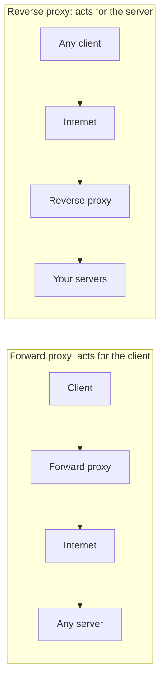
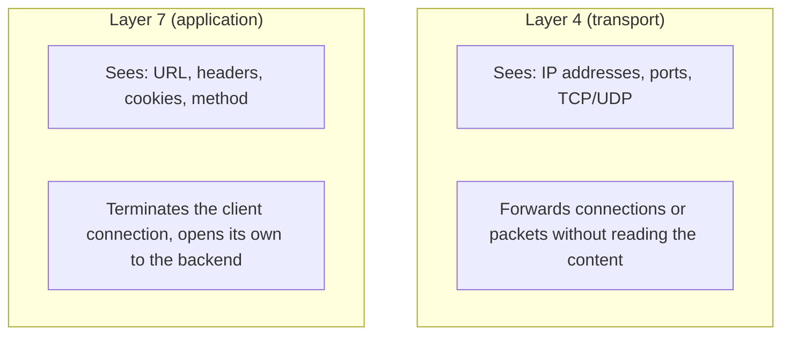
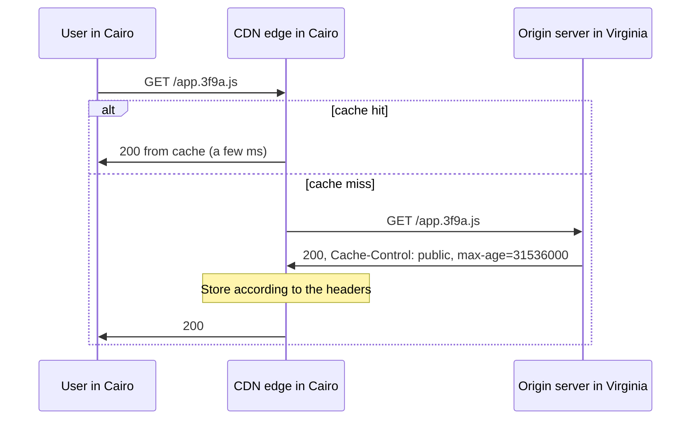
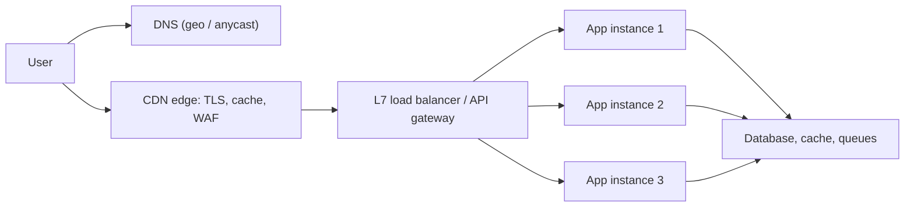

# Proxies, Load Balancers and CDNs

[Home](../README.md) › [Networking](README.md) › Proxies, Load Balancers and CDNs

> **In one sentence:** Almost no request reaches your application directly: it passes through intermediaries that terminate TLS, spread load across instances, remove unhealthy ones, and serve cached copies from locations near the user.

**Before this:** [TCP and UDP](02-tcp-udp.md), [TLS](04-tls-https.md), [HTTP fundamentals](05-http-fundamentals.md), [DNS](03-dns.md).
**After this:** [system design building blocks](../10-system-design/02-building-blocks.md), [caching](../08-backend-engineering/04-caching.md), [deployment](../08-backend-engineering/09-deployment-and-operations.md).

## Forward and reverse proxies

A **proxy** is a server that sits between a client and a server and passes traffic.



| | Forward proxy | Reverse proxy |
|---|---|---|
| Works for | The client | The server |
| The server sees | The proxy's address | The proxy's address |
| The client knows about it | Yes (it is configured) | No (it looks like the server) |
| Used for | Corporate filtering, anonymity, outbound access control | Load balancing, TLS termination, caching, routing, protection |

Backend engineers work with **reverse proxies**: Nginx, HAProxy, Envoy, Traefik, Caddy, and cloud load balancers.

### What a reverse proxy does for you

| Function | Why it helps |
|---|---|
| **TLS termination** | Certificates are managed in one place. The app speaks plain HTTP |
| **Load balancing** | Spreads requests across instances |
| **Health checking** | Stops sending traffic to broken instances |
| **Routing** | `/api/*` to the API service, `/static/*` to file storage, by host or path |
| **Connection handling** | Holds thousands of slow client connections and uses a few fast keep-alive connections to the app |
| **Buffering** | Reads a slow client's request completely before passing it on, and takes the response quickly, so the app is not held by slow clients |
| **Compression and caching** | gzip/brotli, and caching of responses |
| **Protection** | Rate limiting, request size limits, timeouts, IP filtering, WAF rules |
| **Zero-downtime deploys** | Moves traffic between old and new versions |

Node.js can do many of these, but it is usually better to let the proxy do them. Its code is specialized native code, and your Node.js process stays free for application logic.

### What the application must know when behind a proxy

The TCP connection your app sees comes from the proxy, not from the user. The proxy passes the original information in headers:

| Header | Content |
|---|---|
| `X-Forwarded-For` | `client, proxy1, proxy2` — each proxy appends the address it received the request from |
| `X-Forwarded-Proto` | `https` or `http` as seen by the first proxy |
| `X-Forwarded-Host` | The original `Host` header |

**These headers can be faked.** A client can send `X-Forwarded-For: 1.2.3.4` itself. The rule is: trust only the entries added by **your own** proxies. Count from the right: with one trusted proxy in front, the real client IP is the last entry.

```js
// Express: tell it how many proxies to trust.
app.set('trust proxy', 1);     // one proxy hop in front of the app
// Now req.ip, req.protocol and req.secure come from the forwarded headers.
```

If this is misconfigured, [rate limiting](../10-system-design/05-case-rate-limiter.md) by IP can be bypassed with a fake header, or every user appears to have the load balancer's IP and gets limited together.

## Load balancing

A **load balancer** distributes incoming traffic across several backend instances. It gives two things:

- **Scalability:** add instances to handle more load (horizontal scaling).
- **Availability:** if one instance fails, the others continue.

### Layer 4 versus Layer 7



| | Layer 4 | Layer 7 |
|---|---|---|
| Decides by | IP and port | Anything in the HTTP request |
| Unit balanced | Connection | Request |
| TLS | Passes through (or terminates without reading HTTP) | Terminates and inspects |
| Speed | Very fast, low overhead | More CPU per request |
| Features | Simple | Path/host routing, retries, header changes, sticky sessions, canary releases |
| Examples | AWS NLB, HAProxy in TCP mode, IPVS | AWS ALB, Nginx, Envoy, HAProxy in HTTP mode |

The key difference is the **unit**: L4 balances connections, L7 balances requests. With long-lived connections that carry many requests (HTTP/2, gRPC, WebSockets), L4 balancing gives uneven load. See [HTTP/2](06-http2-http3.md#things-that-change-with-multiplexing).

Large systems often use both: L4 at the outer edge for raw throughput, L7 behind it for routing.

### Algorithms

| Algorithm | How it chooses | Good for | Weakness |
|---|---|---|---|
| **Round robin** | Each backend in turn | Identical servers, similar requests | Ignores actual load |
| **Weighted round robin** | In turn, in proportion to weights | Servers of different sizes; canary releases | Weights are static |
| **Least connections** | The backend with the fewest active connections | Requests with very different durations; long-lived connections | Needs connection tracking |
| **Least response time** | The fastest backend recently | Mixed performance | Can oscillate |
| **Random / power of two choices** | Pick two at random, choose the less loaded | Large fleets, many balancers | |
| **IP hash** | Hash of the client IP | Simple stickiness | Uneven behind NAT; reshuffles when backends change |
| **Consistent hashing** | Hash on a ring, so few keys move when backends change | Cache servers, sharding, sticky routing | More complex |

"Power of two choices" is worth knowing: choosing the better of two random backends gives almost the same quality as checking all of them, and it avoids the herd effect where many balancers all pick the same "least loaded" server at once.

[Consistent hashing](../09-distributed-systems/05-partitioning-consistent-hashing.md) matters when the same key should reach the same backend, for example a cache node.

### Health checks

A load balancer must know which backends are able to work.

- **Active checks:** the balancer calls an endpoint (`GET /healthz`) every few seconds. After N failures the backend is removed. After M successes it returns.
- **Passive checks:** the balancer watches real traffic and removes backends that return errors or time out (**outlier detection**).

Design your health endpoints with care:

| Endpoint | Question | If it fails |
|---|---|---|
| **Liveness** | Is the process alive and not stuck? | Restart the process |
| **Readiness** | Can it serve traffic now? (started, connected to dependencies, not shutting down) | Stop sending traffic, do not restart |

A common mistake: the health check queries the database, the database has a short problem, **all** instances fail their checks at once, and the balancer removes all of them. A partial problem becomes a total outage. Liveness checks should not depend on external systems. See [deployment](../08-backend-engineering/09-deployment-and-operations.md).

### Connection draining

When an instance is removed (deploy, scale-in), the balancer should stop sending **new** requests to it but let requests in progress finish. This is **draining**, and it works together with [graceful shutdown](../02-operating-systems/06-signals-ipc-containers.md#graceful-shutdown) in the app: the app fails readiness first, waits for the balancer to notice, then stops.

### Sticky sessions

**Session affinity** sends all requests from one client to the same backend, usually through a cookie set by the balancer.

It is needed when the server keeps per-user state in memory. It has costs: uneven load, lost state when the instance dies, and harder scaling. The better design is **stateless servers**: session data goes to a shared store like Redis, or into a signed token, so any instance can handle any request. See [authentication](../08-backend-engineering/02-authentication-authorization.md).

### Making the load balancer itself available

A single load balancer is a single point of failure. Solutions: an active–passive pair sharing a virtual IP, several balancers behind DNS or anycast, or a managed cloud load balancer that does this for you.

### Other places where balancing happens

- **DNS** — coarse, between regions. See [DNS](03-dns.md#dns-for-traffic-management).
- **Client-side** — the client knows all backends (through service discovery) and chooses one itself. Used by gRPC and by database drivers with multiple hosts.
- **Service mesh** — a sidecar proxy next to each service does L7 balancing, retries and mTLS for it.

## API gateways

An **API gateway** is a reverse proxy specialized for APIs. It is the single entry point for clients and handles the concerns that every service shares:

- Authentication and token validation
- Rate limiting and quotas
- Routing to the right service
- Request and response transformation
- Logging, metrics and tracing

It keeps this logic out of each service. The risk is putting business logic in the gateway, which turns it into a bottleneck that every team must change. See [architecture styles](../10-system-design/03-architecture-styles.md).

## CDNs

A **Content Delivery Network** is a set of reverse proxy caches placed in many locations around the world (**edge locations** or **points of presence**).

### Why

Latency grows with distance. A round trip between continents is 100–200 ms (see [latency numbers](../01-computer-foundations/02-hardware-and-latency.md#latency-numbers-every-engineer-should-know)), and a new HTTPS connection needs several round trips. A CDN puts a copy of your content, and the TLS termination, a few milliseconds from the user.



### How users reach the nearest edge

- **DNS-based routing:** the CDN's DNS server answers with the address of an edge near the user's resolver.
- **Anycast:** the same IP address is announced from every edge, and internet routing delivers packets to the closest one.

### What a CDN does

| Function | Detail |
|---|---|
| **Caching static content** | Images, scripts, styles, video segments, downloads |
| **Caching dynamic content** | API responses that are the same for many users, for short periods |
| **TLS termination at the edge** | Handshakes with a nearby server are fast |
| **Connection optimization** | The edge keeps warm connections to the origin and uses HTTP/2 or HTTP/3 with users |
| **DDoS absorption** | Huge capacity spread over many locations |
| **WAF and bot filtering** | Blocks known attack patterns before they reach you |
| **Edge compute** | Small functions that run at the edge: redirects, header changes, auth checks, A/B tests |
| **Image and video processing** | Resizing and format conversion on request |

### Controlling the CDN: it follows HTTP caching rules

The CDN is a **shared cache**, and it obeys the headers described in [HTTP caching](05-http-fundamentals.md#http-caching):

- `Cache-Control: public, s-maxage=...` to allow and control storage at the edge.
- `Cache-Control: private` or `no-store` for personal data, so it is **never** stored at the edge.
- `Vary` to keep separate copies per relevant request header.

The **cache key** is usually the URL (host, path and query string). If you cache a response that depends on a cookie or the `Authorization` header without making it part of the key, **one user's data is served to another user**. This is one of the most serious caching mistakes.

### Invalidation

When content changes, the cached copies must be replaced.

| Strategy | How | Trade-off |
|---|---|---|
| **Versioned URLs** | Put a content hash in the file name: `app.3f9a1c.js`. New content gets a new URL | The best method. Old copies are never wrong, so they can be cached forever |
| **Short TTL** | `max-age=60` | Simple. Stale for up to the TTL. More origin traffic |
| **Purge** | Call the CDN's API to remove a URL or a tag | Immediate, but takes time to reach all edges and has limits |
| **Stale-while-revalidate** | Serve the old copy while fetching a new one | Fast for users, briefly stale |

### Push and pull

- **Pull CDN** (usual): the edge fetches from your origin on the first request and caches it.
- **Push CDN:** you upload content to the CDN's storage ahead of time. Used for large files.

## A typical request path



Each hop adds its own timeouts, limits and logs. When you debug a failure, the first question is **which hop** produced the error. A `502` comes from a proxy, not from your app. A response header such as `server` or `via` usually tells you who answered.

Timeouts should **decrease** as you go inward: the client's timeout is longer than the CDN's, which is longer than the load balancer's, which is longer than the app's timeout to its database. Otherwise an outer layer gives up while inner layers keep doing work that nobody is waiting for. See [reliability patterns](../08-backend-engineering/06-reliability-patterns.md).

## How this connects

- **Statelessness** is what makes load balancing simple. See [HTTP fundamentals](05-http-fundamentals.md#the-model) and [building blocks](../10-system-design/02-building-blocks.md).
- **Health checks and draining** pair with graceful shutdown in the app. See [errors and process lifecycle](../06-nodejs/05-errors-and-process-lifecycle.md).
- **Keep-alive timeout ordering** between balancer and app prevents `502` errors. See [TCP](02-tcp-udp.md#why-econnreset-happens-in-practice).
- **CDN caching** is the outermost layer of the caching hierarchy. See [caching](../08-backend-engineering/04-caching.md).
- **Consistent hashing** is used for cache-aware and shard-aware routing. See [partitioning](../09-distributed-systems/05-partitioning-consistent-hashing.md).
- **Rate limiting at the edge** is covered in the [rate limiter case study](../10-system-design/05-case-rate-limiter.md).
- **The whole path** is traced in [life of an HTTP request](../13-end-to-end/01-life-of-an-http-request.md).

## Interview questions

<details>
<summary><strong>🟢 Q1. What is a reverse proxy and why use one in front of Node.js?</strong></summary>

A reverse proxy is a server that receives client requests and forwards them to backend servers. To the client it looks like the real server.

In front of Node.js it handles things that are better done outside the application: TLS termination, load balancing across several Node processes or machines, serving static files, compression, buffering slow clients, rate limiting, and request size and timeout limits. That keeps the single-threaded Node process free for application logic and lets me deploy new versions without downtime.

</details>

<details>
<summary><strong>🟢 Q2. What is the difference between a layer 4 and a layer 7 load balancer?</strong></summary>

A layer 4 load balancer works at the transport level. It sees IP addresses and ports and forwards TCP connections or UDP packets without looking at the content. It is very fast and works for any protocol.

A layer 7 load balancer understands HTTP. It terminates the client connection, reads the request, and can route by host, path, headers or cookies. It can terminate TLS, retry failed requests, and balance each request separately. It uses more resources per request.

The practical difference is the unit: layer 4 balances connections, layer 7 balances requests.

</details>

<details>
<summary><strong>🟡 Q3. Which load balancing algorithms do you know, and when would you use each?</strong></summary>

Round robin sends requests to each server in turn. It is fine when servers are equal and requests cost about the same. Weighted round robin adds weights for servers of different capacity, or for sending a small percentage to a new version.

Least connections picks the server with the fewest active connections. It is better when request durations vary a lot or connections are long-lived, like WebSockets.

IP hash and consistent hashing send the same client or key to the same server. Consistent hashing is the better version, because when a server is added or removed only a small part of the keys move. I would use it for cache nodes.

There is also "power of two choices": pick two servers at random and use the less loaded one. It works very well at scale with little coordination.

</details>

<details>
<summary><strong>🟡 Q4. How do you get the real client IP when your app is behind a load balancer?</strong></summary>

The socket's remote address is the load balancer. The original client address is in the `X-Forwarded-For` header, which each proxy appends to.

The danger is that the client can send that header too, with any value. So I must only trust the part added by my own infrastructure. If there is exactly one trusted proxy, the real client IP is the last address in the list. In Express I configure `trust proxy` with the number of proxies, or their address ranges, and then `req.ip` is correct. Taking the first address in the list without thinking is a security bug, because an attacker can fake it to bypass IP-based rate limits.

</details>

<details>
<summary><strong>🟡 Q5. How does a CDN work, and what would you put behind one?</strong></summary>

A CDN is a network of caching proxies in many locations. Users are directed to a nearby edge by DNS or anycast routing. The edge terminates TLS and serves the response from its cache if it has it. On a miss, it fetches from my origin server, stores the response according to the cache headers, and returns it.

I put static assets behind it first: scripts, styles, images, video, with hashed file names and a long max-age. I can also cache public API responses for a short time. I would never let it cache personalized responses, so those must be marked `private` or `no-store`. Beyond caching, a CDN gives DDoS protection, a firewall at the edge, and faster TLS handshakes for distant users.

</details>

<details>
<summary><strong>🟡 Q6. What are sticky sessions, and why are they usually avoided?</strong></summary>

Sticky sessions mean the load balancer sends all requests from a client to the same backend, usually using a cookie. It is needed if the server keeps session state in its own memory.

The problems: load becomes uneven, because some clients are much more active than others. When an instance dies or is replaced during a deploy, its users lose their sessions. And scaling in or out does not rebalance existing users.

The better approach is to keep the application stateless. Session data goes into a shared store like Redis, or into a signed token held by the client. Then any instance can handle any request, and instances can be added or removed freely. WebSockets are a special case, because the connection itself is tied to one server.

</details>

<details>
<summary><strong>🔴 Q7. A database blip lasted 10 seconds, but your whole service was down for two minutes. The health check queries the database. Explain.</strong></summary>

When the database had its short problem, the health check failed on every instance at the same time, because they all share that database. The load balancer marked all of them unhealthy and stopped sending traffic, so users got errors even for endpoints that do not need the database. If the health check is also used as a liveness probe, the orchestrator restarted all the instances together. Then they all had to start again, reconnect, and pass the check several times before the balancer added them back. That recovery takes far longer than the original problem.

The fix is to separate the checks. Liveness should only test that the process itself works, with no external dependencies. Readiness can consider dependencies, but with care: a shared dependency failing should not remove every instance. It is better for the app to stay in rotation and return errors for the affected requests, with timeouts and a circuit breaker, than to disappear completely. Many balancers also have a "fail open" setting, where they keep sending traffic if all backends look unhealthy.

</details>

<details>
<summary><strong>🔴 Q8. A user reports seeing another user's profile data. Where do you look first?</strong></summary>

I would suspect a shared cache serving a personalized response: the CDN, a reverse proxy cache, or an application-level cache with a bad key.

For the HTTP layer, I check the response headers of the profile endpoint. If it does not send `Cache-Control: private` or `no-store`, and the CDN is configured to cache that path, the edge may store the first user's response under the URL alone and return it to everyone. I would also check for a missing `Vary` header, and for cache rules that ignore cookies or the `Authorization` header.

For the application cache, I check that the cache key includes the user ID.

The immediate action is to purge the cache and disable caching for that path. Then I fix the headers and add a test that asserts personalized endpoints are not cacheable.

</details>

## Key takeaways

- A reverse proxy acts for the server: TLS termination, routing, buffering, protection.
- Behind a proxy, client IP and scheme come from `X-Forwarded-*` headers. Trust only your own proxies.
- L4 balances connections (fast, simple). L7 balances requests (smart, more costly).
- Algorithms: round robin, least connections, consistent hashing, power of two choices.
- Health checks: separate liveness from readiness. Do not let a shared dependency remove every instance.
- Prefer stateless servers over sticky sessions.
- A CDN is a geographically distributed shared cache controlled by `Cache-Control`. Never cache personalized responses at the edge.
- Timeouts should get shorter from the outside in.

---

← [WebSockets, SSE and Real-Time](07-websockets-sse-realtime.md) | Next: [04 JavaScript →](../04-javascript/README.md)
