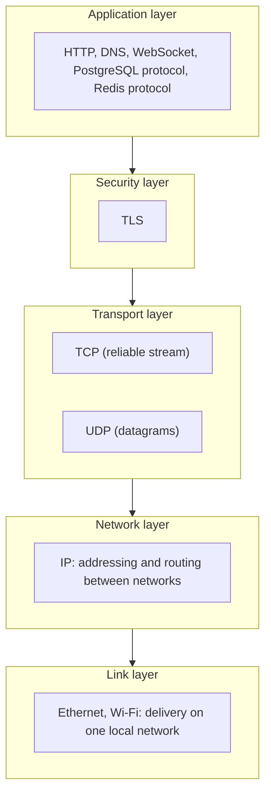

# 03 — Networking

[Home](../README.md) › Networking

A backend is a program that talks to other programs over a network. Every request your service receives, and every query it sends to a database, travels through the layers described here. Timeouts, connection resets, slow first requests, and "it works locally but not in production" are all networking problems.

## Pages

| # | Page | What you will understand |
|---|---|---|
| 1 | [Layers, IP and Routing](01-layers-ip-routing.md) | The layered model, IP addresses, subnets, routing, NAT, ports |
| 2 | [TCP and UDP](02-tcp-udp.md) | Handshake, reliability, flow and congestion control, connection states, sockets |
| 3 | [DNS](03-dns.md) | How names become addresses, record types, caching, TTL |
| 4 | [TLS and HTTPS](04-tls-https.md) | Encryption basics, certificates, the TLS handshake, mTLS |
| 5 | [HTTP Fundamentals](05-http-fundamentals.md) | Methods, status codes, headers, caching, cookies, CORS |
| 6 | [HTTP/2 and HTTP/3](06-http2-http3.md) | Multiplexing, head-of-line blocking, QUIC |
| 7 | [WebSockets, SSE and Real-Time](07-websockets-sse-realtime.md) | Polling, long polling, Server-Sent Events, WebSockets |
| 8 | [Proxies, Load Balancers and CDNs](08-proxies-load-balancers-cdn.md) | Reverse proxies, L4 vs L7 balancing, algorithms, health checks, CDN |

## The stack in one picture

Each layer uses the one below and adds one capability:

| Layer | Adds | Unit of data |
|---|---|---|
| Link | Delivery to a neighbor on the same network | Frame |
| Network (IP) | Delivery across networks to any address | Packet |
| Transport (TCP/UDP) | Delivery to a specific program (port); TCP adds reliability and order | Segment / datagram |
| TLS | Privacy, integrity, and proof of identity | Record |
| Application | Meaning: requests, responses, queries | Message |

## How this section connects to the rest

| Networking concept | Where it shows up |
|---|---|
| Sockets are file descriptors | [Files and I/O](../02-operating-systems/04-files-and-io.md), [I/O multiplexing](../02-operating-systems/05-io-multiplexing.md) |
| TCP is a byte stream without message boundaries | [Buffers and streams](../06-nodejs/03-buffers-and-streams.md) |
| Connection setup is expensive | Keep-alive, HTTP agents, [connection pooling](../07-databases/11-data-access-from-node.md) |
| DNS lookups use the libuv thread pool | [Node.js architecture](../06-nodejs/01-architecture.md) |
| HTTP semantics (methods, status codes, caching) | [API design](../08-backend-engineering/01-api-design.md), [caching](../08-backend-engineering/04-caching.md) |
| Cookies, CORS, TLS | [Authentication](../08-backend-engineering/02-authentication-authorization.md), [web security](../08-backend-engineering/03-web-security.md) |
| Networks are unreliable | [Reliability patterns](../08-backend-engineering/06-reliability-patterns.md), [distributed systems fundamentals](../09-distributed-systems/01-fundamentals.md) |
| Load balancers and CDNs | [System design building blocks](../10-system-design/02-building-blocks.md) |

## Primary sources

- Kurose and Ross, *Computer Networking: A Top-Down Approach*.
- Stevens, *TCP/IP Illustrated, Volume 1*.
- RFC 9293 (TCP), RFC 1034/1035 (DNS), RFC 8446 (TLS 1.3), RFC 9110–9114 (HTTP semantics, HTTP/1.1, HTTP/2, HTTP/3), RFC 9000 (QUIC), RFC 6455 (WebSocket).
- Grigorik, *High Performance Browser Networking* (free online).
- MDN Web Docs for HTTP headers, cookies and CORS.

---

← [Signals, IPC and Containers](../02-operating-systems/06-signals-ipc-containers.md) | Next: [Layers, IP and Routing →](01-layers-ip-routing.md)
