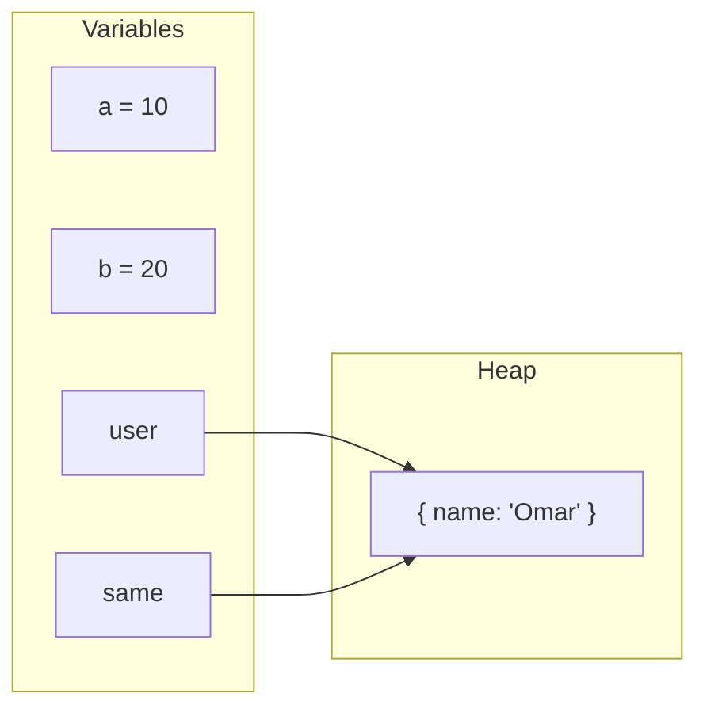

# Types and Coercion

[Home](../README.md) › [JavaScript](README.md) › Types and Coercion

> **In one sentence:** JavaScript has seven primitive types that are copied by value and one object type that is shared by reference, and when an operator gets a type it does not expect, the language converts it by fixed rules that you can learn instead of fear.

**Before this:** [Data representation](../01-computer-foundations/01-data-representation.md).
**After this:** [Execution, scope and closures](02-execution-scope-closures.md), [TypeScript fundamentals](../05-typescript/01-type-system-fundamentals.md).

## The types

JavaScript is **dynamically typed**: a variable has no type, a *value* has a type.

| Type | `typeof` result | Notes |
|---|---|---|
| `undefined` | `'undefined'` | "No value was given" |
| `null` | `'object'` ⚠️ | "Intentionally no value". The `typeof` result is a historical bug that cannot be fixed |
| `boolean` | `'boolean'` | `true`, `false` |
| `number` | `'number'` | 64-bit IEEE 754 double. Includes `NaN`, `Infinity`, `-0` |
| `bigint` | `'bigint'` | Integers of any size: `10n` |
| `string` | `'string'` | Immutable sequence of UTF-16 code units |
| `symbol` | `'symbol'` | A unique, non-string property key |
| **object** | `'object'` or `'function'` | Everything else: plain objects, arrays, functions, dates, maps, errors, promises |

The first seven are **primitives**. Primitives are **immutable**: you cannot change a string or a number, you can only create a new one.

```js
typeof undefined;        // → 'undefined'
typeof null;             // → 'object'    (bug, kept for compatibility)
typeof 42;               // → 'number'
typeof 42n;              // → 'bigint'
typeof 'hi';             // → 'string'
typeof Symbol('id');     // → 'symbol'
typeof {};               // → 'object'
typeof [];               // → 'object'    (use Array.isArray)
typeof function () {};   // → 'function'  (functions are callable objects)
typeof undeclaredName;   // → 'undefined' (typeof never throws for undeclared names)
```

### undefined versus null

- `undefined` is what the language gives you: an unset variable, a missing property, a missing argument, a function with no `return`.
- `null` is what a programmer writes to say "there is deliberately nothing here".

This distinction matters in APIs. In JSON, `undefined` does not exist:

```js
JSON.stringify({ a: undefined, b: null });   // → '{"b":null}'
JSON.stringify([undefined, null]);           // → '[null,null]'
```

So in a `PATCH` body, a missing field ("do not change it") and `null` ("clear it") are different things. See [API design](../08-backend-engineering/01-api-design.md).

### Primitive wrappers

How can `'abc'.toUpperCase()` work if a string is not an object? When you access a property on a primitive, JavaScript temporarily wraps it in an object (`String`, `Number`, `Boolean`), finds the method on that object's prototype, and discards the wrapper.

Never create wrappers yourself: `new String('a')` is an object, so it is truthy and `typeof` gives `'object'`.

## Values and references

This is the single most important fact about JavaScript types.

- A variable holding a **primitive** holds the value itself. Assignment **copies the value**.
- A variable holding an **object** holds a **reference** to it. Assignment **copies the reference**. Both variables point to the same object.

```js
let a = 10;
let b = a;      // copy of the value
b = 20;
a;              // → 10

const user = { name: 'Sara' };
const same = user;      // copy of the reference
same.name = 'Omar';
user.name;              // → 'Omar'   (one object, two names for it)
```



### Arguments are passed by sharing

JavaScript always passes the **value** of the argument. For an object, that value is a reference.

```js
function rename(u) {
  u.name = 'Changed';      // changes the caller's object
}
function replace(u) {
  u = { name: 'New' };     // only changes the local variable
}

const person = { name: 'Original' };
rename(person);
person.name;               // → 'Changed'
replace(person);
person.name;               // → 'Changed'   (not replaced)
```

A function **can mutate** an object it receives, but it **cannot reassign** the caller's variable.

### const is about the binding, not the value

`const` prevents reassigning the variable. It does not make the object immutable.

```js
const list = [1, 2];
list.push(3);            // fine: the array is mutated
// list = [];            // TypeError: Assignment to constant variable

const frozen = Object.freeze({ a: 1, inner: { b: 2 } });
frozen.a = 99;           // ignored (throws in strict mode)
frozen.inner.b = 99;     // works: freeze is shallow
```

### Comparing and copying objects

Objects are compared by **identity**, not by content:

```js
({ a: 1 }) === ({ a: 1 });     // → false  (two different objects)
[] === [];                     // → false
const x = {}; x === x;         // → true
```

Copies:

```js
const original = { name: 'A', tags: ['x'], created: new Date() };

const shallow = { ...original };            // copies top-level properties only
shallow.tags.push('y');
original.tags;                              // → ['x', 'y']   (shared inner array)

const deep = structuredClone(original);     // real deep copy; keeps Date, Map, Set, cycles
const viaJson = JSON.parse(JSON.stringify(original));   // loses Date (becomes string), undefined, functions, Map, Set
```

`structuredClone` is the right default for a deep copy. It cannot clone functions or class instances with their prototypes.

**Why this matters on a backend:** shared mutable objects are a common source of bugs. A cached configuration object returned to callers can be mutated by one request and seen by all others. Returning a cached object by reference and then modifying it corrupts the cache. Either copy on read, freeze, or treat data as immutable.

## Type conversion

**Coercion** is automatic conversion from one type to another. It happens in three directions: to string, to number, and to boolean.

### To boolean: truthy and falsy

There are exactly eight **falsy** values. Everything else is truthy.

```js
false, 0, -0, 0n, '', null, undefined, NaN
```

The surprises are the truthy ones:

```js
Boolean('0');        // → true   (non-empty string)
Boolean('false');    // → true
Boolean([]);         // → true   (all objects are truthy)
Boolean({});         // → true
```

The classic bug:

```js
function setLimit(limit) {
  limit = limit || 100;     // BUG: a valid limit of 0 becomes 100
}
function setLimitFixed(limit) {
  limit = limit ?? 100;     // only null and undefined trigger the default
}
```

- `||` returns the right side when the left is **falsy**.
- `??` (nullish coalescing) returns the right side only when the left is **`null` or `undefined`**.
- `?.` (optional chaining) stops and returns `undefined` when the left is `null` or `undefined`.

### To number

| Value | `Number(value)` |
|---|---|
| `undefined` | `NaN` |
| `null` | `0` |
| `true` / `false` | `1` / `0` |
| `''`, `'  '` | `0` |
| `'42'`, `' 42 '` | `42` |
| `'42px'` | `NaN` |
| `[]` | `0` (via `''`) |
| `[5]` | `5` (via `'5'`) |
| `{}` | `NaN` |

```js
Number('42px');       // → NaN
parseInt('42px', 10); // → 42    (parses until the first invalid character)
parseInt('08');       // → 8
+'3.14';              // → 3.14  (unary plus is Number())
Number('');           // → 0     (often not what you want when validating input)
```

`NaN` is the only value not equal to itself. Use `Number.isNaN(x)`. The global `isNaN(x)` coerces first, so `isNaN('abc')` is `true`.

Input validation rule: never trust `Number(x)` alone. Query parameters and environment variables are always strings, and `Number('')` is `0`. Validate explicitly, or use a schema library. See [TypeScript patterns](../05-typescript/04-patterns-for-backends.md).

### To string

```js
String(null);            // → 'null'
String(undefined);       // → 'undefined'
String([1, 2]);          // → '1,2'
String({});              // → '[object Object]'
`${[1, [2, 3]]}`;        // → '1,2,3'
```

### Objects to primitives

When an object is used where a primitive is needed, the engine calls, in order:

1. `obj[Symbol.toPrimitive](hint)` if it exists.
2. Otherwise, for hint `'string'`: `toString()` then `valueOf()`. For hint `'number'` or `'default'`: `valueOf()` then `toString()`.

Plain objects and arrays have a `valueOf` that returns the object itself, so `toString` is used: `'[object Object]'` for objects, the joined elements for arrays. `Date` is special: with the default hint it prefers the string form.

## Operators and coercion

### The `+` operator

`+` is the only arithmetic operator that also concatenates. The rule: convert both sides to primitives. **If either is a string, concatenate. Otherwise add as numbers.**

```js
1 + 2;            // → 3
'1' + 2;          // → '12'
1 + 2 + '3';      // → '33'     (left to right: 3 + '3')
'1' + 2 + 3;      // → '123'
[] + [];          // → ''       ('' + '')
[] + {};          // → '[object Object]'
1 + null;         // → 1        (null → 0)
1 + undefined;    // → NaN      (undefined → NaN)
true + true;      // → 2
```

The other arithmetic operators (`-`, `*`, `/`, `%`) always convert to numbers:

```js
'10' - 3;         // → 7
'10' * '2';       // → 20
'a' - 1;          // → NaN
```

### Equality

| Operator | Name | Coerces? |
|---|---|---|
| `===` | Strict equality | No. Different types → `false` |
| `==` | Loose equality | Yes |
| `Object.is(a, b)` | Same-value equality | No. Also treats `NaN` as equal to `NaN`, and `+0` as different from `-0` |

The rules of `==`, in the order they apply:

1. Same type → compare like `===`.
2. `null == undefined` → `true`. Neither equals anything else.
3. Number and string → convert the string to a number.
4. Boolean and anything → convert the boolean to a number first.
5. Object and primitive → convert the object to a primitive.

```js
0 == '';            // → true    ('' → 0)
0 == '0';           // → true
'' == '0';          // → false   (both strings: compared as strings)
null == undefined;  // → true
null == 0;          // → false   (rule 2: null only equals undefined)
[] == ![];          // → true    (![] is false → 0; [] → '' → 0)
NaN == NaN;         // → false
[1] == 1;           // → true    ([1] → '1' → 1)
```

Practical rule: **use `===` everywhere**, with one accepted exception: `x == null` is a short and clear test for "`null` or `undefined`".

### Relational operators

`<`, `>`, `<=`, `>=` compare two strings by code units (dictionary order), and otherwise convert both to numbers.

```js
'10' < '9';         // → true    (string comparison: '1' < '9')
10 < 9;             // → false
'10' < 9;           // → false   (one is a number: numeric comparison)
null >= 0;          // → true    (null → 0)
null == 0;          // → false   (different rules!)
undefined >= 0;     // → false   (undefined → NaN)
```

This is why sorting needs care:

```js
[10, 9, 1].sort();                  // → [1, 10, 9]   (default sort compares as strings!)
[10, 9, 1].sort((a, b) => a - b);   // → [1, 9, 10]
```

### Logical operators return operands, not booleans

```js
'a' || 'b';         // → 'a'      (first truthy value)
'' || 'b';          // → 'b'
'a' && 'b';         // → 'b'      (first falsy value, or the last value)
null && 'b';        // → null
0 ?? 5;             // → 0
!!'text';           // → true     (explicit conversion to boolean)
```

## Checking types correctly

| Question | Reliable check |
|---|---|
| Is it a string / number / boolean / bigint / symbol? | `typeof x === 'string'` |
| Is it `null`? | `x === null` |
| Is it `null` or `undefined`? | `x == null` |
| Is it an array? | `Array.isArray(x)` |
| Is it `NaN`? | `Number.isNaN(x)` |
| Is it an integer? | `Number.isInteger(x)`, `Number.isSafeInteger(x)` |
| Is it a plain object? | `x !== null && typeof x === 'object' && !Array.isArray(x)` |
| Is it an instance of a class? | `x instanceof Cls` (checks the prototype chain; fails across realms) |
| Is it a real number usable in math? | `Number.isFinite(x)` |

## Numbers in practice

The details come from [data representation](../01-computer-foundations/01-data-representation.md). The short list:

```js
0.1 + 0.2 === 0.3;                  // → false
Number.MAX_SAFE_INTEGER;            // → 9007199254740991
(0.1 + 0.2).toFixed(2);             // → '0.30'  (a string)
Math.round(1.005 * 100) / 100;      // → 1       (not 1.01: 1.005 is stored as 1.00499...)
9007199254740993n + 1n;             // → 9007199254740994n
// 1n + 1;                          // TypeError: cannot mix BigInt and other types
JSON.stringify({ id: 1n });         // TypeError: BigInt is not serializable by default
```

## Strings in practice

Strings are immutable and UTF-16 (see [data representation](../01-computer-foundations/01-data-representation.md#utf-16-and-javascript-strings)).

```js
const s = 'héllo';
s[0] = 'X';                      // ignored: strings cannot be changed
s.toUpperCase();                 // → 'HÉLLO'  (a new string)
'a,b,,c'.split(',');             // → ['a', 'b', '', 'c']
'  x '.trim();                   // → 'x'
'abc'.at(-1);                    // → 'c'
'a-b-c'.replaceAll('-', '+');    // → 'a+b+c'
'b'.localeCompare('a');          // → 1   (use for language-aware sorting)
```

Building a large string by `+=` in a loop is fine in modern engines for moderate sizes, but for very large outputs, collecting parts in an array and calling `join('')`, or writing to a [stream](../06-nodejs/03-buffers-and-streams.md), is safer for memory.

## How this connects

- **Numbers are doubles**: precision limits come from [data representation](../01-computer-foundations/01-data-representation.md).
- **TypeScript** catches most coercion mistakes at compile time, but it does not change these run-time rules, and data from outside (JSON, query strings, env vars) is still untyped at run time. See [TypeScript fundamentals](../05-typescript/01-type-system-fundamentals.md).
- **Reference semantics** explain closures capturing variables ([scope and closures](02-execution-scope-closures.md)), shared-state bugs in [async code](04-async-javascript.md), and memory retention ([garbage collection](06-memory-garbage-collection.md)).
- **How V8 stores values** (small integers, heap numbers, hidden classes) is in [V8 internals](05-v8-engine-internals.md).
- **JSON serialization rules** shape your API contracts. See [API design](../08-backend-engineering/01-api-design.md).

## Interview questions

<details>
<summary><strong>🟢 Q1. What are the data types in JavaScript?</strong></summary>

There are seven primitive types: `undefined`, `null`, `boolean`, `number`, `bigint`, `string` and `symbol`. And there is the object type, which includes plain objects, arrays, functions, dates, maps and so on.

Primitives are immutable and are copied by value. Objects are mutable and variables hold references to them. One known oddity is that `typeof null` returns `'object'`, which is an old bug kept for compatibility.

</details>

<details>
<summary><strong>🟢 Q2. What is the difference between <code>==</code> and <code>===</code>?</strong></summary>

`===` is strict equality. It returns false if the types are different, with no conversion. `==` is loose equality. If the types are different, it converts them by a set of rules and then compares.

For example, `0 == ''` is true, because the empty string converts to zero, but `0 === ''` is false. I use `===` by default, because the conversions are easy to get wrong. The one place I accept `==` is `x == null`, which checks for both null and undefined.

</details>

<details>
<summary><strong>🟢 Q3. What is the difference between <code>null</code> and <code>undefined</code>?</strong></summary>

`undefined` means a value was never assigned. It is what I get from a declared variable with no value, a missing property, a missing argument, or a function that returns nothing. `null` is a value that a programmer sets on purpose to mean "no value".

In practice the difference shows up in JSON: `undefined` properties are dropped when serializing, and `null` is kept. So in an API, a missing field and a null field can mean different things, for example "do not change" versus "clear this".

</details>

<details>
<summary><strong>🟡 Q4. Is JavaScript pass-by-value or pass-by-reference?</strong></summary>

It is always pass-by-value, but for objects the value is a reference. This is sometimes called pass-by-sharing.

So if a function changes a property of an object parameter, the caller sees the change, because both refer to the same object. But if the function assigns a new object to the parameter, the caller's variable is not affected, because only the local copy of the reference changed.

</details>

<details>
<summary><strong>🟡 Q5. What is the difference between <code>||</code> and <code>??</code>?</strong></summary>

Both give a fallback value, but they test different things. `a || b` returns `b` when `a` is any falsy value: `0`, empty string, `false`, `NaN`, `null` or `undefined`. `a ?? b` returns `b` only when `a` is `null` or `undefined`.

So for a default like a page size or a retry count, where `0` or an empty string can be a valid value, `??` is the correct operator. With `||`, a valid `0` would be replaced by the default.

</details>

<details>
<summary><strong>🟡 Q6. What do these print, and why? <code>[] + []</code>, <code>[] + {}</code>, <code>1 + '2'</code>, <code>'3' - 1</code>, <code>[] == ![]</code></strong></summary>

- `[] + []` is an empty string. The plus operator converts both arrays to primitives. An array's string form is its elements joined by commas, so each is an empty string.
- `[] + {}` is `'[object Object]'`. The array becomes an empty string and the object becomes `'[object Object]'`.
- `1 + '2'` is `'12'`. If either side is a string, plus concatenates.
- `'3' - 1` is `2`. Minus only works on numbers, so the string is converted.
- `[] == ![]` is `true`. `![]` is `false`, because an array is truthy. Then `[] == false`: the boolean becomes `0`, the array becomes an empty string, which becomes `0`. So `0 == 0`.

</details>

<details>
<summary><strong>🟡 Q7. How do you make a deep copy of an object? What are the pitfalls?</strong></summary>

The spread operator and `Object.assign` only make a shallow copy: nested objects are still shared.

For a deep copy I use `structuredClone`. It handles nested objects, arrays, dates, maps, sets and even circular references. It cannot copy functions, and class instances lose their prototype.

The old trick, `JSON.parse(JSON.stringify(obj))`, works only for plain JSON data. It turns dates into strings, drops `undefined` and functions, fails on circular references and on BigInt, and loses maps and sets.

</details>

<details>
<summary><strong>🔴 Q8. A function returns a cached configuration object. Sometimes a request sees values that another request set. What is wrong and how do you fix it?</strong></summary>

The cache returns the same object reference to every caller. Some code mutates that object, for example it sets a property or pushes to an array inside it, and since all callers share the object, the change is visible to every later request. It is a shared mutable state bug.

There are a few fixes. Return a copy from the cache, for example with `structuredClone`, so callers cannot affect the cached version. Or freeze the cached object deeply, so a mutation throws immediately and the bug is found. Or change the calling code to not mutate, and build a new object instead. In TypeScript, I would also type the return value as readonly, so the compiler catches it.

</details>

<details>
<summary><strong>🔴 Q9. Why is <code>null >= 0</code> true but <code>null == 0</code> false?</strong></summary>

Because the two operators use different algorithms. Relational operators like `>=` convert both sides to numbers when they are not both strings. `null` converts to `0`, so the comparison is `0 >= 0`, which is true.

Loose equality has a special rule for `null`: it is only equal to `undefined` and to itself. It is not converted to a number at all. So `null == 0` is false.

This is one of the reasons I avoid relying on implicit conversion and validate or convert values explicitly.

</details>

## Key takeaways

- 7 primitives (immutable, by value) + objects (mutable, by reference).
- `const` fixes the binding, not the content.
- 8 falsy values: `false`, `0`, `-0`, `0n`, `''`, `null`, `undefined`, `NaN`. Empty arrays and objects are truthy.
- `+` concatenates if either side is a string. Other arithmetic operators convert to numbers.
- Use `===`. Use `??` for defaults. Use `x == null` for null-or-undefined.
- Spread is shallow. `structuredClone` is deep.
- Default `sort()` compares as strings. Pass a comparator for numbers.

---

← [JavaScript](README.md) | Next: [Execution, Scope and Closures →](02-execution-scope-closures.md)
