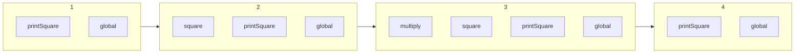
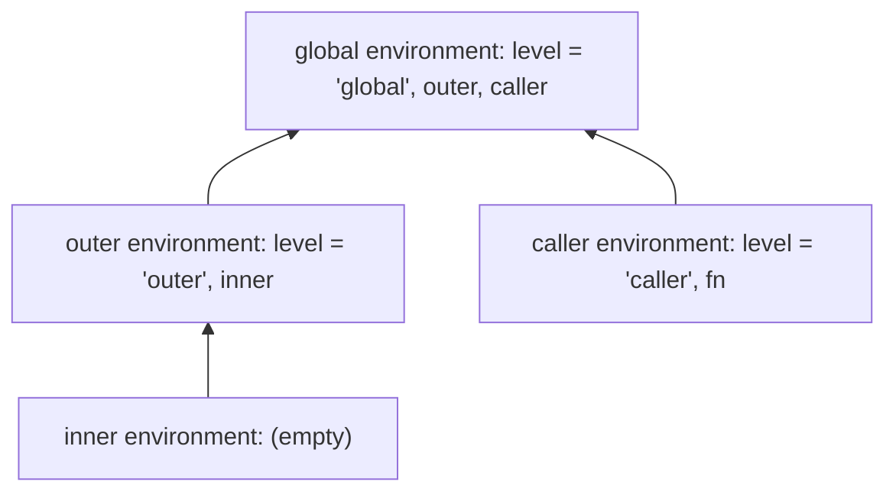
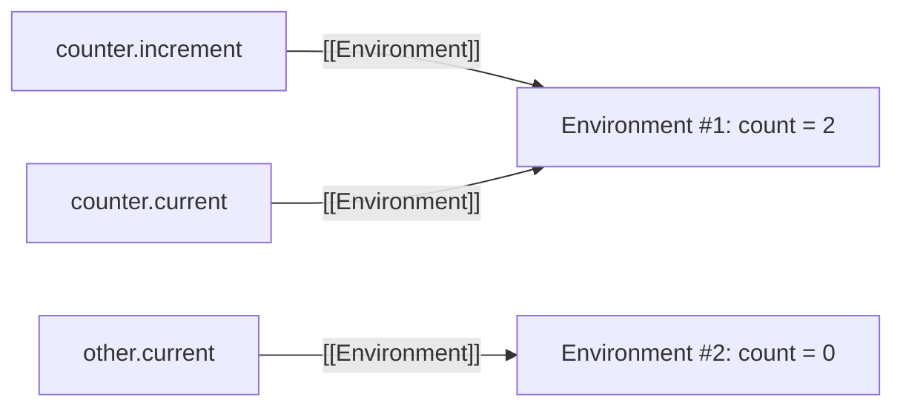

# Execution, Scope and Closures

[Home](../README.md) › [JavaScript](README.md) › Execution, Scope and Closures

> **In one sentence:** Every time code runs, the engine creates an execution context with an environment that maps names to values, environments are linked to the place where the function was *written*, and a function that keeps that link alive after its outer function has returned is a closure.

**Before this:** [Types and coercion](01-types-and-coercion.md).
**After this:** [`this`, prototypes and classes](03-this-prototypes-classes.md), [async JavaScript](04-async-javascript.md), [memory and GC](06-memory-garbage-collection.md).

## Execution contexts and the call stack

JavaScript runs code inside **execution contexts**. There are three kinds:

- The **global** context: created once when the script starts.
- A **function** context: created each time a function is **called**.
- A **module** context: one per ES module.

Each context holds:

1. An **environment record**: the variables, functions and parameters declared in it.
2. A reference to its **outer environment**: where to look when a name is not found here.
3. The value of **`this`** (covered in the [next page](03-this-prototypes-classes.md)).

Contexts are kept on the **call stack**. Calling a function pushes a context. Returning pops it.

```js
function multiply(a, b) {
  return a * b;
}
function square(n) {
  return multiply(n, n);
}
function printSquare(n) {
  console.log(square(n));
}
printSquare(4);
```



Two consequences:

- **There is one call stack, so one thing runs at a time.** While the stack is not empty, nothing else can run: no timers, no I/O callbacks, no promise reactions. This is the run-to-completion rule, and it is why a long synchronous function blocks a Node.js server. See [the event loop](../06-nodejs/02-event-loop.md).
- **The stack has a size limit.** Recursion that goes too deep throws `RangeError: Maximum call stack size exceeded`. The limit depends on frame size, typically around ten thousand frames. See [recursion](../11-data-structures-algorithms/07-recursion-backtracking.md).

A **stack trace** in an error is a snapshot of this stack at the moment the error was created.

## Two phases: creation and execution

When the engine enters a context it works in two steps.

1. **Creation phase.** It scans the code for declarations and sets up the environment record **before running any line**.
2. **Execution phase.** It runs the code line by line.

This is what people call **hoisting**. Nothing is physically moved. Declarations are simply registered first.

| Declaration | At creation | Access before the declaration line |
|---|---|---|
| `var x` | Created and set to `undefined` | `undefined` |
| `function f() {}` | Created and set to the function | Works |
| `let x`, `const x`, `class C` | Created but **uninitialized** | `ReferenceError` |
| `import` | Bound before any module code runs | Works |

```js
console.log(a);        // → undefined   (var is hoisted and initialized)
var a = 1;

greet();               // → 'hi'        (function declarations are fully hoisted)
function greet() { console.log('hi'); }

// console.log(b);     // ReferenceError: Cannot access 'b' before initialization
let b = 2;

// sayBye();           // TypeError: sayBye is not a function (it is undefined here)
var sayBye = function () {};
```

### The temporal dead zone

A `let` or `const` variable exists from the start of its block, but cannot be used until its declaration line runs. The time in between is the **temporal dead zone (TDZ)**.

```js
const x = 'outer';
function demo() {
  // console.log(x);   // ReferenceError — NOT 'outer'. The inner x already exists in this scope.
  const x = 'inner';
  return x;
}
```

The TDZ exists to catch bugs: using a variable before it has its value is almost always a mistake.

## Scope

**Scope** is the region of code where a name is visible.

| Scope | Created by | Holds |
|---|---|---|
| Global | The program | Globals |
| Module | Each ES module (and each CommonJS file, through its wrapper function) | Top-level declarations of the file |
| Function | Each function call | Parameters, `var`, and inner declarations |
| Block | `{ }`, `if`, `for`, `while`, `switch`, `try/catch` | `let`, `const`, `class` |

### var, let and const

| | `var` | `let` | `const` |
|---|---|---|---|
| Scope | Function | Block | Block |
| Before declaration | `undefined` | TDZ error | TDZ error |
| Redeclare in the same scope | Allowed | Error | Error |
| Reassign | Yes | Yes | No |
| Creates a property on the global object | Yes (in scripts) | No | No |

Use `const` by default, `let` when you must reassign, and never `var` in new code.

### Lexical scope and the scope chain

JavaScript uses **lexical scope**: what a function can see is decided by **where it is written in the source**, not by where it is called from.

When code uses a name, the engine looks in the current environment. If the name is not there, it follows the outer reference, again and again, up to the global environment. This list is the **scope chain**.

```js
const level = 'global';

function outer() {
  const level = 'outer';
  function inner() {
    return level;          // found in outer's environment
  }
  return inner;
}

function caller() {
  const level = 'caller';
  const fn = outer();
  return fn();             // called here, but defined inside outer
}

caller();                  // → 'outer'
```



`inner` was written inside `outer`, so its chain goes through `outer`, never through `caller`.

**Shadowing** is when an inner scope declares a name that already exists in an outer scope. The inner one hides the outer one inside that scope.

## Closures

A **closure** is a function together with a reference to the environment in which it was created.

Every function in JavaScript has this reference (stored internally as `[[Environment]]`). It becomes visible and useful when the function **outlives** the call that created it: the outer function has returned, its context is gone from the stack, but its environment record is kept alive because the inner function still points to it.

```js
function createCounter() {
  let count = 0;                 // lives in createCounter's environment
  return {
    increment() { return ++count; },
    current() { return count; },
  };
}

const counter = createCounter();   // createCounter has returned
counter.increment();               // → 1
counter.increment();               // → 2
counter.current();                 // → 2

const other = createCounter();     // a new call creates a new, separate environment
other.current();                   // → 0
```



Three facts to remember:

1. **A closure captures variables, not values.** It sees the *current* value of the variable when it runs, and it can change it.
2. **Each call creates a new environment.** `counter` and `other` do not share `count`.
3. **The environment lives as long as something references the function.** This is how closures can cause memory retention. See below and in [memory and GC](06-memory-garbage-collection.md).

### The loop problem

This is the most asked closure question.

```js
for (var i = 0; i < 3; i++) {
  setTimeout(() => console.log(i), 0);
}
// prints: 3 3 3
```

`var` is function-scoped, so there is **one** variable `i` shared by all three callbacks. The callbacks run after the loop has finished, when `i` is `3`.

```js
for (let i = 0; i < 3; i++) {
  setTimeout(() => console.log(i), 0);
}
// prints: 0 1 2
```

With `let`, the language creates a **new binding of `i` for every iteration**, and copies the value forward. Each callback closes over its own `i`.

Before `let` existed, the fix was to create a new scope by calling a function:

```js
for (var i = 0; i < 3; i++) {
  ((j) => setTimeout(() => console.log(j), 0))(i);    // an IIFE: immediately invoked function expression
}
```

### What closures are used for

**Private state.** The only access to `count` above is through the returned methods. (Classes now also have real private fields with `#name`.)

**Function factories and configuration.**

```js
function createLogger(prefix) {
  return (message) => console.log(`[${prefix}] ${message}`);
}
const dbLog = createLogger('db');
dbLog('connected');                    // prints: [db] connected
```

**Middleware and handlers that need dependencies.** This is everywhere in Node.js.

```js
function requireRole(role) {                 // configuration captured by the closure
  return (req, res, next) => {
    if (req.user?.role !== role) return res.status(403).end();
    next();
  };
}
app.get('/admin', requireRole('admin'), handler);
```

**Memoization.**

```js
function memoize(fn) {
  const cache = new Map();                   // private to this memoized function
  return (arg) => {
    if (!cache.has(arg)) cache.set(arg, fn(arg));
    return cache.get(arg);
  };
}
```

**Callbacks that remember context.** Every callback passed to `setTimeout`, an event emitter, or `.then()` that uses a variable from the surrounding function is a closure. Async code depends on closures to "remember" what a request was doing while it waited. See [async JavaScript](04-async-javascript.md).

**Partial application and currying.**

```js
const add = (a) => (b) => a + b;
const add5 = add(5);
add5(3);                                     // → 8
```

**Debounce and throttle.**

```js
function debounce(fn, ms) {
  let timer;                                 // shared by all calls of the returned function
  return (...args) => {
    clearTimeout(timer);
    timer = setTimeout(() => fn(...args), ms);
  };
}
```

### Closures and memory

A closure keeps its environment alive. Engines optimize this: V8 keeps only the variables that some inner function actually uses, in a heap object called a **context**. But all inner functions created in the same scope **share one context**. So a large value that one closure uses stays alive as long as *any* closure from that scope is alive.

```js
function handler() {
  const bigBuffer = Buffer.alloc(50 * 1024 * 1024);

  const unused = () => bigBuffer.length;     // uses bigBuffer, but is never kept
  return () => 'done';                       // does not use bigBuffer...
}
const fn = handler();
// ...but bigBuffer may still be retained, because both closures share one context.
```

The practical rules:

- Long-lived closures (event listeners, timers, cache entries, module-level callbacks) should not capture large objects they do not need.
- Remove listeners and clear timers when they are no longer needed. An interval whose callback closes over a request object keeps that request alive forever.

This is the most common shape of memory leak in Node.js. See [memory and GC](06-memory-garbage-collection.md#common-leak-patterns).

## Functions

### Declarations, expressions and arrows

```js
function declared() {}                 // hoisted completely
const expressed = function () {};      // the variable follows let/const rules
const arrow = () => {};                // same, plus the differences below
```

Arrow functions differ from normal functions in four ways:

| | Normal function | Arrow function |
|---|---|---|
| `this` | Set by how it is called | Taken from the enclosing scope (lexical) |
| `arguments` object | Yes | No (use `...args`) |
| Can be called with `new` | Yes | No |
| Has a `prototype` property | Yes | No |

The details of `this` are in the [next page](03-this-prototypes-classes.md).

### Parameters

```js
function connect(host, port = 5432, ...rest) {}   // default and rest parameters
connect.length;                                   // → 1  (parameters before the first default)

function f({ id, name = 'anon' } = {}) {}         // destructuring with defaults
```

Default values are evaluated **at call time**, each call, from left to right. A default can use earlier parameters.

### First-class functions

Functions are objects. They can be stored in variables, passed as arguments, returned from functions, and have properties. A function that takes or returns a function is a **higher-order function** (`map`, `filter`, `reduce`, middleware, decorators).

### Strict mode

`'use strict'` at the top of a file or function turns on safer rules: assigning to an undeclared variable throws instead of creating a global, `this` is `undefined` in plain function calls, and some silent failures become errors. **ES modules and class bodies are always strict.** With TypeScript or ESM you are already in strict mode.

## Pure functions and side effects

A **pure function** always returns the same output for the same input and changes nothing outside itself. Pure functions are easy to test, safe to call concurrently, and safe to cache or retry. A **side effect** is anything else: writing to a database, logging, mutating an argument, reading the clock.

Good backend design pushes side effects to the edges (controllers, repositories) and keeps the core logic pure. See [software design](../08-backend-engineering/10-software-design.md).

## How this connects

- **The single call stack** is why JavaScript is run-to-completion, which is the base of the [event loop](../06-nodejs/02-event-loop.md).
- **Closures** are how async callbacks keep their context across time. See [async JavaScript](04-async-javascript.md).
- **Environment retention** is the mechanism behind many leaks. See [memory and GC](06-memory-garbage-collection.md).
- **Module scope** gives each file its own top-level scope. See [modules](07-modules.md).
- **Lexical `this`** in arrow functions follows the same scope chain. See [`this`, prototypes and classes](03-this-prototypes-classes.md).
- **The call stack and recursion depth** matter in [recursion and backtracking](../11-data-structures-algorithms/07-recursion-backtracking.md).
- **Dependency injection** is a structured version of "a function that closes over its dependencies". See [NestJS internals](../06-nodejs/08-nestjs-internals.md).

## Interview questions

<details>
<summary><strong>🟢 Q1. What is a closure?</strong></summary>

A closure is a function that keeps access to the variables of the scope where it was created, even after that outer function has finished running.

It works because every function stores a reference to its outer environment. If I return an inner function from an outer function, the outer function's variables stay alive for as long as the inner function exists. Closures are used for private state, function factories, memoization, and for callbacks that need to remember context, like middleware that is configured with options.

</details>

<details>
<summary><strong>🟢 Q2. What is hoisting?</strong></summary>

Before running the code in a scope, the engine first registers all declarations in that scope. That makes it look as if declarations were moved to the top.

Function declarations are fully available before their line. `var` variables exist but hold `undefined` until the assignment runs. `let`, `const` and `class` are also registered, but they are in the temporal dead zone: reading them before the declaration line throws a `ReferenceError`.

</details>

<details>
<summary><strong>🟢 Q3. What are the differences between <code>var</code>, <code>let</code> and <code>const</code>?</strong></summary>

`var` is function-scoped, is initialized to `undefined` when hoisted, and can be redeclared. `let` and `const` are block-scoped, cannot be used before their declaration because of the temporal dead zone, and cannot be redeclared in the same scope.

`const` also cannot be reassigned. But it does not make an object immutable: I can still change the properties of an object held in a `const`. I use `const` by default and `let` only when I need to reassign.

</details>

<details>
<summary><strong>🟡 Q4. What does this print and why? How do you fix it?</strong>

```js
for (var i = 0; i < 3; i++) {
  setTimeout(() => console.log(i), 100);
}
```

</summary>

It prints `3` three times. `var` is function-scoped, so there is only one `i`, shared by all three callbacks. The callbacks run after the loop has ended, and by then `i` is 3. A closure captures the variable, not the value it had at that moment.

The fix is to use `let`. With `let`, each loop iteration gets its own binding of `i`, so each callback closes over a different variable and it prints 0, 1, 2. The older fix was to wrap the body in an immediately invoked function that takes `i` as a parameter, which creates a new scope per iteration.

</details>

<details>
<summary><strong>🟡 Q5. What is lexical scope?</strong></summary>

Lexical scope means that the variables a function can access are determined by where the function is written in the source code, not by where it is called.

When the function uses a name, the engine looks in the function's own scope first, then in the scope where the function was defined, and so on outward to the global scope. This is fixed when the function is created. So if I pass a function to another module and call it there, it still sees the variables from its original location.

</details>

<details>
<summary><strong>🟡 Q6. What is the temporal dead zone, and why does it exist?</strong></summary>

It is the period between entering a block and reaching the line where a `let`, `const` or `class` is declared. The variable exists in the scope during that time, but it is not initialized, and any access throws a `ReferenceError`.

It exists to catch mistakes. With `var`, using a variable before assignment silently gives `undefined`, which hides bugs. It also makes `const` meaningful: a constant should never be observable with two different values, `undefined` first and the real value later.

</details>

<details>
<summary><strong>🟡 Q7. How can closures cause memory leaks?</strong></summary>

A closure keeps its outer environment alive. If the closure itself lives for a long time, for example as an event listener, a timer callback, or an entry in a cache, then everything it references through that environment cannot be garbage collected.

A typical case in Node.js is adding a listener or starting an interval inside a request handler, where the callback uses the request or some large object, and never removing it. Each request adds one more retained closure. In V8, all closures created in the same scope share one context object, so a variable used by any of them stays alive while any of them is alive.

The fix is to remove listeners and clear timers, to avoid capturing large objects in long-lived callbacks, and to pass only the small values the callback needs.

</details>

<details>
<summary><strong>🔴 Q8. Implement a function <code>once(fn)</code> that makes sure <code>fn</code> is called at most one time.</strong></summary>

```js
function once(fn) {
  let called = false;
  let result;
  return function (...args) {
    if (!called) {
      called = true;
      result = fn.apply(this, args);
      fn = null;             // release the original function and what it closes over
    }
    return result;
  };
}

const init = once(() => { console.log('init'); return 42; });
init();   // prints 'init', returns 42
init();   // returns 42, prints nothing
```

The state, `called` and `result`, lives in the closure, so it is private and each wrapped function has its own. I use a normal function for the wrapper and `apply` with `this`, so it also works as a method. Setting `called` before invoking `fn` means that if `fn` throws, it still counts as called. Whether that is right depends on the requirement, and I would ask the interviewer.

</details>

<details>
<summary><strong>🔴 Q9. What does this print?</strong>

```js
let x = 1;
function a() { console.log(x); }
function b() { let x = 2; a(); }
b();
```

</summary>

It prints `1`. Function `a` is defined at the top level, so its outer scope is the top-level scope, where `x` is 1. It does not matter that `a` is called from inside `b`, where another `x` exists. JavaScript uses lexical scope, not dynamic scope: the scope chain is fixed by where the function is written.

</details>

## Key takeaways

- Each function call creates an execution context with its own environment. Contexts live on one call stack.
- Declarations are registered before code runs. `var` → `undefined`, functions → ready, `let`/`const` → temporal dead zone.
- Scope is lexical: decided by where code is written.
- A closure = function + its defining environment. It captures variables, not values.
- `let` in a `for` loop creates a new binding per iteration.
- Closures keep environments alive. Long-lived closures are the usual source of leaks.

---

← [Types and Coercion](01-types-and-coercion.md) | Next: [`this`, Prototypes and Classes →](03-this-prototypes-classes.md)
