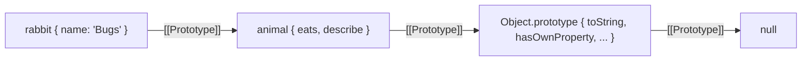
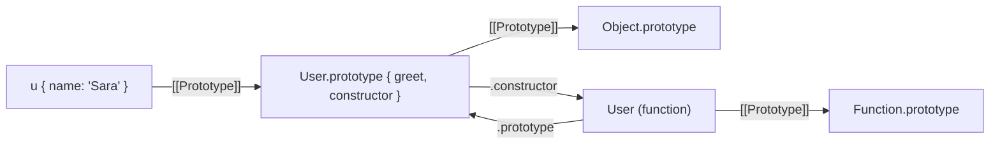
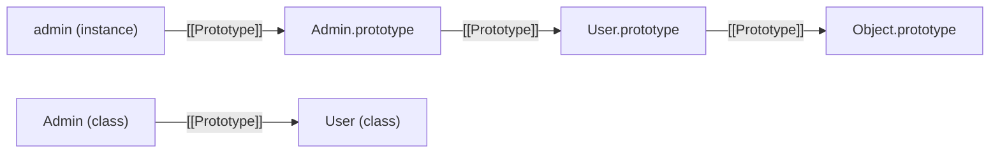

# `this`, Prototypes and Classes

[Home](../README.md) › [JavaScript](README.md) › `this`, Prototypes and Classes

> **In one sentence:** `this` is decided by how a function is *called* (except in arrow functions, which take it from where they are written), objects inherit by delegating property lookups along a chain of prototypes, and `class` is cleaner syntax over exactly that mechanism.

**Before this:** [Execution, scope and closures](02-execution-scope-closures.md).
**After this:** [TypeScript fundamentals](../05-typescript/01-type-system-fundamentals.md), [NestJS internals](../06-nodejs/08-nestjs-internals.md), [V8 internals](05-v8-engine-internals.md).

## `this`

Variables are resolved by **lexical scope**: where the code is written. `this` is different. For a normal function, `this` is set **at each call**, by the way the call is made.

There are four rules. Check them in this order of priority.

### Rule 1: `new` binding

Calling a function with `new` creates a fresh object and binds `this` to it.

```js
function User(name) {
  this.name = name;
}
const u = new User('Sara');
u.name;                       // → 'Sara'
```

### Rule 2: explicit binding with `call`, `apply`, `bind`

You choose `this` yourself.

```js
function greet(greeting, mark) {
  return `${greeting}, ${this.name}${mark}`;
}
const sara = { name: 'Sara' };

greet.call(sara, 'Hello', '!');       // → 'Hello, Sara!'   (arguments listed)
greet.apply(sara, ['Hello', '!']);    // → 'Hello, Sara!'   (arguments as an array)

const bound = greet.bind(sara, 'Hi'); // returns a NEW function with this (and 'Hi') fixed
bound('?');                           // → 'Hi, Sara?'
```

A bound function keeps its `this` forever. It cannot be rebound, and `call` cannot override it.

### Rule 3: implicit binding (method call)

When a function is called as `obj.method()`, `this` is the object **to the left of the dot**.

```js
const account = {
  owner: 'Omar',
  describe() { return `Account of ${this.owner}`; },
};
account.describe();           // → 'Account of Omar'
```

### Rule 4: default binding

A plain call `fn()` has no object. In strict mode (all modules and classes) `this` is `undefined`. In sloppy mode it is the global object.

```js
'use strict';
function show() { return this; }
show();                       // → undefined
```

### Losing `this`

The most common bug: a method is **separated from its object**, then called plainly. Rule 3 no longer applies.

```js
class Counter {
  count = 0;
  increment() { this.count++; }
}
const counter = new Counter();

const inc = counter.increment;     // just a reference to the function
// inc();                          // TypeError: Cannot read properties of undefined (reading 'count')

// The same thing happens whenever a method is passed as a callback:
// setTimeout(counter.increment, 100);
// emitter.on('tick', counter.increment);
// router.get('/x', controller.handle);
```

The receiving code calls your function as `callback()`, with no object to the left of a dot.

Three fixes:

```js
setTimeout(() => counter.increment(), 100);            // 1. wrap in an arrow function
setTimeout(counter.increment.bind(counter), 100);      // 2. bind

class SafeCounter {                                    // 3. arrow function as a class field
  count = 0;
  increment = () => { this.count++; };                 //    created per instance, this is fixed
}
```

Option 3 costs one function object per instance instead of one shared on the prototype. That is usually fine, but it matters for classes with very many instances.

### Arrow functions: lexical `this`

An arrow function has **no `this` of its own**. It uses the `this` of the scope where it is **written**, exactly like a normal variable from the outer scope. `call`, `apply`, `bind` and `new` cannot change it.

```js
class Poller {
  ticks = 0;
  start() {
    setInterval(() => {
      this.ticks++;            // this is the Poller instance: taken from start()
    }, 1000);
  }
}
```

This is why arrows are right for callbacks inside methods, and **wrong** as object methods or prototype methods that need a dynamic `this`:

```js
const obj = {
  name: 'x',
  regular() { return this.name; },      // → 'x'
  arrow: () => this?.name,              // this is the module's this, not obj
};
```

### Summary table

| How the function is called | `this` is |
|---|---|
| `new Fn()` | The new object |
| `fn.call(obj)`, `fn.apply(obj)`, `fn.bind(obj)()` | `obj` |
| `obj.fn()` | `obj` |
| `fn()` | `undefined` (strict) or the global object (sloppy) |
| Arrow function | The `this` of the enclosing scope, always |
| Event listener (normal function) on an `EventEmitter` | The emitter |
| Top level of a CommonJS module | `module.exports` |
| Top level of an ES module | `undefined` |

## Prototypes

### The idea

JavaScript has no classical class inheritance underneath. Every object has a hidden link, `[[Prototype]]`, to another object or to `null`. When you read a property that the object does not have, the engine follows the link and looks there, then follows the next link, until it finds the property or reaches `null`. This list of links is the **prototype chain**, and the mechanism is **delegation**.

```js
const animal = {
  eats: true,
  describe() { return `${this.name} eats: ${this.eats}`; },
};

const rabbit = Object.create(animal);   // rabbit's [[Prototype]] is animal
rabbit.name = 'Bugs';

rabbit.name;                    // → 'Bugs'    (own property)
rabbit.eats;                    // → true      (found on animal)
rabbit.describe();              // → 'Bugs eats: true'   (method found on animal, this is rabbit)
rabbit.toString();              // found on Object.prototype

Object.getPrototypeOf(rabbit) === animal;     // → true
Object.hasOwn(rabbit, 'eats');                // → false
'eats' in rabbit;                             // → true   (in checks the whole chain)
```



Rules to remember:

- **Reading** walks the chain. **Writing** always creates or changes an **own** property on the object itself (unless a setter is found on the chain). `rabbit.eats = false` does not change `animal`.
- A method found on a prototype still gets `this` from the call: `rabbit.describe()` runs with `this === rabbit`.
- Methods live **once** on the prototype and are shared by all objects that link to it. This is the memory advantage over creating functions per object.

### `prototype` versus `[[Prototype]]`

These two names cause most of the confusion.

- **`[[Prototype]]`** is the hidden link every object has. Read it with `Object.getPrototypeOf(obj)`. (`obj.__proto__` is an old accessor for it. Avoid it.)
- **`.prototype`** is a normal property that exists only on **functions and classes**. It is the object that will become the `[[Prototype]]` of instances created with `new`.

```js
function User(name) { this.name = name; }
User.prototype.greet = function () { return `Hi, ${this.name}`; };

const u = new User('Sara');
Object.getPrototypeOf(u) === User.prototype;     // → true
User.prototype.constructor === User;             // → true
```



### What `new` does

`new Fn(args)` performs four steps:

1. Create a new empty object.
2. Set its `[[Prototype]]` to `Fn.prototype`.
3. Call `Fn` with `this` bound to the new object.
4. If `Fn` returned an object, the result is that object. Otherwise the result is the new object.

```js
function myNew(Fn, ...args) {
  const obj = Object.create(Fn.prototype);     // steps 1 and 2
  const result = Fn.apply(obj, args);          // step 3
  return (result !== null && typeof result === 'object') || typeof result === 'function'
    ? result                                    // step 4
    : obj;
}
```

### `instanceof`

`obj instanceof Fn` asks: "is `Fn.prototype` somewhere in the prototype chain of `obj`?" It checks the chain, not the constructor that was used. It can fail when the same class is loaded twice (two copies of a package in `node_modules`) or across realms (worker threads, `vm` contexts), because then there are two different prototype objects.

## Classes

`class` (ES2015) is mostly **syntax** over constructor functions and prototypes, with some real additions.

```js
class User {
  static count = 0;                    // property on the class itself (User.count)
  #passwordHash;                       // private field: truly inaccessible outside the class
  role = 'member';                     // public field: created on each instance

  constructor(name, passwordHash) {
    this.name = name;
    this.#passwordHash = passwordHash;
    User.count++;
  }

  greet() {                            // goes on User.prototype (shared)
    return `Hi, ${this.name}`;
  }

  get isAdmin() {                      // accessor on the prototype
    return this.role === 'admin';
  }

  checkPassword(hash) {
    return this.#passwordHash === hash;
  }

  static fromJSON(json) {              // static method: called as User.fromJSON(...)
    return new User(json.name, json.hash);
  }
}

typeof User;                                         // → 'function'
Object.getOwnPropertyNames(User.prototype);          // → ['constructor', 'greet', 'isAdmin', 'checkPassword']
```

| Class element | Where it lives |
|---|---|
| Methods, getters, setters | `Class.prototype` — one copy, shared |
| Public and private fields | Each **instance** — created when the constructor runs |
| `static` members | The class (constructor function) itself |

How classes differ from plain constructor functions:

- A class **must** be called with `new`.
- Class declarations are in the **temporal dead zone** until their line (not usable before, unlike function declarations).
- Class bodies are always in **strict mode**.
- Methods are **non-enumerable**.
- **`#private` fields** are enforced by the language at run time. TypeScript's `private` keyword is checked only at compile time and does not exist at run time. See [TypeScript fundamentals](../05-typescript/01-type-system-fundamentals.md).

### Inheritance

```js
class Admin extends User {
  constructor(name, hash, permissions) {
    super(name, hash);              // must come before any use of this
    this.permissions = permissions;
    this.role = 'admin';
  }

  greet() {
    return `${super.greet()} (admin)`;     // call the parent's method
  }
}

const admin = new Admin('Lina', 'h', ['users:write']);
admin.greet();                             // → 'Hi, Lina (admin)'
admin instanceof Admin;                    // → true
admin instanceof User;                     // → true
```

`extends` builds **two** prototype chains:



- Instances: `Admin.prototype → User.prototype`. This gives inherited **methods**.
- Classes: `Admin → User`. This gives inherited **static** members.

In a subclass, the object is created by the **parent** constructor. That is why `this` cannot be used before `super()`.

A trap with fields: field initializers of the parent run during `super()`, before the child's fields exist. If the parent constructor calls a method that the child overrides, that method runs before the child's fields are initialized.

### Composition over inheritance

Inheritance creates a strong link between classes: a change in a base class affects every subclass, and deep hierarchies become hard to change. In backend code, prefer **composition**: an object is given the other objects it needs and delegates to them.

```js
// Inheritance: UserService IS A BaseRepository. Hard to test and to change.
// class UserService extends BaseRepository {}

// Composition: UserService HAS A repository and a mailer. Each can be replaced.
class UserService {
  constructor(userRepository, mailer) {
    this.userRepository = userRepository;
    this.mailer = mailer;
  }
  async register(data) {
    const user = await this.userRepository.create(data);
    await this.mailer.sendWelcome(user);
    return user;
  }
}
```

This is exactly what dependency injection does in NestJS. See [NestJS internals](../06-nodejs/08-nestjs-internals.md) and [software design](../08-backend-engineering/10-software-design.md).

## Property descriptors

Every property has attributes that control how it behaves.

| Attribute | Meaning |
|---|---|
| `value` | The value |
| `writable` | Can the value be changed? |
| `enumerable` | Does it appear in `for...in`, `Object.keys`, spread, `JSON.stringify`? |
| `configurable` | Can it be deleted or redefined? |
| `get` / `set` | Accessor functions, instead of `value` / `writable` |

```js
const obj = {};
Object.defineProperty(obj, 'id', { value: 1, writable: false, enumerable: false });
obj.id = 2;                  // ignored (TypeError in strict mode)
Object.keys(obj);            // → []
JSON.stringify(obj);         // → '{}'
```

| Function | Add properties | Remove properties | Change values |
|---|---|---|---|
| `Object.preventExtensions(o)` | ❌ | ✅ | ✅ |
| `Object.seal(o)` | ❌ | ❌ | ✅ |
| `Object.freeze(o)` | ❌ | ❌ | ❌ |

All three are **shallow**.

This explains a common surprise: `JSON.stringify(new Error('boom'))` gives `'{}'`, because `message` and `stack` are non-enumerable. Loggers handle errors specially for this reason.

## Prototype pollution

Because objects share `Object.prototype`, adding a property there makes it appear on **every** object. If user input can reach that, it is a security bug.

```js
// A naive deep merge of untrusted JSON:
const payload = JSON.parse('{"__proto__": {"isAdmin": true}}');
// merge(target, payload) ends up assigning Object.prototype.isAdmin = true
// Afterwards, for ANY object: ({}).isAdmin === true
```

Defenses: validate input with a schema, reject the keys `__proto__`, `constructor` and `prototype` in merge code, use `Object.create(null)` or `Map` for dictionaries built from user keys, and keep libraries updated. See [web security](../08-backend-engineering/03-web-security.md).

## How this connects

- **Lost `this`** is the reason frameworks bind handlers and why NestJS resolves controllers as instances. See [NestJS internals](../06-nodejs/08-nestjs-internals.md).
- **Prototypes and object shapes** are what V8 optimizes with hidden classes and inline caches. Objects with the same shape and prototype are fast. See [V8 internals](05-v8-engine-internals.md).
- **`EventEmitter`, `Stream`, `Error`** and most of the Node.js API are class hierarchies built on this. See [events and async context](../06-nodejs/06-events-and-async-context.md).
- **TypeScript classes, `private` and `interface`** are compile-time views of these run-time objects. See [TypeScript fundamentals](../05-typescript/01-type-system-fundamentals.md).
- **Composition and dependency injection** come back in [software design](../08-backend-engineering/10-software-design.md).

## Interview questions

<details>
<summary><strong>🟢 Q1. How is the value of <code>this</code> determined?</strong></summary>

For a normal function, it depends on how the function is called. There are four cases, in order of priority. If it is called with `new`, `this` is the new object. If it is called with `call`, `apply` or `bind`, `this` is the object I pass. If it is called as a method, like `obj.fn()`, `this` is `obj`. If it is a plain call, `this` is `undefined` in strict mode.

Arrow functions are the exception. They do not have their own `this`. They use the `this` of the scope where they are defined, and that cannot be changed.

</details>

<details>
<summary><strong>🟢 Q2. What is the difference between <code>call</code>, <code>apply</code> and <code>bind</code>?</strong></summary>

All three set `this` explicitly. `call` invokes the function immediately with the arguments listed one by one. `apply` also invokes it immediately, but takes the arguments as an array. `bind` does not call the function. It returns a new function with `this` fixed permanently, and optionally some first arguments fixed too.

</details>

<details>
<summary><strong>🟢 Q3. What is the prototype chain?</strong></summary>

Every object has an internal link to another object, called its prototype. When I read a property and the object does not have it, the engine looks at the prototype, then at the prototype's prototype, and so on until it finds the property or reaches `null`. That sequence is the prototype chain.

It is how inheritance works in JavaScript. Methods are stored once on a prototype object and all instances share them through this lookup.

</details>

<details>
<summary><strong>🟡 Q4. Why does passing a class method as a callback often break, and how do you fix it?</strong></summary>

When I pass `obj.method` as a callback, I pass only the function. The code that receives it calls it as a plain function, so `this` is no longer `obj`. In strict mode it is `undefined`, and using `this.something` throws.

There are three fixes. Wrap the call in an arrow function, like `() => obj.method()`. Bind it, with `obj.method.bind(obj)`. Or define the method as an arrow function in a class field, so that each instance has its own function with `this` fixed. The last option uses a bit more memory, because the function is created per instance instead of being shared on the prototype.

</details>

<details>
<summary><strong>🟡 Q5. What does the <code>new</code> keyword do?</strong></summary>

Four things. It creates a new empty object. It sets that object's prototype to the constructor's `prototype` property. It calls the constructor with `this` bound to the new object. And it returns the new object, unless the constructor explicitly returns another object, in which case that one is returned.

</details>

<details>
<summary><strong>🟡 Q6. Are JavaScript classes real classes?</strong></summary>

They are mostly syntax on top of constructor functions and prototypes. `typeof` of a class is `'function'`, methods are placed on the prototype, and `extends` sets up the prototype chain.

But they are not only sugar. Classes must be called with `new`, they are always strict mode, they have real private fields with the `#` syntax that are enforced at run time, and `super` and field initialization have their own rules. So the model underneath is still prototypes, but classes add some real features.

</details>

<details>
<summary><strong>🟡 Q7. What is the difference between <code>__proto__</code> and <code>prototype</code>?</strong></summary>

`prototype` is a property of constructor functions and classes. It is the object that will be used as the prototype of instances created with `new`.

`__proto__` is an old accessor that exists on every object and returns that object's actual prototype, the internal `[[Prototype]]` link. The modern way to read it is `Object.getPrototypeOf`.

So for `const u = new User()`, `Object.getPrototypeOf(u)` is the same object as `User.prototype`.

</details>

<details>
<summary><strong>🔴 Q8. What does this print?</strong>

```js
const obj = {
  name: 'obj',
  regular() { return this.name; },
  arrow: () => this,
  nested() {
    return [1].map(function () { return this; })[0];
  },
  nestedArrow() {
    return [1].map(() => this.name)[0];
  },
};
obj.regular();
obj.arrow();
obj.nested();
obj.nestedArrow();
const { regular } = obj;
regular();
```

</summary>

- `obj.regular()` returns `'obj'`. It is a method call, so `this` is `obj`.
- `obj.arrow()` returns `undefined` in an ES module (or `module.exports` in CommonJS). An arrow function takes `this` from the enclosing scope, and an object literal does not create a scope, so it is the module's `this`.
- `obj.nested()` returns `undefined`. The callback is a normal function, and `map` calls it as a plain function, so in strict mode `this` is `undefined`.
- `obj.nestedArrow()` returns `'obj'`. The arrow function uses the `this` of `nestedArrow`, which is `obj`.
- `regular()` throws a `TypeError` in strict mode, because `this` is `undefined` and it reads `.name`. The method was separated from the object.

</details>

<details>
<summary><strong>🔴 Q9. What is prototype pollution?</strong></summary>

It is an attack where user input manages to add or change properties on `Object.prototype`. Since almost all objects inherit from it, the injected property then appears on every object in the process.

It usually happens through code that copies untrusted data into objects recursively, like a deep merge or a function that sets a value at a path. If the input contains a key like `__proto__` or `constructor.prototype`, the code writes into the shared prototype. The result can be a bypassed check, for example every object now has `isAdmin: true`, a crash, or in some cases remote code execution.

To prevent it: validate input against a schema, block those keys in merge and path-setting code, use `Map` or objects created with `Object.create(null)` for user-controlled keys, and keep dependencies patched.

</details>

<details>
<summary><strong>🔴 Q10. Why prefer composition over inheritance?</strong></summary>

Inheritance couples a subclass tightly to its base class. A change in the base class can break every subclass. A subclass gets everything from the parent, including things it does not need. And since there is single inheritance, a class cannot easily combine behavior from two sources. Deep hierarchies become hard to understand and to test.

With composition, a class receives the objects it depends on and calls them. Each part has one job, can be replaced, and can be mocked in tests. In a backend this means a service receives its repository, its mailer and its logger through the constructor instead of extending a base class. That is what dependency injection containers like the one in NestJS are built around. I still use inheritance when there is a real "is a" relationship and the hierarchy is shallow, such as custom error classes.

</details>

## Key takeaways

- `this` depends on the call: `new` > `call/apply/bind` > `obj.method()` > plain call.
- Arrow functions take `this` from where they are written and cannot be rebound.
- Passing a method as a callback loses `this`. Wrap, bind, or use an arrow field.
- Objects delegate missing properties to their prototype chain. Writes always go to the object itself.
- `Fn.prototype` becomes the `[[Prototype]]` of instances made with `new Fn()`.
- `class` puts methods on the prototype, fields on instances, statics on the class. `#private` is real at run time.
- Prefer composition and injection over deep inheritance.

---

← [Execution, Scope and Closures](02-execution-scope-closures.md) | Next: [Async JavaScript →](04-async-javascript.md)
