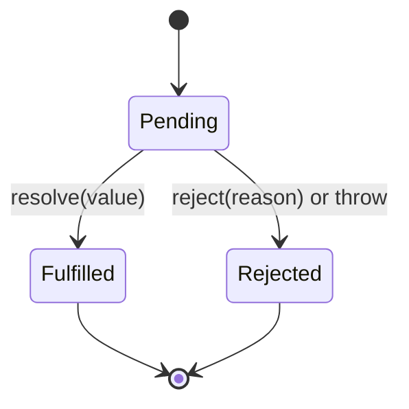
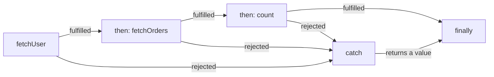

# Async JavaScript

[Home](../README.md) › [JavaScript](README.md) › Async JavaScript

> **In one sentence:** JavaScript never waits: it starts an operation, registers what to do when it finishes, and returns to the caller, and promises with `async/await` are a way to write that "what to do later" as if it were sequential code.

**Before this:** [Execution, scope and closures](02-execution-scope-closures.md), [concurrency and synchronization](../02-operating-systems/03-concurrency-and-synchronization.md).
**After this:** [The Node.js event loop](../06-nodejs/02-event-loop.md), [buffers and streams](../06-nodejs/03-buffers-and-streams.md), [reliability patterns](../08-backend-engineering/06-reliability-patterns.md).

## Why asynchronous

JavaScript has **one call stack**. If a function waited 50 ms for a database, nothing else could run for 50 ms.

So the model is:

1. Start the operation and hand it to the host (Node.js, which gives it to the OS or a thread pool).
2. Give the host a function to call when the result is ready.
3. **Return immediately.** The call stack empties and other work can run.
4. Later, when the result is ready **and the stack is empty**, the host calls your function.

The rule that code is never interrupted in the middle is **run-to-completion**. Async code does not run "at the same time" as other JavaScript. It runs **later, in turn**.

Three styles exist for step 2: callbacks, promises, and `async/await`. Each is built on the one before.

## Callbacks

A **callback** is a function passed to another function to be called later.

Node.js uses the **error-first** convention: the first argument is an error or `null`, the rest are results.

```js
import fs from 'node:fs';

fs.readFile('config.json', 'utf8', (err, data) => {
  if (err) {
    console.error('read failed', err);
    return;                       // do not forget to return
  }
  console.log(data);
});
console.log('this runs first');
```

Problems with callbacks:

**1. Nesting ("callback hell").** Sequential steps become deeper and deeper.

```js
getUser(id, (err, user) => {
  if (err) return done(err);
  getOrders(user.id, (err, orders) => {
    if (err) return done(err);
    getInvoice(orders[0].id, (err, invoice) => {
      if (err) return done(err);
      done(null, invoice);
    });
  });
});
```

**2. Error handling is manual at every level.** `try/catch` does not help, because the callback runs later, on a different stack. A thrown error inside a callback has no caller to catch it.

**3. Inversion of control.** You give your function to someone else's code and trust it to call it exactly once, with the right arguments, and not synchronously sometimes and asynchronously other times. Nothing enforces this.

Callbacks are still the base of Node.js (event emitters, streams, the core `fs` API), and understanding them is necessary to understand promises.

## Promises

A **promise** is an object that represents the future result of an asynchronous operation.

### States



- It starts **pending**.
- It becomes **fulfilled** with a value, or **rejected** with a reason.
- Once settled, **it never changes again**. Calling `resolve` or `reject` a second time does nothing.

This fixes inversion of control: a promise can be settled only once, and its handlers are **always** called asynchronously.

### Creating

```js
const promise = new Promise((resolve, reject) => {
  // This function (the executor) runs IMMEDIATELY and synchronously.
  setTimeout(() => resolve('done'), 100);
});

const sleep = (ms) => new Promise((resolve) => setTimeout(resolve, ms));
```

You need `new Promise` only to wrap a callback-based API. If you already have a promise, do not wrap it again.

```js
// Node.js has promise versions of most APIs, and a converter for the rest:
import { readFile } from 'node:fs/promises';
import { promisify } from 'node:util';
import { setTimeout as delay } from 'node:timers/promises';
```

### Consuming: then, catch, finally

```js
fetchUser(1)
  .then((user) => fetchOrders(user.id))     // return a promise: the chain waits for it
  .then((orders) => orders.length)          // return a value: passed to the next then
  .catch((err) => {                         // catches a rejection from ANY step above
    console.error(err);
    return 0;                               // recover: the chain continues fulfilled with 0
  })
  .finally(() => console.log('cleanup'));   // runs in both cases; does not change the result
```

The rules that make chaining work:

1. **`then` always returns a new promise.**
2. If the handler **returns a value**, the new promise is fulfilled with it.
3. If the handler **returns a promise**, the new promise follows it (waits and takes its result).
4. If the handler **throws**, the new promise is rejected with the error.
5. If there is no handler for the current state, the result **passes through** unchanged. That is how an error skips all `then` handlers until the next `catch`.

`catch(fn)` is just `then(undefined, fn)`.



The most common promise bug is **forgetting to return** inside a `then`:

```js
getUser()
  .then((user) => {
    saveAudit(user);            // BUG: not returned. The chain does not wait for it,
  })                            // and its rejection is not caught by the catch below.
  .then(() => console.log('done'));
```

## The microtask queue

When a promise settles, its handlers do not run immediately. They are put in the **microtask queue**.

The rule: **after the currently running code finishes and the call stack is empty, the engine runs all microtasks, including any that are added while it is draining the queue, before the host runs anything else** (timers, I/O callbacks).

```js
console.log('1');
setTimeout(() => console.log('2'), 0);
Promise.resolve().then(() => console.log('3'));
queueMicrotask(() => console.log('4'));
(async () => {
  console.log('5');
  await null;
  console.log('6');
})();
console.log('7');

// Output: 1 5 7 3 4 6 2
```

Step by step:

| Step | What runs | Output | Microtask queue | Timer queue |
|---|---|---|---|---|
| 1 | `console.log('1')` | 1 | | |
| 2 | `setTimeout` registers a timer | | | [2] |
| 3 | `.then` on an already resolved promise | | [3] | [2] |
| 4 | `queueMicrotask` | | [3, 4] | [2] |
| 5 | The async function starts **synchronously** | 5 | [3, 4] | [2] |
| 6 | `await null` pauses the function and queues its continuation | | [3, 4, 6] | [2] |
| 7 | `console.log('7')` | 7 | [3, 4, 6] | [2] |
| 8 | Stack empty: drain microtasks | 3, 4, 6 | | [2] |
| 9 | The host runs the timer | 2 | | |

Three things to take from this:

- The body of an `async` function runs **synchronously until its first `await`**.
- **Microtasks always run before timers and I/O callbacks.**
- A microtask that keeps adding microtasks **starves** everything else. A recursive `Promise.resolve().then(loop)` blocks the event loop as completely as `while (true)`.

Node.js adds one more queue, `process.nextTick`, which runs even before promise microtasks, and the event loop has several phases for timers and I/O. That is covered in [the event loop](../06-nodejs/02-event-loop.md). The microtask queue itself is part of the JavaScript language.

## async / await

`async/await` is syntax over promises. It does not add a new mechanism.

- An `async` function **always returns a promise**. A returned value fulfills it. A thrown error rejects it.
- `await x` pauses the function until `x` settles. If `x` is fulfilled, `await` gives the value. If rejected, `await` **throws** the reason. If `x` is not a promise, it is wrapped first.
- While the function is paused, **the call stack is free**. `await` is not blocking. The rest of the function is scheduled as a microtask when the promise settles.

```js
async function loadInvoice(userId) {
  try {
    const user = await getUser(userId);
    const orders = await getOrders(user.id);
    return await getInvoice(orders[0].id);
  } catch (err) {
    throw new Error('Could not load invoice', { cause: err });
  }
}
```

This is equivalent to a promise chain, but reads like synchronous code, and normal `try/catch`, loops and conditions work.

Think of each `await` as a point where the function is cut in two. Everything after it is "the callback".

### `return` versus `return await`

```js
async function a() {
  try {
    return fetchData();          // the promise is returned, not awaited here:
  } catch (err) {                // a rejection is NOT caught by this catch
    return null;
  }
}

async function b() {
  try {
    return await fetchData();    // awaited inside try: a rejection IS caught
  } catch (err) {
    return null;
  }
}
```

Outside a `try` block the two forms give the same result. Using `return await` is also better for stack traces. A simple rule: when in doubt, write `return await`.

## Sequential versus concurrent

`await` in a row runs things one after another. That is correct when step 2 needs the result of step 1, and wasteful otherwise.

```js
// Sequential: 300 ms total if each call takes 100 ms
const user = await getUser(id);
const orders = await getOrders(id);
const settings = await getSettings(id);

// Concurrent: 100 ms total
const [user2, orders2, settings2] = await Promise.all([
  getUser(id),
  getOrders(id),
  getSettings(id),
]);
```



```mermaid
gantt
    title Three independent 100 ms calls
    dateFormat x
    axisFormat %L
    section Sequential
    getUser     :a1, 0, 100
    getOrders   :a2, 100, 200
    getSettings :a3, 200, 300
    section Concurrent
    getUser     :b1, 0, 100
    getOrders   :b2, 0, 100
    getSettings :b3, 0, 100
```

An operation **starts when its function is called**, not when it is awaited. `Promise.all` does not start anything. It only waits for promises that are already running.

### Promise combinators

| Method | Fulfills when | Rejects when | Use for |
|---|---|---|---|
| `Promise.all(list)` | **All** fulfill → array of values, in input order | **Any** rejects (immediately) | Independent tasks that must all succeed |
| `Promise.allSettled(list)` | All settle → array of `{status, value \| reason}` | Never | Tasks where you want every outcome |
| `Promise.race(list)` | The first to settle fulfills | The first to settle rejects | Timeouts |
| `Promise.any(list)` | The **first to fulfill** | All reject → `AggregateError` | Redundant sources: first success wins |

Important details:

- `Promise.all` rejects on the first failure, but **the other operations keep running**. Promises cannot be cancelled. Their results are simply ignored.
- With `Promise.race`, the losers also keep running.

```js
const results = await Promise.allSettled(urls.map((u) => fetch(u)));
const ok = results.filter((r) => r.status === 'fulfilled').map((r) => r.value);
const failed = results.filter((r) => r.status === 'rejected').map((r) => r.reason);
```

### Limiting concurrency

`Promise.all` over 10,000 items starts 10,000 operations at once. That can exhaust a connection pool, hit a rate limit, or use all memory. You almost always want a limit.

```js
async function mapLimit(items, limit, fn) {
  const results = new Array(items.length);
  let next = 0;

  async function worker() {
    while (next < items.length) {
      const i = next++;                       // synchronous: no race between workers
      results[i] = await fn(items[i], i);
    }
  }

  const workers = Array.from({ length: Math.min(limit, items.length) }, worker);
  await Promise.all(workers);
  return results;
}

// At most 5 requests in flight at any time:
// const pages = await mapLimit(urls, 5, (url) => fetch(url).then((r) => r.text()));
```

This is a [semaphore](../02-operating-systems/03-concurrency-and-synchronization.md#semaphore) in the form of N workers taking from a shared index. Libraries like `p-limit` and `p-map` do the same thing.

## Common mistakes

### 1. `forEach` with an async callback

```js
// BUG: forEach ignores the returned promises. This does not wait.
items.forEach(async (item) => {
  await save(item);
});
console.log('done');     // printed before any save finishes; errors are unhandled

// Sequential:
for (const item of items) {
  await save(item);
}

// Concurrent:
await Promise.all(items.map((item) => save(item)));
```

### 2. Floating promises

Calling an async function without `await` (or `.catch`) means nobody handles its result or its error.

```js
async function handler(req, res) {
  sendAnalytics(req);                 // floating: a rejection becomes an unhandled rejection
  res.end('ok');
}

// If you really do not want to wait, handle the error explicitly:
// sendAnalytics(req).catch((err) => logger.warn({ err }, 'analytics failed'));
```

In Node.js an **unhandled rejection crashes the process** by default (since Node.js 15). The ESLint rule `@typescript-eslint/no-floating-promises` catches these at build time. See [errors and process lifecycle](../06-nodejs/05-errors-and-process-lifecycle.md).

### 3. Starting promises and awaiting them one by one

```js
const a = fetchA();
const b = fetchB();
const resultA = await a;     // if b rejects while we wait here, nothing is listening to b yet
const resultB = await b;     // → unhandled rejection, even though this line "handles" it later
```

Use `Promise.all([fetchA(), fetchB()])`, which attaches handlers to both at once.

### 4. Unnecessary sequential `await` in a loop

```js
for (const id of ids) {
  users.push(await getUser(id));    // N round trips, one after another
}
```

Often the best fix is not concurrency but **one batched query**: `WHERE id = ANY($1)`. See the [N+1 problem](../07-databases/11-data-access-from-node.md).

### 5. Wrapping a promise in `new Promise`

```js
// Anti-pattern: errors thrown before resolve are lost, and it is just noise.
function getUserBad(id) {
  return new Promise((resolve, reject) => {
    db.query(id).then(resolve).catch(reject);
  });
}
// Just return the promise:
const getUserGood = (id) => db.query(id);
```

### 6. Race conditions across `await`

Every `await` is a point where other code can run. State you read before an `await` may be stale after it. This is the JavaScript form of the read-modify-write race. See [concurrency and synchronization](../02-operating-systems/03-concurrency-and-synchronization.md#does-this-happen-in-nodejs-yes).

### 7. Blocking code inside an async function

`async` does not move work to another thread. This still blocks the event loop for the whole loop:

```js
async function hash(data) {
  let h = 0;
  for (let i = 0; i < 1e9; i++) h = (h * 31 + i) | 0;   // synchronous CPU work
  return h;
}
```

`async` is about **waiting**, not about **computing**. CPU work needs [worker threads](../06-nodejs/04-scaling-cpu-work.md).

## Cancellation and timeouts

A promise cannot be cancelled. The standard tool for cancellation is **`AbortController`**: you create a controller, pass its `signal` to the operation, and call `abort()` to cancel.

```js
async function fetchJson(url) {
  const controller = new AbortController();
  const timer = setTimeout(() => controller.abort(), 3000);

  try {
    const res = await fetch(url, { signal: controller.signal });
    return await res.json();
  } catch (err) {
    if (err.name === 'AbortError') throw new Error('Request timed out');
    throw err;
  } finally {
    clearTimeout(timer);
  }
}

// Shorter, for a pure timeout:
// await fetch(url, { signal: AbortSignal.timeout(3000) });
// Combine several signals (client disconnect OR timeout):
// AbortSignal.any([req.signal, AbortSignal.timeout(3000)])
```

Many Node.js APIs accept a `signal`: `fetch`, `fs.promises`, `timers/promises`, `events.once`, streams, `child_process`.

A timeout built with `Promise.race` only stops **waiting**. The underlying operation continues and still uses a socket and memory. `AbortSignal` actually cancels it. Prefer signals.

Passing a signal down through all the layers of a request, so that work stops when the client disconnects or a deadline passes, is called **deadline propagation**. See [reliability patterns](../08-backend-engineering/06-reliability-patterns.md).

### Retry with exponential backoff

```js
import { setTimeout as delay } from 'node:timers/promises';

async function retry(fn, { retries = 3, baseMs = 100, signal } = {}) {
  for (let attempt = 0; ; attempt++) {
    try {
      return await fn(attempt);
    } catch (err) {
      if (attempt >= retries || signal?.aborted) throw err;
      const backoff = baseMs * 2 ** attempt;
      const jitter = Math.random() * backoff;          // spread retries out
      await delay(jitter, undefined, { signal });
    }
  }
}
```

Only retry operations that are **idempotent**, and only for errors that might go away (timeouts, 503, connection resets), never for a 400. See [reliability patterns](../08-backend-engineering/06-reliability-patterns.md).

## Async iteration

`for await...of` consumes a sequence of values that arrive over time: pages from an API, rows from a database cursor, chunks from a stream.

```js
async function* fetchAllPages(url) {
  let next = url;
  while (next) {
    const res = await fetch(next);
    const page = await res.json();
    yield* page.items;
    next = page.nextUrl;
  }
}

for await (const item of fetchAllPages('/api/items')) {
  // items arrive one page at a time; the next page is fetched only when needed
}
```

The loop pulls the next value only when the body is ready for it, so it gives natural **backpressure**. Node.js streams are async iterables. See [iterators and generators](08-iterators-generators-metaprogramming.md) and [buffers and streams](../06-nodejs/03-buffers-and-streams.md).

## Building blocks worth being able to write

Interviewers often ask for small implementations. These three cover most of them.

```js
// promisify: turn an error-first callback API into a promise API
function promisify(fn) {
  return function (...args) {
    return new Promise((resolve, reject) => {
      fn.call(this, ...args, (err, value) => (err ? reject(err) : resolve(value)));
    });
  };
}

// Promise.all
function promiseAll(iterable) {
  return new Promise((resolve, reject) => {
    const results = [];
    let pending = 0;
    let index = 0;
    for (const item of iterable) {
      const i = index++;
      pending++;
      Promise.resolve(item).then((value) => {
        results[i] = value;                    // keep input order, not completion order
        if (--pending === 0) resolve(results);
      }, reject);                              // first rejection wins; later ones are ignored
    }
    if (index === 0) resolve(results);         // empty input
  });
}

// timeout wrapper
function withTimeout(promise, ms) {
  let timer;
  const timeout = new Promise((_, reject) => {
    timer = setTimeout(() => reject(new Error(`Timed out after ${ms} ms`)), ms);
  });
  return Promise.race([promise, timeout]).finally(() => clearTimeout(timer));
}
```

## How this connects

- **Where callbacks, timers and I/O completions come from** and in which order they run is the [Node.js event loop](../06-nodejs/02-event-loop.md).
- **Closures** are what let the code after an `await` still see its variables. See [scope and closures](02-execution-scope-closures.md).
- **Interleaving at `await`** is the source of logical races. See [concurrency and synchronization](../02-operating-systems/03-concurrency-and-synchronization.md).
- **Unhandled rejections and error propagation** in a server: [errors and process lifecycle](../06-nodejs/05-errors-and-process-lifecycle.md).
- **Following a request across `await` points** for logging and tracing needs `AsyncLocalStorage`. See [events and async context](../06-nodejs/06-events-and-async-context.md).
- **Concurrency limits, timeouts and retries** are the code-level pieces of [reliability patterns](../08-backend-engineering/06-reliability-patterns.md).
- **`Promise.all` over database calls** is limited by the [connection pool](../07-databases/11-data-access-from-node.md).

## Interview questions

<details>
<summary><strong>🟢 Q1. What is a promise?</strong></summary>

A promise is an object that represents the result of an asynchronous operation that has not finished yet. It has three states: pending, fulfilled with a value, or rejected with a reason. Once it is fulfilled or rejected, it cannot change again.

I attach handlers with `then`, `catch` and `finally`, or I use `await`. Each `then` returns a new promise, so operations can be chained, and an error anywhere in the chain goes to the next `catch`.

</details>

<details>
<summary><strong>🟢 Q2. What does <code>async/await</code> do?</strong></summary>

It is syntax on top of promises. An `async` function always returns a promise. Inside it, `await` pauses the function until a promise settles. If the promise is fulfilled, `await` returns the value. If it is rejected, `await` throws, so I can use normal `try/catch`.

The important point is that `await` does not block the thread. The function is suspended, the call stack is released, and other code runs. When the promise settles, the rest of the function continues as a microtask.

</details>

<details>
<summary><strong>🟢 Q3. What is the difference between <code>Promise.all</code>, <code>allSettled</code>, <code>race</code> and <code>any</code>?</strong></summary>

`Promise.all` waits for all promises and gives an array of results. It rejects as soon as one rejects.

`Promise.allSettled` waits for all of them and never rejects. It gives an object for each one with its status and its value or reason. I use it when I want to know every outcome.

`Promise.race` settles as soon as the first promise settles, with that result, whether it is a success or a failure.

`Promise.any` fulfills with the first success. It only rejects if all of them fail.

</details>

<details>
<summary><strong>🟡 Q4. What is the output, and why?</strong>

```js
console.log('A');
setTimeout(() => console.log('B'), 0);
Promise.resolve().then(() => console.log('C'));
console.log('D');
```

</summary>

`A D C B`.

`A` and `D` are synchronous, so they print first. The `then` callback is a microtask, and the `setTimeout` callback is a timer task. When the synchronous code is done and the stack is empty, the engine runs all microtasks, so `C` prints. Only after that does the event loop run the timer, so `B` is last, even with a delay of zero.

</details>

<details>
<summary><strong>🟡 Q5. What is wrong with this code?</strong>

```js
async function processAll(items) {
  items.forEach(async (item) => {
    await processItem(item);
  });
  console.log('All done');
}
```

</summary>

`forEach` does not wait for the promises returned by the async callback. It calls the callback for every item, ignores the returned promises, and returns immediately. So "All done" is printed before any item is processed, `processAll` resolves too early, and if `processItem` rejects, it is an unhandled rejection, which crashes a Node.js process by default.

To process items one at a time, I use a `for...of` loop with `await`. To process them concurrently, I use `await Promise.all(items.map(processItem))`. If there are many items, I add a concurrency limit.

</details>

<details>
<summary><strong>🟡 Q6. When would you run promises sequentially, and when concurrently?</strong></summary>

Sequentially when each step depends on the result of the previous one, when order matters, or when I must not put too much load on a resource.

Concurrently when the operations are independent, because the total time is the slowest one instead of the sum. I use `Promise.all` for that.

But unlimited concurrency is dangerous. Thousands of simultaneous calls can exhaust the database connection pool, hit rate limits, or use too much memory. So for large lists I limit concurrency to a fixed number, with a small worker pool or a library like `p-limit`. And if the calls are database lookups, one batched query is usually better than either.

</details>

<details>
<summary><strong>🟡 Q7. Can you cancel a promise? How do you implement a timeout?</strong></summary>

A promise itself cannot be cancelled. It only represents a result. What I can cancel is the underlying operation, if it supports it. The standard way is `AbortController`. I pass its signal to the operation, for example `fetch`, and when I call `abort`, the operation stops and the promise rejects with an `AbortError`.

For a timeout I use `AbortSignal.timeout(ms)` as the signal. An older approach is `Promise.race` between the operation and a timer promise. That only stops waiting. The operation itself keeps running in the background and still uses resources, so the signal is better.

</details>

<details>
<summary><strong>🟡 Q8. What happens to an unhandled promise rejection in Node.js?</strong></summary>

If a promise is rejected and no handler is attached by the time the microtask queue has been processed, Node emits the `unhandledRejection` event on `process`. Since Node 15, the default behavior, if I do not listen for that event, is to throw the error as an uncaught exception, which terminates the process with a non-zero exit code.

So every promise needs a handler: an `await` inside a `try/catch`, a `.catch`, or a framework that does it. The typical causes are a missing `await`, an async function passed to `forEach` or to an event emitter, or starting several promises and awaiting them one after another instead of with `Promise.all`.

</details>

<details>
<summary><strong>🔴 Q9. What is the output?</strong>

```js
async function first() {
  console.log(1);
  await second();
  console.log(2);
}
async function second() {
  console.log(3);
}
console.log(4);
first();
Promise.resolve().then(() => console.log(5));
console.log(6);
```

</summary>

`4 1 3 6 2 5`.

`4` is synchronous. Calling `first()` runs its body synchronously: it prints `1`, then calls `second()`, which prints `3` and returns an already fulfilled promise. The `await` suspends `first` and schedules its continuation as a microtask. Control returns to the main script, which schedules the `then` callback as a second microtask and prints `6`.

Now the stack is empty and microtasks run in order: the continuation of `first` prints `2`, then the `then` callback prints `5`.

</details>

<details>
<summary><strong>🔴 Q10. Is there a difference between <code>return promise</code> and <code>return await promise</code> in an async function?</strong></summary>

Outside a `try` block, the result for the caller is the same. Inside a `try` block, it matters. With `return promise`, the function hands the promise out and leaves the `try` block. If the promise later rejects, the `catch` in that function does not run. With `return await promise`, the function waits inside the `try`, so a rejection is thrown there and the `catch` or `finally` runs at the right time.

There is a second difference: with `return await`, the function stays in the async stack trace, which makes errors easier to debug. So I prefer `return await`, especially inside `try/catch`.

</details>

<details>
<summary><strong>🔴 Q11. Implement a function that runs async tasks with a concurrency limit.</strong></summary>

```js
async function mapLimit(items, limit, fn) {
  const results = new Array(items.length);
  let next = 0;
  async function worker() {
    while (next < items.length) {
      const i = next++;
      results[i] = await fn(items[i], i);
    }
  }
  await Promise.all(Array.from({ length: Math.min(limit, items.length) }, worker));
  return results;
}
```

I start `limit` workers. Each worker takes the next index and processes that item, in a loop, until no items are left. Reading and incrementing `next` is synchronous, with no `await` in between, so two workers can never take the same index. Results are stored by index, so the output order matches the input order. If any task throws, `Promise.all` rejects. The other workers finish the task they are on and then continue with remaining items, so in a real version I would add a flag or an abort signal to stop them.

</details>

<details>
<summary><strong>🔴 Q12. Can an async function block the event loop?</strong></summary>

Yes. `async` only changes how the function returns its result and lets it use `await`. The code between awaits still runs synchronously on the main thread. If that code is a heavy loop, a large `JSON.parse`, or a synchronous crypto or file call, the event loop is blocked for that whole time.

Also, awaiting something that is already resolved does not help. It only yields to the microtask queue, which runs before any I/O or timers. So a loop that awaits resolved promises can still starve the event loop. To really yield, the code has to wait for a macrotask, for example with `setImmediate`, or move the CPU work to a worker thread.

</details>

## Key takeaways

- JavaScript never waits. It registers a continuation and returns. Run-to-completion means no interruption between `await` points.
- A promise is pending, then fulfilled or rejected, once. `then` returns a new promise. Errors flow to the next `catch`.
- Microtasks (promise reactions) run after the current code and before timers and I/O.
- An `async` function runs synchronously until its first `await`.
- Operations start when called. `Promise.all` only waits. Limit concurrency for large sets.
- `forEach` does not await. Floating promises crash the process. Use `Promise.all` instead of awaiting started promises one by one.
- Use `AbortSignal` for timeouts and cancellation.
- `async` does not make CPU work non-blocking.

---

← [`this`, Prototypes and Classes](03-this-prototypes-classes.md) | Next: [V8 Engine Internals →](05-v8-engine-internals.md)
