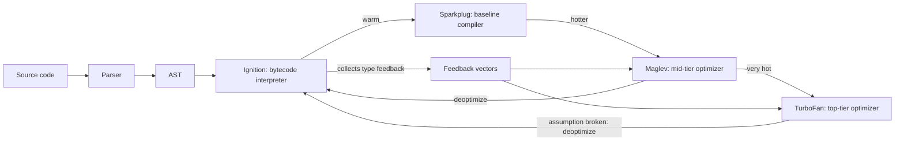
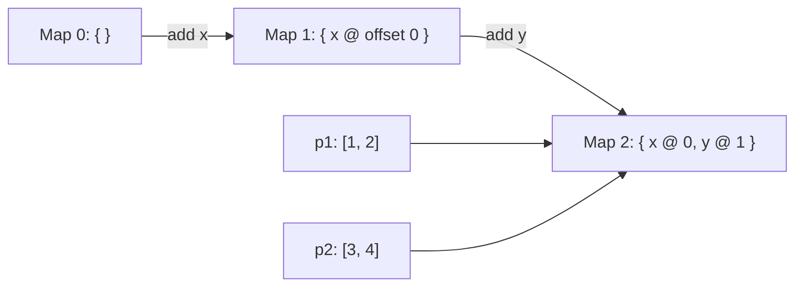

# V8 Engine Internals

[Home](../README.md) › [JavaScript](README.md) › V8 Engine Internals

> **In one sentence:** V8 starts running your code quickly as interpreted bytecode, watches which functions are hot and what types they actually see, and compiles those into fast machine code based on assumptions that it must throw away (deoptimize) when your code breaks them.

**Before this:** [Types and coercion](01-types-and-coercion.md), [`this`, prototypes and classes](03-this-prototypes-classes.md), [hardware and latency](../01-computer-foundations/02-hardware-and-latency.md).
**After this:** [Memory and garbage collection](06-memory-garbage-collection.md), [Node.js architecture](../06-nodejs/01-architecture.md), [performance and debugging](../06-nodejs/07-performance-debugging.md).

## What an engine is

A **JavaScript engine** is the program that reads JavaScript source and executes it. **V8** is Google's engine, written in C++. It is used in Chrome, Node.js and Deno.

V8 implements the ECMAScript language: parsing, execution, memory management, the microtask queue. It does **not** provide `setTimeout`, `fs`, HTTP or the event loop. Those come from the host. See [Node.js architecture](../06-nodejs/01-architecture.md).

## The problem V8 solves

JavaScript is hard to make fast:

- A variable can hold any type, and the type can change at any time.
- `a + b` can mean number addition, string concatenation, or a call to `valueOf`.
- `obj.x` can be an own property, a property on a prototype, a getter, or missing.
- Objects can gain and lose properties at run time.

A simple interpreter checks all of this on every operation. That is very slow. A compiler for C knows the types ahead of time and produces a few machine instructions.

V8's answer is **just-in-time (JIT) compilation with speculation**: observe what the program really does, assume it will keep doing that, generate machine code specialized for that case, and keep a way back if the assumption fails.

## The pipeline



| Tier | What it produces | Start-up cost | Speed of the result |
|---|---|---|---|
| **Ignition** | Bytecode, interpreted | Very low | Slow |
| **Sparkplug** | Machine code translated directly from bytecode, no optimization | Low | Faster |
| **Maglev** | Optimized machine code, compiled quickly | Medium | Fast |
| **TurboFan** | Highly optimized machine code | High | Fastest |

The idea of several tiers is a trade-off between **compile time** and **run time**. Most code runs once or a few times, so optimizing it would waste more time than it saves. Only code that proves to be **hot** (called often, or looping many times) is worth the cost.

### Parsing

The parser turns source text into an **abstract syntax tree (AST)**. To save start-up time, V8 uses **lazy parsing**: functions that are not called immediately are only pre-parsed (checked for syntax errors) and fully parsed later, when first called.

Start-up cost is why large bundles hurt cold starts in serverless environments. Node.js can reuse compiled bytecode through a **code cache** to reduce this.

### Ignition: bytecode and feedback

Ignition compiles the AST to compact **bytecode** and interprets it. It is a register machine with an accumulator.

```bash
node --print-bytecode --print-bytecode-filter=add script.js
```

While interpreting, Ignition records **type feedback** for each operation into the function's **feedback vector**: which object shapes were seen at each property access, which types at each `+`, which function was called at each call site. This recorded history is what the optimizing compilers use.

### Optimizing compilers and speculation

When a function is hot, Maglev or TurboFan compiles it using the feedback. If a `+` has only ever seen small integers, the compiler emits an integer add, guarded by a cheap check:

```
check that a is a small integer   → if not, deoptimize
check that b is a small integer   → if not, deoptimize
add them                          → if overflow, deoptimize
```

Common optimizations: **inlining** (copying a small function's body into its caller), removing redundant checks, **escape analysis** (an object that never leaves the function does not need to be allocated on the heap), and constant folding.

### Deoptimization

If a guard fails, for example the function is suddenly called with a string, the optimized code is no longer valid. V8 **deoptimizes**: it discards the optimized code for that function and continues in the interpreter from the same point, with the correct state.

The function may be optimized again later with the new feedback. If it keeps changing, V8 eventually stops trying to optimize it.

Deoptimization is not an error. It is a normal part of the design. It becomes a performance problem only when it happens repeatedly in hot code.

## How objects are stored: hidden classes

JavaScript objects look like dictionaries, but a hash lookup for every property access would be too slow. V8 gives every object a **hidden class** (called a **Map** inside V8, also known as a **shape**).

A hidden class describes the **layout** of an object: which properties it has, in which order, and at which offset each one is stored. Objects with the same properties added in the same order share one hidden class.

```js
function Point(x, y) {
  this.x = x;      // transition: {} → {x}
  this.y = y;      // transition: {x} → {x, y}
}
const p1 = new Point(1, 2);
const p2 = new Point(3, 4);    // same hidden class as p1
```



The object itself stores only a pointer to its hidden class and the property **values**. The names and offsets are stored once, in the hidden class. Reading `p.x` becomes: check the hidden class, load the value at offset 0. That is as fast as a field access in a compiled language.

Hidden classes form a tree of **transitions**. The order matters:

```js
const a = { x: 1, y: 2 };     // shape {x, y}
const b = { y: 2, x: 1 };     // shape {y, x} — a DIFFERENT hidden class
```

### Fast mode and dictionary mode

Objects with a stable shape are in **fast mode**. Some operations push an object into **dictionary mode** (a real hash table, slower for access and not optimizable in the same way):

- `delete obj.prop` on a property that is not the last one added.
- Adding a very large number of properties dynamically.
- Using an object as a map with arbitrary, changing keys.

This is one reason to use `Map` for dictionaries with dynamic keys: a `Map` is designed for that workload.

## Inline caches

A property access like `user.name` appears at one place in the code, a **call site**, but it can run millions of times. An **inline cache (IC)** remembers, per call site, what was seen before.

The first time `user.name` runs, V8 does the full lookup, then stores in the feedback vector: "for hidden class H1, `name` is at offset 2". Next time, it only compares the hidden class and loads from offset 2.

A call site has a state, depending on how many different hidden classes it has seen:

| State | Shapes seen | Speed |
|---|---|---|
| **Monomorphic** | 1 | Fastest. One comparison. Optimizers can inline through it |
| **Polymorphic** | 2 to 4 | Slower. A short list of comparisons |
| **Megamorphic** | More than 4 | Slowest. Falls back to a global cache lookup. Blocks many optimizations |

```js
function getX(point) {
  return point.x;                  // one call site
}

// Monomorphic: every argument has the same shape
getX({ x: 1, y: 2 });
getX({ x: 3, y: 4 });

// Now polymorphic or megamorphic: different shapes at the same call site
getX({ x: 1 });
getX({ y: 2, x: 1 });
getX({ x: 1, z: 3 });
getX({ a: 0, x: 1 });
getX({ x: 1, b: 2, c: 3 });
```

This is the central idea of V8 performance: **hot code runs fastest when each call site sees one shape.**

## Values in memory

### Tagged values: Smis and heap objects

V8 stores each value in one machine word and uses the lowest bits as a **tag**:

- A **Smi** (small integer) is stored directly inside the word. No allocation, no pointer to follow. The range is 31 bits when pointer compression is on (as in Chrome) and 32 bits on typical 64-bit Node.js builds.
- Everything else is a **pointer to a heap object**: strings, objects, and numbers that are not Smis.

A number that is not a small integer (`0.5`, `2 ** 40`, `NaN`) is a **HeapNumber**: a small heap object holding a 64-bit double. V8 avoids allocating one each time where it can, for example by storing doubles directly in arrays of doubles or in object fields known to hold doubles.

Practical meaning: integer arithmetic in small ranges is the cheapest kind of number work in JavaScript.

### Arrays and elements kinds

V8 tracks what an array contains, called its **elements kind**, and picks the most efficient storage.

| Kind | Content | Storage |
|---|---|---|
| `PACKED_SMI_ELEMENTS` | Only small integers | Array of Smis |
| `PACKED_DOUBLE_ELEMENTS` | Numbers, including fractions | Array of raw doubles |
| `PACKED_ELEMENTS` | Anything | Array of tagged pointers |
| `HOLEY_*` versions | The array has holes (missing indexes) | Same, but every read must check for a hole and may need to look at the prototype chain |
| Dictionary elements | Very sparse | Hash table |

Transitions go **only one way**, from more specific to more general, and never back:

```js
const arr = [1, 2, 3];      // PACKED_SMI_ELEMENTS
arr.push(1.5);              // → PACKED_DOUBLE_ELEMENTS
arr.push('x');              // → PACKED_ELEMENTS
arr[10] = 0;                // → HOLEY_ELEMENTS (indexes 5..9 are holes)

const holey = new Array(100);    // HOLEY from the start
const packed = [];               // PACKED; grow it with push
```

A packed array of numbers is stored as continuous memory, which is also good for the [CPU cache](../01-computer-foundations/02-hardware-and-latency.md#why-arrays-beat-linked-lists-in-practice). For binary data and large numeric data, **TypedArrays** (`Float64Array`, `Uint8Array`, `Buffer`) give a fixed element type and fixed layout by definition.

### Strings

V8 has several internal string representations, chosen automatically:

- **One-byte or two-byte:** strings with only Latin-1 characters use 1 byte per character. Otherwise 2 bytes (UTF-16).
- **Cons strings (ropes):** `a + b` can create a small node that points to both parts instead of copying. The string is flattened when needed. This makes repeated concatenation cheaper than it looks.
- **Sliced strings:** `substring` can create a view into the parent string instead of a copy. A small slice can therefore keep a very large parent string alive, which is an occasional source of [memory retention](06-memory-garbage-collection.md).
- **Internalized strings:** identical property names and short literals are stored once and compared by pointer.

## What this means for your code

Do not write strange code to please the engine. The engine is tuned for clear, conventional code. But a few habits follow naturally from how it works, and they matter in **hot paths**: code that runs for every request, every row, every message.

| Habit | Reason |
|---|---|
| Initialize all properties in the constructor or object literal, always in the same order | Objects share one hidden class. Call sites stay monomorphic |
| Do not add properties to objects later, and avoid `delete`. Set to `undefined` or `null` instead | Avoids shape transitions and dictionary mode |
| Keep a function's arguments the same type each time | Stable feedback, no deoptimization |
| Do not mix element types in arrays used for number work. Avoid holes | Keeps the fastest elements kind |
| Use `Map`/`Set` for dynamic keys, plain objects or classes for fixed structures | Each is optimized for its job |
| Keep hot functions small and focused | Easier to inline and optimize |
| Avoid `arguments` tricks, `with`, and `eval` | They prevent optimization |
| Classes and constructor functions are good | They create consistent shapes automatically |

A realistic backend example:

```js
// Polymorphic: rows have different shapes depending on which fields exist
function toDto(row) {
  const dto = { id: row.id };
  if (row.email) dto.email = row.email;        // some objects get this property, some do not
  if (row.phone) dto.phone = row.phone;
  return dto;
}

// Monomorphic: every object has the same shape
function toDtoStable(row) {
  return {
    id: row.id,
    email: row.email ?? null,
    phone: row.phone ?? null,
  };
}
```

The second version is also a better API contract: the response always has the same fields.

### Measure first

These effects are real, but they are small compared with one unnecessary database query. The right order of work is:

1. Find the bottleneck with a **profiler**. See [performance and debugging](../06-nodejs/07-performance-debugging.md).
2. Fix algorithmic and I/O problems first: N+1 queries, missing indexes, sequential calls that could be parallel.
3. Only then look at engine-level details in the hottest functions.

Micro-benchmarks are easy to get wrong: the optimizer may remove the code you are measuring, or behave differently than in the real program. Useful flags when you do investigate:

```bash
node --trace-opt --trace-deopt app.js        # log optimizations and deoptimizations
node --cpu-prof app.js                       # write a CPU profile to open in Chrome DevTools
node --allow-natives-syntax script.js        # enables %DebugPrint(obj), %HaveSameMap(a, b) for experiments
```

## How this connects

- **Hidden classes and prototypes**: classes give consistent shapes. See [`this`, prototypes and classes](03-this-prototypes-classes.md).
- **Smis and doubles** are the engine-level view of [number representation](../01-computer-foundations/01-data-representation.md).
- **The heap** that these objects live in, and how it is collected, is the [next page](06-memory-garbage-collection.md).
- **JIT warm-up** explains why a new Node.js process is slower for its first requests, which matters for cold starts and for benchmarks. See [performance and debugging](../06-nodejs/07-performance-debugging.md).
- **V8 is one part of Node.js**, embedded next to libuv. See [Node.js architecture](../06-nodejs/01-architecture.md).
- **Stable object shapes** also make good API contracts. See [API design](../08-backend-engineering/01-api-design.md).

## Interview questions

<details>
<summary><strong>🟢 Q1. Is JavaScript interpreted or compiled?</strong></summary>

Both. In V8, the source is parsed and compiled to bytecode, which an interpreter called Ignition executes. That gives a fast start. While it runs, V8 collects information about the types it sees. Functions that run often are then compiled to machine code by JIT compilers: first a simple baseline compiler, then optimizing compilers that use the collected type information.

So it is just-in-time compiled, with an interpreter as the first tier.

</details>

<details>
<summary><strong>🟡 Q2. What is a hidden class in V8?</strong></summary>

A hidden class, which V8 calls a Map, describes the layout of an object: which properties it has, in which order, and where each value is stored. Objects that are created the same way, with the same properties in the same order, share one hidden class.

It lets V8 treat dynamic objects like fixed structs. To read a property, V8 checks the hidden class and reads the value at a known offset, instead of doing a dictionary lookup. If I add properties in a different order, or add and delete properties later, objects end up with different hidden classes, and the code that handles them gets slower.

</details>

<details>
<summary><strong>🟡 Q3. What is an inline cache? What do monomorphic, polymorphic and megamorphic mean?</strong></summary>

An inline cache stores, for each property access or call in the code, what happened last time: which hidden class the object had and where the property was found. The next time, V8 only checks that the hidden class is the same and uses the cached location.

Monomorphic means that place in the code has seen only one hidden class. This is the fastest case and the optimizer can inline through it. Polymorphic means it has seen a few, up to four, and V8 checks them one by one. Megamorphic means it has seen more than that. V8 falls back to a slower global lookup and cannot optimize the code as well.

</details>

<details>
<summary><strong>🟡 Q4. What is deoptimization and what causes it?</strong></summary>

The optimizing compiler generates machine code based on assumptions from past behavior, for example that an argument is always a small integer or that an object always has a certain shape. It adds checks for these assumptions. If a check fails at run time, the optimized code is not valid for this case. V8 throws it away and continues in the interpreter. That is deoptimization.

Typical causes are passing a different type than before to a hot function, objects with different shapes arriving at the same code, an integer operation that overflows into a floating-point number, or changing the element type of an array. One deoptimization is harmless. Repeated deoptimization in hot code is a performance problem.

</details>

<details>
<summary><strong>🟡 Q5. Why is <code>delete obj.prop</code> often discouraged in hot code?</strong></summary>

Deleting a property changes the object's shape. In many cases V8 switches the object to dictionary mode, where properties are stored in a hash table. Property access on such an object is slower, and code that sees a mix of fast objects and dictionary objects becomes polymorphic.

If I just need the property to have no value, I set it to `undefined` or `null`, which keeps the shape. If I need a collection where keys are added and removed all the time, I use a `Map`, which is designed for that.

</details>

<details>
<summary><strong>🔴 Q6. Why does V8 have several compiler tiers instead of one optimizing compiler?</strong></summary>

Because there is a trade-off between how long compilation takes and how fast the result runs. A highly optimizing compiler like TurboFan produces excellent code but is slow and uses memory. Most code in a program runs only a few times, so optimizing it would cost more than it saves, and it would delay start-up.

So V8 starts with the interpreter, which starts immediately and collects type feedback. Code that gets warm goes to Sparkplug, a baseline compiler that is very quick. Hotter code goes to Maglev, which optimizes reasonably fast. Only the hottest code goes to TurboFan. Each function gets the level of optimization that its usage justifies.

</details>

<details>
<summary><strong>🔴 Q7. A function processes database rows and is slow in the profiler. The rows come from several queries with different column sets. How could the engine be involved, and what would you do?</strong></summary>

If rows from different queries have different sets of properties, or the same properties in a different order, they have different hidden classes. The property accesses inside the function then see many shapes and become polymorphic or megamorphic, so each access is slower and the optimizer cannot inline or specialize the code. If the function also adds optional properties conditionally, the output objects have many shapes too, which pushes the problem to every consumer.

First I would confirm with a CPU profile that this function really is the hot spot, and that the time is not actually in the query or in serialization. Then I would normalize the data at the boundary: map every row to one object with a fixed set of fields in a fixed order, using `null` for missing values, or use a class. After that, the hot function always sees one shape. I would measure again, because these gains are real but usually smaller than fixing a query.

</details>

## Key takeaways

- V8 = parser → Ignition (bytecode + feedback) → Sparkplug → Maglev → TurboFan.
- Optimized code is built on assumptions about types and shapes. Broken assumptions cause deoptimization.
- Hidden classes give objects a fixed layout. Same properties in the same order means the same hidden class.
- Inline caches make property access fast. Monomorphic call sites are best.
- Arrays have elements kinds that only become more general. Avoid mixed types and holes in numeric arrays.
- Write consistent, conventional code: same shapes, same types. Use `Map` for dynamic keys.
- Profile first. Algorithm and I/O problems are almost always bigger.

---

← [Async JavaScript](04-async-javascript.md) | Next: [Memory and Garbage Collection →](06-memory-garbage-collection.md)
