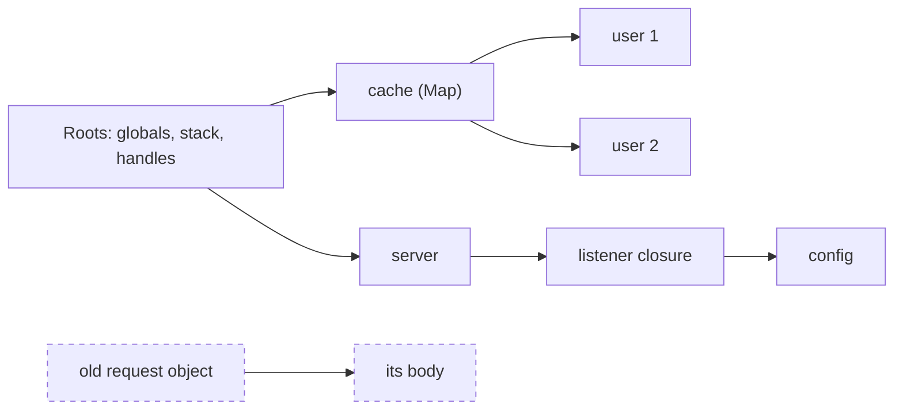
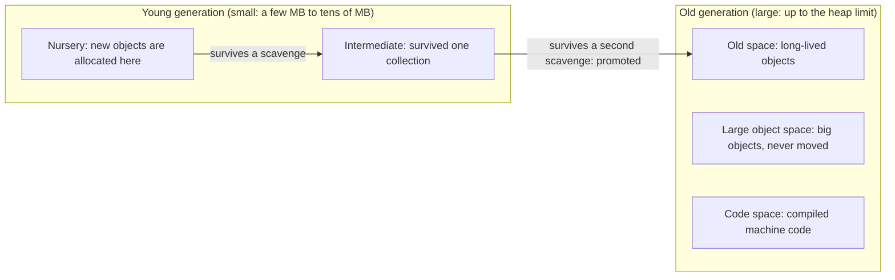

# Memory and Garbage Collection

[Home](../README.md) › [JavaScript](README.md) › Memory and Garbage Collection

> **In one sentence:** V8 keeps an object alive for as long as it can be reached from a root, collects short-lived objects cheaply and often, collects long-lived objects rarely and at a higher cost, and a "memory leak" in JavaScript is simply an object that your code can still reach but will never use again.

**Before this:** [Execution, scope and closures](02-execution-scope-closures.md), [V8 engine internals](05-v8-engine-internals.md), [OS memory management](../02-operating-systems/02-memory-management.md).
**After this:** [Node.js performance and debugging](../06-nodejs/07-performance-debugging.md), [Buffers and streams](../06-nodejs/03-buffers-and-streams.md), [production debugging playbook](../13-end-to-end/03-production-debugging-playbook.md).

## Where values live

A running JavaScript program uses two kinds of memory.

| Area | What it holds | How it is freed |
|---|---|---|
| **Stack** | One frame per active function call: local variables that are small integers or pointers, return address | Automatically, when the function returns |
| **Heap** | Objects, arrays, strings, closures, functions: everything that is not a Smi | By the garbage collector |

A variable never "contains" an object. It contains a pointer to an object on the heap. This is the engine-level reason for [reference semantics](01-types-and-coercion.md).

```js
function handler(req) {
  const user = { id: 1 };     // the object is on the heap; `user` (a pointer) is on the stack
  return user.id;
}                             // the frame is popped; the object is now unreachable → garbage
```

The stack is small (about 1 MB by default, change with `--stack-size`). Deep recursion fills it and throws `RangeError: Maximum call stack size exceeded`. The heap is large and is the subject of this page.

## Reachability: the only rule

JavaScript has no `free`. The engine decides what to free using one rule:

> An object is **alive** if it can be reached by following pointers from a **root**. Everything else is garbage.

**Roots** are the starting points:

- The global object (`globalThis`) and module-level variables.
- Local variables and parameters of every function currently on the call stack.
- Internal engine references: pending timers, pending promises, active handles, the microtask queue.



The dashed objects have no path from a root. They are garbage, even though they point to each other. This is why reference **cycles are not a problem** for a tracing collector, unlike for simple reference counting.

The collector cannot know whether you will *use* an object again. It only knows whether you *can* reach it. A memory leak is the gap between those two.

## The generational idea

V8's collector is built on one observation, called the **generational hypothesis**:

> Most objects die young.

A request handler creates hundreds of temporary objects: parsed JSON, intermediate arrays, strings, closures. Almost all of them are garbage a few milliseconds later. A few objects (the cache, the connection pool, loaded modules) live for the whole life of the process.

So V8 splits the heap into two **generations** and uses a different algorithm for each.



| | Young generation | Old generation |
|---|---|---|
| Size | Small | Large |
| Collector | **Scavenger** (minor GC) | **Mark-Sweep-Compact** (major GC) |
| How often | Very often | Rarely |
| Cost depends on | Number of **surviving** objects | Number of **live** objects in the whole heap |
| Typical pause | Around a millisecond | Longer, but mostly done off the main thread |

### Allocation is cheap

Allocating in the young generation is a **bump pointer**: V8 keeps a pointer to the next free byte, returns it, and moves it forward. It is nearly as cheap as stack allocation. When the space is full, a scavenge runs.

This is why creating many short-lived objects in JavaScript is fine. The cost is not in allocating them. The cost comes when they **survive**.

### Minor GC: the Scavenger

The young generation is divided into two equal halves: **from-space** and **to-space**. Only one is in use at a time.

1. Start from the roots. Find every young object that is reachable.
2. **Copy** each live object into to-space, one after another (this also compacts them).
3. Update all pointers to the new addresses.
4. Everything left in from-space is garbage. The whole space is reused. Nothing is freed object by object.
5. Swap the roles of the two spaces.

The work is proportional to the number of **live** objects, not the amount of garbage. If 95% of young objects are dead, the scavenge touches only 5%.

An object that survives **two** scavenges is **promoted** (copied into the old generation). It has shown that it is not short-lived.

One detail: the scavenger must also find young objects that are referenced **from old objects**, without scanning the whole old generation. V8 keeps a list of those references, maintained by a **write barrier**: a small piece of code that runs on every pointer store into an object.

### Major GC: Mark-Sweep-Compact

The old generation is collected in three phases.

1. **Mark.** Starting from the roots, follow every pointer and mark each object that is reached. This uses three colors: white (not seen), grey (seen, children not yet visited), black (done). At the end, white objects are garbage.
2. **Sweep.** Walk the memory pages and add the unmarked regions to **free lists**, so the space can be reused.
3. **Compact.** On pages that are badly fragmented, move the live objects together and update the pointers. Compaction is expensive, so V8 does it only for selected pages.

Marking is proportional to the number of **live** objects in the whole heap. A process holding 2 GB of live data has slow major collections, however little garbage it creates.

## Why pauses are short: Orinoco

JavaScript runs on one main thread. A naive collector would stop that thread for the whole collection ("stop-the-world"), and on a large heap that could take hundreds of milliseconds. During that time the [event loop](../06-nodejs/02-event-loop.md) handles nothing.

V8's collector (project name **Orinoco**) reduces main-thread pauses with three techniques:

| Technique | Meaning |
|---|---|
| **Parallel** | The main thread stops, but several helper threads share the work, so the pause is shorter. Used for scavenging and compaction |
| **Incremental** | The work is split into small steps that are mixed with JavaScript execution. Used for marking |
| **Concurrent** | Helper threads do the work **while** JavaScript keeps running. Used for most marking and for sweeping |

Concurrent marking needs the write barrier again: if your code changes a pointer while a helper thread is marking, the barrier tells the collector, so that no live object is missed.

The result: a typical major GC in a healthy Node.js service pauses the main thread for a few milliseconds, not hundreds. Pauses become a problem when the heap is very large or nearly full. Near the limit, V8 runs collection after collection that frees little, and the process spends most of its time in GC before it finally crashes.

## Heap limits in Node.js

The old generation has a maximum size. When V8 cannot free enough memory under that limit, the process dies:

```
FATAL ERROR: Reached heap limit Allocation failed - JavaScript heap out of memory
```

```bash
node --max-old-space-size=4096 app.js     # old generation limit, in MB
node --max-semi-space-size=64 app.js      # young generation semi-space size, in MB
```

- The default limit depends on the machine's memory and the Node.js version. Do not rely on it. **Set it explicitly** in production.
- In a container, set it **below** the container's memory limit, for example about 75% of it. The heap is not the only memory the process uses (see below). If the process as a whole exceeds the container limit, the kernel's [OOM killer](../02-operating-systems/02-memory-management.md) kills it with `SIGKILL`, and you get no JavaScript error and no stack trace. Exit code 137 is the sign.
- A larger young generation (`--max-semi-space-size`) can help a service that allocates heavily per request: fewer scavenges, and fewer objects promoted by accident. Measure before and after.

### What `process.memoryUsage()` tells you

```js
process.memoryUsage();
// → {
//   rss: 68_000_000,           // resident set size: all physical memory held by the process
//   heapTotal: 20_000_000,     // memory V8 has reserved for the heap
//   heapUsed: 14_000_000,      // memory used by live (or not yet collected) JS objects
//   external: 2_100_000,       // memory of C++ objects bound to JS objects (Buffers, etc.)
//   arrayBuffers: 1_000_000    // part of external: ArrayBuffer and Buffer memory
// }
```

| Symptom | Likely meaning |
|---|---|
| `heapUsed` grows across many major GCs | A leak in JavaScript objects |
| `heapUsed` is flat, `external` grows | Buffers or other native memory are being retained |
| `heapUsed` and `external` are flat, `rss` grows | Native memory: an addon, memory fragmentation in the allocator, or many threads |
| `heapUsed` moves up and down in a saw-tooth | Normal. Garbage builds up, then a collection frees it |

A [`Buffer`](../06-nodejs/03-buffers-and-streams.md) stores its bytes **outside** the V8 heap. Only a small wrapper object is on the heap. A service can therefore use far more memory than `--max-old-space-size` and be killed by the container limit while its JavaScript heap looks small.

## Memory leaks

In a garbage-collected language, a leak is not "memory that was never freed". It is **an object that is still reachable but will never be used again**. The collector is working correctly. Your code is holding a reference.

For a long-running server this matters more than for a script, because the process lives for days and every request can add a little.

### The common causes

**1. Unbounded caches and maps**

```js
const cache = new Map();

async function getUser(id) {
  if (!cache.has(id)) cache.set(id, await db.findUser(id));    // grows forever
  return cache.get(id);
}
```

The cache is reachable from a module variable, so everything in it is alive. Every cache needs a **size limit** and an **eviction rule** (LRU, TTL). See [caching](../08-backend-engineering/04-caching.md).

**2. Event listeners that are never removed**

```js
function handle(req, res) {
  const onUpdate = (data) => res.write(data);
  bus.on('update', onUpdate);                // `bus` lives forever and now holds onUpdate → res → req
  // missing: req.on('close', () => bus.off('update', onUpdate));
}
```

A long-lived emitter holds its listeners. Each listener is a closure that holds its scope. Node.js prints `MaxListenersExceededWarning` when one emitter has more than 10 listeners for an event. Treat that warning as a leak report, not as noise. See [events and async context](../06-nodejs/06-events-and-async-context.md).

**3. Closures holding more than you think**

A closure keeps its outer scope alive. In V8, all closures created in the same scope **share one context object**. A variable used by *any* of them is kept alive as long as *any* of them is alive.

```js
function setup() {
  const big = Buffer.alloc(50 * 1024 * 1024);
  const logSize = () => console.log(big.length);    // uses `big`
  const tick = () => {};                            // does not use `big`...
  setInterval(tick, 1000);                          // ...but shares the context that holds it
}
```

`tick` never touches `big`, but because `logSize` captured it, `big` is in the shared context, and the timer keeps that context alive.

**4. Timers and intervals that are never cleared**

`setInterval` keeps its callback, and everything the callback can reach, alive until `clearInterval` is called.

**5. Per-request data stored in long-lived structures**

Arrays of "recent requests", maps keyed by request ID that are filled on start and not deleted on error paths, promises that never settle and hold their closures, queues that are produced to faster than they are consumed (missing [backpressure](../06-nodejs/03-buffers-and-streams.md)).

**6. Accidental globals and module state**

Assigning to an undeclared variable in non-strict code creates a global. Module-level arrays and objects live as long as the process.

### Weak references

Sometimes you want to attach data to an object **without** keeping that object alive.

| Tool | What it does |
|---|---|
| `WeakMap` | Keys are objects, held weakly. When the key object becomes unreachable, the entry disappears. Not iterable |
| `WeakSet` | A set of weakly held objects |
| `WeakRef` | A reference that does not keep its target alive. `ref.deref()` returns the object or `undefined` |
| `FinalizationRegistry` | Runs a callback some time after an object was collected |

```js
const metadata = new WeakMap();

function annotate(req) {
  metadata.set(req, { startedAt: Date.now() });    // gone automatically when `req` is collected
}
```

`WeakMap` is the right choice for per-object metadata and private data. `WeakRef` and `FinalizationRegistry` are harder to use correctly: you cannot predict when collection happens, or whether a finalizer runs at all before the process exits. Never use them for logic that must run, such as closing a file or releasing a lock.

## Finding a leak

### Step 1: confirm it

Plot `heapUsed` (or `rss`) over hours. A leak is a line whose **low points** keep rising. A saw-tooth with a flat baseline is healthy.

```bash
node --trace-gc app.js
# [pid] 1234 ms: Scavenge 12.3 (16.0) -> 9.1 (17.0) MB, 0.8 / 0.0 ms ...
# [pid] 5678 ms: Mark-Compact 48.2 (60.0) -> 31.0 (55.0) MB, 4.2 / 0.0 ms ...
```

Look at the number **after** each `Mark-Compact`. If it grows from one major GC to the next under steady load, objects are being retained.

### Step 2: take heap snapshots

A **heap snapshot** is a file containing every object on the heap and every reference between them.

```js
import v8 from 'node:v8';
v8.writeHeapSnapshot();                     // writes Heap-<date>.heapsnapshot; blocks while writing
```

```bash
node --inspect app.js                                   # then open chrome://inspect → Memory
node --heapsnapshot-near-heap-limit=3 app.js            # write snapshots automatically just before OOM
node --heapsnapshot-signal=SIGUSR2 app.js               # write one when the signal arrives
```

Taking a snapshot **pauses the process** and needs extra memory about the size of the heap. In production, take the instance out of the load balancer first.

### Step 3: compare snapshots

The standard method is the **three-snapshot technique**:

1. Warm the service up, force a GC, take snapshot 1.
2. Apply load (for example 1,000 requests), take snapshot 2.
3. Apply the same load again, take snapshot 3.
4. In Chrome DevTools, open snapshot 3 and show objects allocated **between snapshot 1 and snapshot 2** that are **still alive**.

Those objects survived a full extra round of load. They are the leak candidates.

### Step 4: read the retainers

For a suspicious object, DevTools shows two sizes and one path:

- **Shallow size:** the memory of the object itself.
- **Retained size:** the memory that would be freed if this object were removed, including everything only it keeps alive. Sort by this.
- **Retainers:** the chain of references from a root to the object. This path is the answer. It tells you *who* is holding the object: a `Map` in a module, a listener array on an emitter, a closure context.

Fix the retainer, not the object.

## Writing memory-friendly code

- **Stream large data.** Do not load a whole file or result set into memory. See [buffers and streams](../06-nodejs/03-buffers-and-streams.md).
- **Bound everything that grows:** caches, queues, arrays of history, maps of in-flight work.
- **Clean up on every path:** remove listeners, clear timers and delete map entries in `finally` blocks and in `close` handlers, not only on the success path.
- **Avoid promoting garbage.** Objects that live just long enough to be promoted (for example, held across a slow `await`) are much more expensive than objects that die in the young generation.
- **Do not call `global.gc()` in production.** V8's own heuristics are better. A forced full collection only adds a pause.
- **Object pooling is rarely worth it.** Young-generation allocation is already very cheap, and pooled objects become long-lived objects that the major GC must mark.

## How this connects

- **Closures and scope** explain why a function keeps data alive. See [execution, scope and closures](02-execution-scope-closures.md).
- **The V8 heap sits inside the process's virtual memory**, next to native memory. `rss` is the operating system's view. See [OS memory management](../02-operating-systems/02-memory-management.md).
- **Container memory limits and the OOM killer** decide what happens when the process grows too much. See [signals, IPC and containers](../02-operating-systems/06-signals-ipc-containers.md) and [deployment](../08-backend-engineering/09-deployment-and-operations.md).
- **GC pauses block the event loop**, so they appear as latency spikes. See [the event loop](../06-nodejs/02-event-loop.md).
- **Buffers live outside the heap.** See [buffers and streams](../06-nodejs/03-buffers-and-streams.md).
- **Profiling tools and the full investigation method** are in [performance and debugging](../06-nodejs/07-performance-debugging.md) and the [production debugging playbook](../13-end-to-end/03-production-debugging-playbook.md).
- **Databases face the same problem** with dead row versions and solve it with a different collector. See [storage internals](../07-databases/04-storage-internals.md).

## Interview questions

<details>
<summary><strong>🟢 Q1. How does garbage collection work in JavaScript?</strong></summary>

It is based on reachability. The engine starts from a set of roots, which are global variables, the variables of functions currently on the call stack, and internal references like pending timers. It follows every pointer from those roots. Any object it can reach is alive. Any object it cannot reach is garbage and its memory is reused.

In V8 the heap is split into a young generation and an old generation. New objects go into the young generation, which is collected often and quickly by copying the survivors. Objects that survive two of those collections are moved to the old generation, which is collected less often with a mark-sweep-compact algorithm.

</details>

<details>
<summary><strong>🟢 Q2. What is the difference between the stack and the heap?</strong></summary>

The stack holds one frame for each function call that is currently running: its local variables and where to return to. It is freed automatically when the function returns, and it is small, around a megabyte. The heap holds objects, arrays, strings and closures. It is large and is managed by the garbage collector.

A local variable that refers to an object is a pointer on the stack to an object on the heap. When the function returns, the pointer is gone. The object is freed later by the collector, if nothing else points to it.

</details>

<details>
<summary><strong>🟡 Q3. JavaScript has a garbage collector. How can it have memory leaks?</strong></summary>

The collector only frees objects that are unreachable. A leak in JavaScript is an object that is still reachable, so the collector must keep it, but that the program will never use again.

The usual causes are a cache or a map that grows without a limit, event listeners added to a long-lived emitter and never removed, intervals that are never cleared, closures that capture large objects, and per-request data stored in a module-level structure and not deleted on error paths. In all these cases something long-lived holds a reference to something that should have been short-lived.

</details>

<details>
<summary><strong>🟡 Q4. Why does V8 use generations?</strong></summary>

Because most objects die very young. A request creates many temporary objects that are garbage a few milliseconds later, and only a few objects live for a long time.

So V8 puts new objects in a small young generation and collects it with a copying collector. The cost of that collector depends only on how many objects survive, and most do not, so it is very fast. Objects that survive are moved to the old generation, which is big and is collected rarely, because marking it costs time proportional to everything that is alive. Splitting the heap this way gives cheap, frequent cleanup for temporary objects without scanning the whole heap each time.

</details>

<details>
<summary><strong>🟡 Q5. What is the difference between <code>Map</code> and <code>WeakMap</code>, and when do you use a <code>WeakMap</code>?</strong></summary>

A `Map` holds strong references to its keys and values. As long as the map is alive, everything in it is alive. A `WeakMap` holds its keys weakly. The keys must be objects, and if nothing else references a key, the entry is removed and the value can be collected too. Because of that, a `WeakMap` cannot be iterated and has no size.

I use a `WeakMap` to attach extra data to objects I do not own, such as metadata for a request or a socket, or private data for class instances. The data lives exactly as long as the object, and I do not need cleanup code.

</details>

<details>
<summary><strong>🟡 Q6. A Node.js container is killed with exit code 137, but there is no "heap out of memory" error in the logs. What happened?</strong></summary>

Exit code 137 means the process received `SIGKILL`. In a container that is usually the kernel's OOM killer, because the process used more memory than the container limit. It is not a V8 error, so there is no JavaScript stack trace.

It happens when total process memory is larger than the V8 heap limit suggests. Buffers and other native memory are outside the V8 heap. Or the V8 heap limit is set higher than the container limit, so V8 never thinks it is out of memory. I would compare `rss`, `heapUsed` and `external` over time to see which one grows, set `--max-old-space-size` to about three quarters of the container limit so V8 collects harder before the kernel acts, and then look for retained buffers or a heap leak.

</details>

<details>
<summary><strong>🔴 Q7. Memory of a production Node.js service grows slowly over several days. How do you investigate?</strong></summary>

First I confirm it is a real leak and not just a heap that has not reached its steady state. I look at memory after major garbage collections, not at the peaks. If the baseline keeps rising under steady traffic, it is a leak. I also check which number grows: `heapUsed` means JavaScript objects, `external` means buffers, and only `rss` means native memory.

For a heap leak I take heap snapshots. I take one instance out of rotation, take a snapshot, send it a known amount of traffic, take a second one, repeat the traffic, and take a third. In DevTools I look at objects that were allocated between the first and second snapshot and are still alive in the third. I sort by retained size and read the retainer chain of the largest groups. The chain shows who holds them: for example a `Map` in some module, or a listener list on an emitter.

Then I fix the holder: add a size limit and eviction to the cache, remove the listener on close, clear the timer. I deploy and watch the baseline to confirm that it is flat. I would also check which release the growth started with, because the diff of that release often points directly at the cause.

</details>

<details>
<summary><strong>🔴 Q8. Can garbage collection affect request latency? How would you see it and reduce it?</strong></summary>

Yes. Parts of a collection stop the main thread, and while it is stopped the event loop handles nothing. Scavenges are short, around a millisecond. Major collections do most of their work concurrently, but they still have pauses, and those grow with the amount of live data. If the heap is close to its limit, V8 collects again and again and the process can spend most of its time in GC.

I would see it as spikes in p99 latency that match spikes in event loop delay. I can confirm with `--trace-gc`, or with the GC entries from `perf_hooks`, which give the duration of each collection.

To reduce it, I lower the amount of live data on the heap: move big caches to Redis, stream instead of buffering, bound in-memory structures. I reduce allocation in hot paths. I make sure the heap limit has enough headroom. And if many objects are promoted only because they live across an `await`, I try a larger young generation with `--max-semi-space-size` and measure the result.

</details>

## Key takeaways

- Alive means reachable from a root. Cycles are not a problem.
- Young generation: bump allocation, copying scavenger, cost proportional to survivors. Old generation: mark-sweep-compact, cost proportional to live data.
- Short-lived objects are cheap. Objects that survive and get promoted are expensive.
- V8 does most marking and sweeping concurrently, so pauses are normally a few milliseconds.
- Set `--max-old-space-size` explicitly, below the container limit. Buffers are outside the heap.
- A leak is a reachable but unused object. The usual holders are caches, listeners, timers, closures and module-level collections.
- Find leaks with snapshot comparison. Read the retainer chain and fix the holder.

---

← [V8 Engine Internals](05-v8-engine-internals.md) | Next: [Modules →](07-modules.md)
