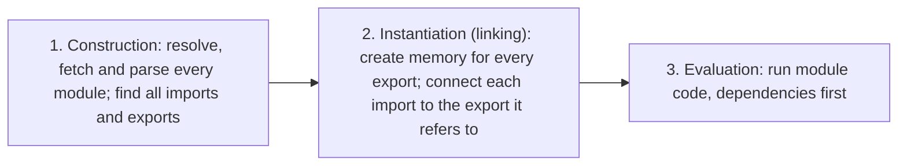

# Modules

[Home](../README.md) › [JavaScript](README.md) › Modules

> **In one sentence:** A module is a file with its own scope that states what it needs and what it offers; CommonJS loads modules synchronously by running them and caching an `exports` object, while ES modules are parsed and linked as a static graph first and only then executed, with live bindings between them.

**Before this:** [Execution, scope and closures](02-execution-scope-closures.md), [async JavaScript](04-async-javascript.md).
**After this:** [TypeScript compiler, tsconfig and modules](../05-typescript/03-compiler-tsconfig-modules.md), [Node.js architecture](../06-nodejs/01-architecture.md).

## Why modules exist

Without modules, every script shares one global scope. Names collide, the load order matters but is not written anywhere, and nobody can tell what a file depends on.

A module system gives three things:

1. **Its own scope per file.** Top-level variables are private unless exported.
2. **Explicit dependencies.** A file declares what it imports.
3. **Run once.** A module is evaluated one time and the result is shared by everyone who imports it.

Node.js has two module systems, for historical reasons. **CommonJS (CJS)** was created for Node.js in 2009, before the language had modules. **ES modules (ESM)** were added to the language in 2015 and are the standard. Both are in use and you need to understand both, and how they work together.

## CommonJS

```js
// math.js
const PI = 3.14159;
function area(r) { return PI * r * r; }
module.exports = { area };

// app.js
const { area } = require('./math.js');
console.log(area(2));
```

### What `require` really does

`require` is an ordinary function that runs at run time. For `require('./math.js')`, Node.js does this:

1. **Resolve** the specifier to an absolute file path.
2. **Check the cache** (`require.cache`), keyed by that path. If the module is there, return its `module.exports` immediately.
3. **Create** a new `module` object with an empty `exports` object and put it in the cache **before running anything**.
4. **Wrap** the file's source in a function and **run** it:

```js
(function (exports, require, module, __filename, __dirname) {
  // your file's code is here
});
```

5. **Return** `module.exports`.

This wrapper explains several things at once:

- Top-level variables are local to the wrapper function. That is why they are private.
- `require`, `module`, `exports`, `__filename` and `__dirname` are not globals. They are parameters.
- `exports` is just a second reference to `module.exports`. Assigning `exports = something` changes the local variable only and exports nothing. Use `module.exports = something`, or add properties: `exports.name = value`.
- Top-level `return` is legal in a CommonJS file. `this` at the top level is `module.exports`.

### Properties of CommonJS

| Property | Consequence |
|---|---|
| **Synchronous** | `require` reads the file from disk and runs it before returning. Fine at start-up. Bad inside a request handler |
| **Dynamic** | `require` can be called anywhere, with a computed path, inside an `if`. Tools cannot know the dependency graph without running the code |
| **Exports are a plain object** | The importer gets a reference to the `exports` object. Destructuring it **copies** the values at that moment |
| **Cached by resolved path** | The module runs once. Everyone gets the same object. This is how a module works as a singleton |

```js
// counter.js (CommonJS)
let count = 0;
module.exports = { count, increment() { count++; } };

// app.js
const counter = require('./counter.js');
counter.increment();
console.log(counter.count);     // → 0   (the object's property was copied from `count` when the module ran)
```

## ES modules

```js
// math.js
const PI = 3.14159;
export function area(r) { return PI * r * r; }
export default class Circle {}

// app.js
import Circle, { area } from './math.js';
import * as math from './math.js';
```

`import` and `export` are **syntax**, not functions. They are only allowed at the top level of a module, and the specifier must be a string literal. This makes the dependency graph **static**: it can be read from the source text without running anything.

### Three phases

ESM loading is split into separate phases for the whole graph.



1. **Construction.** Starting from the entry file, the loader resolves each specifier, reads the file, and parses it to find its `import` and `export` statements. It repeats this until the whole graph is known. **No code runs.**
2. **Instantiation.** The engine creates a binding (a memory slot) for every export and connects every import to the matching slot. A missing export is detected here, as a `SyntaxError` before anything runs.
3. **Evaluation.** Module bodies are run, in **post-order**: a module's dependencies run before the module itself. Each module runs once.

### Live bindings

An import is not a copy. It is a read-only **view of the exporting module's variable**.

```js
// counter.js (ESM)
export let count = 0;
export function increment() { count++; }

// app.js
import { count, increment } from './counter.js';
increment();
console.log(count);      // → 1   (the import sees the current value)
count = 5;               // TypeError: imports are read-only for the importer
```

Compare this with the CommonJS example above, which printed `0`.

### Other ESM properties

- **Always strict mode.** No `"use strict"` needed.
- **`this` at the top level is `undefined`.**
- **Imports are hoisted.** All imports are resolved and all dependencies evaluated before the first line of the module body runs, wherever the `import` statement is written.
- **No `require`, `module`, `__filename`, `__dirname`.** Use `import.meta`:

```js
import.meta.url;          // 'file:///app/src/server.js'
import.meta.dirname;      // '/app/src'          (Node.js 20.11+)
import.meta.filename;     // '/app/src/server.js'
```

- **Top-level `await`** is allowed. The module, and every module that imports it, waits until the promise settles.

```js
// config.js
export const config = await loadConfigFromVault();
```

Use it with care. A slow or hanging top-level `await` delays the start of everything that depends on that module.

- **Dynamic `import()`** is a function-like form that returns a promise for the module namespace. It works in both ESM and CommonJS files. Use it for lazy loading and for loading ESM from CommonJS.

```js
const { default: sharp } = await import('sharp');     // loaded only when first needed
```

## CommonJS and ESM side by side

| | CommonJS | ES modules |
|---|---|---|
| Syntax | `require()`, `module.exports` | `import`, `export` |
| When dependencies are known | At run time, when `require` is called | Before execution, from the source text |
| Loading | Synchronous | Asynchronous graph loading; supports top-level `await` |
| What the importer gets | A reference to the `exports` object. Destructured values are copies | Live, read-only bindings |
| Conditional / computed import | Yes, `require` anywhere | Only with dynamic `import()` |
| Strict mode | Opt in | Always |
| Top-level `this` | `module.exports` | `undefined` |
| File path helpers | `__filename`, `__dirname` | `import.meta.filename`, `import.meta.dirname` |
| Tree shaking by bundlers | Difficult | Works well, because the graph is static |
| Runs in browsers | No (needs a bundler) | Yes |

## Circular dependencies

A cycle exists when A imports B and B imports A, directly or through other modules. Both systems allow it. Both can give surprising results.

**CommonJS** returns a **partially filled `exports` object**:

```js
// a.js
exports.loaded = false;
const b = require('./b.js');          // 2. a.js stops here and b.js runs
exports.loaded = true;

// b.js
const a = require('./a.js');          // 3. a.js is already in the cache → returns its exports SO FAR
console.log(a.loaded);                // → false
```

Because the module was put in the cache before it ran, the inner `require` does not loop forever. It gets whatever was exported up to that point. If `a.js` had used `module.exports = {...}` at the end of the file, `b.js` would hold the old, empty object forever.

**ES modules** link the bindings first, so the import always refers to the right variable. But the variable may not be **initialized** yet:

```js
// a.js
import { b } from './b.js';
export const a = 'a';

// b.js
import { a } from './a.js';
console.log(a);       // ReferenceError: Cannot access 'a' before initialization
export const b = 'b';
```

`b.js` runs first (it is a dependency of `a.js`). At that moment `a` is in the [temporal dead zone](02-execution-scope-closures.md). If `b.js` only used `a` later, inside a function called after start-up, it would work, because the binding is live.

**How to deal with cycles:** they are usually a design signal. Move the shared part into a third module that both import. If a cycle must stay, do not use the imported values at module top level; use them inside functions. [NestJS](../06-nodejs/08-nestjs-internals.md) has `forwardRef()` for exactly this problem at the dependency-injection level.

## How Node.js decides the module type

Node.js must know, for each file, whether to treat it as CommonJS or ESM.

| Signal | Result |
|---|---|
| `.mjs` extension | ESM |
| `.cjs` extension | CommonJS |
| `.js` and the nearest `package.json` has `"type": "module"` | ESM |
| `.js` and the nearest `package.json` has `"type": "commonjs"` or no `type` | CommonJS |

Recent Node.js versions can also detect ESM syntax in an ambiguous `.js` file and switch automatically. Do not depend on that. State `"type"` in `package.json` explicitly.

## Resolution: from specifier to file

The string in `import x from '...'` is called the **specifier**. There are three kinds.

| Kind | Example | How it is resolved |
|---|---|---|
| **Relative / absolute** | `'./user.service.js'`, `'/abs/file.js'` | Relative to the importing file |
| **Bare** | `'express'`, `'lodash/merge'` | Searched in `node_modules` |
| **Built-in** | `'node:fs'`, `'node:crypto'` | Provided by Node.js. Always use the `node:` prefix: it is explicit and cannot be shadowed by a package |

### The `node_modules` search

For a bare specifier, Node.js looks for `node_modules/<name>` in the directory of the importing file, then in the parent directory, then in its parent, up to the file system root.

```
/app/src/services/user.js  imports 'express'
  → /app/src/services/node_modules/express    (not found)
  → /app/src/node_modules/express             (not found)
  → /app/node_modules/express                 (found)
```

This walk is why a package can have its own version of a dependency nested inside it, and why package managers can hoist shared dependencies to the top.

### Inside the package: `main` and `exports`

Once the package directory is found, `package.json` says which file to load.

```json
{
  "name": "my-lib",
  "type": "module",
  "main": "./dist/index.cjs",
  "exports": {
    ".": {
      "types": "./dist/index.d.ts",
      "import": "./dist/index.js",
      "require": "./dist/index.cjs"
    },
    "./utils": "./dist/utils.js"
  },
  "imports": {
    "#db/*": "./src/db/*.js"
  }
}
```

- **`main`** is the old, single entry point.
- **`exports`** is the modern form and wins over `main`. It does two things. It defines the **public entry points**: anything not listed cannot be imported (`my-lib/dist/internal.js` fails with `ERR_PACKAGE_PATH_NOT_EXPORTED`). And it allows **conditional exports**: a different file for `import` and for `require`, and a `types` entry for TypeScript.
- **`imports`** defines private aliases that start with `#`, usable only inside the package. It is a built-in replacement for long relative paths like `../../../db/client.js`.

### Differences in ESM resolution

- **File extensions are required** for relative imports: `import './user.js'`, not `import './user'`.
- **No automatic `index.js`** for directory imports.
- CommonJS `require` does both of those for you: it tries `.js`, `.json`, `.node`, and `index.js` in a directory.

This is the most common error when moving a project to ESM, and it is why TypeScript projects write `.js` in import paths even though the source file is `.ts`. See [compiler, tsconfig and modules](../05-typescript/03-compiler-tsconfig-modules.md).

## Using the two systems together

| Direction | How | Notes |
|---|---|---|
| ESM imports CJS | `import pkg from 'cjs-package'` | Always works. The default import is `module.exports`. Named imports work when Node.js can detect the export names by static analysis of the CJS file; if it cannot, import the default and destructure it |
| CJS loads ESM | `const m = await import('esm-package')` | Always works, but is asynchronous |
| CJS loads ESM | `const m = require('esm-package')` | Supported without a flag in Node.js 22.12 and later, **only if** the ESM graph has no top-level `await`. Otherwise it throws `ERR_REQUIRE_ASYNC_MODULE` |

```js
// ESM importing a CommonJS package
import express from 'express';                 // default = module.exports
import { Router } from 'express';              // works if the names can be detected

// JSON in ESM needs an import attribute
import pkg from './package.json' with { type: 'json' };

// CommonJS helpers inside an ESM file
import { createRequire } from 'node:module';
const require = createRequire(import.meta.url);
const legacy = require('./legacy.cjs');
```

### The dual package hazard

If a library ships both a CommonJS build and an ESM build, one program can load **both copies**: one part of the dependency tree uses `require`, another uses `import`. Now there are two separate module instances with separate state. An `instanceof` check against a class from the "other" copy fails. A singleton exists twice.

Library authors avoid it by shipping one real implementation and a thin wrapper for the other format, or by shipping only ESM now that `require(esm)` works.

## Module state and singletons

A module is evaluated once per process (per resolved path), and its top-level variables live for the life of the process. So module scope is the simplest singleton:

```js
// db.js
import pg from 'pg';
export const pool = new pg.Pool({ max: 10 });     // created once; every importer shares it
```

Things to remember:

- Module-level state is **shared by all requests**. Never keep per-request data there. Use function arguments or [`AsyncLocalStorage`](../06-nodejs/06-events-and-async-context.md).
- Module-level collections are a common source of [memory leaks](06-memory-garbage-collection.md).
- Code at module top level runs at **import time**. Opening connections or reading the environment there makes the module hard to test and makes import order matter. Prefer exporting a function that does the work when called.
- Each [worker thread](../06-nodejs/04-scaling-cpu-work.md) and each [cluster process](../06-nodejs/04-scaling-cpu-work.md) has its own module instances. A module-level `Map` is not shared between them.
- Tests that mock modules work by replacing entries in the module cache or by hooking the loader. This is easier in CommonJS than in ESM, where bindings are read-only.

## Bundlers and tree shaking

A **bundler** (esbuild, Rollup, webpack) follows the import graph at build time and writes one or a few output files. **Tree shaking** removes exports that nothing imports. It depends on the static structure of ESM: the bundler can prove that an export is unused without running the code.

For backend code a bundler is optional. Node.js loads modules from disk itself. Bundling is worth it mainly for **serverless functions**, where a smaller package and fewer files to read reduce cold-start time, and for shipping a single-file CLI.

## How this connects

- **The module wrapper is a function**, so module privacy is just [function scope and closures](02-execution-scope-closures.md).
- **Uninitialized imports in a cycle** are the [temporal dead zone](02-execution-scope-closures.md) again.
- **Top-level `await` and dynamic `import()`** are built on [promises](04-async-javascript.md).
- **TypeScript must be configured to match** the module system Node.js will use at run time. Most "cannot find module" errors in TypeScript projects come from a mismatch. See [compiler, tsconfig and modules](../05-typescript/03-compiler-tsconfig-modules.md).
- **Synchronous `require` blocks the event loop** when called inside a request. See [the event loop](../06-nodejs/02-event-loop.md).
- **NestJS modules are a different concept.** They are dependency-injection containers built on top of JavaScript modules. See [NestJS internals](../06-nodejs/08-nestjs-internals.md).
- **Dependencies are a supply-chain risk.** Everything in `node_modules` runs with your process's permissions. See [web security](../08-backend-engineering/03-web-security.md).

## Interview questions

<details>
<summary><strong>🟢 Q1. What are the main differences between CommonJS and ES modules?</strong></summary>

CommonJS uses `require` and `module.exports`. `require` is a normal function that runs at run time, loads the file synchronously, and returns the module's exports object. ES modules use `import` and `export`, which are syntax. The imports are static, so the whole dependency graph is known before any code runs.

There are a few more differences. ES module imports are live bindings to the exporting module's variables, while in CommonJS you get the exports object and destructured values are copies. ES modules are always in strict mode, support top-level `await`, and do not have `__dirname` or `require`. And because ES modules are static, bundlers can remove unused exports.

</details>

<details>
<summary><strong>🟢 Q2. What happens when you <code>require</code> the same module twice?</strong></summary>

The module's code runs only the first time. Node.js resolves the path, runs the file, and stores the module in a cache keyed by the resolved file path. The second `require` returns the same `module.exports` object from the cache.

So both callers share one object and one module state. That is why a module can be used as a singleton, for example a module that exports a database pool.

</details>

<details>
<summary><strong>🟢 Q3. What is the difference between <code>exports</code> and <code>module.exports</code>?</strong></summary>

Node.js wraps each CommonJS file in a function and passes `module` and `exports` as arguments. At the start, `exports` and `module.exports` point to the same object. What `require` returns is `module.exports`.

So `exports.foo = 1` works, because it changes the shared object. But `exports = { foo: 1 }` only reassigns the local variable, and `module.exports` is still the original empty object. To export a single function or class, I must assign to `module.exports`.

</details>

<details>
<summary><strong>🟡 Q4. What are live bindings?</strong></summary>

In ES modules an import is not a copy of the value. It is a read-only reference to the variable in the module that exports it. If the exporting module changes that variable later, every importer sees the new value.

In CommonJS, if I destructure `const { count } = require('./counter')`, I get the value at that moment, and later changes inside the module are not visible. With `import { count } from './counter.js'`, I always read the current value. The importer cannot assign to it, only the exporting module can.

</details>

<details>
<summary><strong>🟡 Q5. How do circular dependencies behave in CommonJS and in ES modules?</strong></summary>

In CommonJS, a module is put into the cache before its code runs. If A requires B and B requires A, then B gets A's exports object as it is at that moment, which is only partly filled. Properties that A sets later are missing when B's top-level code runs. If A replaces `module.exports` at the end, B keeps the old empty object.

In ES modules, all imports and exports are linked before any code runs, so B's import really points to A's variable. But B is evaluated first, and if it reads the variable at the top level, the variable is not initialized yet and it throws a `ReferenceError`. If B only uses it later inside a function, it works.

In both cases the fix is the same: move the shared code to a third module, or do not use the imported value at module load time.

</details>

<details>
<summary><strong>🟡 Q6. How does Node.js resolve <code>import x from 'some-package'</code>?</strong></summary>

It is a bare specifier, so Node.js looks for a `node_modules/some-package` directory. It starts in the directory of the importing file and walks up through the parent directories until it finds one.

Then it reads the package's `package.json`. If there is an `exports` field, that decides which file is loaded, and it can give a different file for `import` and for `require`. Paths that are not listed in `exports` cannot be imported. If there is no `exports` field, it uses `main`, and falls back to `index.js`. The package's `type` field and the file extension decide whether the file is loaded as CommonJS or as an ES module.

</details>

<details>
<summary><strong>🔴 Q7. Why can ES modules have top-level <code>await</code> but CommonJS cannot? What is the cost?</strong></summary>

`require` is synchronous. It must return the finished exports before the next line runs, so it cannot wait for a promise. ES module loading is designed as asynchronous phases. The graph is built and linked first, and evaluation can pause on a module with a top-level `await` and continue when the promise settles.

The cost is that the module blocks every module that depends on it. If it awaits something slow, the application starts slowly, and if the promise never settles, the application never starts and there may be no error. It is also the reason `require` of an ES module only works when the graph has no top-level `await`. I use it for things that really must be ready before the module can be used, like loading configuration, and I keep it out of libraries.

</details>

<details>
<summary><strong>🔴 Q8. What is the dual package hazard?</strong></summary>

It happens when a package ships both a CommonJS build and an ES module build, and one application loads both. For example, my code imports the ESM build, and another dependency requires the CommonJS build. These are two different files, so Node.js creates two module instances with separate state.

The symptoms are confusing. An `instanceof` check fails because the object was created by the class from the other copy. A singleton or a registry exists twice. Configuration set in one copy is not visible in the other.

A library avoids it by having one real implementation and making the other format a thin wrapper that re-exports it, or by keeping all state in one shared file, or by shipping only ESM, which newer Node.js versions can also load with `require`.

</details>

## Key takeaways

- A module has its own scope, explicit dependencies, and runs once.
- CommonJS: `require` is a synchronous function. The file is wrapped in a function. The result is cached by path. Exports are a plain object.
- ESM: static syntax. Three phases: construction, linking, evaluation. Live read-only bindings. Strict mode. Top-level `await`.
- Cycles give a partial exports object in CommonJS and an uninitialized binding in ESM. Fix the design.
- `"type"` in `package.json` and the file extension choose the module system. `exports` defines the public surface of a package.
- ESM relative imports need the file extension.
- Module scope is process-wide shared state. Never store per-request data there.

---

← [Memory and Garbage Collection](06-memory-garbage-collection.md) | Next: [Iterators, Generators and Metaprogramming →](08-iterators-generators-metaprogramming.md)
