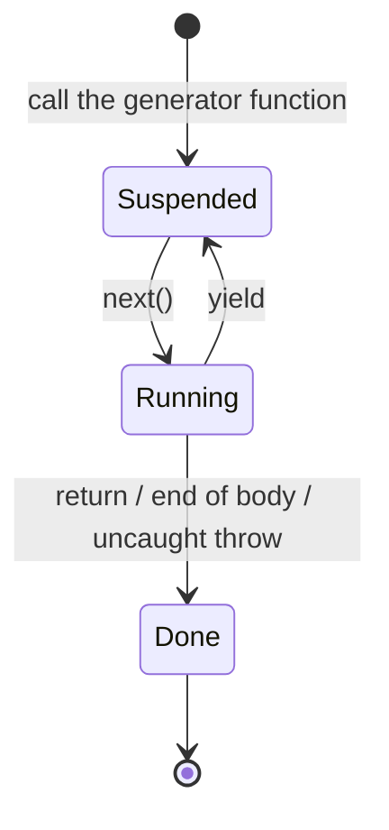

# Iterators, Generators and Metaprogramming

[Home](../README.md) › [JavaScript](README.md) › Iterators, Generators and Metaprogramming

> **In one sentence:** JavaScript defines small protocols (iteration, async iteration, well-known symbols, proxy traps) that let your own objects plug into language features like `for...of`, spread and `await`, and generators are functions that can pause, which makes those protocols easy to implement.

**Before this:** [`this`, prototypes and classes](03-this-prototypes-classes.md), [async JavaScript](04-async-javascript.md).
**After this:** [Buffers and streams](../06-nodejs/03-buffers-and-streams.md), [NestJS internals](../06-nodejs/08-nestjs-internals.md), [TypeScript generics and advanced types](../05-typescript/02-generics-advanced-types.md).

## The iteration protocols

`for...of`, spread (`[...x]`), destructuring (`const [a, b] = x`), `Array.from`, `new Map(x)`, `Promise.all(x)` and `yield*` all work with arrays, strings, maps, sets and your own objects. They can do that because they do not know about arrays. They only know a **protocol**: a small agreement about method names and return values.

There are two parts.

**An iterator** is an object with a `next()` method that returns `{ value, done }`.

**An iterable** is an object with a method under the key `Symbol.iterator` that returns an iterator.

```js
const iterable = [10, 20];
const iterator = iterable[Symbol.iterator]();

iterator.next();     // → { value: 10, done: false }
iterator.next();     // → { value: 20, done: false }
iterator.next();     // → { value: undefined, done: true }
```

`for (const x of iterable)` is this, written by the engine:

```js
const it = iterable[Symbol.iterator]();
let step;
while (!(step = it.next()).done) {
  const x = step.value;
  // loop body
}
```

### Writing an iterable by hand

```js
class Range {
  constructor(start, end) { this.start = start; this.end = end; }

  [Symbol.iterator]() {
    let current = this.start;
    const end = this.end;
    return {
      next: () => current <= end
        ? { value: current++, done: false }
        : { value: undefined, done: true },
      return() {                          // optional: called if the consumer stops early
        return { value: undefined, done: true };
      },
    };
  }
}

[...new Range(1, 4)];      // → [1, 2, 3, 4]
```

Two properties matter for backend work:

- **Iteration is lazy.** A value is produced only when `next()` is called. A range of one billion numbers uses no memory until you consume it, and only one value at a time.
- **Early exit is signalled.** If the consumer leaves a `for...of` loop with `break`, `return` or an exception, the engine calls the iterator's `return()` method. This is the hook for cleanup, such as closing a file or a database cursor.

Built-in iterables: `Array`, `String` (iterates by code point, not by UTF-16 unit), `Map`, `Set`, `TypedArray`, `arguments`. Plain objects are **not** iterable. Use `Object.keys`, `Object.values` or `Object.entries` for them.

## Generators

Writing iterators by hand needs manual state. A **generator function** (`function*`) lets you write the same logic as ordinary code that **pauses** at each `yield`.

```js
function* range(start, end) {
  for (let i = start; i <= end; i++) {
    yield i;                       // pause here, hand `i` to the consumer
  }
}

const gen = range(1, 3);
gen.next();      // → { value: 1, done: false }
gen.next();      // → { value: 2, done: false }
gen.next();      // → { value: 3, done: false }
gen.next();      // → { value: undefined, done: true }
```

Calling a generator function does **not** run its body. It returns a **generator object**, which is both an iterator and an iterable. Each `next()` runs the body until the next `yield`, then suspends it. The local variables and the position in the code are kept on the heap, not on the call stack, so the function can be resumed later.



### Two-way communication

`yield` is an expression. The value passed to `next(value)` becomes the result of the `yield` where the generator was paused.

```js
function* conversation() {
  const name = yield 'What is your name?';
  const lang = yield `Hello ${name}. Favourite language?`;
  return `${name} likes ${lang}`;
}

const g = conversation();
g.next();              // → { value: 'What is your name?', done: false }
g.next('Ahmed');       // → { value: 'Hello Ahmed. Favourite language?', done: false }
g.next('TypeScript');  // → { value: 'Ahmed likes TypeScript', done: true }
```

- `gen.throw(err)` resumes the generator by throwing `err` at the paused `yield`. The generator can catch it with `try/catch`.
- `gen.return(value)` finishes the generator early. Its `finally` blocks run. This is what `for...of` calls on `break`.
- `yield* other` delegates to another iterable and yields each of its values.

```js
function* withCleanup() {
  const conn = openConnection();
  try {
    yield* conn.rows();
  } finally {
    conn.close();            // runs on normal end, on error, and when the consumer breaks out
  }
}
```

### Lazy pipelines

Generators compose into pipelines that process one item at a time, with constant memory.

```js
function* filter(iterable, predicate) {
  for (const x of iterable) if (predicate(x)) yield x;
}
function* map(iterable, fn) {
  for (const x of iterable) yield fn(x);
}
function* take(iterable, n) {
  if (n <= 0) return;
  for (const x of iterable) {
    yield x;
    if (--n === 0) return;
  }
}
function* naturals() { let n = 1; while (true) yield n++; }     // infinite

[...take(map(filter(naturals(), n => n % 2 === 0), n => n * n), 3)];
// → [4, 16, 36]   — only 6 numbers were ever produced
```

Compare with array methods: `arr.filter(...).map(...).slice(0, 3)` builds a complete intermediate array at each step. Modern engines also provide **iterator helpers** directly on iterators (`iterator.map(...)`, `.filter(...)`, `.take(n)`, `.toArray()`), which give the same lazy behavior without writing the helpers yourself.

### Generators and `async/await`

A generator can pause and be resumed with a value or with an error. That is exactly what an async function needs to do at each `await`. Before `async/await` existed, libraries implemented it with generators: `yield` a promise, and a small runner called `next(result)` when the promise fulfilled or `throw(error)` when it rejected.

`async/await` is that pattern built into the language. Understanding generators is understanding how an [async function](04-async-javascript.md) suspends.

## Async iteration

Many data sources produce values **over time**: lines of a file, rows from a database cursor, messages from a queue, pages from an API. The async version of the protocol handles this.

- An **async iterable** has a method under `Symbol.asyncIterator`.
- Its iterator's `next()` returns a **promise** of `{ value, done }`.
- It is consumed with `for await...of`.

An **async generator** (`async function*`) can use both `await` and `yield`:

```js
async function* fetchAllPages(baseUrl) {
  let cursor = null;
  do {
    const res = await fetch(`${baseUrl}?cursor=${cursor ?? ''}`);
    const { items, nextCursor } = await res.json();
    yield* items;                        // hand over the items of this page, one by one
    cursor = nextCursor;
  } while (cursor);
}

for await (const item of fetchAllPages('https://api.example.com/orders')) {
  await processOrder(item);              // the next page is not requested until we need it
}
```

The important property is **backpressure for free**. The generator does not continue past a `yield` until the consumer asks for the next value. A slow consumer automatically slows the producer down. Nothing piles up in memory.

Node.js [readable streams](../06-nodejs/03-buffers-and-streams.md) are async iterables, so this works directly:

```js
import { createReadStream } from 'node:fs';
import { createInterface } from 'node:readline';

const lines = createInterface({ input: createReadStream('huge.log') });
for await (const line of lines) {
  // one line at a time; the file is never fully in memory
}
```

`for await...of` processes items **one after another**. If the items are independent and you want concurrency, collect work into batches and use `Promise.all`, or use a concurrency limiter. See [async JavaScript](04-async-javascript.md).

## Symbols

A **symbol** is a primitive value that is unique and can be used as a property key.

```js
const id = Symbol('id');
const other = Symbol('id');
id === other;                    // → false: the description is only a label

const user = { name: 'Sara', [id]: 42 };
Object.keys(user);               // → ['name']        symbol keys are skipped
JSON.stringify(user);            // → '{"name":"Sara"}'
user[id];                        // → 42
```

Uses:

- **Keys that cannot collide.** A library can attach data to your object without any risk of overwriting one of your properties.
- **`Symbol.for('key')`** returns the same symbol for the same string across the whole process (a global registry). It is used when different copies of a module must agree on a key.
- **Well-known symbols** are the hooks the language uses to call your code.

| Well-known symbol | Language feature it controls |
|---|---|
| `Symbol.iterator` | `for...of`, spread, destructuring |
| `Symbol.asyncIterator` | `for await...of` |
| `Symbol.toPrimitive` | Conversion to a primitive (`+obj`, `` `${obj}` ``). See [types and coercion](01-types-and-coercion.md) |
| `Symbol.toStringTag` | The name in `Object.prototype.toString.call(obj)` |
| `Symbol.hasInstance` | The `instanceof` operator |
| `Symbol.dispose`, `Symbol.asyncDispose` | The `using` and `await using` declarations |

Symbol keys are **not private**. `Object.getOwnPropertySymbols(obj)` and `Reflect.ownKeys(obj)` return them. For real privacy use `#private` class fields.

### Explicit resource management

The `using` declaration calls an object's `[Symbol.dispose]()` method automatically when the variable goes out of scope, including when an exception is thrown. `await using` does the same with `[Symbol.asyncDispose]()`. It is supported in current Node.js LTS lines and in TypeScript 5.2 and later.

```js
async function transfer() {
  await using client = await pool.acquire();     // client[Symbol.asyncDispose]() runs at the end of the block
  await client.query('...');
}                                                // released here, even if the query throws
```

It replaces the `try { ... } finally { release() }` pattern for connections, locks, file handles and temporary resources.

## Map, Set, WeakMap, WeakSet

| | `Object` | `Map` |
|---|---|---|
| Key types | Strings and symbols only. Other keys are converted to strings | Any value, including objects |
| Order | Integer-like keys first, in numeric order, then strings in insertion order | Insertion order, always |
| Size | `Object.keys(o).length` | `map.size` |
| Inherited keys | Has a prototype: `'toString' in {}` is `true` | None |
| Frequent add and delete | Can push the object into slow [dictionary mode](05-v8-engine-internals.md) | Designed for it |
| JSON | Direct | Needs conversion |

**Rule:** use an object or a class for a **record** with a fixed, known set of fields. Use a `Map` for a **dictionary** with keys that come from data.

There is also a security reason. An object used as a dictionary with user-controlled keys is open to **prototype pollution**: a key like `__proto__` or `constructor` reaches into the prototype chain. A `Map`, or an object created with `Object.create(null)`, does not have this problem. See [web security](../08-backend-engineering/03-web-security.md).

**`Set`** stores unique values. Lookup with `has` is O(1) on average, compared with O(n) for `array.includes`.

```js
const unique = [...new Set([3, 1, 3, 2, 1])];     // → [3, 1, 2]

const a = new Set([1, 2, 3]);
const b = new Set([2, 3, 4]);
a.intersection(b);     // → Set {2, 3}
a.union(b);            // → Set {1, 2, 3, 4}
a.difference(b);       // → Set {1}
```

`Map` and `Set` compare keys with **SameValueZero**: like `===`, except that `NaN` equals `NaN`. Objects are compared **by reference**, so `map.get({ id: 1 })` never finds an entry stored under a different `{ id: 1 }` object. For composite keys, build a string key such as `` `${tenantId}:${userId}` ``.

**`WeakMap` and `WeakSet`** hold their object keys weakly, so they do not prevent garbage collection. They are covered in [memory and garbage collection](06-memory-garbage-collection.md).

## Property descriptors

Every property has hidden attributes, stored in a **descriptor**.

```js
Object.getOwnPropertyDescriptor({ x: 1 }, 'x');
// → { value: 1, writable: true, enumerable: true, configurable: true }
```

| Attribute | Meaning |
|---|---|
| `value` | The stored value (data property) |
| `get` / `set` | Functions called on read and write (accessor property) |
| `writable` | Can the value be changed by assignment? |
| `enumerable` | Does it appear in `for...in`, `Object.keys`, spread and `JSON.stringify`? |
| `configurable` | Can the property be deleted or its attributes changed? |

```js
const account = {};
Object.defineProperty(account, 'id', { value: 7, writable: false, enumerable: true });
account.id = 8;        // silently ignored; TypeError in strict mode
```

Three levels of locking an object:

| Function | Add properties | Delete properties | Change values |
|---|---|---|---|
| `Object.preventExtensions(o)` | No | Yes | Yes |
| `Object.seal(o)` | No | No | Yes |
| `Object.freeze(o)` | No | No | No |

All three are **shallow**. A frozen object can still contain a mutable nested object.

## Proxy and Reflect

A **`Proxy`** wraps a target object and lets you intercept the basic operations on it. Each interception function is called a **trap**.

```js
const target = { name: 'Sara' };

const proxy = new Proxy(target, {
  get(target, prop, receiver) {
    console.log(`read ${String(prop)}`);
    return Reflect.get(target, prop, receiver);
  },
  set(target, prop, value, receiver) {
    if (prop === 'age' && !Number.isInteger(value)) {
      throw new TypeError('age must be an integer');
    }
    return Reflect.set(target, prop, value, receiver);
  },
});

proxy.name;           // logs "read name" → 'Sara'
proxy.age = 'old';    // TypeError
```

| Trap | Intercepts |
|---|---|
| `get`, `set` | Reading and writing a property |
| `has` | The `in` operator |
| `deleteProperty` | `delete` |
| `ownKeys` | `Object.keys`, `for...in`, spread |
| `getOwnPropertyDescriptor`, `defineProperty` | Descriptor operations |
| `apply` | Calling a function |
| `construct` | `new` |
| `getPrototypeOf`, `setPrototypeOf` | Prototype access |

**`Reflect`** is an object with one method for each trap, which performs the **default behavior**. Inside a trap, call the matching `Reflect` method to forward the operation. Pass the `receiver` argument along: it keeps `this` correct for getters and for inherited properties.

Where proxies are used in real backend code:

- **ORMs** use them for lazy loading of relations and for change tracking.
- **Validation and schema libraries** use them to observe access.
- **Mocking libraries** create objects that accept any method call.
- **Reactive systems** (Vue, MobX) track which properties were read and written.
- **Client generators** turn `api.users.getById(1)` into an HTTP call without defining each method.

Costs and limits:

- A proxy is **slower** than a plain object. Property access through a trap cannot use the [inline caches](05-v8-engine-internals.md) that make normal access fast. Keep proxies out of hot loops.
- Proxies make code **harder to debug**: reading a property can run arbitrary code.
- Some built-in objects (`Map`, `Date`, objects with `#private` fields) store data in internal slots that are tied to the real object. Calling their methods through a proxy fails unless the trap binds the method to the target.

## Decorators and metadata

A **decorator** is a function applied to a class, method, field or accessor with the `@name` syntax. It receives the thing it decorates and can replace it or record information about it.

There are two versions, and they are **not compatible**:

| | Legacy ("experimental") decorators | Standard (TC39) decorators |
|---|---|---|
| Enabled by | `experimentalDecorators` in tsconfig | Default in TypeScript 5.0 and later |
| Parameter decorators | Yes | No |
| Type metadata | `emitDecoratorMetadata` writes constructor parameter types | No automatic type metadata |
| Used by | NestJS, TypeORM, class-validator | Newer libraries |

[NestJS](../06-nodejs/08-nestjs-internals.md) dependency injection depends on the legacy version: `emitDecoratorMetadata` makes the compiler store each constructor's parameter types, and the `reflect-metadata` library reads them at run time. This is needed because [TypeScript types are erased](../05-typescript/01-type-system-fundamentals.md); the metadata is the one place where type information survives into the running program.

## How this connects

- **Generators suspend and resume**, which is the mechanism behind [`async/await`](04-async-javascript.md).
- **Async iterables are how streams are consumed** with backpressure. See [buffers and streams](../06-nodejs/03-buffers-and-streams.md).
- **Database cursors and paginated APIs** fit async generators naturally: fetch a batch, yield its rows, fetch the next. See [data access from Node.js](../07-databases/11-data-access-from-node.md) and [API design](../08-backend-engineering/01-api-design.md).
- **`Map` versus object** is also an engine question: shapes and dictionary mode. See [V8 engine internals](05-v8-engine-internals.md).
- **`WeakMap`** and its effect on collection: [memory and garbage collection](06-memory-garbage-collection.md).
- **Hash tables** are the data structure behind `Map` and `Set`. See [arrays, strings and hashing](../11-data-structures-algorithms/02-arrays-strings-hashing.md).
- **Decorators and reflection metadata** are the base of [NestJS internals](../06-nodejs/08-nestjs-internals.md).

## Interview questions

<details>
<summary><strong>🟢 Q1. What is the difference between an iterable and an iterator?</strong></summary>

An iterator is an object with a `next` method. Each call returns an object with `value` and `done`. An iterable is an object that can give you an iterator: it has a method under the key `Symbol.iterator` that returns one.

`for...of`, spread and destructuring work on iterables. They call `Symbol.iterator` once to get an iterator and then call `next` until `done` is true. Arrays, strings, maps and sets are iterable. Plain objects are not.

</details>

<details>
<summary><strong>🟢 Q2. When would you use a <code>Map</code> instead of a plain object?</strong></summary>

When I need a dictionary with keys that come from data. A `Map` accepts any type as a key, including objects. It keeps insertion order, has a `size` property, and is built for frequent adding and deleting. It also has no prototype keys, so a user-supplied key like `__proto__` or `constructor` cannot cause trouble.

I use a plain object or a class when the structure is a record with a fixed set of known fields, like a user with `id`, `name` and `email`. That is also what the engine optimizes best for objects.

</details>

<details>
<summary><strong>🟡 Q3. What is a generator function and how does it work?</strong></summary>

A generator function is declared with `function*`. Calling it does not run the body. It returns a generator object, which is an iterator. Each call to `next` runs the body until the next `yield`, returns the yielded value, and pauses the function there. The local variables and the position are saved, so the next call to `next` continues from the same point.

It is useful for producing values lazily, one at a time, including infinite sequences, and it is the easiest way to make an object iterable. I can also send a value in with `next(value)`, throw an error in with `throw`, and stop it early with `return`, which runs its `finally` blocks.

</details>

<details>
<summary><strong>🟡 Q4. How are generators related to <code>async/await</code>?</strong></summary>

An async function needs to stop at an `await`, give control back, and continue later with the result or with an error. A generator can do exactly that: it pauses at `yield`, and it can be resumed with a value through `next` or with an error through `throw`.

Before `async/await`, libraries used this. The generator yielded a promise, and a runner function waited for the promise and then called `next` with the result or `throw` with the error. `async/await` is the same idea built into the language, with the runner inside the engine and promises as the mechanism for resuming.

</details>

<details>
<summary><strong>🟡 Q5. What is an async iterator, and where would you use one in a backend?</strong></summary>

It is an iterator whose `next` method returns a promise of the `value` and `done` object. An object is async iterable if it has a `Symbol.asyncIterator` method, and I consume it with `for await...of`. The easiest way to write one is an async generator, which can use both `await` and `yield`.

I use it for data that arrives over time and may be large: reading a file line by line, going through a database cursor, walking all pages of a paginated API, consuming a queue. The big advantage is that the producer only continues when the consumer asks for the next item. So I get backpressure automatically and memory stays constant.

</details>

<details>
<summary><strong>🟡 Q6. What is a <code>Symbol</code> and what is it used for?</strong></summary>

A symbol is a primitive value that is guaranteed to be unique. I can use it as a property key. Symbol keys do not appear in `Object.keys`, `for...in` or `JSON.stringify`, so they are good for attaching data to an object without colliding with any other property.

The second use is the well-known symbols, which are how the language lets objects customize built-in behavior. `Symbol.iterator` makes an object work with `for...of`. `Symbol.asyncIterator` does the same for `for await`. `Symbol.toPrimitive` controls type conversion, and `Symbol.dispose` works with the `using` declaration. Symbols are not private, though. They can be listed with `Object.getOwnPropertySymbols`.

</details>

<details>
<summary><strong>🔴 Q7. What is a <code>Proxy</code>? Give a real use and explain the cost.</strong></summary>

A `Proxy` wraps a target object and lets me define traps, which are functions that intercept basic operations like reading a property, writing a property, checking `in`, deleting, or calling a function. Inside a trap I normally use the matching `Reflect` method to do the default operation, and I add my own behavior around it.

A real use is an ORM entity. The proxy records which fields were changed, so only those are written in the update, or it loads a relation from the database the first time the property is read. Mocking libraries and reactive state libraries also use proxies.

The cost is performance and clarity. Access through a proxy cannot be optimized like normal property access, so it is clearly slower in hot code. And it hides behavior: a simple property read can run code or a query. So I use it at the edges, not in tight loops.

</details>

<details>
<summary><strong>🔴 Q8. You need to export 5 million rows from PostgreSQL as CSV through an HTTP endpoint. How do the features on this page help?</strong></summary>

The danger is loading all rows into memory. I would treat the result as an async iterable instead. I use a database cursor or a query stream that returns rows in batches, and I wrap it in an async generator that yields one row at a time. A second async generator turns each row into a CSV line. Then I pipe that to the HTTP response, for example with `Readable.from` and `pipeline`.

Because each step is pulled by the next one, the database is only asked for the next batch when the response can accept more data. If the client is slow, everything slows down and memory stays flat. If the client disconnects, the pipeline is destroyed, the generator's `finally` block runs, and I close the cursor and release the connection there. So I get constant memory, backpressure and cleanup with very little code.

</details>

## Key takeaways

- Iterable: has `[Symbol.iterator]()`. Iterator: has `next()` returning `{ value, done }`. Many language features are built on this protocol.
- Generators are pausable functions. They produce values lazily and can receive values and errors.
- Async generators and `for await...of` process data that arrives over time, with automatic backpressure.
- Symbols are unique keys. Well-known symbols are the hooks into language behavior.
- `Map` for dictionaries, objects for records. `Set` for uniqueness and fast membership tests.
- `Proxy` intercepts object operations and `Reflect` performs the defaults. Powerful, but slower and less obvious.
- NestJS depends on legacy decorators and emitted type metadata.

---

← [Modules](07-modules.md) | Next: [05 TypeScript →](../05-typescript/README.md)
