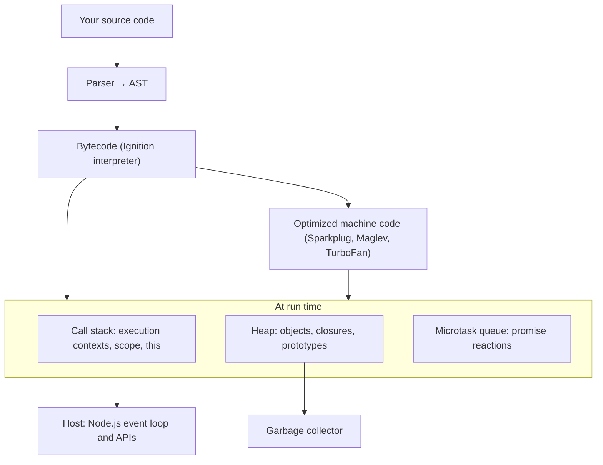

# 04 — JavaScript

[Home](../README.md) › JavaScript

JavaScript is the language you write every day, so this section goes deep. It covers the language rules (types, scope, `this`, prototypes), the asynchronous model (promises, microtasks, `async/await`), and what the engine does with your code (compilation, hidden classes, garbage collection).

The goal is that you can **predict** what any piece of JavaScript does, and explain why.

## Pages

| # | Page | What you will understand |
|---|---|---|
| 1 | [Types and Coercion](01-types-and-coercion.md) | The 8 types, value versus reference, equality, conversion rules |
| 2 | [Execution, Scope and Closures](02-execution-scope-closures.md) | Execution contexts, the call stack, hoisting, the temporal dead zone, closures |
| 3 | [`this`, Prototypes and Classes](03-this-prototypes-classes.md) | The four binding rules, the prototype chain, what `class` really does |
| 4 | [Async JavaScript](04-async-javascript.md) | Callbacks, promises, microtasks, `async/await`, concurrency patterns, cancellation |
| 5 | [V8 Engine Internals](05-v8-engine-internals.md) | Parsing, bytecode, JIT tiers, hidden classes, inline caches, deoptimization |
| 6 | [Memory and Garbage Collection](06-memory-garbage-collection.md) | The heap, generational GC, memory leaks and how to find them |
| 7 | [Modules](07-modules.md) | CommonJS versus ES modules, resolution, loading, interop |
| 8 | [Iterators, Generators and Metaprogramming](08-iterators-generators-metaprogramming.md) | Iteration protocols, generators, `Map`/`Set`/`WeakMap`, `Symbol`, `Proxy` |

## How the pieces fit

- Pages 1–3 are about the **language**: what the specification says your code means.
- Page 4 is about **time**: how code that waits is scheduled.
- Pages 5–6 are about the **engine**: how V8 makes it fast and manages memory.
- Pages 7–8 are about **structure**: how programs are divided and how the language can be extended.

The language itself has no I/O, no timers and no event loop. Those come from the **host**: the browser or Node.js. The boundary between "JavaScript" and "Node.js" is one of the most useful things to be clear about, and [Node.js architecture](../06-nodejs/01-architecture.md) picks up exactly where this section ends.

## Where this leads

- [05 TypeScript](../05-typescript/README.md) adds a static type system on top of these runtime rules. TypeScript's types disappear at run time, so everything here still applies.
- [06 Node.js](../06-nodejs/README.md) adds the event loop, I/O and the standard library.
- Number precision and string encoding rules come from [data representation](../01-computer-foundations/01-data-representation.md).

## Primary sources

- The ECMAScript Language Specification (ECMA-262), tc39.es/ecma262.
- MDN Web Docs, JavaScript reference and guides.
- The V8 blog (v8.dev/blog) for engine internals.
- Simpson, *You Don't Know JS Yet*.
- Rauschmayer, *Deep JavaScript* and *JavaScript for Impatient Programmers* (exploringjs.com).

---

← [Proxies, Load Balancers and CDNs](../03-networking/08-proxies-load-balancers-cdn.md) | Next: [Types and Coercion →](01-types-and-coercion.md)
