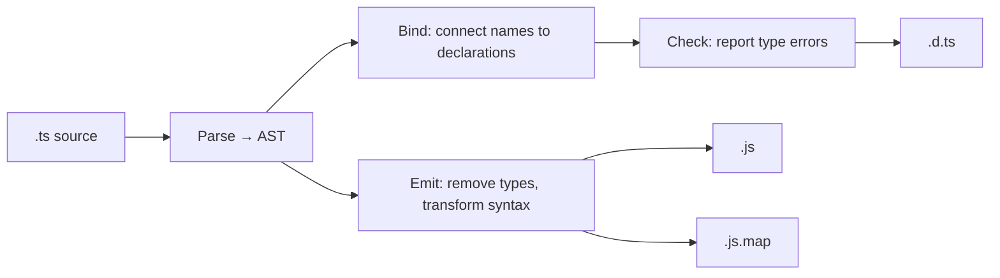
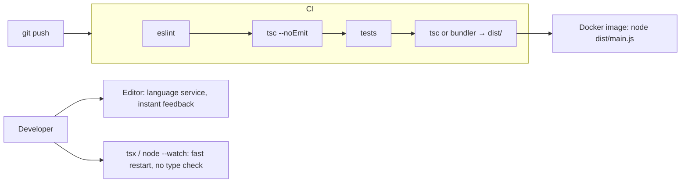

# Compiler, tsconfig and Modules

[Home](../README.md) › [TypeScript](README.md) › Compiler, tsconfig and Modules

> **In one sentence:** The TypeScript compiler does two independent jobs, checking types and producing JavaScript, and `tsconfig.json` controls both; most build problems come from module settings that do not match how Node.js will actually load the output.

**Before this:** [Type system fundamentals](01-type-system-fundamentals.md), [JavaScript modules](../04-javascript/07-modules.md).
**After this:** [Patterns for backends](04-patterns-for-backends.md), [deployment and operations](../08-backend-engineering/09-deployment-and-operations.md).

## Two jobs: checking and emitting



| Job | What it needs | What it produces | Speed |
|---|---|---|---|
| **Type checking** | The whole program: every file and every type definition | Error messages | Slow. It is the expensive part |
| **Emitting (transpiling)** | One file at a time | JavaScript | Fast |

The two jobs are independent. Three consequences:

1. **Type errors do not stop emit by default.** `tsc` writes JavaScript even when it reports errors, unless `noEmitOnError` is set.
2. **Fast tools only emit.** esbuild, swc, `tsx`, and Node.js's built-in type stripping remove types without checking them. They are fast because they skip the expensive job.
3. **You must still run the checker somewhere.** The usual setup: a fast transpiler for running and building, and `tsc --noEmit` in the editor, in a pre-commit hook and in CI.

A project where nobody runs `tsc --noEmit` is not type-checked, whatever the editor shows.

## `tsconfig.json`

A `tsconfig.json` marks the root of a TypeScript project. It says which files belong to it and which options to use.

A good starting point for a Node.js backend service:

```jsonc
{
  "compilerOptions": {
    // --- language and output ---
    "target": "ES2023",
    "lib": ["ES2023"],
    "module": "NodeNext",
    "moduleResolution": "NodeNext",
    "outDir": "dist",
    "rootDir": "src",
    "sourceMap": true,

    // --- type safety ---
    "strict": true,
    "noUncheckedIndexedAccess": true,
    "noImplicitOverride": true,
    "noFallthroughCasesInSwitch": true,

    // --- module correctness ---
    "verbatimModuleSyntax": true,
    "isolatedModules": true,
    "esModuleInterop": true,
    "resolveJsonModule": true,

    // --- build behavior ---
    "skipLibCheck": true,
    "incremental": true,
    "noEmitOnError": true
  },
  "include": ["src/**/*"],
  "exclude": ["node_modules", "dist"]
}
```

A [NestJS](../06-nodejs/08-nestjs-internals.md) project also needs `"experimentalDecorators": true` and `"emitDecoratorMetadata": true`.

### Language and output options

| Option | Meaning |
|---|---|
| `target` | The JavaScript version of the **output syntax**. Newer syntax is rewritten ("down-levelled") to this version. Match it to your Node.js version: there is no reason to down-level `async/await` for a runtime that supports it |
| `lib` | Which built-in **type definitions** are available (`Array.prototype.at`, `Promise.withResolvers`, ...). It adds types only, never implementations. A backend does not include `"DOM"` |
| `outDir` / `rootDir` | Where output goes, and which source directory maps to it |
| `sourceMap` | Writes `.js.map` files, so that stack traces and debuggers show the original `.ts` lines. Run Node.js with `--enable-source-maps` |
| `declaration` | Writes `.d.ts` files. Needed for libraries and for project references, not for a deployed service |

`target` and `lib` are separate. `target` changes syntax. It does **not** add missing run-time features: if you use a method that your Node.js version does not have, the compiler will not provide it.

### Type-safety options

| Option | Effect |
|---|---|
| `strict` | Turns on the strict family: `strictNullChecks`, `noImplicitAny`, `strictFunctionTypes`, `strictBindCallApply`, `strictPropertyInitialization`, `noImplicitThis`, `useUnknownInCatchVariables`, `alwaysStrict` |
| `noUncheckedIndexedAccess` | `arr[i]` and `record[key]` have type `T \| undefined`. Closes a real soundness hole |
| `exactOptionalPropertyTypes` | `name?: string` means "may be absent", not "may be `undefined`" |
| `noImplicitOverride` | A method that overrides a base method must say `override`, so renaming the base method produces an error |
| `noFallthroughCasesInSwitch` | A `case` that falls into the next one is an error |

Always start a new project with `strict: true`. Turning it on later in a large codebase is expensive.

### Build options

| Option | Effect |
|---|---|
| `skipLibCheck` | Does not type-check the `.d.ts` files in `node_modules`. Faster builds, and it avoids errors caused by conflicts between dependencies' type definitions. The usual choice for applications |
| `incremental` | Saves information about the last build in a `.tsbuildinfo` file, and rechecks only what changed |
| `noEmitOnError` | No output when there are type errors |
| `noEmit` | Check only. Used when another tool does the emitting |

## Modules: the settings that cause the most trouble

The compiler must answer two separate questions.

| Question | Option |
|---|---|
| What module format should the **output** use? | `module` |
| How is an **import specifier** turned into a file? | `moduleResolution` |

The right answer is: **exactly what the runtime will do**. For code that Node.js runs directly, that means `NodeNext`.

| Setting | Use when |
|---|---|
| `"module": "NodeNext"` (with `moduleResolution: "NodeNext"`) | Node.js runs the emitted files. TypeScript follows Node.js's own rules: it reads `"type"` in `package.json`, and `.mts` / `.cts` extensions, to decide whether each file is ESM or CommonJS, and it respects `exports` in packages |
| `"module": "ESNext"` + `"moduleResolution": "Bundler"` | A bundler (esbuild, Vite, webpack) processes the code. Resolution is looser: no file extensions needed |
| `"module": "CommonJS"` + `"moduleResolution": "Node10"` | The old default. It does not understand `exports` in `package.json`. Avoid it for new projects |

### Why TypeScript ESM imports say `.js`

With `NodeNext` in an ESM project, relative imports must include the extension, and the extension is `.js` even though the file on disk is `.ts`:

```ts
import { UserService } from './user.service.js';      // the source file is user.service.ts
```

The reason: **TypeScript does not rewrite import specifiers.** It emits the string you wrote. Node.js's ESM loader requires a full file name, and at run time the file that exists is `user.service.js` in `dist`. So you write the name of the **output** file.

If you run the `.ts` files directly (Node.js type stripping, described below), you write `.ts` extensions instead, with `allowImportingTsExtensions`. If you also compile with `tsc`, `rewriteRelativeImportExtensions` (TypeScript 5.7 and later) turns `.ts` into `.js` in the output.

### `verbatimModuleSyntax` and `import type`

Types are erased, so an import that is only used as a type should disappear from the output. The compiler used to decide this by analysis, which gave surprising results: an import you expected to run for its side effects could vanish.

`verbatimModuleSyntax` makes the rule simple and explicit:

- An import **without** `type` is kept in the output exactly as written.
- An import **with** `type` is removed completely.

```ts
import type { User } from './user.js';                    // removed
import { type Order, createOrder } from './order.js';     // only createOrder remains
import './register-handlers.js';                          // kept: imported for its side effects
```

### `isolatedModules`

Single-file transpilers see one file at a time. A few TypeScript features need information from other files (for example re-exporting a type without `type`, or `const enum` from another file). `isolatedModules` reports an error when you write something that cannot be compiled file by file. Turn it on whenever a tool other than `tsc` produces your JavaScript.

### `esModuleInterop`

CommonJS has `module.exports = fn`. ESM has a `default` export. They are not the same thing. `esModuleInterop` adds small helper functions to CommonJS output so that `import express from 'express'` works for a CommonJS package. It is not needed when the output is real ESM run by Node.js, because Node.js does that mapping itself, but leaving it on is harmless.

### Path aliases

```jsonc
{ "compilerOptions": { "paths": { "@app/*": ["./src/*"] } } }
```

`paths` only tells the **type checker** where to find files. It does **not** change the emitted import strings. Node.js will fail on `@app/users` at run time unless something else resolves it: a bundler, a loader, or a rewrite step.

The clean alternative is the [`imports` field](../04-javascript/07-modules.md) in `package.json` with `#` aliases. Node.js and TypeScript (with `NodeNext`) both understand it natively:

```json
{ "imports": { "#app/*": "./dist/*" } }
```

## Declaration files

A **declaration file** (`.d.ts`) contains only types, no code. It describes the shape of JavaScript that exists somewhere else.

Where the types for a package come from:

1. **The package itself**, through the `types` condition in `exports` or a `types` field in its `package.json`.
2. **DefinitelyTyped**: a separate package named `@types/<name>`, maintained by the community. `@types/node` gives the types for Node.js built-ins. Keep its major version equal to your Node.js major version.
3. **Your own declaration** for a package that has no types:

```ts
// src/types/legacy-lib.d.ts
declare module 'legacy-lib' {
  export function sign(payload: string, secret: string): string;
}
```

Declaration files are written by people and can be **wrong or out of date**. The compiler trusts them completely. This is one of the [soundness holes](01-type-system-fundamentals.md).

### Augmenting existing types

Because interfaces [merge](01-type-system-fundamentals.md), you can add to a library's types:

```ts
// src/types/express.d.ts
import type { AuthUser } from '../auth/auth-user.js';

declare global {
  namespace Express {
    interface Request { user?: AuthUser }
  }
}
export {};
```

## Running TypeScript in Node.js

| Method | How it works | Type checks? | Notes |
|---|---|---|---|
| `tsc` then `node dist/main.js` | Compile ahead of time, run JavaScript | Yes | The standard production path. No TypeScript tooling in the running container |
| **Node.js type stripping** | `node src/main.ts`. Node.js replaces type syntax with whitespace and runs the result | No | Built in and on by default in current Node.js LTS lines. Only **erasable** syntax: no `enum`, no `namespace` with values, no parameter properties, no legacy decorators. Does not read `tsconfig.json` |
| `tsx`, `ts-node` with swc | A loader transpiles files as they are imported | No | Good for development and scripts |
| Bundler (esbuild, tsup) | Transpile and bundle into one file | No | Useful for serverless: smaller package, faster cold start |

Because stripping replaces types with **whitespace**, line and column numbers do not move, and no source map is needed.

The option `erasableSyntaxOnly` (TypeScript 5.8 and later) makes the compiler report an error for any syntax that cannot be erased. Use it if you want your source to run under type stripping.

For production, prefer compiled JavaScript: start-up is faster, the image does not need dev dependencies, and what runs is exactly what CI built and tested.

### A typical build pipeline



In a Docker image, use a **multi-stage build**: one stage installs all dependencies and compiles; the final stage contains only `dist/`, production dependencies and the Node.js runtime. See [deployment and operations](../08-backend-engineering/09-deployment-and-operations.md).

## Performance of the compiler

Type checking a large codebase can become slow, both in CI and in the editor.

- **`incremental`** and **`skipLibCheck`** are the cheap wins.
- **Project references** (`"composite": true` and a `references` list) split a monorepo into projects that are built separately and cached. A project depends on another project's `.d.ts` output, not on its source. Build with `tsc --build`.
- **Explicit return types on exported functions** let the checker read a signature instead of inferring it through the function body. `isolatedDeclarations` enforces this, and lets other tools generate `.d.ts` files in parallel without type checking.
- **Very complex types** (deep conditional types, huge unions) are the usual cause of a slow editor. `tsc --extendedDiagnostics` and `--generateTrace` show where the time goes.
- **The native compiler.** TypeScript 7 is a new implementation of the compiler in a compiled language, several times faster than the JavaScript implementation. The language and the type system are the same.

## Common errors and their causes

| Error | Usual cause |
|---|---|
| `Cannot find module './x' or its corresponding type declarations` | With `NodeNext`: missing `.js` extension. For a package: no types installed, or `moduleResolution` is too old to read `exports` |
| `ERR_MODULE_NOT_FOUND` at run time, but it compiles | `paths` alias that nothing resolves at run time, or a missing extension that a looser `moduleResolution` accepted |
| `ERR_REQUIRE_ESM`, or `require is not defined in ES module scope` | The output format does not match `"type"` in `package.json` |
| `SyntaxError: Cannot use import statement outside a module` | Node.js treats the file as CommonJS, but it contains ESM syntax |
| `X is a type and must be imported using a type-only import` | `verbatimModuleSyntax` is on. Add `type` |
| Stack traces point to `dist/*.js` lines | Source maps are not written, or Node.js was started without `--enable-source-maps` |
| It works in the editor and fails in CI | The editor uses a different TypeScript version or a different `tsconfig.json` than the build |

## How this connects

- **The module systems themselves** (CommonJS, ESM, resolution, `exports`) are explained in [JavaScript modules](../04-javascript/07-modules.md). The TypeScript settings only mirror them.
- **Erasure** is why a transpiler can work one file at a time. See [type system fundamentals](01-type-system-fundamentals.md).
- **Decorator options** are required by [NestJS](../06-nodejs/08-nestjs-internals.md).
- **Type checking is a CI step** next to linting and tests. See [testing](../08-backend-engineering/07-testing.md) and [deployment and operations](../08-backend-engineering/09-deployment-and-operations.md).
- **Source maps** make production stack traces readable. See [errors and process lifecycle](../06-nodejs/05-errors-and-process-lifecycle.md) and [observability](../08-backend-engineering/08-observability.md).
- **Bundle size and cold start**: [V8's parsing cost](../04-javascript/05-v8-engine-internals.md).

## Interview questions

<details>
<summary><strong>🟢 Q1. What does the TypeScript compiler do?</strong></summary>

It does two things. It type-checks the program: it reads all the files and the type definitions and reports where types are used inconsistently. And it emits JavaScript: it removes the type syntax, and if needed it rewrites newer syntax for the configured target version. It can also write declaration files and source maps.

The two jobs are independent. By default, `tsc` emits JavaScript even if there are type errors. And other tools can do the emit step alone, without any type checking.

</details>

<details>
<summary><strong>🟢 Q2. What is the difference between <code>target</code> and <code>lib</code>?</strong></summary>

`target` is the JavaScript version of the emitted syntax. If the source uses newer syntax than the target, the compiler rewrites it. `lib` is the set of built-in type definitions that the checker knows about, such as the methods on `Array` or `Promise` for a given ECMAScript version, or the DOM types.

Neither one adds run-time implementations. If I use a method that my Node.js version does not have, the code compiles and fails at run time. So I set both to match the Node.js version I deploy on.

</details>

<details>
<summary><strong>🟡 Q3. Tools like esbuild or swc compile TypeScript much faster than <code>tsc</code>. What is the trade-off?</strong></summary>

They only transpile. They remove type annotations and transform syntax, one file at a time, without building the type information for the whole program. That is why they are fast. The trade-off is that they do not report type errors at all. Code with a type error builds and runs.

So I use them for fast development and for the build, and I run `tsc --noEmit` separately, in the editor and as a required step in CI. I also turn on `isolatedModules`, so the compiler warns me about the few TypeScript features that cannot be compiled one file at a time.

</details>

<details>
<summary><strong>🟡 Q4. Why do imports in a TypeScript ESM project use the <code>.js</code> extension?</strong></summary>

Because TypeScript does not rewrite import paths. It emits the same string I wrote. In ES modules, Node.js needs the full file name with its extension for relative imports. At run time the file is the compiled `.js` file, so the import must name that file.

With `moduleResolution` set to `NodeNext`, TypeScript applies the same rule as Node.js and understands that `./user.js` refers to `user.ts` in the source. It looks odd, but it means the code that TypeScript checked is exactly what Node.js will resolve.

</details>

<details>
<summary><strong>🟡 Q5. What do <code>module</code> and <code>moduleResolution</code> control, and what should a Node.js service use?</strong></summary>

`module` controls the module format of the output: CommonJS `require` calls or ES module `import` statements. `moduleResolution` controls how the compiler finds the file for an import: whether extensions are required, and whether it reads the `exports` field of a package.

For a service that Node.js runs directly, I set both to `NodeNext`. Then TypeScript follows Node.js's real rules, including using the `type` field in `package.json` to decide whether each file is CommonJS or ESM. If a bundler processes the code, I use `Bundler` resolution, which is looser. The principle is that the compiler's model must match what really loads the code. Otherwise it compiles and then fails at run time.

</details>

<details>
<summary><strong>🟡 Q6. I configured a path alias in <code>tsconfig.json</code>. It compiles, but fails at run time with "module not found". Why?</strong></summary>

The `paths` option only tells the type checker where to find the files. It does not change the import strings in the emitted JavaScript. So the output still contains the import of `@app/users`, and Node.js does not know what that means.

To fix it, something must resolve the alias at run time or at build time: a bundler that understands the aliases, or a step that rewrites them. My preferred solution is the `imports` field in `package.json` with names that start with a hash. Both Node.js and TypeScript understand it natively, so there is nothing extra to configure.

</details>

<details>
<summary><strong>🔴 Q7. Node.js can now run <code>.ts</code> files directly. How does that work, and would you use it in production?</strong></summary>

It uses type stripping. Node.js removes the type annotations from the file, replacing them with whitespace, and runs what is left. Because it only erases, the line and column positions stay the same and no source map is needed. It does not type-check and it does not read `tsconfig.json`.

It only supports syntax that can be erased. Features that need real code generation are not supported in that mode: enums, namespaces with run-time values, constructor parameter properties, and the legacy decorators that NestJS uses. Imports need the real `.ts` extension, and type imports must be marked with `type`.

It is very good for scripts, tooling and local development. For a production service I still compile ahead of time. The process starts faster. The image does not need the source or dev tooling. I can use the full language. And what runs is exactly the artifact that CI checked and tested.

</details>

<details>
<summary><strong>🔴 Q8. Type checking in a large monorepo takes several minutes. How would you speed it up?</strong></summary>

First I measure with `--extendedDiagnostics` to see where the time goes: the number of files, or the check time of a few complex types. A trace shows which types are expensive.

Then the standard steps. I turn on `incremental` and `skipLibCheck`. I split the repository into project references, so each package is built separately against the declaration files of its dependencies, and unchanged packages come from the cache. I make sure `include` does not pull in generated files or tests that do not need to be there. I add explicit return types to exported functions, so the checker does not infer through large function bodies, and I simplify the worst type-level code, which is often a deep conditional type or a very large union.

In CI, I cache the build info files and run type checking in parallel with tests. And I would evaluate the native TypeScript compiler, which is several times faster with the same type system.

</details>

## Key takeaways

- Checking and emitting are separate. Fast tools only emit. Always run `tsc --noEmit` in CI.
- `target` changes output syntax. `lib` changes available types. Neither adds run-time features.
- Use `strict` and `noUncheckedIndexedAccess` from the first day.
- Module settings must match the runtime: `NodeNext` for Node.js, `Bundler` for bundlers.
- TypeScript never rewrites import specifiers: `.js` extensions in ESM, and `paths` aliases need a run-time solution.
- `verbatimModuleSyntax` plus `import type` makes it obvious what stays in the output.
- Node.js can strip types and run `.ts` directly, without checking, for erasable syntax only.

---

← [Generics and Advanced Types](02-generics-advanced-types.md) | Next: [Patterns for Backends →](04-patterns-for-backends.md)
