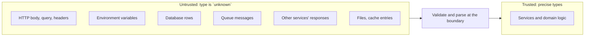
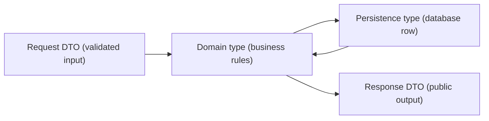

# Patterns for Backends

[Home](../README.md) › [TypeScript](README.md) › Patterns for Backends

> **In one sentence:** In a backend, TypeScript is most valuable when untrusted data is validated once at the boundary and turned into precise types, and when those types are designed so that invalid states, mixed-up identifiers and unhandled cases cannot compile.

**Before this:** [Type system fundamentals](01-type-system-fundamentals.md), [generics and advanced types](02-generics-advanced-types.md).
**After this:** [API design](../08-backend-engineering/01-api-design.md), [software design](../08-backend-engineering/10-software-design.md), [data access from Node.js](../07-databases/11-data-access-from-node.md).

## The trust boundary

Inside your program, the compiler guarantees consistency. At the edges, data arrives from places the compiler cannot see.



The rule: **parse, do not just assert.** At each boundary, run code that checks the data and returns a typed value, or fails. After that point the rest of the program can trust the types, and it needs no defensive checks.

### Schema as the single source of truth

Writing an `interface` and a separate validator means two descriptions that will drift apart. A schema library (Zod, Valibot, ArkType, TypeBox) lets you write the **run-time schema once** and **derive the static type** from it.

```ts
import { z } from 'zod';

export const CreateOrderSchema = z.object({
  customerId: z.string().uuid(),
  items: z.array(z.object({
    sku: z.string().min(1),
    quantity: z.number().int().positive().max(1000),
  })).min(1),
  couponCode: z.string().optional(),
});

export type CreateOrderInput = z.infer<typeof CreateOrderSchema>;
// { customerId: string; items: { sku: string; quantity: number }[]; couponCode?: string }

app.post('/orders', async (req, res) => {
  const parsed = CreateOrderSchema.safeParse(req.body);        // req.body is unknown data
  if (!parsed.success) {
    return res.status(400).json({ error: 'VALIDATION_FAILED', issues: parsed.error.issues });
  }
  const order = await orderService.create(parsed.data);        // parsed.data: CreateOrderInput
  res.status(201).json(order);
});
```

What validation gives you beyond types:

- **Constraints that types cannot express:** ranges, lengths, formats, relationships between fields.
- **Rejection of unknown fields**, which protects against [mass assignment](../08-backend-engineering/03-web-security.md).
- **Coercion and defaults** in one place: query strings are always strings, so `?limit=20` needs converting to a number.
- **A clear 400 response** for the caller, not a 500 from deep inside the code.

In NestJS, the same job is done by DTO classes with `class-validator` decorators and a global `ValidationPipe`, or by a Zod pipe. See [NestJS internals](../06-nodejs/08-nestjs-internals.md).

### Typed configuration

`process.env` is a `Record<string, string | undefined>`. Validate it **once, at start-up**, and export a typed object. A missing variable then stops the process immediately with a clear message, instead of causing an error on the first request that needs it.

```ts
const EnvSchema = z.object({
  NODE_ENV: z.enum(['development', 'test', 'production']),
  PORT: z.coerce.number().int().min(1).max(65535).default(3000),
  DATABASE_URL: z.string().url(),
  JWT_SECRET: z.string().min(32),
  REDIS_URL: z.string().url().optional(),
});

export const env = EnvSchema.parse(process.env);       // throws at boot if anything is wrong
export type Env = typeof env;
```

The rest of the code imports `env`. Nothing else reads `process.env`.

### Other boundaries

- **Database rows.** A generic like `pool.query<User>(...)` is an assertion, not a check. Either generate types from the real schema (Prisma, Drizzle, Kysely, or a SQL type generator) or validate rows. See [data access from Node.js](../07-databases/11-data-access-from-node.md).
- **Responses from other services** can change without notice. Parse them with a schema, at least for the fields you use.
- **Queue messages** may have been produced by an older version of the code. Validate, and include a version in the message. See [messaging and queues](../08-backend-engineering/05-messaging-queues.md).
- **`JSON.parse` and `res.json()`** return `any`. Assign the result to `unknown` and parse it.

## Make invalid states unrepresentable

Design the types so that a wrong value does not compile.

```ts
// Weak: many combinations are possible that make no sense
interface Order {
  status: string;
  paidAt?: Date;
  shippedAt?: Date;
  trackingNumber?: string;
  cancelReason?: string;
}

// Strong: each state carries exactly the data that exists in that state
type Order = OrderBase & (
  | { status: 'pending' }
  | { status: 'paid'; paidAt: Date }
  | { status: 'shipped'; paidAt: Date; shippedAt: Date; trackingNumber: string }
  | { status: 'cancelled'; cancelledAt: Date; cancelReason: string }
);
```

Functions can then demand a specific state:

```ts
type PaidOrder = Extract<Order, { status: 'paid' }>;

function ship(order: PaidOrder, trackingNumber: string): Extract<Order, { status: 'shipped' }> {
  return { ...order, status: 'shipped', shippedAt: new Date(), trackingNumber };
}
```

Calling `ship` with a pending order is a compile error. The state machine is written in the types, and the [exhaustive `switch`](01-type-system-fundamentals.md) makes the compiler list every place to update when a state is added.

## Branded types

Structural typing treats every `string` the same. A user ID, an order ID and an email are interchangeable to the compiler, so arguments in the wrong order compile.

A **brand** adds a property that exists only in the type system, which makes the types incompatible.

```ts
declare const brand: unique symbol;
type Brand<T, Name extends string> = T & { readonly [brand]: Name };

type UserId = Brand<string, 'UserId'>;
type OrderId = Brand<string, 'OrderId'>;
type Email = Brand<string, 'Email'>;
type Cents = Brand<number, 'Cents'>;

function getOrder(userId: UserId, orderId: OrderId) { /* ... */ }

declare const userId: UserId;
declare const orderId: OrderId;
getOrder(orderId, userId);          // Error: the arguments are swapped
getOrder('abc', 'def');             // Error: a plain string is not a UserId
```

The only way to create a branded value is a function that validates. So the brand also records that validation happened:

```ts
function toEmail(input: string): Email {
  if (!/^[^@\s]+@[^@\s]+\.[^@\s]+$/.test(input)) throw new ValidationError('invalid email');
  return input.toLowerCase() as Email;         // the one allowed assertion, inside the constructor
}
```

At run time a branded value is still an ordinary string. There is no cost. Use brands for identifiers, for validated values, and for units (cents, milliseconds, bytes), where mixing two numbers is a real class of bugs.

## Typing errors

### What `throw` gives you

JavaScript can throw any value, and TypeScript does not track what a function throws. Function signatures say nothing about failure. In a `catch` block the variable is `unknown`:

```ts
try {
  await charge(order);
} catch (err) {
  if (err instanceof PaymentDeclinedError) return { ok: false, reason: err.reason };
  if (err instanceof Error) logger.error({ err }, 'charge failed');
  throw err;                                   // unknown errors continue upward
}
```

Create a small hierarchy of error classes so that code and the HTTP layer can tell them apart:

```ts
export abstract class AppError extends Error {
  abstract readonly code: string;
  abstract readonly httpStatus: number;
  constructor(message: string, options?: { cause?: unknown }) {
    super(message, options);
    this.name = new.target.name;
  }
}

export class NotFoundError extends AppError {
  readonly code = 'NOT_FOUND';
  readonly httpStatus = 404;
}
export class ConflictError extends AppError {
  readonly code = 'CONFLICT';
  readonly httpStatus = 409;
}
```

`cause` keeps the original error and its stack trace when you wrap a low-level error in a domain error. See [errors and process lifecycle](../06-nodejs/05-errors-and-process-lifecycle.md).

### Errors as values

For failures that are **expected** and that the caller must handle (validation failed, insufficient funds, not found), you can return them instead of throwing. The failure is then visible in the signature and the compiler forces the caller to deal with it.

```ts
type Result<T, E> = { ok: true; value: T } | { ok: false; error: E };

type WithdrawError =
  | { type: 'INSUFFICIENT_FUNDS'; balance: Cents }
  | { type: 'ACCOUNT_FROZEN' }
  | { type: 'DAILY_LIMIT_EXCEEDED'; limit: Cents };

async function withdraw(id: AccountId, amount: Cents): Promise<Result<Receipt, WithdrawError>> { /* ... */ }

const result = await withdraw(accountId, amount);
if (!result.ok) {
  switch (result.error.type) {
    case 'INSUFFICIENT_FUNDS': return res.status(422).json({ /* ... */ });
    case 'ACCOUNT_FROZEN': return res.status(403).json({ /* ... */ });
    case 'DAILY_LIMIT_EXCEEDED': return res.status(429).json({ /* ... */ });
  }
}
res.json(result.value);        // narrowed: only reachable when ok is true
```

A balanced approach:

| Kind of failure | Mechanism |
|---|---|
| Expected business outcomes that the caller handles | `Result` or a discriminated union |
| Unexpected failures: bugs, lost connections, broken invariants | `throw`, caught by one central error handler |

Do not wrap everything in `Result`. It is a tool for the cases where forgetting to handle the failure is a real bug.

## Layers and their types

Different layers need different shapes of the same concept. Keep them as separate types, and convert explicitly.



```ts
interface UserRow { id: string; email: string; password_hash: string; created_at: Date }

interface User { id: UserId; email: Email; passwordHash: string; createdAt: Date }

interface UserResponse { id: string; email: string; createdAt: string }

function toResponse(user: User): UserResponse {
  return { id: user.id, email: user.email, createdAt: user.createdAt.toISOString() };
}
```

Why this matters:

- **Security.** Returning the domain object or the row directly leaks fields such as `passwordHash`. An explicit response type, built with an allow-list, cannot leak a field that somebody adds later. Structural typing does **not** protect you here: an object with extra properties is assignable to the response type, and `JSON.stringify` writes all of them. The mapper function is what protects you.
- **Stability.** The API contract can stay the same while the database schema changes.
- **Honesty about serialization.** A `Date` becomes a string in JSON, and a `bigint` cannot be serialized by default. The response type should show what is really sent.

## Dependencies behind interfaces

Describe what a component **needs** as an interface. Then the real implementation and a test double are both acceptable, without a mocking framework doing unsafe things.

```ts
interface Clock { now(): Date }

interface UserRepository {
  findById(id: UserId): Promise<User | undefined>;
  save(user: User): Promise<void>;
}

class SignupService {
  constructor(
    private readonly users: UserRepository,
    private readonly clock: Clock,
  ) {}
}

const fakeClock: Clock = { now: () => new Date('2026-01-01T00:00:00Z') };     // in tests
```

Because typing is structural, anything with the right shape satisfies the interface. No `implements` is required.

One limit: interfaces are erased, so a dependency-injection container cannot use an interface as a lookup key at run time. NestJS needs a class or an explicit injection token. See [NestJS internals](../06-nodejs/08-nestjs-internals.md).

## Smaller patterns that pay off

**Exhaustive lookup tables.** `Record<Union, ...>` forces an entry for every member:

```ts
type Role = 'admin' | 'editor' | 'viewer';

const permissions = {
  admin: ['read', 'write', 'delete'],
  editor: ['read', 'write'],
  viewer: ['read'],
} as const satisfies Record<Role, readonly string[]>;       // adding a Role without an entry is an error
```

**Readonly by default.** Mark parameters and properties that should not be modified.

```ts
function total(items: readonly OrderItem[]): Cents { /* cannot push to or sort `items` */ }
```

**Options objects instead of boolean parameters.** `createUser(email, true, false)` is unreadable and easy to get wrong. `createUser(email, { sendWelcomeEmail: true, isAdmin: false })` is checked by name.

**`unknown` in, precise out.** Functions that accept external data take `unknown` and return a validated type. Functions inside the domain take precise types and never re-validate.

**Wrap resources with `using`.** Database clients, locks and temporary files that implement `Symbol.asyncDispose` are released automatically. See [explicit resource management](../04-javascript/08-iterators-generators-metaprogramming.md).

**Lint rules for what the compiler does not catch.** `typescript-eslint` has rules for the most damaging mistakes in async backend code:

| Rule | Catches |
|---|---|
| `no-floating-promises` | A promise that is neither awaited nor handled: a lost error, or an [unhandled rejection](../06-nodejs/05-errors-and-process-lifecycle.md) |
| `no-misused-promises` | An async function passed where a synchronous callback is expected (`forEach`, an event handler) |
| `no-explicit-any`, `no-unsafe-*` | `any` spreading through the code |
| `switch-exhaustiveness-check` | A `switch` over a union that misses a case |
| `await-thenable` | `await` on something that is not a promise |

## What not to do

| Anti-pattern | Why it hurts | Alternative |
|---|---|---|
| `req.body as CreateOrderInput` | No check at all. A wrong body crashes deep inside the code or writes bad data | Parse with a schema |
| `any` to make an error disappear | Disables checking and spreads | `unknown` and narrowing, or fix the type |
| `value!` | Removes `undefined` from the type with no run-time check | Handle the missing case, or use an assertion function with a message |
| One big interface with many optional fields | Allows impossible combinations | Discriminated union |
| Returning entities or rows from controllers | Leaks internal fields | Explicit response types and mappers |
| Duplicating a type and a validator by hand | They drift apart | Derive the type from the schema |
| `// @ts-ignore` | Hides every error on the line, forever | `// @ts-expect-error` with a reason: it fails when the error goes away |
| `Function`, `object`, `{}` as types | Almost no information | A specific function signature, `Record<string, unknown>` |

## How this connects

- **Why validation is necessary:** types are erased. See [type system fundamentals](01-type-system-fundamentals.md).
- **Validation is a security control**, not only a convenience. See [web security](../08-backend-engineering/03-web-security.md).
- **Request and response contracts, error formats and status codes:** [API design](../08-backend-engineering/01-api-design.md).
- **Typed query results and generated database types:** [data access from Node.js](../07-databases/11-data-access-from-node.md).
- **Interfaces for dependencies** are dependency inversion. See [software design](../08-backend-engineering/10-software-design.md) and [testing](../08-backend-engineering/07-testing.md).
- **Error classes, `cause` and the central error handler:** [errors and process lifecycle](../06-nodejs/05-errors-and-process-lifecycle.md).
- **Money as integer cents**, never as a floating-point number: [data representation](../01-computer-foundations/01-data-representation.md).

## Interview questions

<details>
<summary><strong>🟢 Q1. If the code is written in TypeScript, why do you still need run-time validation?</strong></summary>

Because TypeScript types are removed at compile time. They check that my own code is consistent, but they cannot check data that only exists at run time: a request body, a query string, an environment variable, a database row, a message from a queue. If I declare that `req.body` is a certain type, the compiler believes me and no check happens.

So at every boundary I validate the data with a schema. If it passes, I get a properly typed value and the rest of the code can trust it. If it fails, the caller gets a clear 400 error. Without that, bad input causes an error deep in the code, or wrong data is saved.

</details>

<details>
<summary><strong>🟢 Q2. How do you keep validation rules and TypeScript types in sync?</strong></summary>

I define the schema once with a schema library like Zod and derive the TypeScript type from it with type inference. The schema is the single source of truth: it is the run-time validator, and the static type comes from it automatically. When I add a field to the schema, the type changes too.

In NestJS with `class-validator`, the DTO class plays both roles: the class is the type, and the decorators are the validation rules. In both cases the point is the same: there is one definition, not an interface and a separate validator that can drift apart.

</details>

<details>
<summary><strong>🟡 Q3. What is a branded type and when would you use one?</strong></summary>

TypeScript is structurally typed, so two types with the same shape are interchangeable. A `UserId` and an `OrderId` that are both strings can be swapped by mistake, and it compiles. A branded type adds a marker property that exists only at the type level. That makes the two types incompatible, although at run time both are plain strings.

I create branded values through one function that validates the input and then asserts the brand. So the type also proves that the value was validated. I use brands for IDs, for validated values like an email address, and for units like cents or milliseconds, where mixing two numbers is a real bug.

</details>

<details>
<summary><strong>🟡 Q4. How do you handle errors in a type-safe way, given that TypeScript does not type what a function throws?</strong></summary>

I separate two kinds of failures. Expected business outcomes that the caller must handle, like insufficient funds or a duplicate email, I return as values: a discriminated union with a success case and specific error cases. The compiler then forces the caller to check the result, and a `switch` over the error type can be checked for exhaustiveness.

Unexpected failures, like a lost database connection or a bug, I throw. They go up to one central error handler, which logs them and returns a 500. I use a small hierarchy of error classes with a code and an HTTP status, so the handler can map known errors to responses. In `catch` blocks the variable is `unknown`, so I narrow it with `instanceof` before I use it.

</details>

<details>
<summary><strong>🟡 Q5. Why should you not return a database entity directly from an API endpoint?</strong></summary>

There are three reasons. The first is security: the entity may have fields that must not leave the server, like a password hash or internal flags. And when someone adds a new sensitive column later, it is exposed automatically. TypeScript does not prevent this, because an object with extra properties is still assignable to a narrower type, and JSON serialization writes every property.

The second is coupling: the API contract becomes the same as the database schema, so I cannot change one without changing the other. The third is that serialization changes types: dates become strings, for example. So I define an explicit response type and a mapper function that copies only the allowed fields.

</details>

<details>
<summary><strong>🟡 Q6. How do you handle environment variables in a TypeScript service?</strong></summary>

I treat them as untrusted input. Every value in `process.env` is a string or undefined. At start-up I parse the whole environment with a schema that checks that the required variables exist, converts numbers and booleans, applies defaults, and checks formats like URLs. If something is wrong, the process exits immediately with a message that names the variable.

The result is one typed configuration object that the rest of the code imports. Nothing else reads `process.env` directly. That gives me fail-fast behavior at deployment time, not an error on the first request that needs the missing value. It also gives precise types everywhere.

</details>

<details>
<summary><strong>🔴 Q7. How would you model an order that moves through several states, so that invalid operations do not compile?</strong></summary>

I model it as a discriminated union on a `status` field, where each member contains only the data that exists in that state. A pending order has no payment date. A paid order has `paidAt`. A shipped order has `paidAt`, `shippedAt` and a tracking number. With one interface and optional fields, I could represent a shipped order without a tracking number. With the union, I cannot.

Then each transition is a function that accepts only the state it is valid from and returns the next state. `ship` takes a paid order and returns a shipped order. Calling it with a pending order is a compile error. When I read an order from the database, I parse the row into this union at the boundary, so a row with inconsistent data is detected there. And every `switch` over the status has a `never` check, so adding a new state shows me every place that must handle it.

The types do not replace the database constraints or the check inside a transaction that the state has not changed concurrently. They make the application logic much harder to get wrong.

</details>

<details>
<summary><strong>🔴 Q8. You join a codebase with many <code>any</code> types and no strict mode. How do you improve it without stopping feature work?</strong></summary>

Step by step, starting where the risk is highest. First I make sure type checking runs in CI at all, so that it cannot get worse. Then I add validation at the boundaries: request bodies, environment, responses from external services. That is where wrong types cause real incidents.

Next I enable the strict flags one at a time, starting with `noImplicitAny` and then `strictNullChecks`, which finds the most real bugs. For existing violations I either fix them per module, or I record the current errors as a baseline and only fail on new ones, so new code must be clean. I add lint rules against explicit `any` and against floating promises, as warnings first and then as errors.

I replace `any` with `unknown` at the edges and let the compiler show me where narrowing is needed. I fix modules in order of how often they change and how critical they are. And I use `@ts-expect-error` with a comment for cases I postpone, not `@ts-ignore`, so they show up when they are fixed.

</details>

## Key takeaways

- Types stop at the process boundary. Parse external data with a schema and derive the type from it.
- Validate configuration at start-up and fail fast.
- Model states as discriminated unions, so invalid combinations do not compile.
- Brand identifiers, validated values and units to stop mix-ups that structural typing allows.
- Return expected failures as typed values. Throw unexpected ones to a central handler.
- Keep request, domain, persistence and response types separate, with explicit mappers.
- Lint for floating promises and `any`. The compiler does not catch them.

---

← [Compiler, tsconfig and Modules](03-compiler-tsconfig-modules.md) | Next: [06 Node.js →](../06-nodejs/README.md)
