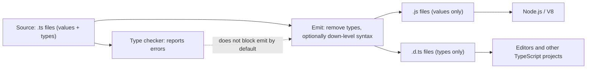

# 05 — TypeScript

[Home](../README.md) › TypeScript

TypeScript is JavaScript plus a static type system. The type system runs **before** your program, finds a large class of mistakes, and is then removed completely. What runs in Node.js is plain JavaScript.

That one fact organizes the whole section: types describe your program to the compiler and to your editor, but they do not exist at run time. Everything that needs run-time knowledge of a type (validating a request body, dependency injection, serialization) needs a separate run-time mechanism.

## Pages

| # | Page | What you will understand |
|---|---|---|
| 1 | [Type System Fundamentals](01-type-system-fundamentals.md) | Erasure, structural typing, inference, narrowing, unions, `any` / `unknown` / `never`, soundness |
| 2 | [Generics and Advanced Types](02-generics-advanced-types.md) | Generics, constraints, `keyof`, mapped and conditional types, `infer`, template literal types, variance |
| 3 | [Compiler, tsconfig and Modules](03-compiler-tsconfig-modules.md) | What `tsc` does, the options that matter, module resolution, build pipelines, running TypeScript in Node.js |
| 4 | [Patterns for Backends](04-patterns-for-backends.md) | Validation at boundaries, discriminated unions, branded types, typed errors, typing configuration and data access |

## The model

- **Checking** and **emitting** are two separate jobs. Tools like esbuild, swc and Node.js's own type stripping only do the second one. They do not check types.
- **Types and values live in two separate spaces.** A few things (`class`, `enum`) exist in both.
- The type system is **structural**: compatibility is decided by shape, not by name.
- The type system is **not fully sound** on purpose. `any`, type assertions and a few design choices can let a wrong value through. Knowing where the holes are is part of using TypeScript well.

## How this section connects

| TypeScript concept | Where it matters |
|---|---|
| Types are erased | Request bodies must be validated at run time: [API design](../08-backend-engineering/01-api-design.md), [web security](../08-backend-engineering/03-web-security.md) |
| Decorator metadata | The one place types survive to run time, used by [NestJS dependency injection](../06-nodejs/08-nestjs-internals.md) |
| Module settings | Must match how Node.js loads [modules](../04-javascript/07-modules.md) |
| Discriminated unions | Modelling states and errors in [software design](../08-backend-engineering/10-software-design.md) |
| Types for query results | [Data access from Node.js](../07-databases/11-data-access-from-node.md) |
| Run-time behavior | Unchanged. Everything in [JavaScript](../04-javascript/README.md) still applies |

## Primary sources

- The TypeScript Handbook and release notes, typescriptlang.org.
- Vanderkam, *Effective TypeScript*.
- The TypeScript compiler options reference (TSConfig Reference).
- Node.js documentation: "Modules: TypeScript".

---

← [Iterators, Generators and Metaprogramming](../04-javascript/08-iterators-generators-metaprogramming.md) | Next: [Type System Fundamentals →](01-type-system-fundamentals.md)
