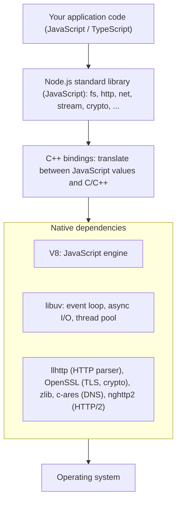
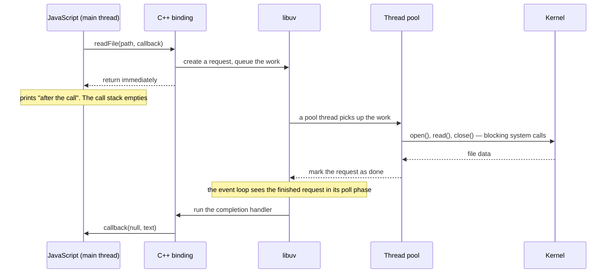
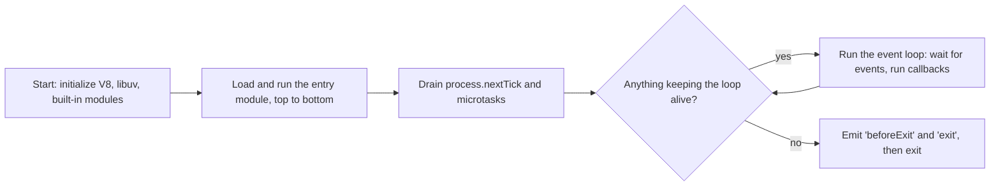

# Node.js Architecture

[Home](../README.md) › [Node.js](README.md) › Architecture

> **In one sentence:** Node.js runs your JavaScript on a single thread inside V8 and gives every waiting operation to libuv, which uses the kernel's readiness notifications for network I/O and a small thread pool for file I/O and a few heavy functions, then calls your JavaScript back when the work is done.

**Before this:** [V8 engine internals](../04-javascript/05-v8-engine-internals.md), [async JavaScript](../04-javascript/04-async-javascript.md), [I/O multiplexing](../02-operating-systems/05-io-multiplexing.md), [processes, threads and scheduling](../02-operating-systems/01-processes-threads-scheduling.md).
**After this:** [The event loop](02-event-loop.md), [scaling CPU work](04-scaling-cpu-work.md).

## The problem Node.js was built to solve

A web server spends most of its time **waiting**: for a database, for another service, for a slow client. In the classic model, each connection gets its own thread, and the thread blocks while it waits.

| | Thread per connection | Event loop (Node.js) |
|---|---|---|
| 10,000 idle connections | 10,000 threads, each with its own stack, mostly asleep | One thread and 10,000 small objects |
| Cost of waiting | A blocked thread plus [context switches](../02-operating-systems/01-processes-threads-scheduling.md) | Nothing. The kernel holds the socket until it is ready |
| Shared data | Needs locks. Race conditions are possible | One thread runs JavaScript, so no locks for JavaScript data |
| CPU-heavy work | Other threads continue | **Everything stops** until it finishes |

Node.js chooses the second model. It is very good at handling many connections that are mostly waiting. It is bad at long calculations on the main thread. Every strength and every weakness of Node.js comes from this one decision.

## The parts



| Part | Job |
|---|---|
| **V8** | Parses, compiles and runs JavaScript. Manages the heap and garbage collection. Owns the microtask queue. Knows nothing about files, sockets or timers |
| **libuv** | A C library. Provides the event loop, non-blocking network I/O through the kernel, a thread pool for operations that have no good non-blocking form, timers, child processes and signals. It hides the differences between Linux, macOS and Windows |
| **Bindings** | C++ code that connects the two worlds. When you call `fs.readFile`, a binding converts the JavaScript arguments, starts a libuv request, and later converts the result back and calls your callback |
| **Standard library** | The JavaScript modules you import with the `node:` prefix. Most of them are thin JavaScript layers over the bindings |
| **Other native libraries** | `llhttp` parses HTTP/1.1. OpenSSL does TLS and cryptography. `c-ares` does asynchronous DNS queries. `zlib` does compression |

**Where JavaScript ends and Node.js begins.** The language (ECMAScript) defines objects, functions, promises and the microtask queue. It defines no I/O at all. `setTimeout`, `fs`, `http`, `process` and `Buffer` are **host APIs** that Node.js adds. `fetch`, `URL`, `AbortController`, `structuredClone` and Web Streams are **web standard APIs** that Node.js also implements, so that code can be shared with browsers and other runtimes.

## What happens in one asynchronous call

```js
import { readFile } from 'node:fs';

readFile('/etc/hosts', 'utf8', (err, text) => {
  console.log(text.length);
});
console.log('after the call');
```



The key points:

- The call **returns immediately**. Your code continues.
- The blocking system calls happen on **another thread**.
- The callback runs later, **on the main thread**, when the call stack is empty and the event loop reaches it.

## Two ways of waiting

libuv does not treat all I/O the same way. This is the most misunderstood part of Node.js.

### Network I/O: the kernel does the waiting

Sockets support **non-blocking** mode. libuv registers each socket with the kernel's readiness mechanism: [`epoll`](../02-operating-systems/05-io-multiplexing.md) on Linux, `kqueue` on macOS, IOCP on Windows. Then **one system call** waits for all of them and returns the ones that are ready.

No thread is used per connection, and the thread pool is not involved. This is why one Node.js process can hold tens of thousands of open connections.

Handled this way: TCP and UDP sockets, pipes, HTTP servers and clients, database and Redis connections, DNS queries made with `dns.resolve*`.

### The thread pool: for things that cannot wait that way

Some operations have no practical non-blocking form on all platforms. For those, libuv runs the blocking call on a thread from its **thread pool**, and tells the event loop when it is done.

| Uses the thread pool | Does **not** use the thread pool |
|---|---|
| Almost all `fs` operations (asynchronous versions) | TCP / UDP sockets, HTTP |
| `dns.lookup()` (it calls the system's `getaddrinfo`) | `dns.resolve*()` (uses c-ares over sockets) |
| `crypto.pbkdf2`, `crypto.scrypt`, `crypto.randomBytes`, `crypto.generateKeyPair` (asynchronous versions) | Timers |
| `zlib` (asynchronous versions) | Child processes, signals |
| Some native addons | Your JavaScript |

Facts about the pool:

- **Default size: 4 threads.** It is shared by the whole process.
- Change it with the environment variable `UV_THREADPOOL_SIZE` (maximum 1024). It must be set before the pool is first used, in practice before the process starts.
- When all threads are busy, new work **waits in a queue**.

This creates a kind of slowness that surprises people:

```js
import { pbkdf2 } from 'node:crypto';

for (let i = 0; i < 8; i++) {
  const start = Date.now();
  pbkdf2('password', 'salt', 500_000, 64, 'sha512', () => {
    console.log(`hash ${i}: ${Date.now() - start} ms`);
  });
}
// The first 4 finish together. The next 4 take about twice as long: they waited for a free thread.
```

In a real service: many concurrent password hashes fill the pool, and now every file read and every `dns.lookup` waits behind them. An outgoing HTTP request that needs to resolve a host name is delayed, although the network is fine. The event loop is not blocked, and the CPU may not be full. The pool is simply saturated.

`dns.lookup` deserves special attention, because `http.request`, `fetch` and most database drivers use it for host names. A slow DNS server can fill the pool on its own.

## "Is Node.js single-threaded?"

The precise answer has three parts:

1. **Your JavaScript runs on one thread**, the main thread. Two of your callbacks never run at the same time.
2. **The process has several threads.** The main thread, the 4 libuv pool threads, and V8's helper threads for garbage collection and JIT compilation.
3. **You can create more JavaScript threads** with [worker threads](04-scaling-cpu-work.md). Each has its own V8 instance and its own event loop.

So: single-threaded execution of your code, in a multi-threaded process.

### What you gain: no data races in JavaScript

A function runs to completion before anything else runs. Between two lines of synchronous code, no other JavaScript can change your variables. You do not need locks for in-memory data.

```js
let counter = 0;
function increment() { counter++; }     // safe: nothing can interrupt this
```

### What you do not gain: freedom from race conditions

Every `await` is a point where **other code can run**. Logic that reads, waits, and then writes can still be wrong.

```js
async function withdraw(accountId, amount) {
  const account = await db.getAccount(accountId);     // 1. read
  if (account.balance < amount) throw new Error('insufficient funds');
  await db.setBalance(accountId, account.balance - amount);      // 2. write, using a stale value
}
// Two concurrent calls both read 100, both pass the check, both write 50.
```

The fix is not in Node.js. It is in the database: an atomic `UPDATE ... WHERE balance >= $1`, or a [transaction with the right locking](../07-databases/08-locking.md). With several processes or servers, this is the only place where it can be fixed.

## What blocks, and what does not

| Operation | Runs where | Blocks the main thread? |
|---|---|---|
| `await fetch(url)`, a database query | Kernel, non-blocking sockets | No |
| `await fs.promises.readFile(path)` | Thread pool | No |
| `fs.readFileSync(path)` | Main thread | **Yes**, for the whole read |
| `await bcrypt.hash(pw, 12)` (asynchronous version) | Thread pool | No |
| `crypto.pbkdf2Sync(...)`, `bcrypt.hashSync(...)` | Main thread | **Yes** |
| `JSON.parse(largeString)`, `JSON.stringify(largeObject)` | Main thread | **Yes** |
| A loop over one million items, sorting a large array | Main thread | **Yes** |
| A regular expression with catastrophic backtracking | Main thread | **Yes**, possibly for seconds |
| `zlib.gzipSync(...)` | Main thread | **Yes** |
| `require()` of a module not yet loaded | Main thread | **Yes** |

`await` does not move work to another thread. It only works with operations that are already asynchronous. `await` in front of a CPU-heavy synchronous function changes nothing:

```js
async function handler(req, res) {
  const result = await heavyCalculation(req.body);      // still runs on the main thread, start to finish
  res.json(result);
}
```

**Rule:** synchronous APIs are fine during start-up (reading configuration, loading modules). Never use them in code that handles requests.

## When Node.js is a good choice

| Good fit | Poor fit |
|---|---|
| APIs that mostly call databases and other services | Heavy computation in the request path: video encoding, image processing, large in-memory data transformations |
| Many concurrent connections: WebSockets, server-sent events, chat, notifications | Workloads that need shared-memory parallelism across many cores |
| Streaming and proxying data | Long CPU-bound batch jobs (unless moved to workers or another service) |
| Backend-for-frontend layers, gateways | |
| Teams that share TypeScript between frontend and backend | |

CPU-heavy work is still possible in Node.js with [worker threads](04-scaling-cpu-work.md), or by moving it to a queue and a separate worker service. The point is that it needs a deliberate design. It does not work by default.

## The life of a Node.js process



The process stays alive as long as there are **active handles or requests**: a listening server, an open socket, a pending timer, an in-flight file operation. When none are left, it exits by itself. This is why a script ends when its work is done, while a server runs until it is stopped. It is also why a forgotten open connection or interval can keep a process from exiting during [shutdown](05-errors-and-process-lifecycle.md).

## How this connects

- **V8** compiles and runs the JavaScript and manages its memory. See [V8 engine internals](../04-javascript/05-v8-engine-internals.md) and [memory and garbage collection](../04-javascript/06-memory-garbage-collection.md).
- **`epoll`** is what makes one thread able to watch thousands of sockets. See [I/O multiplexing](../02-operating-systems/05-io-multiplexing.md).
- **The order in which callbacks run** is the subject of [the event loop](02-event-loop.md).
- **Using more cores** is covered in [scaling CPU work](04-scaling-cpu-work.md).
- **Database connections are sockets**, so queries do not use the thread pool, but they are limited by the [connection pool](../07-databases/11-data-access-from-node.md).
- **Races across `await`** are solved with [transactions and locking](../07-databases/08-locking.md).
- **Other databases made the opposite choice.** PostgreSQL uses one process per connection, which is why it needs connection pooling in front of it. See [data access from Node.js](../07-databases/11-data-access-from-node.md).
- **Thread pool saturation** is one of the cases in the [production debugging playbook](../13-end-to-end/03-production-debugging-playbook.md).

## Interview questions

<details>
<summary><strong>🟢 Q1. What is Node.js?</strong></summary>

Node.js is a runtime that executes JavaScript outside the browser. It combines the V8 JavaScript engine with libuv, a C library that provides an event loop and asynchronous I/O, and it adds a standard library for files, networking, processes, streams and cryptography.

Its model is event-driven and non-blocking. Application code runs on a single thread, and operations that wait, like network and disk I/O, are done in the background. When they finish, their callbacks are run by the event loop. That makes it efficient for servers that handle many connections which mostly wait for I/O.

</details>

<details>
<summary><strong>🟢 Q2. Is Node.js single-threaded?</strong></summary>

My JavaScript code runs on one thread, so only one piece of it runs at a time. But the Node.js process has more threads. libuv has a thread pool, four threads by default, for file system operations, some crypto functions, compression and `dns.lookup`. V8 uses extra threads for garbage collection and for compiling code. And I can start worker threads to run JavaScript in parallel.

Network I/O does not use threads at all. It uses the operating system's non-blocking sockets and a mechanism like `epoll`. So the accurate answer is: single-threaded JavaScript execution in a multi-threaded process.

</details>

<details>
<summary><strong>🟢 Q3. What are V8 and libuv, and what does each one do?</strong></summary>

V8 is the JavaScript engine. It parses and compiles JavaScript, runs it, and manages memory with a garbage collector. It only knows the language. It has no concept of files, sockets or timers.

libuv is a C library that provides everything around that. It implements the event loop, it does non-blocking network I/O using `epoll`, `kqueue` or IOCP depending on the operating system, it has the thread pool for blocking operations, and it provides timers, child processes and signal handling. Node.js connects the two with C++ bindings, so a JavaScript call like `fs.readFile` becomes a libuv request, and the result comes back as a JavaScript callback.

</details>

<details>
<summary><strong>🟡 Q4. How can Node.js handle thousands of concurrent connections with one thread?</strong></summary>

Because a connection that is waiting costs almost nothing. The sockets are in non-blocking mode and are registered with the kernel's event notification mechanism, `epoll` on Linux. The event loop makes one system call that asks which sockets have something to do, and the kernel returns only the ready ones. The loop runs the callbacks for those and asks again.

So there is no thread per connection, no stack per connection and no context switching between thousands of threads. A connection is a small object in memory and a file descriptor. The limit becomes memory and how much CPU time the JavaScript callbacks need, not the number of connections. This works as long as each callback is short. If one of them does a long calculation, all the other connections wait.

</details>

<details>
<summary><strong>🟡 Q5. What is the libuv thread pool, and which operations use it?</strong></summary>

It is a pool of worker threads that libuv uses for operations that cannot be done in a non-blocking way through the kernel on all platforms. The default size is four, and I can change it with the `UV_THREADPOOL_SIZE` environment variable.

The asynchronous file system functions use it, because regular file I/O does not work with `epoll`. `dns.lookup` uses it, because it calls the blocking system resolver. The asynchronous versions of CPU-heavy crypto functions like `pbkdf2` and `scrypt` use it, and so does `zlib` compression. Network sockets, timers and my own JavaScript do not use it.

Because it is small and shared, it can be saturated. If many password hashes run at the same time, file reads and DNS lookups wait behind them.

</details>

<details>
<summary><strong>🟡 Q6. Does <code>await</code> make code run on another thread?</strong></summary>

No. `await` only pauses the current async function until a promise settles, and lets the event loop run other things in the meantime. Where the work happens depends on the operation behind the promise. If it is a network request, the kernel does the waiting. If it is a file read, a pool thread does it. In both cases the main thread is free.

But if the function I await is ordinary synchronous JavaScript that does a heavy calculation, it runs completely on the main thread and blocks it. Marking it `async` or adding `await` does not change that. To move CPU work off the main thread I need a worker thread or a separate process.

</details>

<details>
<summary><strong>🔴 Q7. A Node.js API becomes slow under load. CPU is at 30% and event loop delay is normal, but outgoing HTTP calls and file reads are slow. What could it be?</strong></summary>

That pattern points to the libuv thread pool being saturated. The event loop is healthy, so it is not blocked JavaScript. The CPU is not full. But file reads use the pool, and outgoing HTTP calls use it too, for `dns.lookup`, which calls the blocking system resolver. If something fills the four threads, everything that needs the pool waits in a queue.

I would look for the work that fills it: many concurrent password hashes with bcrypt or scrypt, heavy compression, a lot of file I/O on a slow disk, or DNS lookups that are slow because of a bad resolver. I can confirm by timing a trivial pool operation under load, or by checking whether the latency disappears when I raise `UV_THREADPOOL_SIZE`.

For the fix, it depends on the cause. I can raise the pool size to match the cores and the workload. I can limit how many hashes run at once. I can reuse connections with keep-alive, so that DNS is not resolved for every request, and use a caching resolver. Or I can move the heavy work to dedicated worker threads so it does not compete with I/O.

</details>

<details>
<summary><strong>🔴 Q8. Node.js is single-threaded, so there are no race conditions. True or false?</strong></summary>

False. What is true is that there are no data races on JavaScript memory: one function runs to completion before another starts, so two callbacks never modify a variable at the same instant, and I do not need locks for that.

But race conditions at the logical level are still possible, because every `await` is a point where other code can run. If a handler reads a value, awaits something, and then writes based on what it read, another request can change the value in between. The classic example is checking a balance and then updating it. And as soon as there are several processes or servers, in-process state does not help at all.

So I make the critical operation atomic where the data lives: a single conditional update, a transaction with row locking, a unique constraint, or an atomic Redis command. In-process, I avoid sharing mutable state across an `await` without thinking about what can happen between the two steps.

</details>

## Key takeaways

- Node.js = V8 (runs JavaScript) + libuv (event loop, async I/O, thread pool) + bindings + a standard library.
- Your JavaScript runs on one thread and each callback runs to completion.
- Network I/O waits in the kernel (`epoll`). File I/O, `dns.lookup`, crypto and zlib use a 4-thread pool.
- The thread pool is small and shared. It can be saturated while the event loop looks healthy.
- `await` does not move work off the main thread. CPU-heavy synchronous code blocks everything.
- No data races on JavaScript memory, but logical races across `await` are real. Fix them in the database.
- The process stays alive while handles or requests are active.

---

← [Node.js](README.md) | Next: [The Event Loop →](02-event-loop.md)
