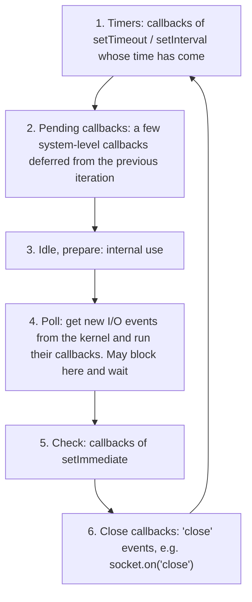
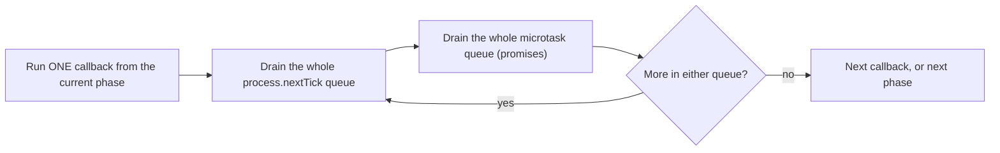
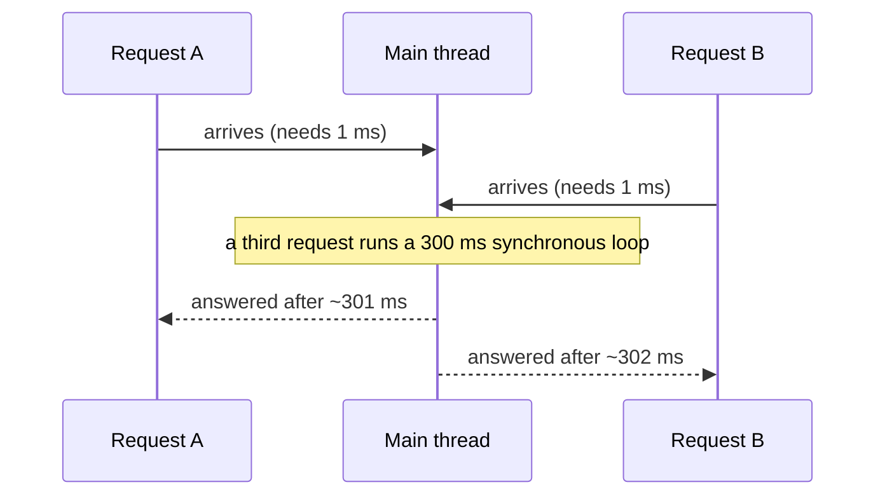

# The Event Loop

[Home](../README.md) › [Node.js](README.md) › The Event Loop

> **In one sentence:** The event loop is a loop in libuv that goes through fixed phases (timers, I/O, immediates, close events), runs the ready callbacks of each phase one at a time on the main thread, and after every single callback Node.js empties the `process.nextTick` queue and then the promise microtask queue.

**Before this:** [Node.js architecture](01-architecture.md), [async JavaScript](../04-javascript/04-async-javascript.md), [I/O multiplexing](../02-operating-systems/05-io-multiplexing.md).
**After this:** [Buffers and streams](03-buffers-and-streams.md), [performance and debugging](07-performance-debugging.md).

## The basic idea

A Node.js program is a set of callbacks waiting for events. The event loop is the code that decides **which callback runs next**.

```
while (there is something to wait for) {
    run the callbacks that are ready, in a fixed order of phases
    if nothing is ready, sleep in the kernel until something is
}
```

Two rules never change:

1. **One callback at a time.** A callback runs on the main thread until it returns. Nothing interrupts it.
2. **The loop cannot move forward while a callback is running.** If a callback takes 2 seconds, no timer fires, no request is accepted and no response is sent for 2 seconds.

## The phases



Each phase has its own queue of callbacks. The loop enters a phase, runs the callbacks in that queue (all of them, or up to a limit), then moves to the next phase. One full round is called an **iteration** or a **tick** of the loop.

| Phase | What runs | Notes |
|---|---|---|
| **Timers** | `setTimeout` and `setInterval` callbacks that are due | A timer gives a **minimum** delay, not an exact time |
| **Pending callbacks** | Some system operation callbacks, such as certain TCP errors | Rarely important for application code |
| **Poll** | Almost all I/O callbacks: incoming data, finished file reads, new connections, query results | The most important phase. The loop **waits here** when there is nothing else to do |
| **Check** | `setImmediate` callbacks | Runs right after the poll phase |
| **Close callbacks** | `'close'` events of sockets and handles | Clean-up |

### The poll phase in detail

Most of a server's life is spent in the poll phase. When the loop arrives there:

- If I/O events are ready, it runs their callbacks one after another, until the queue is empty or an internal limit is reached.
- If nothing is ready:
  - If `setImmediate` callbacks are waiting, it leaves at once and goes to the check phase.
  - Otherwise it **blocks in the kernel** ([`epoll_wait`](../02-operating-systems/05-io-multiplexing.md)) until an event arrives **or** the nearest timer is due. The time until the next timer is used as the timeout of that system call.

This is why an idle Node.js server uses 0% CPU. It is not spinning. It is asleep inside the kernel, and the kernel wakes it when there is work.

One version detail: since Node.js 20 (libuv 1.45), timers are run once per iteration, after the poll phase, where older versions also checked them before it. For application code the model above is still correct: timer callbacks run in their own phase, in order of their due time.

## The two queues that are not phases

Two more queues exist, and they belong to no phase. Node.js empties them **after every single callback**, whenever the JavaScript call stack becomes empty:

1. **The `process.nextTick` queue**, completely.
2. **The microtask queue** (promise reactions: `.then`, `.catch`, `.finally`, the code after an `await`, `queueMicrotask`), completely.

Then step 1 and 2 repeat until both are empty. Only then does the loop continue with the next callback or the next phase.



Priority, from first to last:

| Order | Mechanism | Runs |
|---|---|---|
| 1 | Synchronous code | Immediately, to completion |
| 2 | `process.nextTick` | As soon as the current operation finishes, before promises |
| 3 | Promise microtasks | After the nextTick queue is empty |
| 4 | Timers, I/O, `setImmediate`, close | In their phases |

The microtask queue is part of [the language and V8](../04-javascript/04-async-javascript.md). `process.nextTick` is a Node.js addition and is older than promises.

## Worked example

```js
const { readFile } = require('node:fs');

console.log('1 sync');

setTimeout(() => console.log('2 timeout'), 0);
setImmediate(() => console.log('3 immediate'));

process.nextTick(() => console.log('4 nextTick'));
Promise.resolve().then(() => console.log('5 promise'));

readFile(__filename, () => {
  console.log('6 file read');
  setTimeout(() => console.log('7 timeout inside I/O'), 0);
  setImmediate(() => console.log('8 immediate inside I/O'));
  process.nextTick(() => console.log('9 nextTick inside I/O'));
});

console.log('10 sync');
```

Output (this is a **CommonJS** script; the ES module difference is described below):

```
1 sync
10 sync
4 nextTick
5 promise
2 timeout
3 immediate
6 file read
9 nextTick inside I/O
8 immediate inside I/O
7 timeout inside I/O
```

Step by step:

1. The script runs top to bottom: `1` and `10`. Everything else is only **scheduled**.
2. The stack is empty. The nextTick queue runs (`4`), then the microtask queue (`5`).
3. The loop starts. Timers phase: `2`. Check phase: `3`. (The order of these two can swap; see below.)
4. Later, the file read finishes. Its callback runs in the poll phase: `6`.
5. After that callback, the nextTick queue is drained: `9`.
6. The loop is in the poll phase, so the **check** phase is next: `8`.
7. The timers phase comes in the next iteration: `7`.

Two details that are often asked:

**`setTimeout(fn, 0)` versus `setImmediate(fn)` in the main module.** The order of `2` and `3` is **not guaranteed**. A delay of 0 is treated as 1 ms. If the loop starts in less than 1 ms, the timer is not due yet, and the immediate runs first. It depends on how busy the machine is.

**The same two inside an I/O callback.** The order **is** guaranteed: `setImmediate` first. The callback is running in the poll phase, and the check phase always comes before the next timers phase.

**ES modules change one thing.** In an ES module, the top-level code is itself run as part of an asynchronous job, so the microtask queue is already being processed when it runs. The result is that at the top level of an ES module, `5 promise` prints **before** `4 nextTick`. Inside ordinary callbacks the order is the usual one: nextTick first.

## `setTimeout`, `setImmediate`, `process.nextTick`: which to use

| Function | When the callback runs | Typical use |
|---|---|---|
| `process.nextTick(fn)` | After the current operation, before any I/O, before promises | Let the caller finish setting up (for example attaching event listeners) before an event is emitted. Mostly for library code |
| `queueMicrotask(fn)` | In the microtask queue, like a promise reaction | The standard, portable way to defer something until just after the current code |
| `setImmediate(fn)` | In the check phase of the current or next iteration | **Give the event loop a chance to do I/O** before continuing. Splitting long work into pieces |
| `setTimeout(fn, ms)` | In a timers phase, at least `ms` milliseconds later | Delays, timeouts, retries with backoff |

The names are historical and misleading: `process.nextTick` runs **before** `setImmediate`. Read `nextTick` as "right now, after this function" and `setImmediate` as "in the next round of the loop".

### Starvation

Because the nextTick and microtask queues are drained **completely**, code that keeps adding to them stops the loop from ever reaching the next phase.

```js
function forever() {
  process.nextTick(forever);        // the loop never reaches the poll phase: no I/O, no timers
}

async function alsoForever() {
  while (true) await null;          // each `await` schedules a microtask; same effect
}
```

`setImmediate` does not have this problem. A callback scheduled from inside a `setImmediate` callback runs in the **next** iteration, so I/O gets a turn in between.

## Timers are not precise

`setTimeout(fn, 100)` means "run `fn` **no earlier than** 100 ms from now". The real delay is 100 ms plus however long the loop is busy with something else.

```js
const start = Date.now();
setTimeout(() => console.log(`fired after ${Date.now() - start} ms`), 100);

const end = Date.now() + 500;
while (Date.now() < end) {}          // block the main thread for 500 ms
// → fired after ~500 ms
```

Consequences:

- `setInterval` **drifts**. For exact schedules (for example "every day at 02:00"), compute the next time from the clock each time, or use a scheduler.
- A timeout implemented with `setTimeout` can fire late if the loop is blocked. The timeout itself is a callback waiting in the same queue.
- To measure durations use `performance.now()` or `process.hrtime.bigint()`. They use a monotonic clock. `Date.now()` can jump when the system clock is adjusted.
- Timers are stored efficiently (grouped by duration), so creating thousands of them is cheap.

A timer keeps the process alive. `timer.unref()` tells Node.js that this timer alone should not prevent exit. That is useful for background intervals such as periodic metrics.

## Blocking the event loop

**Blocking the event loop** means running JavaScript (or a synchronous native call) for so long that other events have to wait. With one thread, the latency of every request includes the time of whatever else is running.



A request that needs 1 ms of work takes 300 ms, because it queued behind someone else's slow code. This is the reason for unexplained p99 latency in Node.js services.

### Common causes

| Cause | Example |
|---|---|
| Synchronous APIs | `fs.readFileSync`, `crypto.pbkdf2Sync`, `zlib.gzipSync`, `child_process.execSync` |
| Large JSON | `JSON.parse` of a 50 MB body. `JSON.stringify` of a huge result. Both are synchronous, with no way to yield |
| Loops over large data | Sorting, grouping or transforming hundreds of thousands of items in memory |
| Regular expressions | Catastrophic backtracking (**ReDoS**): a pattern like `/^(a+)+$/` on a crafted input takes exponential time. See [web security](../08-backend-engineering/03-web-security.md) |
| CPU-heavy algorithms | Image processing, PDF generation, hashing in pure JavaScript, compression |
| Garbage collection | Long pauses on a large or nearly full heap. See [memory and GC](../04-javascript/06-memory-garbage-collection.md) |
| Endless microtasks | A promise chain that never yields to the loop |

A useful way to think about it: every handler should have a **small, bounded cost**. If the cost grows with the size of the input, and the input comes from a user, then a user can block your server. That is both a performance problem and a denial-of-service risk. Limit body sizes, array lengths and page sizes at the boundary.

### What to do instead

| Technique | When |
|---|---|
| **Use the asynchronous API** | Always, in request-handling code |
| **Do less in memory** | Let the database filter, sort, aggregate and paginate. See [query planning](../07-databases/06-query-planning.md) |
| **Stream** | Process large data piece by piece. See [buffers and streams](03-buffers-and-streams.md) |
| **Partition** the work | Do a chunk, then yield with `setImmediate`, then continue. The total time is the same, but other callbacks run in between |
| **Offload** to a worker thread | CPU-heavy work that cannot be avoided. See [scaling CPU work](04-scaling-cpu-work.md) |
| **Move it out of the request** | Put a job on a queue and process it in a separate worker service. See [messaging and queues](../08-backend-engineering/05-messaging-queues.md) |

Partitioning looks like this:

```js
import { setImmediate as yieldToLoop } from 'node:timers/promises';

async function processAll(items) {
  const results = [];
  for (let i = 0; i < items.length; i++) {
    results.push(transform(items[i]));
    if (i % 1000 === 999) await yieldToLoop();       // let pending I/O and timers run
  }
  return results;
}
```

Use `setImmediate` for this, not `process.nextTick` or a resolved promise. Those two do not let the loop reach the poll phase, so they do not help.

## Measuring the loop

You cannot fix what you do not measure. Two numbers describe the health of the loop.

**Event loop delay (lag):** how late callbacks run compared with when they were scheduled. A healthy service has a delay of a few milliseconds or less. A p99 delay of 100 ms means some requests wait 100 ms before any of their code starts.

**Event loop utilization (ELU):** the fraction of time the loop spends running callbacks, as opposed to waiting in the poll phase. It is a number between 0 and 1. Near 1 means the main thread is saturated, even if the machine's total CPU usage looks low because the other cores are idle.

```js
import { monitorEventLoopDelay, performance } from 'node:perf_hooks';

const histogram = monitorEventLoopDelay({ resolution: 20 });
histogram.enable();

let last = performance.eventLoopUtilization();

setInterval(() => {
  const elu = performance.eventLoopUtilization(last);
  last = performance.eventLoopUtilization();
  metrics.gauge('event_loop_delay_p99_ms', histogram.percentile(99) / 1e6);
  metrics.gauge('event_loop_utilization', elu.utilization);
  histogram.reset();
}, 10_000).unref();
```

Export both as metrics and alert on them. They are the earliest signal that a Node.js service is in trouble: usually earlier than CPU graphs. ELU is also a better signal for autoscaling than CPU percentage, because one Node.js process can use at most one core for JavaScript. How to find **which** code is responsible is covered in [performance and debugging](07-performance-debugging.md).

## How this connects

- **Microtasks, promises and `async/await`** are defined by the language. See [async JavaScript](../04-javascript/04-async-javascript.md).
- **The poll phase is `epoll_wait`.** See [I/O multiplexing](../02-operating-systems/05-io-multiplexing.md).
- **Where callbacks come from** (kernel or thread pool): [Node.js architecture](01-architecture.md).
- **Garbage collection pauses** stop the loop too. See [memory and garbage collection](../04-javascript/06-memory-garbage-collection.md).
- **Worker threads** each have their own event loop. See [scaling CPU work](04-scaling-cpu-work.md).
- **Load balancer health checks** time out when the loop is blocked, so a healthy process can be removed from rotation. See [proxies, load balancers and CDNs](../03-networking/08-proxies-load-balancers-cdn.md).
- **Timeouts, retries and backoff** are built on timers. See [reliability patterns](../08-backend-engineering/06-reliability-patterns.md).
- **Redis** uses the same design, one thread with an event loop, and has the same weakness to slow commands. See [NoSQL and Redis](../07-databases/10-nosql-redis.md).

## Interview questions

<details>
<summary><strong>🟢 Q1. What is the event loop?</strong></summary>

The event loop is what lets Node.js do non-blocking I/O with a single JavaScript thread. It is a loop, implemented in libuv, that waits for events such as a timer expiring, data arriving on a socket or a file read finishing, and then runs the JavaScript callbacks for them, one at a time.

When my code starts an asynchronous operation, the operation is handed to the operating system or to the thread pool, and my code continues. When the operation finishes, its callback is queued. The event loop takes the queued callbacks and runs them when the call stack is empty. If there is nothing to do, it sleeps in the kernel until the next event.

</details>

<details>
<summary><strong>🟢 Q2. What are the phases of the event loop?</strong></summary>

There are six. First the timers phase, which runs `setTimeout` and `setInterval` callbacks that are due. Then pending callbacks, for a few deferred system callbacks. Then idle and prepare, which are internal. Then the poll phase, which gets new I/O events from the kernel and runs their callbacks. This is where the loop waits if there is nothing to do. Then the check phase, which runs `setImmediate` callbacks. And last the close callbacks phase, for events like a socket closing.

Between every callback, in any phase, Node.js drains the `process.nextTick` queue and then the promise microtask queue.

</details>

<details>
<summary><strong>🟢 Q3. What is the difference between <code>process.nextTick</code>, <code>setImmediate</code> and <code>setTimeout(fn, 0)</code>?</strong></summary>

`process.nextTick` runs its callback right after the current operation finishes, before the event loop continues and before promise callbacks. `setImmediate` runs in the check phase of the loop, after the poll phase, so I/O gets a chance to be processed first. `setTimeout` with zero runs in the timers phase once at least one millisecond has passed.

So the order is normally nextTick, then promises, and then the timer and the immediate. Between `setTimeout(0)` and `setImmediate`, the order is not guaranteed when they are called from the main module. Inside an I/O callback, `setImmediate` always runs first.

</details>

<details>
<summary><strong>🟡 Q4. What is the difference between the microtask queue and <code>process.nextTick</code> queue?</strong></summary>

The microtask queue is part of JavaScript itself. It holds promise reactions, which means the callbacks of `then`, `catch` and `finally`, and the continuation of an async function after an `await`. The `process.nextTick` queue is specific to Node.js and is managed by Node.js, not by V8.

Both are processed after the current callback finishes and before the event loop moves on. Node.js drains the nextTick queue first, completely, then the microtask queue, completely, and repeats if either one got new entries. One exception is the top level of an ES module, where promise microtasks run before nextTick callbacks. For new code I prefer `queueMicrotask` or promises, because they are standard. `nextTick` can starve I/O if it is used recursively.

</details>

<details>
<summary><strong>🟡 Q5. What does "blocking the event loop" mean and why is it a problem?</strong></summary>

It means that some code runs on the main thread for a long time without returning. Because there is only one thread for JavaScript, nothing else can happen during that time. No other request is processed, no response is sent, no timer fires, and health checks are not answered.

The effect is that one slow operation adds its duration to the latency of every request that arrives during it. Typical causes are synchronous file or crypto functions, parsing or serializing very large JSON, loops over large arrays, regular expressions with catastrophic backtracking, and heavy calculations. It is also a security problem, because an attacker who can send an input that is expensive to process can make the service unavailable for everyone.

</details>

<details>
<summary><strong>🟡 Q6. How do you detect that the event loop is blocked?</strong></summary>

I measure event loop delay and event loop utilization. Delay is how late a scheduled callback actually runs. Node.js has `monitorEventLoopDelay` in `perf_hooks`, which gives a histogram, and I export the p99 as a metric. Utilization is the share of time the loop spends running callbacks compared with waiting. A value close to one means the main thread is saturated.

In production I watch these two metrics next to request latency. If p99 latency rises and loop delay rises with it, the cause is CPU work on the main thread. If latency rises but loop delay is flat, the time is being spent waiting for something else, like the database. To find the code that is responsible, I take a CPU profile and look at the flame graph for the functions with the most self time.

</details>

<details>
<summary><strong>🟡 Q7. Is <code>setTimeout</code> accurate?</strong></summary>

No. The delay is a minimum. The callback goes into the timers queue when the time has passed, but it only runs when the event loop reaches the timers phase and the call stack is free. If the main thread is busy for 500 milliseconds, a 100 millisecond timer fires after 500.

For the same reason `setInterval` drifts over time. If I need something to happen at exact clock times, I calculate the next delay from the current time on every run, or I use a scheduler. And to measure how long something took, I use `performance.now()`, which is monotonic, not `Date.now()`.

</details>

<details>
<summary><strong>🔴 Q8. An endpoint has to process 500,000 records in memory and it freezes the server for two seconds. What are your options?</strong></summary>

First I ask whether the work has to be done in Node.js at all. Often the filtering, sorting or aggregation can be done by the database, with proper indexes and pagination, and the service only gets the result it needs. That is usually the best fix.

If the data must be processed in the application, I have three options. I can stream it: read rows through a cursor and write the output as a stream, so memory stays flat and each chunk is small. I can partition the work: process a batch, yield to the event loop with `setImmediate`, and continue. The total time stays the same, but other requests are served in between. Or I can move the work to a worker thread from a pool, so the main thread stays free. That is right for real CPU work.

If the job is long, it should not be in the request at all. The endpoint puts a job on a queue and returns 202 with a job ID, and a separate worker process does the work. I would also add a limit, so that no single request can ask for an unbounded amount of work.

</details>

<details>
<summary><strong>🔴 Q9. Why does an idle Node.js server use no CPU, and how does the loop know when to wake up?</strong></summary>

When the loop reaches the poll phase and has no callbacks to run, it makes a blocking system call to the kernel's event mechanism, which is `epoll_wait` on Linux. All its sockets and other handles are registered there. The thread sleeps inside the kernel, so it uses no CPU.

It wakes up in two cases. The kernel wakes it when one of the registered file descriptors becomes ready, for example data arrived on a socket or a new connection came in. Work that finished on the thread pool also signals the loop through a file descriptor that the loop watches. The second case is a timeout: before sleeping, libuv calculates the time until the nearest timer and passes that as the timeout of the system call, so the loop wakes up in time to run the timer. If `setImmediate` callbacks are pending, it does not sleep at all and goes straight to the check phase.

</details>

## Key takeaways

- The loop runs phases in order: timers → pending → poll → check → close. One callback at a time.
- After every callback: drain `process.nextTick`, then promise microtasks, completely.
- The poll phase is where the loop waits in the kernel, with a timeout until the next timer.
- Inside an I/O callback, `setImmediate` always runs before `setTimeout(0)`. In the main module the order is not guaranteed.
- Recursive `nextTick` or endless microtasks starve I/O. `setImmediate` does not.
- Timers give a minimum delay, never an exact one.
- Any synchronous work delays every request. Keep per-callback cost small and bounded.
- Monitor event loop delay and utilization in production.

---

← [Architecture](01-architecture.md) | Next: [Buffers and Streams →](03-buffers-and-streams.md)
