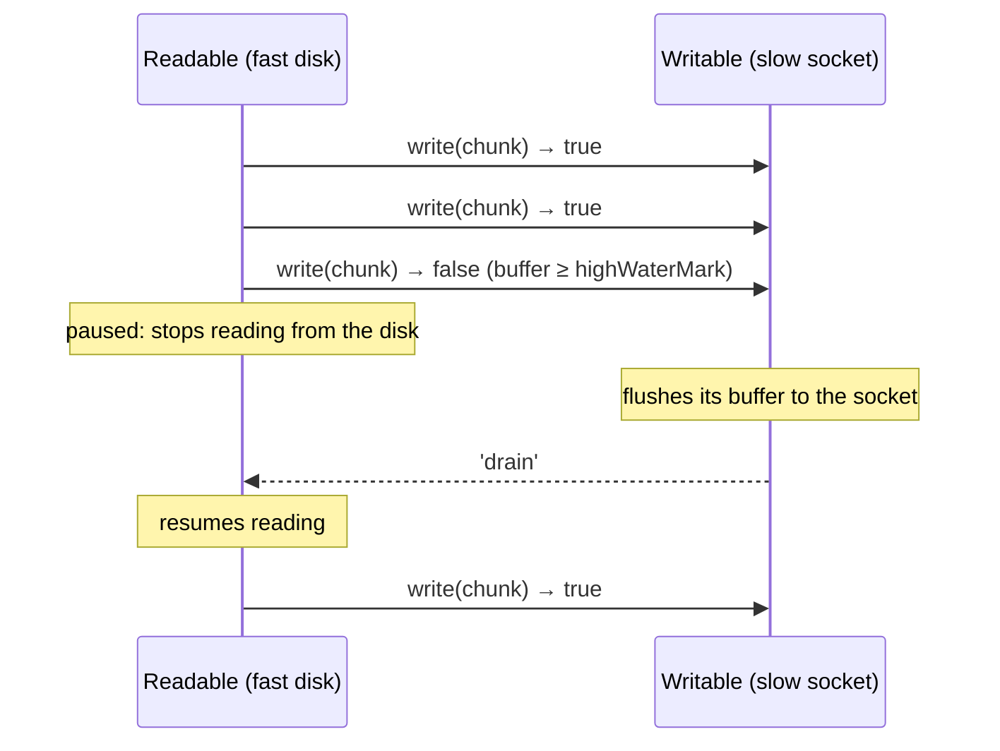

# Buffers and Streams

[Home](../README.md) › [Node.js](README.md) › Buffers and Streams

> **In one sentence:** A `Buffer` is a fixed block of raw bytes stored outside the V8 heap, and a stream processes data as a sequence of small chunks with a built-in signal called backpressure, which makes a fast producer wait for a slow consumer so that memory use stays constant however large the data is.

**Before this:** [The event loop](02-event-loop.md), [data representation](../01-computer-foundations/01-data-representation.md), [files and I/O](../02-operating-systems/04-files-and-io.md), [iterators and generators](../04-javascript/08-iterators-generators-metaprogramming.md).
**After this:** [Performance and debugging](07-performance-debugging.md), [HTTP fundamentals](../03-networking/05-http-fundamentals.md).

## Buffers

### Why they exist

JavaScript strings are sequences of UTF-16 code units. They are for text. But files, sockets, images, compressed data and encrypted data are **bytes**, and many byte sequences are not valid text at all. A `Buffer` is Node.js's type for raw bytes.

A `Buffer` is a subclass of `Uint8Array`: a fixed-length sequence of integers from 0 to 255. Its memory is allocated **outside the V8 heap**. Only a small handle object lives on the heap. This matters for [memory accounting](../04-javascript/06-memory-garbage-collection.md): buffer memory appears in `external` and `arrayBuffers`, not in `heapUsed`, and it is not limited by `--max-old-space-size`.

```js
const a = Buffer.from('héllo', 'utf8');        // from a string
const b = Buffer.from([0x68, 0x69]);           // from bytes
const c = Buffer.from('aGk=', 'base64');       // from another encoding
const d = Buffer.alloc(1024);                  // 1024 bytes, filled with zeros
const e = Buffer.allocUnsafe(1024);            // 1024 bytes, NOT cleared

a.length;                    // → 6   (bytes: é takes 2 bytes in UTF-8)
'héllo'.length;              // → 5   (UTF-16 code units)
a.toString('hex');           // → '68c3a96c6c6f'
a.toString('base64');        // → 'aMOpbGxv'
```

### Encodings

An **encoding** is a rule for converting between bytes and text. The bytes are the truth. The text is one interpretation of them. See [data representation](../01-computer-foundations/01-data-representation.md).

| Encoding | Use |
|---|---|
| `utf8` | Text. The default. 1 to 4 bytes per character |
| `hex` | Bytes as readable text, 2 characters per byte. Hashes, IDs |
| `base64` / `base64url` | Bytes inside text formats: JSON, headers, URLs, JWTs. About 33% larger than the bytes |
| `latin1` | One byte per character. Legacy protocols |
| `utf16le` | Windows text formats |

Two things to remember:

- **String length is not byte length.** `Content-Length` must be the byte length: use `Buffer.byteLength(str)`, not `str.length`.
- **Base64 is an encoding, not encryption.** Anyone can decode it.

### `alloc` versus `allocUnsafe`

`Buffer.alloc(n)` returns zero-filled memory. `Buffer.allocUnsafe(n)` skips the clearing, so it is faster, but the memory may contain **old data from the process**: fragments of earlier requests, keys or passwords. If such a buffer is sent out before it is completely overwritten, that is a data leak.

Small `allocUnsafe` buffers (and `Buffer.from`) are cut from a shared, pre-allocated **pool** of 8 KB, which avoids a system allocation for each small buffer.

Use `Buffer.alloc` unless you have measured a need and you overwrite every byte immediately.

### Views share memory

```js
const buf = Buffer.from('hello world');
const view = buf.subarray(0, 5);       // no copy: the same memory
view[0] = 0x48;
buf.toString();                         // → 'Hello world'
```

`subarray` (and the older `slice` on buffers) returns a **view**, not a copy. Two consequences: changes are visible through both, and a tiny view keeps the **whole** original block alive. To keep only a small part of a large buffer for a long time, copy it: `Buffer.from(view)`.

### Characters split across chunks

Data from a socket or a file arrives in chunks, and a chunk boundary can fall **in the middle of a multi-byte character**.

```js
const bytes = Buffer.from('é');             // 2 bytes: c3 a9
bytes.subarray(0, 1).toString();            // → '�'  (invalid: half a character)
```

Calling `chunk.toString()` on each chunk separately corrupts such characters. Use `stream.setEncoding('utf8')` or a `TextDecoder` with `{ stream: true }`. Both keep an incomplete character until the rest arrives.

## Why streams

Suppose an endpoint returns a 2 GB file.

```js
// Buffering: the whole file is in memory at once
const data = await fs.promises.readFile('/data/export.csv');       // 2 GB allocated
res.end(data);

// Streaming: about 64 KB in memory at any moment
fs.createReadStream('/data/export.csv').pipe(res);
```

| | Buffering | Streaming |
|---|---|---|
| Memory | Proportional to the data size, times the number of concurrent requests | Constant per request |
| Time to first byte | After everything is loaded | Immediately |
| Size limit | Available memory (and the maximum buffer and string sizes) | None |
| Failure mode | Out of memory under load | Slower, but stable |

The buffered version works in development with a small file and one user. It fails in production with a large file and fifty users. Streams are how a process with 512 MB of memory serves files of any size.

## The four stream types

| Type | Role | Examples |
|---|---|---|
| **Readable** | A source of data | `fs.createReadStream`, an incoming HTTP request on a server, `process.stdin`, a database query stream |
| **Writable** | A destination | `fs.createWriteStream`, an HTTP response on a server, `process.stdout` |
| **Duplex** | Both, as two independent sides | A TCP socket, a TLS socket |
| **Transform** | A duplex stream whose output is computed from its input | `zlib.createGzip()`, a cipher, a CSV parser |

All streams are [`EventEmitter`s](06-events-and-async-context.md). By default they carry `Buffer` or string chunks. In **object mode** they carry any JavaScript values, one object per chunk, which is used for parsed records.

## Backpressure

This is the idea that makes streams work.

A source can usually produce data faster than the destination can accept it. A disk reads at gigabytes per second. A client on a mobile network receives at a megabyte per second. If the source just keeps reading, the unsent data piles up in memory.

**Backpressure** is the mechanism by which a slow consumer tells the producer to pause.

### How it works

Every stream has an internal buffer with a threshold called **`highWaterMark`**. In current Node.js versions the default is 64 KiB for byte streams (16 KiB in versions before Node.js 22) and 16 objects in object mode.

- **Writable side:** `writable.write(chunk)` returns `false` when the buffered amount has reached `highWaterMark`. This means "stop sending". When the buffer has been flushed, the stream emits `'drain'`, which means "continue".
- **Readable side:** when its own buffer is full, a readable stops reading from its underlying source until data is consumed.



`highWaterMark` is a **threshold, not a limit**. `write()` always accepts the chunk and buffers it. If you ignore the `false` return value, the buffer grows without bound:

```js
// Wrong: ignores backpressure. With a slow destination, memory grows until the process dies
for (const row of millionRows) {
  res.write(JSON.stringify(row) + '\n');
}

// Right, by hand
import { once } from 'node:events';
for (const row of millionRows) {
  if (!res.write(JSON.stringify(row) + '\n')) {
    await once(res, 'drain');
  }
}
```

In practice you rarely write that loop. `pipeline` does it for you.

Backpressure continues below the stream. When the kernel's socket send buffer is full because the client is not reading, that is [TCP flow control](../03-networking/02-tcp-udp.md). The stream's buffer then fills, `write()` returns `false`, and the source pauses. The signal travels from a slow client on another continent all the way back to your disk or your database cursor.

## Connecting streams: use `pipeline`

```js
import { pipeline } from 'node:stream/promises';
import { createReadStream, createWriteStream } from 'node:fs';
import { createGzip } from 'node:zlib';

await pipeline(
  createReadStream('access.log'),
  createGzip(),
  createWriteStream('access.log.gz'),
);
```

`pipeline` connects the streams, handles backpressure between each pair, waits for completion, and on any error **destroys every stream** in the chain and rejects.

The older `source.pipe(destination)` handles backpressure too, but it does **not** forward errors and does **not** clean up:

```js
// Dangerous
createReadStream(path).pipe(res);
// If the client disconnects, the read stream is not destroyed: the file descriptor leaks.
// If the read fails, `res` is never ended: the request hangs.
// An 'error' event with no listener throws and can crash the process.
```

**Rule:** use `pipeline` (the promise version from `node:stream/promises`). Avoid `.pipe()` in server code.

`pipeline` also accepts an `AbortSignal` for [cancellation](06-events-and-async-context.md), and [async generator functions](../04-javascript/08-iterators-generators-metaprogramming.md) as steps:

```js
await pipeline(
  createReadStream('users.ndjson', 'utf8'),
  splitLines,                                         // async function*(source) { ... }
  async function* (lines) {
    for await (const line of lines) {
      const user = JSON.parse(line);
      if (user.active) yield JSON.stringify({ id: user.id }) + '\n';
    }
  },
  createWriteStream('active.ndjson'),
  { signal: abortController.signal },
);
```

## Consuming and creating streams

### Reading: async iteration

A readable is an async iterable. This is the simplest correct way to consume one: backpressure and error handling are automatic, and leaving the loop destroys the stream.

```js
let bytes = 0;
for await (const chunk of createReadStream('big.bin')) {
  bytes += chunk.length;
}
```

The event-based forms still exist. A readable is in one of two modes:

| Mode | How you get data | Started by |
|---|---|---|
| **Flowing** | Chunks are pushed to you through `'data'` events as fast as possible | Adding a `'data'` listener, `pipe()`, `resume()` |
| **Paused** | You pull chunks with `read()` when `'readable'` is emitted | The initial state |

A `'data'` listener that does asynchronous work per chunk does **not** wait for that work. That is a common way to lose backpressure. Prefer `for await` or `pipeline`.

### Creating a readable

```js
import { Readable } from 'node:stream';

async function* rows(cursor) {
  try {
    for await (const row of cursor) yield `${row.id},${row.email}\n`;
  } finally {
    await cursor.close();              // runs on normal end, on error, and on early exit
  }
}

await pipeline(Readable.from(rows(cursor)), res);
```

`Readable.from(asyncIterable)` turns any async generator into a stream. The generator is only advanced when the consumer wants more, so backpressure reaches the database cursor.

### Creating a transform

```js
import { Transform } from 'node:stream';

const upperCase = new Transform({
  transform(chunk, encoding, callback) {
    callback(null, chunk.toString().toUpperCase());       // callback(error, output)
  },
});
```

For most transformations an async generator inside `pipeline` is shorter and clearer than a `Transform` class.

### Stream lifecycle

| Event | Meaning |
|---|---|
| `'data'`, `'readable'` | Data is available (readable) |
| `'end'` | No more data will be produced (readable) |
| `'drain'` | The buffer has emptied: writing can continue (writable) |
| `'finish'` | All data was flushed after `end()` (writable) |
| `'error'` | Something failed. **With no listener, it throws** |
| `'close'` | The stream and its resources are closed |

`stream.destroy(err)` stops a stream immediately and releases its resources. `finished(stream)` from `node:stream/promises` gives a promise that settles when a stream is done or has failed.

## Streams in HTTP

On a Node.js server, the request is a **readable** stream and the response is a **writable** stream. Body parsers hide this by buffering the whole body, which is fine for small JSON and wrong for uploads.

```js
// Upload: stream the body directly to its destination, never holding it in memory
app.put('/files/:id', async (req, res) => {
  await pipeline(req, createWriteStream(pathFor(req.params.id)));
  res.status(201).end();
});

// Download or export: stream from the source to the response
app.get('/export.csv', async (req, res) => {
  res.setHeader('Content-Type', 'text/csv');
  const cursor = db.queryCursor('SELECT id, email FROM users ORDER BY id');
  await pipeline(Readable.from(rows(cursor)), res);
});
```

Things that matter in production:

- **Limit the body size.** A JSON body parser needs a limit (for example 100 KB). Without one, a single request can fill memory.
- **A streamed response has no `Content-Length`.** In HTTP/1.1 it is sent with [chunked transfer encoding](../03-networking/05-http-fundamentals.md).
- **Errors in the middle are awkward.** Once the status code and the first bytes are sent, you cannot change to a 500. The only signal left is to destroy the connection, so the client sees an incomplete response. Do the checks that can fail (authorization, validation) **before** the first byte.
- **A client that disconnects** destroys the response stream. With `pipeline`, that destroys the source too, and the database cursor or file is closed.

## Web Streams

Node.js also implements the **Web Streams** standard: `ReadableStream`, `WritableStream`, `TransformStream`. `fetch` uses them: `response.body` is a web `ReadableStream`. The concepts are the same (chunks, backpressure, piping), but the API is different.

```js
import { Readable } from 'node:stream';

const res = await fetch(url);
await pipeline(Readable.fromWeb(res.body), createWriteStream('download.bin'));
```

`Readable.fromWeb` / `Readable.toWeb` and the matching `Writable` functions convert between the two kinds.

## Choosing between buffering and streaming

| Situation | Choice |
|---|---|
| Small payloads with a known upper limit (a JSON API body, a config file) | Buffer. It is simpler and faster |
| Size unknown or controlled by a user | Stream, or enforce a strict size limit |
| Files, exports, reports, backups, media | Stream |
| Proxying a request or response to another service | Stream |
| You need the whole content to work on it (parse one JSON document, compute something over all of it) | Buffer with a limit, or use a streaming parser |

Streams have a cost: more complex code and some overhead per chunk. Do not stream a 200-byte JSON response.

## How this connects

- **Bytes, encodings and UTF-8:** [data representation](../01-computer-foundations/01-data-representation.md).
- **File descriptors and the page cache** under file streams: [files and I/O](../02-operating-systems/04-files-and-io.md).
- **TCP flow control** is the same idea at the transport layer, and stream backpressure connects to it. See [TCP and UDP](../03-networking/02-tcp-udp.md).
- **Chunked transfer encoding and `Content-Length`:** [HTTP fundamentals](../03-networking/05-http-fundamentals.md).
- **Async iterators and generators** are the modern interface to streams. See [iterators, generators and metaprogramming](../04-javascript/08-iterators-generators-metaprogramming.md).
- **Buffers are outside the V8 heap:** [memory and garbage collection](../04-javascript/06-memory-garbage-collection.md).
- **Database cursors** provide rows as a stream: [data access from Node.js](../07-databases/11-data-access-from-node.md).
- **Queues apply backpressure between services:** [messaging and queues](../08-backend-engineering/05-messaging-queues.md).
- **`zlib` and file streams use the thread pool:** [architecture](01-architecture.md).

## Interview questions

<details>
<summary><strong>🟢 Q1. What is a <code>Buffer</code> in Node.js?</strong></summary>

A `Buffer` is a fixed-size block of raw bytes. Node.js uses it for binary data: file contents, data from sockets, images, compressed or encrypted data. JavaScript strings are for text, and many byte sequences are not valid text, so a separate type is needed.

It is a subclass of `Uint8Array`, and its memory is allocated outside the V8 heap. To convert between a buffer and a string I have to name an encoding, like UTF-8, hex or base64. The length of a buffer is in bytes, which can be different from the length of the string it came from.

</details>

<details>
<summary><strong>🟢 Q2. What are streams and why use them?</strong></summary>

A stream handles data piece by piece as it becomes available. I do not need to load everything into memory first. There are four types: readable for sources, writable for destinations, duplex for both, and transform for a duplex stream that changes the data as it passes through.

The main reasons to use them are memory and time. With a stream, memory use stays constant even if the data is gigabytes in size, and the first bytes can be sent to the client immediately. Without streams, a service that reads a large file into memory for each request runs out of memory as soon as a few requests arrive together.

</details>

<details>
<summary><strong>🟡 Q3. What is backpressure?</strong></summary>

Backpressure is the mechanism that stops a fast producer from overwhelming a slow consumer. A file can be read much faster than a slow client can receive it. Without control, the data that was read but not yet sent would pile up in memory.

In Node.js, every writable stream has an internal buffer with a threshold called `highWaterMark`. When I call `write` and the buffer is over the threshold, `write` returns false. That is the signal to stop writing. When the buffer has been flushed, the stream emits a `drain` event and I can continue. `pipeline` does this automatically: it pauses the readable when the writable is full and resumes it on drain.

</details>

<details>
<summary><strong>🟡 Q4. What is the difference between <code>pipe</code> and <code>pipeline</code>?</strong></summary>

Both connect a readable to a writable and handle backpressure. The difference is in error handling and cleanup. `pipe` does not forward errors and does not destroy the other streams when one fails. If the destination closes early, for example because the client disconnected, the source stays open and its file descriptor leaks. If the source fails, the destination is never ended. And an error event with no listener crashes the process.

`pipeline` connects any number of streams, destroys all of them if any one fails or closes early, and reports a single result through a promise or a callback. So in server code I always use `pipeline`, normally the promise version from `stream/promises`.

</details>

<details>
<summary><strong>🟡 Q5. What is the difference between <code>Buffer.alloc</code> and <code>Buffer.allocUnsafe</code>?</strong></summary>

`Buffer.alloc` returns memory that is filled with zeros. `Buffer.allocUnsafe` returns memory without clearing it, so it is faster, but the buffer can contain old data from the process, like parts of earlier requests or secrets.

If I use `allocUnsafe` and then send or save the buffer before I have overwritten all of it, I leak that old data. So I use `alloc` by default. I only use `allocUnsafe` in a measured hot path where I fill the whole buffer right away.

</details>

<details>
<summary><strong>🟡 Q6. Why can <code>chunk.toString()</code> on each chunk of a stream corrupt text?</strong></summary>

Because the chunk boundaries are about bytes, not characters. In UTF-8, a character can take from one to four bytes. A chunk can end in the middle of a character, with the remaining bytes at the start of the next chunk. If I convert each chunk to a string separately, both halves are invalid and are replaced by the replacement character.

The fix is to use a decoder that keeps state between chunks. Calling `setEncoding('utf8')` on the stream does that, and so does a `TextDecoder` in streaming mode. They hold back an incomplete character until the rest of its bytes arrive.

</details>

<details>
<summary><strong>🔴 Q7. Design an endpoint that exports 10 million database rows as CSV.</strong></summary>

The main constraint is that I must never have all the rows in memory. I read from the database with a server-side cursor or a query stream, which gives rows in batches. I wrap it in an async generator that turns each row into a CSV line, with correct escaping. Then I use `pipeline` to connect it to the HTTP response, with a gzip transform in between if the client accepts it.

Because of backpressure, the cursor is only advanced when the response can take more data. A slow client slows down the reading and memory stays flat. If the client disconnects, `pipeline` destroys everything, and in the generator's `finally` block I close the cursor and release the connection.

There are more things to consider. A streamed response cannot change its status code after it has started, so I do authorization and validation first. The query holds a database connection and possibly a long transaction for the whole download, so I would run it on a read replica and limit how many exports can run at once. For very large exports, a better design is an asynchronous job: generate the file in the background, upload it to object storage, and give the user a link to download.

</details>

<details>
<summary><strong>🔴 Q8. A service's memory grows quickly when clients are slow, although it uses streams. What is likely wrong?</strong></summary>

Somewhere, backpressure is being ignored, so data is produced faster than it is consumed and it collects in a buffer. The usual causes are these. The code calls `write` in a loop without checking the return value or waiting for `drain`. It uses a `data` event listener that starts asynchronous work for each chunk without pausing the stream. Or it collects chunks into an array, which is buffering under another name.

It can also be in the middle of a chain: a custom transform that pushes much more than it receives, or a step that reads everything from a source into a queue in memory. And because buffers live outside the V8 heap, the growth shows in RSS and in `external` memory, not in `heapUsed`. That is a hint by itself.

I would look at `writableLength` on the destination streams to see where data is piling up. Then I would replace the manual wiring with `pipeline` or with `for await` loops, which respect backpressure by design. And I would add a limit on how much may be buffered before the connection is closed.

</details>

## Key takeaways

- `Buffer` = raw bytes, outside the V8 heap. Text needs an explicit encoding. Byte length ≠ string length.
- `subarray` shares memory. `allocUnsafe` may expose old data.
- Streams give constant memory and a fast first byte, for data of any size.
- Backpressure: `write()` returns `false` → wait for `'drain'`. `highWaterMark` is a threshold, not a limit.
- Use `pipeline` from `node:stream/promises`. Avoid `.pipe()`.
- Consume with `for await`. Create with `Readable.from(asyncGenerator)`.
- HTTP requests and responses are streams. Limit body sizes. Decide failures before the first byte.

---

← [The Event Loop](02-event-loop.md) | Next: [Scaling CPU Work →](04-scaling-cpu-work.md)
