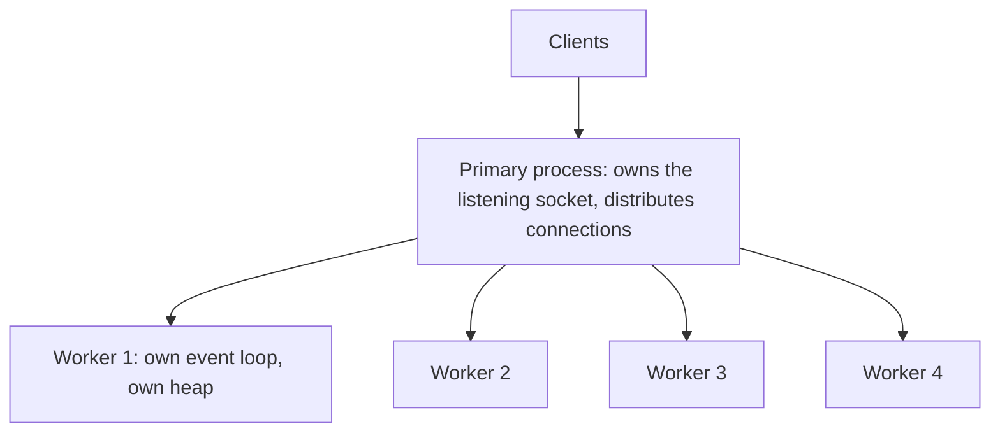
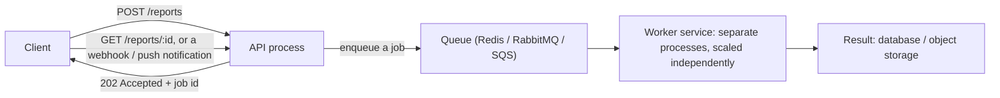
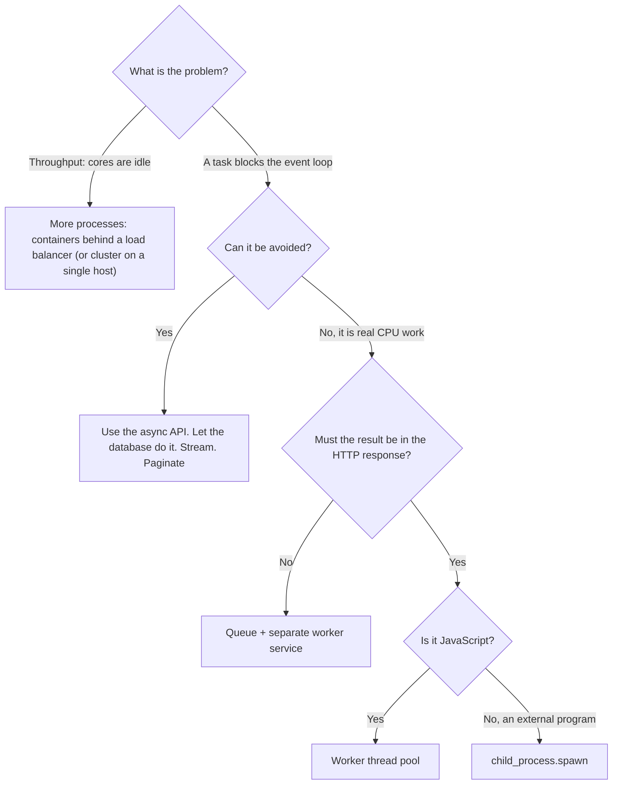

# Scaling CPU Work

[Home](../README.md) › [Node.js](README.md) › Scaling CPU Work

> **In one sentence:** One Node.js event loop uses one CPU core, so to use more you either run more processes (cluster, containers, child processes), which share nothing and scale request handling, or you start worker threads inside one process, which run CPU-heavy JavaScript in parallel without blocking the main event loop.

**Before this:** [Architecture](01-architecture.md), [the event loop](02-event-loop.md), [processes, threads and scheduling](../02-operating-systems/01-processes-threads-scheduling.md), [concurrency and synchronization](../02-operating-systems/03-concurrency-and-synchronization.md).
**After this:** [Errors and process lifecycle](05-errors-and-process-lifecycle.md), [deployment and operations](../08-backend-engineering/09-deployment-and-operations.md), [messaging and queues](../08-backend-engineering/05-messaging-queues.md).

## Two different problems

"Node.js is single-threaded" causes two separate problems. They have different solutions.

| Problem | Symptom | Solution |
|---|---|---|
| **A. One process uses one core.** The machine has 8 cores and 7 are idle | Throughput stops growing although the machine is mostly idle | Run **more processes**: cluster, or several containers behind a load balancer |
| **B. A CPU-heavy task blocks the event loop.** One slow calculation stops every other request | Latency spikes for all requests while one heavy request runs | Move the task **off the main thread**: worker threads, a child process, or a separate service behind a queue |

More processes do not solve problem B. With 8 processes, a heavy request still freezes one of them, and every request routed to that process waits. Worker threads do not solve problem A well either: the HTTP handling still happens on one main thread.

## The three tools

| | `worker_threads` | `child_process` | `cluster` |
|---|---|---|---|
| What it creates | A **thread** in the same process | A **new process**, running any program | Several **Node.js processes** sharing one server port |
| Runs | JavaScript | Anything: Node.js, Python, `ffmpeg`, a shell command | Copies of your server |
| Memory | Separate V8 heap per worker. Can **share** memory with `SharedArrayBuffer` | Fully separate | Fully separate |
| Start-up cost | Tens of milliseconds, several MB | Higher: a whole process | Higher: a whole process |
| Isolation if it crashes | An uncaught error ends the worker. A native crash or out-of-memory can take down the process | Complete. The parent survives | Complete. The primary starts a replacement |
| Communication | `postMessage` (structured clone, transfer, or shared memory) | stdin/stdout/stderr pipes, or an IPC channel with `fork` | IPC between primary and workers |
| Use for | CPU-heavy JavaScript in a server | Running external programs. Strong isolation | Using all cores for request handling on one machine |

## Worker threads

A **worker thread** runs JavaScript on another OS thread, in the same process. Each worker has its **own V8 isolate, own heap and own event loop**. JavaScript objects are **not** shared between threads. That is how Node.js adds threads and still has no data races on ordinary objects.

```js
// hash-worker.js
import { parentPort } from 'node:worker_threads';
import { scryptSync } from 'node:crypto';

parentPort.on('message', ({ id, password, salt }) => {
  const hash = scryptSync(password, salt, 64);        // blocking is fine here: this is not the main thread
  parentPort.postMessage({ id, hash });
});
```

```js
// main.js
import { Worker } from 'node:worker_threads';

const worker = new Worker(new URL('./hash-worker.js', import.meta.url));
worker.on('message', ({ id, hash }) => { /* resolve the pending promise for `id` */ });
worker.on('error', (err) => { /* an uncaught exception in the worker */ });
worker.on('exit', (code) => { /* the worker stopped */ });
worker.postMessage({ id: 1, password: 'secret', salt: 'abc' });
```

### Moving data between threads

There are three ways, with very different costs.

| Method | What happens | Cost |
|---|---|---|
| **Structured clone** (the default for `postMessage`) | The value is **copied**: serialized on one side, rebuilt on the other. Handles objects, arrays, `Map`, `Set`, `Date`, typed arrays, cycles. Not functions, not class prototypes | Proportional to the data size. Paid on the sending and the receiving thread |
| **Transfer** | An `ArrayBuffer` (or a `MessagePort`) is **moved**. The sender can no longer use it | Almost zero, whatever the size |
| **`SharedArrayBuffer`** | Both threads see the **same memory** | Zero copy, but now you have real shared memory and need `Atomics` for safe access |

```js
const data = new Uint8Array(100 * 1024 * 1024);
worker.postMessage(data, [data.buffer]);         // transferred: no copy
data.byteLength;                                 // → 0   the sender's view is now detached
```

The copy cost is the most common reason a worker is slower than expected. Sending a 200 MB object to a worker blocks the main thread while it is serialized, which is exactly the blocking the worker was supposed to remove. Send small messages, or send binary data and transfer it.

With `SharedArrayBuffer`, the classic [concurrency problems](../02-operating-systems/03-concurrency-and-synchronization.md) come back: two threads can read and write the same bytes. `Atomics` provides atomic operations (`Atomics.add`, `Atomics.compareExchange`) and a wait/notify mechanism to build locks. Most applications never need this. Message passing is simpler and safe.

### Always use a pool

Creating a worker for each task wastes the start-up time and, under load, creates an unlimited number of threads. Use a **worker pool**: a fixed set of workers that are started once, plus a queue of tasks.

```js
import Piscina from 'piscina';
import { availableParallelism } from 'node:os';

const pool = new Piscina({
  filename: new URL('./resize-worker.js', import.meta.url).href,
  maxThreads: Math.max(1, availableParallelism() - 1),      // leave a core for the main thread
  maxQueue: 100,                                            // bound the queue: reject when overloaded
});

app.post('/thumbnails', async (req, res) => {
  const result = await pool.run({ image: req.body.image, width: 200 });
  res.json(result);
});
```

Sizing: for CPU-bound work, about the number of available cores. More threads than cores only adds [context switching](../02-operating-systems/01-processes-threads-scheduling.md). Bound the queue, so that under overload you reject quickly (HTTP 503) and do not build a backlog that nobody will wait for.

### When worker threads are the right tool

- CPU-heavy JavaScript that must run inside a request-serving process: image resizing, PDF generation, parsing or serializing very large documents, compression, hashing, heavy calculations.
- The task takes clearly longer than the cost of sending its data to the worker and back. As a rough guide, tens of milliseconds or more.

They are **not** useful for I/O. Waiting for a database in a worker thread gains nothing: the main thread was not blocked by that wait in the first place.

## Child processes

`child_process` starts another program as a separate OS process.

| Function | Behavior | Use for |
|---|---|---|
| `spawn(cmd, args)` | Starts the program **without a shell**. Returns streams for stdin, stdout, stderr | Long-running commands, large output. The default choice |
| `execFile(file, args)` | Like `spawn`, but **buffers** the output and returns it when the program ends | Short commands with small output |
| `exec(commandString)` | Runs the string **in a shell**, buffers the output | Shell features (pipes, globs), with trusted input only |
| `fork(modulePath)` | Starts a new **Node.js** process with an IPC channel for `send()` / `on('message')` | A separate Node.js program that exchanges messages with the parent |

```js
import { spawn } from 'node:child_process';
import { pipeline } from 'node:stream/promises';

const ffmpeg = spawn('ffmpeg', ['-i', 'pipe:0', '-vf', 'scale=640:-1', '-f', 'mp4', 'pipe:1']);
await Promise.all([
  pipeline(inputStream, ffmpeg.stdin),
  pipeline(ffmpeg.stdout, outputStream),
]);
```

### Command injection

`exec` passes a string to a shell. If any part of that string comes from a user, the user can run arbitrary commands.

```js
exec(`convert ${req.query.file} out.png`);              // file = "a.png; rm -rf /"  → disaster
execFile('convert', [req.query.file, 'out.png']);       // the argument is passed as data, never parsed by a shell
```

**Rule:** with untrusted input, use `spawn` or `execFile` with an argument array, never `exec`. Also validate the argument, because a value that starts with `-` can be read as an option by the program. See [web security](../08-backend-engineering/03-web-security.md).

### Other things to handle

- **Exit:** listen for `'exit'`/`'close'` and check the exit code and signal. Listen for `'error'`, which is emitted when the program cannot be started at all.
- **Timeouts:** a child can hang. Use the `timeout` option or an `AbortSignal`, and kill it.
- **Output size:** `exec` and `execFile` fail when the output is larger than `maxBuffer` (1 MB by default). Use `spawn` and streams for large output.
- **Zombies and orphans:** make sure children are stopped when the parent shuts down. See [signals, IPC and containers](../02-operating-systems/06-signals-ipc-containers.md).
- **The synchronous versions** (`execSync`, `spawnSync`) block the event loop. Use them only in scripts and at start-up.

## Cluster

The `cluster` module starts several copies of your server on one machine, all accepting connections on the **same port**.

```js
import cluster from 'node:cluster';
import { availableParallelism } from 'node:os';

if (cluster.isPrimary) {
  for (let i = 0; i < availableParallelism(); i++) cluster.fork();

  cluster.on('exit', (worker, code, signal) => {
    console.error(`worker ${worker.process.pid} died (${signal ?? code}); starting a new one`);
    cluster.fork();
  });
} else {
  await import('./server.js');          // each worker runs the whole application
}
```



How it works: the **primary** process forks the workers, and the workers are full Node.js processes created with `child_process.fork`. By default (except on Windows) the primary accepts each new connection and hands it to a worker in **round-robin** order.

### What cluster means for your design

Workers are separate processes. They share **nothing** in memory.

| In-memory thing | Problem with several processes | Fix |
|---|---|---|
| A cache in a `Map` | Each process has its own copy: lower hit rate, inconsistent results | A shared cache such as Redis. See [caching](../08-backend-engineering/04-caching.md) |
| Sessions in memory | The next request may reach another process that does not know the session | A session store, or stateless tokens. See [authentication](../08-backend-engineering/02-authentication-authorization.md) |
| A rate-limit counter | The real limit becomes N times higher | Count in Redis. See [rate limiter case study](../10-system-design/05-case-rate-limiter.md) |
| WebSocket connections | A message for user X must reach the process that holds X's socket | Pub/sub between processes. See [WebSockets and real-time](../03-networking/07-websockets-sse-realtime.md) |
| A `setInterval` job | It runs N times | A distributed lock, or a dedicated scheduler process |
| Database pool size | Total connections = pool size × number of processes | Size the pool with all processes in mind. See [data access from Node.js](../07-databases/11-data-access-from-node.md) |

This list is the definition of a **stateless** service. A service that is correct with 4 cluster workers is also correct with 4 containers on 4 machines. The design work is the same.

### Cluster or containers?

Today, most production systems do not use the cluster module. They run **one Node.js process per container** and let the orchestrator (Kubernetes, ECS) run many containers behind a load balancer.

| | Cluster module | One process per container |
|---|---|---|
| Scaling unit | Processes on one machine | Containers on many machines |
| Restart, health checks, rolling updates | You, or a process manager such as PM2 | The orchestrator |
| Resource limits | Shared by all workers | Per container |
| Failure isolation | One machine | Spread over machines |
| Good for | A single VM or bare-metal server | Container platforms |

The reasoning: the orchestrator already does everything the cluster primary does, and it does it across machines. Running a cluster **inside** a container that has a limit of 1 CPU only adds memory use and contention.

**CPU limits in containers.** `os.cpus().length` reports the host's cores, not the container's limit. `os.availableParallelism()` is the function meant for sizing pools, but check what it returns in your environment. Do not start 64 workers in a container that is limited to 2 CPUs: the kernel will throttle them. See [signals, IPC and containers](../02-operating-systems/06-signals-ipc-containers.md).

## Getting the work out of the request entirely

Often the best answer to "this request does heavy work" is that the work should not be in the request.



Advantages: the API stays fast and its capacity is not consumed by heavy jobs. Workers scale separately. Jobs can be retried and survive a restart. Load peaks are absorbed by the queue. The cost is more moving parts, and results that arrive later. See [messaging and queues](../08-backend-engineering/05-messaging-queues.md).

## Decision guide



## How this connects

- **Threads versus processes, context switches, cores:** [processes, threads and scheduling](../02-operating-systems/01-processes-threads-scheduling.md).
- **Shared memory, atomics, locks:** [concurrency and synchronization](../02-operating-systems/03-concurrency-and-synchronization.md).
- **Why the main thread must stay free:** [the event loop](02-event-loop.md).
- **The libuv thread pool is a different thing.** It runs native code for `fs`, DNS, crypto and zlib. It never runs your JavaScript. See [architecture](01-architecture.md).
- **Signals and restarting workers:** [errors and process lifecycle](05-errors-and-process-lifecycle.md).
- **Load balancing across processes and machines:** [proxies, load balancers and CDNs](../03-networking/08-proxies-load-balancers-cdn.md).
- **Stateless services and horizontal scaling:** [system design building blocks](../10-system-design/02-building-blocks.md).
- **Background jobs:** [messaging and queues](../08-backend-engineering/05-messaging-queues.md).

## Interview questions

<details>
<summary><strong>🟢 Q1. How can a Node.js application use multiple CPU cores?</strong></summary>

There are two ways, depending on the goal. To handle more requests, I run several Node.js processes, because each process has its own event loop and can use one core. I can do that with the cluster module, which forks workers that share one port, or more commonly today by running several containers behind a load balancer.

To run CPU-heavy JavaScript without blocking the event loop, I use worker threads. They run JavaScript on other threads inside the same process. For external programs I use child processes.

</details>

<details>
<summary><strong>🟢 Q2. What is the difference between <code>spawn</code>, <code>exec</code> and <code>fork</code>?</strong></summary>

All three create a child process. `spawn` starts a program directly, without a shell, and gives me streams for its input and output. That is good for long-running commands and large output. `exec` runs a command string in a shell and collects the whole output in a buffer, which it passes to a callback at the end. It is convenient for short commands, but it has a size limit, and it is dangerous with user input, because the shell interprets the string.

`fork` is a special case of `spawn` that starts a new Node.js process running a given module, and it sets up a communication channel, so parent and child can send messages to each other.

</details>

<details>
<summary><strong>🟡 Q3. What is the difference between worker threads and the cluster module?</strong></summary>

They solve different problems. Cluster starts several separate Node.js processes that all accept connections on the same port. Each process runs the whole application with its own memory and its own event loop. It is for scaling request handling across cores.

Worker threads are threads inside one process. Each has its own V8 instance and event loop, but they can pass messages cheaply, transfer buffers without copying, and share memory with `SharedArrayBuffer`. They are for taking a specific CPU-heavy task off the main thread, so the event loop stays responsive.

So I use cluster or multiple containers to handle more requests, and worker threads to keep a heavy calculation from blocking the requests in one process.

</details>

<details>
<summary><strong>🟡 Q4. How do worker threads communicate, and what does it cost?</strong></summary>

Mainly through `postMessage`. By default the message is copied with the structured clone algorithm: it is serialized in one thread and rebuilt in the other. The cost grows with the size of the data and is paid on both sides. So sending a very large object can block the main thread for a noticeable time.

There are two ways to avoid the copy. I can transfer an `ArrayBuffer`. That moves the ownership to the other thread instantly, and the sender cannot use it anymore. Or I can use a `SharedArrayBuffer`, which both threads access directly. But then I have real shared memory and I must use `Atomics` to avoid races. For most cases I keep messages small, or I transfer binary data.

</details>

<details>
<summary><strong>🟡 Q5. When should you <em>not</em> use worker threads?</strong></summary>

For I/O. If the task is waiting for a database, an HTTP call or a file, the main thread is not blocked anyway, because that waiting is done by the kernel or the libuv thread pool. A worker adds overhead and gives no benefit.

Also for very short tasks, where the cost of sending the data to the worker and back is larger than the work itself. And they are not a way to scale request throughput. For that I need more processes. Finally, if the heavy work does not have to finish inside the request, a job queue with a separate worker service is usually a better design than worker threads inside the API process.

</details>

<details>
<summary><strong>🟡 Q6. What changes in your application when you go from one process to several?</strong></summary>

Everything stored in process memory stops being shared. An in-memory cache becomes several separate caches. Sessions kept in memory break, because the next request can reach another process. A rate limiter that counts in memory allows N times the limit. Scheduled jobs with `setInterval` run once in each process. WebSocket connections live in one process, so sending a message to a user needs a pub/sub layer between processes. And the total number of database connections is the pool size times the number of processes.

So I move shared state outside the processes: Redis for cache, sessions, rate limits and pub/sub, the database for durable state, and a lock or a dedicated scheduler for periodic jobs. Then the service is stateless and can be scaled to any number of processes or machines.

</details>

<details>
<summary><strong>🔴 Q7. Would you use the cluster module inside a Kubernetes pod?</strong></summary>

Usually not. In Kubernetes, the unit of scaling is the pod. The platform already does what the cluster primary does: it runs several copies, restarts the ones that crash, balances traffic between them, and does rolling updates. One Node.js process per container keeps things simple. Resource limits apply to exactly one process, health checks describe one process, and a crash affects one unit.

If I run a cluster inside a pod, I have to make the number of workers match the CPU limit of the container, not the cores of the host, or the kernel throttles them. Memory is multiplied by the number of workers inside one memory limit, and one worker that leaks can get the whole pod killed. Signal handling and graceful shutdown become more complicated as well.

The exception is when the cost per pod is significant and I give the pod several whole CPUs. Then one pod with a few workers can be more efficient than many small pods. But the default is one process per container, scaled horizontally.

</details>

<details>
<summary><strong>🔴 Q8. An endpoint generates a PDF and takes 3 seconds of CPU. Under load, the whole API becomes slow. Design a fix.</strong></summary>

The three seconds of synchronous work block the event loop, so every other request in that process waits. Adding processes only spreads the problem.

First I decide whether the PDF must be returned in the same request. If it does not have to be, the best design is asynchronous. The endpoint validates the request, puts a job on a queue, and returns 202 with a job ID. A separate worker service generates the PDF and stores it in object storage, and the client polls or is notified and then downloads it. The API stays fast, the workers scale separately, and jobs can be retried.

If the response must be synchronous, I move the generation to a pool of worker threads. The size is about the number of cores, and the queue has a limit. The main thread only passes the input and streams back the result as a transferred buffer. When the queue is full, I return 503 with a `Retry-After` header and do not let the latency grow without limit.

In both cases I add a concurrency limit or a rate limit per user for this endpoint, I cache results for identical inputs if that is possible, and I monitor event loop delay to confirm that the main thread is healthy again.

</details>

## Key takeaways

- One event loop = one core. More throughput needs more processes. A blocked loop needs the work moved off the main thread.
- Worker threads: separate heaps, message passing. Structured clone copies, transfer moves, `SharedArrayBuffer` shares.
- Use a bounded worker pool, sized to the available cores. Workers do not help I/O.
- `spawn` / `execFile` with argument arrays. Never `exec` with user input.
- Cluster workers share nothing. Externalize cache, sessions, counters, pub/sub and schedulers.
- On container platforms, prefer one process per container and scale horizontally.
- Long or heavy work usually belongs in a queue and a separate worker service.

---

← [Buffers and Streams](03-buffers-and-streams.md) | Next: [Errors and Process Lifecycle →](05-errors-and-process-lifecycle.md)
