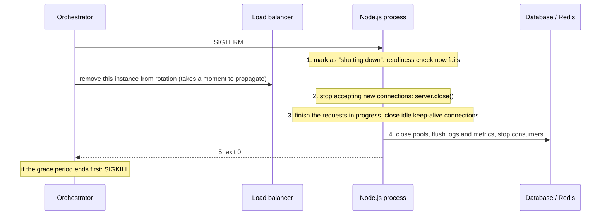

# Errors and Process Lifecycle

[Home](../README.md) › [Node.js](README.md) › Errors and Process Lifecycle

> **In one sentence:** Handle expected (operational) errors where you can do something useful about them, let unexpected errors (bugs) crash the process so that a supervisor restarts it in a clean state, and when the process is asked to stop, finish the requests in progress and close resources before exiting.

**Before this:** [The event loop](02-event-loop.md), [async JavaScript](../04-javascript/04-async-javascript.md), [signals, IPC and containers](../02-operating-systems/06-signals-ipc-containers.md).
**After this:** [Reliability patterns](../08-backend-engineering/06-reliability-patterns.md), [observability](../08-backend-engineering/08-observability.md), [deployment and operations](../08-backend-engineering/09-deployment-and-operations.md).

## Two kinds of errors

The most useful distinction in error handling is not the error class. It is whether the error was **expected**.

| | Operational error | Programmer error (bug) |
|---|---|---|
| What it is | A failure of the environment or the input, in a correct program | A mistake in the code |
| Examples | Invalid input, record not found, connection refused, timeout, disk full, 503 from another service | Reading a property of `undefined`, a wrong argument type, a broken invariant, a forgotten `await` |
| Can it be prevented by better code? | No. It will happen in production | Yes |
| Right reaction | **Handle it**: return 4xx, retry, use a fallback, report to the user | **Fix the code**. At run time: log, crash, restart |

Why crash on a bug? After an unexpected exception, you do not know what state the process is in. A transaction may be half finished, a lock may still be held, a cache entry may be half written. Continuing risks wrong results that are much harder to detect than a restart. A fresh process is in a known good state.

The opposite mistake is just as bad: treating operational errors as fatal. A service that crashes because one upstream call timed out is not robust.

## The four ways an error is delivered

How an error reaches you depends on the API style. Using the wrong mechanism means the error is **never seen**.

| API style | How the error arrives | How to handle it |
|---|---|---|
| Synchronous function | `throw` | `try / catch` |
| Promise / `async` function | A rejected promise | `await` inside `try / catch`, or `.catch()` |
| Callback | The first argument: `(err, result) => {}` | Check `if (err)` first |
| `EventEmitter`, stream | An `'error'` event | `.on('error', handler)`, or `pipeline` |

```js
// try/catch does NOT catch errors from a callback that runs later
try {
  setTimeout(() => { throw new Error('boom'); }, 0);      // thrown from a new call stack → uncaughtException
} catch (err) { /* never runs */ }

// try/catch does NOT catch a rejection that is not awaited
try {
  doAsyncWork();                                          // missing await → unhandledRejection
} catch (err) { /* never runs */ }

// An 'error' event with no listener is thrown
const stream = fs.createReadStream('/no/such/file');      // → uncaught exception, the process exits
stream.on('error', (err) => { /* now it is handled */ });
```

A `try / catch` only catches what is thrown **synchronously inside it**, plus rejections of promises that are **awaited inside it**. See [async JavaScript](../04-javascript/04-async-javascript.md).

## Error objects

Always throw `Error` objects, never strings or plain objects. An `Error` captures a **stack trace** at the moment it is created.

```js
class AppError extends Error {
  constructor(message, { code, status = 500, cause, details } = {}) {
    super(message, { cause });
    this.name = new.target.name;
    this.code = code;              // stable, machine-readable: 'ORDER_NOT_FOUND'
    this.status = status;          // HTTP status to return
    this.details = details;
    this.isOperational = true;     // marks it as expected
  }
}

class NotFoundError extends AppError {
  constructor(resource, id) {
    super(`${resource} ${id} not found`, { code: `${resource.toUpperCase()}_NOT_FOUND`, status: 404 });
  }
}
```

Useful properties:

| Property | Meaning |
|---|---|
| `message` | Text for humans. Do not put logic on it: it changes |
| `name` | The class name |
| `stack` | Where the error was created |
| `code` | A stable identifier. Node.js system errors have one: `ECONNREFUSED`, `ENOENT`, `ETIMEDOUT`, `EADDRINUSE`, `EMFILE`. Test this, not the message |
| `cause` | The lower-level error that led to this one |

**Keep the cause when you wrap an error.** Translating a low-level error into a domain error is good. Losing the original is not.

```js
try {
  await db.query(sql, params);
} catch (err) {
  throw new AppError('could not save order', { code: 'ORDER_SAVE_FAILED', cause: err });
}
```

Other rules:

- **Do not catch what you cannot handle.** `catch (err) { console.log(err) }` followed by continuing as if nothing happened hides failures. Either handle the error meaningfully, or add context and rethrow, or do not catch it.
- **Never use an empty `catch`.** If ignoring an error really is correct, write a comment that says why.
- **Async stack traces** work across `await`, so an error shows the chain of async functions that led to it. A promise chain built with `.then()` and no `await` gives a worse trace.
- **Compiled TypeScript:** start Node.js with `--enable-source-maps`, so that stack traces show `.ts` files and lines.

## Central error handling in an HTTP service

Handle errors **in one place**, at the edge of the request. Route handlers and services only throw.

```js
// Express 5: a rejected promise from an async handler is passed to the error middleware automatically
app.get('/orders/:id', async (req, res) => {
  const order = await orders.findById(req.params.id);
  if (!order) throw new NotFoundError('order', req.params.id);
  res.json(order);
});

// The error middleware: four arguments, registered last
app.use((err, req, res, next) => {
  if (res.headersSent) return next(err);              // the response has started: let the default handler close the connection

  const status = err.isOperational ? err.status : 500;
  req.log[status >= 500 ? 'error' : 'warn']({ err, requestId: req.id }, 'request failed');

  res.status(status).json({
    error: {
      code: err.isOperational ? err.code : 'INTERNAL_ERROR',
      message: err.isOperational ? err.message : 'Internal server error',
      requestId: req.id,
    },
  });
});
```

Principles:

- **Known errors map to 4xx with a clear code. Unknown errors map to 500 with a generic message.** Never send stack traces, SQL or internal messages to a client: they help an attacker. See [web security](../08-backend-engineering/03-web-security.md).
- **Log the full error** on the server, with its stack, its cause and a **request ID**. Return the request ID to the client, so that a user's report can be matched to a log line. See [observability](../08-backend-engineering/08-observability.md).
- **Log each error once**, where it is handled. Logging and rethrowing at every level gives five log entries for one failure.
- In Express 4, an async handler's rejection was **not** caught automatically. That was a classic source of hanging requests. Express 5, Fastify and NestJS handle it.

## The last line of defence

Some errors escape everything. Node.js has two process-level events for them.

| Event | When | Default behavior |
|---|---|---|
| `'uncaughtException'` | An exception reached the top of the call stack with no handler | Print the stack trace and **exit with code 1** |
| `'unhandledRejection'` | A promise was rejected and no handler was attached in time | Since Node.js 15: treated like an uncaught exception. The process **exits with code 1** |

```js
process.on('uncaughtException', (err, origin) => {
  logger.fatal({ err, origin }, 'uncaught exception');
  shutdown(1);                       // log, try a quick graceful stop, then exit
});

process.on('unhandledRejection', (reason) => {
  logger.fatal({ err: reason }, 'unhandled rejection');
  shutdown(1);
});
```

Use these handlers to **log and exit**, never to continue. After an uncaught exception the process state is unknown. The correct sequence is: record what happened, stop accepting work, exit with a non-zero code, and let the supervisor (Kubernetes, systemd, PM2) start a new process.

The usual cause of an unhandled rejection is a **floating promise**: an async function called without `await` and without `.catch()`.

```js
app.post('/signup', async (req, res) => {
  const user = await users.create(req.body);
  sendWelcomeEmail(user);                         // floating: if it rejects, the process crashes
  res.status(201).json(user);
});

// If the work really should run in the background, handle its failure explicitly
sendWelcomeEmail(user).catch((err) => logger.error({ err }, 'welcome email failed'));
```

The lint rule `no-floating-promises` finds these at build time. See [TypeScript patterns for backends](../05-typescript/04-patterns-for-backends.md).

## Exit codes and how a process ends

| Exit code | Meaning |
|---|---|
| `0` | Success |
| `1` | Uncaught fatal error |
| Other non-zero | Failure. A supervisor treats it as a crash |
| `128 + n` | Killed by signal `n`. `137` = `SIGKILL` (9), often the [OOM killer](../04-javascript/06-memory-garbage-collection.md). `143` = `SIGTERM` (15) |

A Node.js process ends when:

1. **The event loop has nothing left to wait for.** This is the natural end.
2. **`process.exit(code)` is called.** It ends the process **immediately**: pending asynchronous work is dropped, and output that was not flushed can be lost. Prefer setting `process.exitCode = 1` and letting the loop empty.
3. **A fatal error** is not handled.
4. **A signal** arrives and its default action ends the process.

## Signals

A **signal** is a small asynchronous message from the kernel or from another process. See [signals, IPC and containers](../02-operating-systems/06-signals-ipc-containers.md).

| Signal | Sent by | Meaning | Can be handled? |
|---|---|---|---|
| `SIGTERM` | `kill <pid>`, Kubernetes, Docker, systemd | "Please stop." The standard request to shut down | Yes |
| `SIGINT` | Ctrl+C in a terminal | "Interrupt" | Yes |
| `SIGKILL` | `kill -9`, the OOM killer, an orchestrator after the grace period | Stop immediately | **No**. The process gets no chance to react |
| `SIGHUP` | Terminal closed. By convention: "reload configuration" | | Yes |
| `SIGUSR1` | A user | Node.js uses it to start the inspector | Reserved |
| `SIGUSR2` | A user | Free for the application, for example to write a heap snapshot | Yes |

```js
process.on('SIGTERM', () => shutdown(0));
process.on('SIGINT', () => shutdown(0));
```

Once you install a handler for `SIGTERM` or `SIGINT`, the default action (exit) no longer happens. The process only exits when your code makes it exit.

## Graceful shutdown

Processes are stopped all the time: every deployment, every scale-down, every node replacement. If a process just dies, requests in progress get a connection reset, and work in progress is lost. **Graceful shutdown** means stopping without the clients noticing.



```js
let shuttingDown = false;

async function shutdown(code) {
  if (shuttingDown) return;
  shuttingDown = true;                                    // the readiness endpoint now returns 503

  const forceExit = setTimeout(() => {
    logger.error('shutdown timed out, forcing exit');
    process.exit(1);
  }, 25_000);
  forceExit.unref();                                      // this timer must not keep the process alive

  try {
    await new Promise((r) => setTimeout(r, 5_000));       // let the load balancer stop sending traffic
    server.closeIdleConnections();                        // idle keep-alive sockets would keep close() waiting
    await new Promise((resolve, reject) =>
      server.close((err) => (err ? reject(err) : resolve())));   // stop accepting; wait for active requests
    await queueConsumer.stop();                           // finish the current job, take no new ones
    await db.end();
    await redis.quit();
    await logger.flush?.();
    process.exitCode = code;
  } catch (err) {
    logger.error({ err }, 'error during shutdown');
    process.exit(1);
  }
}

app.get('/ready', (req, res) => res.status(shuttingDown ? 503 : 200).end());
```

The details that matter:

- **The order is: stop receiving, finish, then close.** Closing the database pool before the active requests finish makes them fail.
- **There is a race at the start.** `SIGTERM` and the removal from the load balancer happen at the same time, not one after the other. For a short period, new requests still arrive. Keep serving for a few seconds before closing the server (the wait above, or a `preStop` hook in Kubernetes).
- **Keep-alive connections.** `server.close()` waits for all connections to end, and an idle keep-alive connection can stay open for a long time. Close the idle ones explicitly. Responses sent during shutdown should carry `Connection: close`.
- **Always have a deadline.** If something hangs, force the exit before the orchestrator's `SIGKILL` (30 seconds by default in Kubernetes).
- **Long-lived connections** (WebSockets, SSE) do not finish by themselves. Send a close frame and let clients reconnect to another instance.
- **Background workers** should finish the current job, or return it to the queue, and take no new ones. Jobs must be [idempotent](../08-backend-engineering/06-reliability-patterns.md), because a `SIGKILL` can still interrupt them.

### The PID 1 problem in containers

Two things commonly break shutdown in Docker.

**The signal never reaches Node.js.** If the image starts the application through a shell or through `npm`, that wrapper is the main process and does not forward `SIGTERM`. The container then waits the whole grace period and is killed.

```dockerfile
CMD npm start                          # shell form: sh → npm → node. The signal is not forwarded reliably
CMD ["node", "dist/main.js"]           # exec form: node receives SIGTERM directly
```

**Node.js is PID 1.** The first process in a container has special rules in Linux: signals for which it has **no handler** are ignored, and it is responsible for reaping orphaned child processes. So without a `SIGTERM` handler, a Node.js process running as PID 1 ignores `SIGTERM`. Either install the handlers (you need them anyway), or run a small init process (`docker run --init`, or `tini`) as PID 1.

## Start-up and health checks

The beginning of the lifecycle needs the same care as the end.

- **Fail fast at start-up.** Validate configuration, and connect to the things the service cannot work without. If something is missing, exit with a non-zero code. A deployment that fails immediately is much better than one that starts and then fails on real requests.
- **Listen last.** Start accepting traffic only after initialization is complete.

| Probe | Question | On failure |
|---|---|---|
| **Liveness** | Is the process hopelessly stuck? | The container is **restarted** |
| **Readiness** | Can it serve traffic right now? | It is **removed from the load balancer**, not restarted |
| **Startup** | Has it finished starting? | The other probes wait |

Keep the liveness check trivial. It should not call the database: if the database is down, restarting every instance of the service makes the situation worse. Readiness may check critical dependencies. Note that a [blocked event loop](02-event-loop.md) also makes health checks time out. See [deployment and operations](../08-backend-engineering/09-deployment-and-operations.md).

## How this connects

- **`try/catch`, rejections and `await`:** [async JavaScript](../04-javascript/04-async-javascript.md).
- **Signals and PID 1:** [signals, IPC and containers](../02-operating-systems/06-signals-ipc-containers.md).
- **Stream errors and `pipeline`:** [buffers and streams](03-buffers-and-streams.md).
- **Error events on emitters, and `AbortController` for cancellation:** [events and async context](06-events-and-async-context.md).
- **Typed errors and `Result` types:** [TypeScript patterns for backends](../05-typescript/04-patterns-for-backends.md).
- **Error response formats and status codes:** [API design](../08-backend-engineering/01-api-design.md).
- **Retries, timeouts, circuit breakers, idempotency:** [reliability patterns](../08-backend-engineering/06-reliability-patterns.md).
- **Structured logging and error tracking:** [observability](../08-backend-engineering/08-observability.md).
- **Rolling deployments, probes, zero downtime:** [deployment and operations](../08-backend-engineering/09-deployment-and-operations.md).
- **Database transactions roll back when a connection dies**, which is part of why crashing is safe: [transactions and isolation](../07-databases/07-transactions-isolation.md).

## Interview questions

<details>
<summary><strong>🟢 Q1. What is the difference between operational errors and programmer errors?</strong></summary>

Operational errors are failures that a correct program must expect at run time: invalid user input, a record that does not exist, a network timeout, a database that is temporarily unavailable. I handle them. I return a 4xx response, retry, or use a fallback.

Programmer errors are bugs: reading a property of undefined, passing the wrong type, forgetting an await. I cannot handle them in a meaningful way at run time, because the program is in a state I did not plan for. The right reaction is to log the error with full detail, let the process crash and restart in a clean state, and fix the code.

</details>

<details>
<summary><strong>🟢 Q2. How are errors delivered in Node.js, and how do you handle each case?</strong></summary>

It depends on the style of the API. Synchronous code throws, and I use try/catch. Promises and async functions reject, and I handle that with try/catch around an `await`, or with `.catch()`. Callback APIs pass the error as the first argument, and I must check it before using the result. Event emitters and streams emit an `error` event, and I must add a listener for it or use `pipeline` for streams.

The important point is that these do not mix. A try/catch around a call that takes a callback does not catch an error thrown later inside the callback. And it does not catch a rejection from a promise that I did not await.

</details>

<details>
<summary><strong>🟡 Q3. What happens on an unhandled promise rejection? What should you do in the handler?</strong></summary>

In current Node.js versions, an unhandled rejection is treated like an uncaught exception: Node prints the error and the process exits with code 1. Older versions only printed a warning.

I register handlers for `unhandledRejection` and `uncaughtException`, but only to log the error with as much context as possible and then shut down. I do not continue running, because I do not know what state the application is in. The supervisor restarts the process. The real fix is to remove the cause, which is nearly always a promise that was not awaited and has no catch. A lint rule against floating promises finds most of them.

</details>

<details>
<summary><strong>🟡 Q4. Why is it a bad idea to keep the process running after an <code>uncaughtException</code>?</strong></summary>

Because the exception interrupted some code at an unknown point, and nothing cleaned up after it. The application may be in an inconsistent state. A database connection could be in the middle of a transaction and be returned to the pool. A lock or a resource may never be released. An in-memory structure may be half updated. A request may never get a response.

If the process continues, it can produce wrong results or leak resources, and that is much harder to notice and debug than a restart. A restart is cheap and gives a known good state, provided there are several instances and a supervisor. So the handler logs, tries a short graceful shutdown, and exits with a non-zero code.

</details>

<details>
<summary><strong>🟡 Q5. How do you structure error handling in an HTTP API?</strong></summary>

I handle errors in one central place at the edge. Handlers and services throw typed errors and do not format responses themselves. I have a base application error class with a stable error code and an HTTP status, and subclasses like not found, validation, conflict and unauthorized.

A global error handler catches everything. For known application errors it returns the matching status and a consistent JSON body with the code and a message. For anything else it returns 500 with a generic message, and it never leaks stack traces or internal details. It logs the full error once, with the stack, the cause and the request ID, and it includes the request ID in the response so I can find the log later. When I wrap a low-level error into a domain error, I keep the original as the `cause`.

</details>

<details>
<summary><strong>🟡 Q6. What is graceful shutdown and how do you implement it?</strong></summary>

It is stopping a process without failing the requests that are in progress. The process gets `SIGTERM` from the orchestrator, during a deployment for example. If it just exits, active requests are cut off.

In the signal handler I do these steps in order. I mark the instance as not ready, so the readiness check fails and the load balancer stops sending traffic. I wait a few seconds for that to take effect. I call `server.close()` to stop accepting new connections and wait for the active requests to finish, and I close the idle keep-alive connections so they do not hold the server open. Then I stop queue consumers, close the database and Redis connections, and flush logs. Finally I let the process exit with code zero.

I also set a timeout that forces the exit if this takes too long. It must be shorter than the orchestrator's grace period, after which the process gets `SIGKILL` anyway.

</details>

<details>
<summary><strong>🔴 Q7. During rolling deployments, a small number of requests fail with connection resets or 502 errors. What do you check?</strong></summary>

That is almost always a shutdown problem. First I check that the process receives `SIGTERM` at all. If the container starts the app through `npm start` or a shell, the signal may not reach Node.js, and the container is killed after the grace period with requests still open. The fix is to start `node` directly in exec form. I also check that there is a `SIGTERM` handler, because as PID 1 the process ignores the signal without one.

Second, the race between the signal and the load balancer. The pod is sent `SIGTERM` at the same moment as it is removed from the endpoints, and the removal takes time to reach every proxy. If the server stops accepting connections immediately, new requests get connection refused. I add a short delay before closing, with a preStop hook or in the handler.

Third, keep-alive. The load balancer reuses connections. If the application closes an idle connection at the same moment the proxy sends a request on it, the proxy gets a reset. So the application's keep-alive timeout should be longer than the load balancer's idle timeout, and during shutdown the responses should send `Connection: close`.

Last, I check that the grace period is longer than the longest request, and that the shutdown order is correct: finish the requests before closing the database pool.

</details>

<details>
<summary><strong>🔴 Q8. Why can calling <code>process.exit()</code> be a problem, and what is the alternative?</strong></summary>

`process.exit()` ends the process immediately. The event loop does not get a chance to finish pending work. Requests in progress are dropped, a database write that was started may not complete, buffered log lines or metrics may never be sent, and data written to stdout through a pipe can be cut off because those writes are asynchronous.

It is also hard on callers. A library that calls `process.exit` takes away the application's chance to clean up.

The alternative is to let the process end naturally. I set `process.exitCode` to the code I want, stop the things that keep the event loop alive, which means closing the server, the connection pools and the timers, and then Node exits by itself when nothing is left. I keep `process.exit` for the forced path, the timeout during shutdown when something does not close, and for command line scripts.

</details>

## Key takeaways

- Operational errors: handle them. Programmer errors: log, crash, restart, fix.
- Four delivery mechanisms: `throw`, rejection, callback argument, `'error'` event. `try/catch` covers only synchronous throws and awaited promises.
- Throw `Error` objects with a stable `code`. Keep the original error as `cause`.
- One central error handler: known errors → 4xx, unknown → generic 500, full details only in logs.
- `uncaughtException` and `unhandledRejection` handlers log and exit. They do not continue.
- Graceful shutdown: fail readiness → stop accepting → finish in-flight work → close resources → exit, with a deadline.
- In containers, start `node` directly (exec form) and install signal handlers.

---

← [Scaling CPU Work](04-scaling-cpu-work.md) | Next: [Events and Async Context →](06-events-and-async-context.md)
