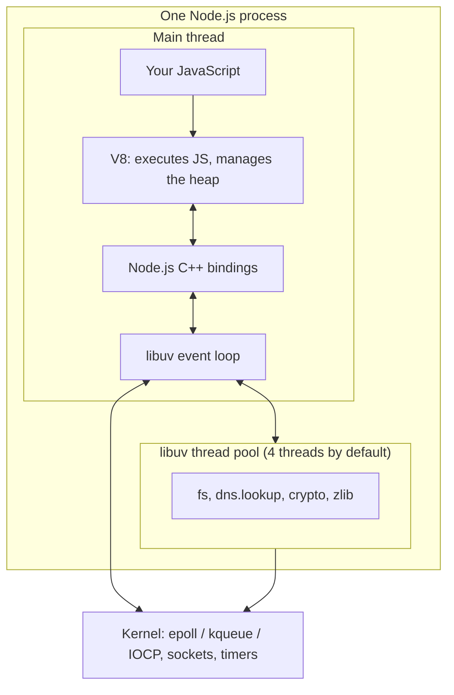

# 06 — Node.js

[Home](../README.md) › Node.js

Node.js is a program that runs JavaScript outside the browser. It joins the V8 engine with a C library called libuv, which provides an event loop and asynchronous I/O, and adds a standard library for files, networking, processes and cryptography.

This section explains how that machine works: which thread runs what, in which order callbacks execute, how data moves through streams, how to use more than one CPU core, and how to find out why a service is slow or leaking.

## Pages

| # | Page | What you will understand |
|---|---|---|
| 1 | [Architecture](01-architecture.md) | V8, libuv, bindings, the thread pool, and what "single-threaded" really means |
| 2 | [The Event Loop](02-event-loop.md) | The phases, `process.nextTick`, microtasks, timers, and what blocking the loop does |
| 3 | [Buffers and Streams](03-buffers-and-streams.md) | Binary data, the four stream types, backpressure, `pipeline` |
| 4 | [Scaling CPU Work](04-scaling-cpu-work.md) | Worker threads, child processes, cluster, and when to use each |
| 5 | [Errors and Process Lifecycle](05-errors-and-process-lifecycle.md) | Error kinds, unhandled rejections, signals, graceful shutdown |
| 6 | [Events and Async Context](06-events-and-async-context.md) | `EventEmitter`, `AsyncLocalStorage`, `AbortController`, diagnostics channels |
| 7 | [Performance and Debugging](07-performance-debugging.md) | Measuring the event loop, CPU and heap profiling, finding the real bottleneck |
| 8 | [NestJS Internals](08-nestjs-internals.md) | Dependency injection, modules, the request pipeline, decorators and metadata |

## The model

Three ideas carry the whole section:

1. **Your JavaScript runs on one thread.** Only one piece of your code runs at a time, and it runs until it returns.
2. **Waiting is not done by that thread.** Network I/O is handed to the kernel. File I/O and some CPU-heavy library functions are handed to a small thread pool. The main thread is told when they finish.
3. **So the main thread must never be busy for long.** Every request shares it. One slow synchronous function delays all of them.

## How this section connects

| Node.js concept | Built on |
|---|---|
| Event loop | [I/O multiplexing](../02-operating-systems/05-io-multiplexing.md) (`epoll`), [async JavaScript](../04-javascript/04-async-javascript.md) |
| Thread pool, worker threads | [Processes, threads and scheduling](../02-operating-systems/01-processes-threads-scheduling.md) |
| Streams and backpressure | [Files and I/O](../02-operating-systems/04-files-and-io.md), [TCP flow control](../03-networking/02-tcp-udp.md) |
| Cluster, child processes | [Processes](../02-operating-systems/01-processes-threads-scheduling.md), [signals and IPC](../02-operating-systems/06-signals-ipc-containers.md) |
| Graceful shutdown | [Signals](../02-operating-systems/06-signals-ipc-containers.md), [deployment](../08-backend-engineering/09-deployment-and-operations.md) |
| Heap and GC | [Memory and garbage collection](../04-javascript/06-memory-garbage-collection.md) |
| HTTP server | [HTTP fundamentals](../03-networking/05-http-fundamentals.md) |
| Database access | [Data access from Node.js](../07-databases/11-data-access-from-node.md) |

## Primary sources

- Node.js API documentation and guides, nodejs.org ("The Node.js Event Loop", "Don't Block the Event Loop", "Backpressuring in Streams").
- libuv documentation, docs.libuv.org ("Design overview").
- Casciaro and Mammino, *Node.js Design Patterns*.
- NestJS documentation, docs.nestjs.com.

---

← [Patterns for Backends](../05-typescript/04-patterns-for-backends.md) | Next: [Architecture →](01-architecture.md)
